<h1 align="center">&nbsp;Coupled CARLA</h1>

<p align="center">
  <b>A human-factors driving simulator for real places.</b><br>
  Type a place, get a drivable world built from open data, and put drivers, pedestrians, cyclists, AV passengers
  and drone pilots in it together.
</p>

<p align="center">
  <a href="https://github.com/bazilinskyy/coupled-carla/actions/workflows/tests.yml"></a>
  <a href="LICENSE"></a>
  
  
  
  
  
  <a href="https://github.com/bazilinskyy/coupled-carla/releases"></a>
  <a href="https://github.com/sponsors/bazilinskyy"></a>
  <a href="https://ko-fi.com/bazilinskyy"></a>
</p>

<p align="center">
  <a href="https://bazilinskyy.github.io/coupled-carla/">Project page</a> ·
  <a href="#quick-start">Quick start</a> ·
  <a href="#make-a-map-of-any-place">Make a map</a> ·
  <a href="#videos">Videos</a> ·
  <a href="#how-it-works">How it works</a> ·
  <a href="#coupled-experiments-phase-2">Coupled experiments</a> ·
  <a href="#session-dashboard">Session dashboard</a> ·
  <a href="#phase-3-carla-10-and-the-eindhoven-digital-twin">Digital twin</a> ·
  <a href="#drones">Drones</a> ·
  <a href="docs/lab_guide.md">Lab guide</a> ·
  <a href="#support-coupled-carla">Support</a>
</p>

Coupled CARLA builds a drivable [CARLA](https://carla.org)
world for any bounding box on Earth from OpenStreetMap, fills it with traffic from [SUMO](https://eclipse.dev/sumo/)
(cars, cyclists, buses with proper car-following and lane-change models), puts a participant at the wheel
(keyboard, Logitech G25 with force feedback, or an autopilot for tests) and logs every trial at 50 Hz in the
spirit of [coupled-sim](https://github.com/bazilinskyy/coupled-sim). Eindhoven is the reference city; 18 more
cities, three per inhabited continent from megacity to small town, are ready to drive.

**Phase 1** brought one human (or autopilot) and SUMO traffic to any city. **Phase 2** adds coupled
experiments in coupled-sim's sense: 2+ humans at their own stations (driver, pedestrian, AV passenger with
eHMI controls) and n AI participants (scripted cars with coupled-sim-style triggers and eHMIs, scripted
walkers) in the same world, with visual sync, latency logging and stations on other machines (see
[Coupled experiments](#coupled-experiments-phase-2)). **Phase 3** (in progress) moves to CARLA 1.0 on Unreal
Engine 5.8 with a Dutch digital twin of Eindhoven: AHN terrain, 8 cm aerial photos and 3DBAG buildings with
real roof shapes (see [Phase 3](#phase-3-carla-10-and-the-eindhoven-digital-twin)); the code is ready for both
CARLA 0.9.16 and 1.0.

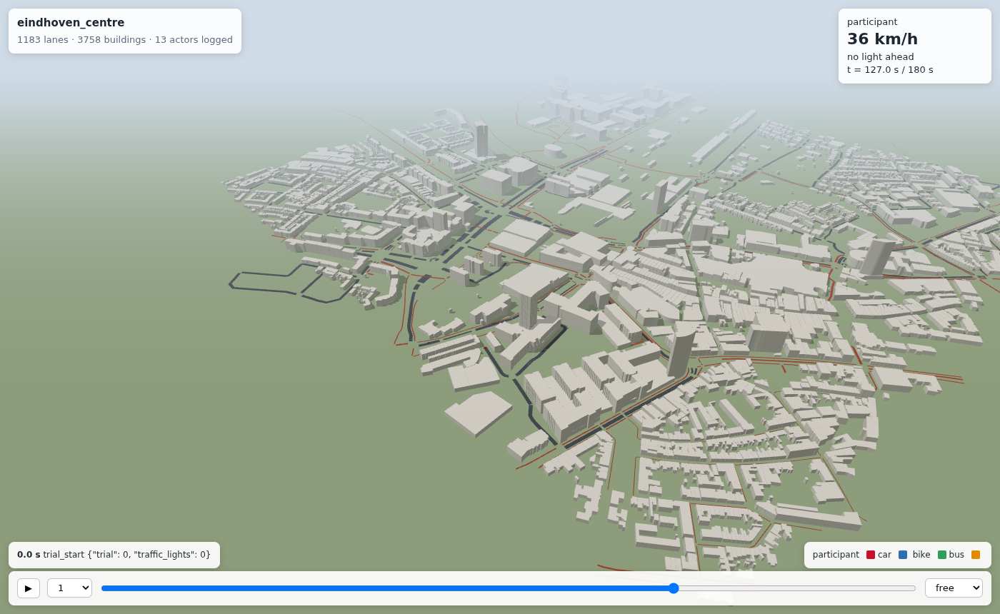

*Eindhoven city centre, replayed in the browser trial viewer (three.js) from a logged trial: 3,758 OSM buildings,
the drivable road network, cycleways in red, the participant in red and SUMO traffic in blue.*

---

## Contents
- [Citation](#citation) · [License](#license) · [Support](#support-coupled-carla)
- [What you get](#what-you-get) · [Videos](#videos) · [Screenshots](#screenshots) · [How it works](#how-it-works)
- [Quick start](#quick-start) · [Make a map of any place](#make-a-map-of-any-place) (for first-time users, no programming)
- [Maps](#cities): [19 cities](#cities), [real-world scenery, terrain and weather](#real-world-scenery-terrain-and-weather), [parked cars](#parked-cars), [night and rain](#night-and-rain), [scenery on CARLA 1.0](#scenery-on-carla-10-and-on-baked-levels), [public transport](#public-transport), [standard CARLA maps](#standard-carla-maps)
- [Experiments](#experiment-files): [experiment files](#experiment-files), [participants, inputs and views](#participants-inputs-and-views), [coupled experiments](#coupled-experiments-phase-2), [the Eindhoven crossing](#running-the-eindhoven-crossing), [study tools](#study-tools), [simulated humans](#simulated-humans-optional), [session dashboard](#session-dashboard), [VR stations](docs/lab_guide.md#vr-stations), [sound, in-car displays and eHMIs](#sound-in-car-displays-and-designed-ehmis), [drones](#drones)
- [CARLA 1.0 and the digital twin](#phase-3-carla-10-and-the-eindhoven-digital-twin): [running on CARLA 1.0](#running-on-carla-10), [the Eindhoven twin](#the-eindhoven-digital-twin)
- [Traffic](#traffic) · [Traffic lights](#traffic-lights)
- [Data](#logging-and-data): [logging](#logging-and-data), [analysis](#analysis), [trial viewer](#trial-viewer)
- [Performance](#performance) · [coupled-sim features](#coupled-sim-features-in-coupled-carla) · [Known limits](#known-limits) · [Roadmap](#roadmap)
- [Lessons learned](#lessons-learned-gotchas) · [Project layout](#project-layout)
- [Credits, data and licences](#credits-data-and-licences)

## Citation
If you use Coupled CARLA for academic work, please cite the software (GitHub's "Cite this repository" button gives
it in APA and BibTeX, from [`CITATION.cff`](CITATION.cff)):

> Bazilinskyy, P. (2026). Coupled CARLA: a human-factors driving simulator for real places [Computer software].
> https://github.com/bazilinskyy/coupled-carla

and the coupled simulator it builds on:

> Bazilinskyy, P., Kooijman, L., Dodou, D., & De Winter, J. C. F. (2020). Coupled simulator for research on the
> interaction between pedestrians and (automated) vehicles. 19th Driving Simulation Conference (DSC). Antibes, France.

## License

The source code of Coupled CARLA is released under the [MIT License](LICENSE). Third-party code and data used by
it are not covered by this license and remain under the licenses of their developers: the SUMO bridge vendored in
`coupledcarla/bridge` (CARLA, MIT, © CVC), CARLA and Eclipse SUMO themselves (MIT, EPL-2.0), and the map and
city data (OpenStreetMap under the ODbL, so built maps are derived databases under the ODbL; the other sources
under CC0, CC BY 4.0, Licence Ouverte, ODbL or their open data terms). See
[Credits, data and licences](#credits-data-and-licences) for each.

## What you get

| | |
|---|---|
| **Any place** | `map.bbox: [south, west, north, east]` -> OSM download -> pruned road graph -> OpenDRIVE for CARLA + matching SUMO network, in seconds (2.6 s for 1.6 km of central Eindhoven, plus the download). Left- and right-hand traffic. |
| **Real-world scenery** | Every map is filled from free open data: real terrain on the roads (AHN lidar in the Netherlands, AWS Terrain Tiles elsewhere), buildings at their real footprints and heights (3DBAG, IGN BD TOPO, NYC Open Data, PLATEAU, Overture Maps), OSM street trees by species and height (sized from Meta/WRI canopy heights where OSM has none), the Dutch BGT's ground surfaces and street furniture, parks, water, lamps, benches, bus shelters, bollards and road signs, and the weather and sun of a real place and time (Open-Meteo) ([Real-world scenery](#real-world-scenery-terrain-and-weather)). |
| **19 cities** | Eindhoven plus 18 cities on six continents, from Tokyo and Cairo to Luang Prabang and Ushuaia ([Cities](#cities)). |
| **CARLA's towns** | Town01-Town07 and Town10HD (CARLA 0.9.16; the 1.0 towns are not tested yet) with every feature: SUMO traffic that runs the towns' own traffic lights, parked cars, crowds and CARLA's AI walkers, stations, eHMIs, drones, sound, night lights (`map: {carla_town: Town10HD_Opt}`; [Standard CARLA maps](#standard-carla-maps)). |
| **Traffic models** | SUMO drives everything that is not a participant: EIDM car following, the sublane lane-change model (cyclists and cars share and overtake), a Dutch-flavoured fleet with Gazelle bikes and buses, car demand fitted to open traffic counts where cities publish them (7 maps, SUMO's routeSampler), cyclists on the real cycle network at counted volumes. The participant's car is mirrored into SUMO, so traffic reacts to them. |
| **Real public transport** | The bus lines of OpenStreetMap run on their real streets and stop at their real stops (16 of the 19 maps have OSM bus lines); where the city publishes a GTFS timetable (10 maps) they come as often as that timetable says for the trial's hour and day; at `time: now` the real buses start where they are at that moment (GTFS-Realtime, e.g. all of the Netherlands) ([Public transport](#public-transport)). |
| **Real car fleet** | Car body types and colours from open vehicle registers (RDW for the Netherlands, NY DMV for Manhattan with its yellow cabs, Waka Kotahi for New Zealand, Senatran for Brazil), mapped onto CARLA's models; each SUMO car's colour is the CARLA car's ([Traffic](#traffic)). |
| **City-scale, real time** | SUMO simulates the whole map; only actors within 250 m of a participant exist in CARLA (level of detail), which keeps a city real time on one GPU. |
| **Participants** | Keyboard, Logitech G25 wheel with force feedback, or autopilot; driver, hood or chase view. |
| **Logging** | coupled-sim-style per-frame CSV at 50 Hz (participants always, AI actors near them), events, live JSON over UDP 40131, SUMO's trajectory output for the whole network, CARLA's recorder for replay. |
| **Trial viewer** | Browser replay of any trial in 3D with the OSM buildings, timeline, follow camera, light state and events. |
| **Experiment files** | YAML: map, server, simulation, traffic, participants, points of interest, logging, a trial sequence with per-trial overrides. |
| **Coupled experiments** | Stations for a driver, a pedestrian and an AV passenger on any machine of the LAN; scripted AI cars (routes, coupled-sim-style triggers, eHMI on the front, rear, roof, road or as "eyes") and walkers; a pedestrian crowd; SUMO traffic yields to pedestrians; eye-contact events; visual sync; round trips and frame latency logged. |
| **Two CARLA generations** | The same experiment files for CARLA 0.9.16 (UE 4.26) and CARLA 1.0 (UE 5.8): renamed blueprints are mapped to their closest stand-ins, and the scenery has a mesh catalogue per version. |
| **Study tools** | Counterbalanced trial plans per participant, an experiment validator, continuous responses (hold button, slider), take-over requests in automated driving, a session dashboard to run a whole experiment from a browser, station sound (vehicles, AVAS, spoken eHMIs), in-car displays, haptic cues and eHMIs from design files: coupled-sim's study tools on CARLA ([Study tools](#study-tools)). |
| **Eindhoven digital twin** | Central Eindhoven baked into a CARLA 1.0 level from Dutch open data (AHN terrain, 3DBAG buildings, OSM roads with lane markings, kerbs and sidewalks), driven with SUMO traffic on its own OpenDRIVE ([The Eindhoven digital twin](#the-eindhoven-digital-twin)). |

## Make a map of any place

It is easier than ever to drive through a real place in a simulator. Modelling a city's streets, buildings and
traffic by hand used to keep a team of 3D artists busy for months. Today most of it is open data that anyone may
download: OpenStreetMap's streets, lanes, signs and trees, mapped by volunteers; building footprints and heights
from national registers (3DBAG, BD TOPO, PLATEAU, NYC) and Overture Maps; terrain from lidar and global elevation
models; the weather and the sun of a real day; bus timetables; open traffic counts. Free, open simulators, CARLA
for the 3D world and SUMO for the traffic, turn it into a world you can drive. Coupled CARLA puts these together,
and the map maker reduces it to typing a place and pressing a button. It is meant for people who do not program:
researchers in psychology and human factors, designers, students, city planners.

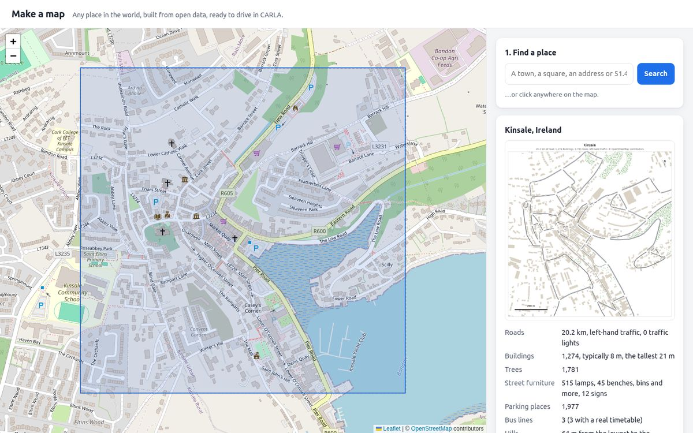

**Set up once** (a computer with an internet connection; to drive, a Windows or Linux PC with a gaming graphics
card):

1. Download Coupled CARLA (the green Code button, Download ZIP) and unpack it.
2. Install [uv](https://docs.astral.sh/uv/getting-started/installation/), then, in the `coupled-carla` folder:
   `uv venv --python 3.12 .venv` and `uv pip install -r requirements.txt`.
3. To drive: unpack [CARLA 0.9.16](https://github.com/carla-simulator/carla/releases/tag/0.9.16) as a folder
   `CARLA_0.9.16` next to the `coupled-carla` folder.

**Every day:** double-click `make_map.bat` (Windows), `Make a map.command` (macOS) or `make_map.sh` (Linux). The
browser opens a world map. Type a place (a town, a square, an address, coordinates; any language) or click on the
map, choose small (about 1 km), medium (1.4 km) or large (2 km), press **Build this map**, then **Drive it**. The launchers take the map maker's options (e.g. `./make_map.sh --no-browser --port 8790`) and were tested on Windows 11, Ubuntu 22.04 and macOS 15 ([make_a_map.md](docs/make_a_map.md)).

The map maker fills in what you would otherwise have to know: the driving side from the country, how busy the
traffic is from the size of the town (OSM's population figures; a big city nearby counts), a readable name, and a
commented experiment file (`experiments/places/<name>.yaml`) with the same city block as the 19 cities. While it
builds, it says what it is doing in plain words; the technical log goes to `maps/<name>/build.log`. At the end it
draws the map from above (`preview.png`) and lists what is in it and which open data it came from, with their
licences (`summary.txt`). Step by step, with troubleshooting: [docs/make_a_map.md](docs/make_a_map.md).

**Tested** on five places that are not among the 19 cities (2026-11-15, lin4080): typed as shown (or clicked on the
page), built with the map maker, then a 40 s headless autopilot drive on CARLA 0.9.16 (Epic, RTX 4080 SUPER). Build
times are from pressing Enter to the summary, most of it spent waiting for the open data services (Overpass mirrors
answered 502 and 504 several times and the map maker moved on to the next).

| Typed | Found | What it tests | Size | Build | Roads | Buildings | Trees | Bus lines (timetable) | Hills | Drive: real-time factor, collisions |
|---|---|---|---|---|---|---|---|---|---|---|
| `명동, 서울` | 🇰🇷&nbsp;Myeong-dong, Seoul, South Korea | Korean script; big city (9.5 M), right-hand | medium | 4.5 min | 40.5 km | 2,527 | 58,728 (Namsan's forest) | 45 (0) | 131 m | 0.980, 0 |
| `Connaught Place, New Delhi` | 🇮🇳&nbsp;New Delhi, India | a left-hand country not yet covered; big city | medium | 3.1 min | 31.4 km | 1,227 | 236 | 40 (0) | 46 m | 0.993, 0 |
| `Hallstatt` | 🇦🇹&nbsp;Hallstatt, Austria | a village of 388 people between a lake and a mountain | small | 2.8 min | 0.8 km | 235 | 39 | none | 516 m | 0.990, 0 (stuck 5 times, put back) |
| `Plaza Mayor, Salamanca` | 🇪🇸&nbsp;Salamanca, Spain | a town | medium | 4.5 min | 26.1 km | 2,328 | 4,204 | 28 (15) | 56 m | 0.981, 0 |
| (a click on the page) | 🇮🇪&nbsp;Kinsale, Ireland | a left-hand small town, built through the web page | small | 3.4 min | 20.2 km | 1,274 | 1,781 | 3 (3) | 64 m | 0.995, 0 |

| 🇰🇷&nbsp;Myeong-dong, Seoul | 🇮🇳&nbsp;Connaught Place, New Delhi |
|---|---|
| 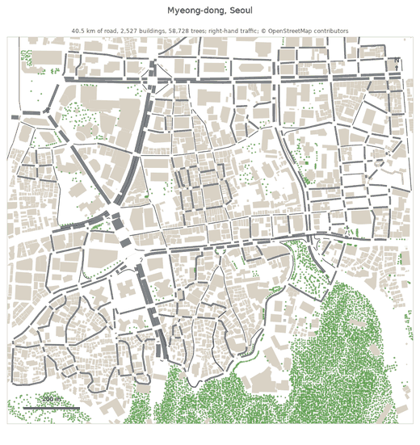 | 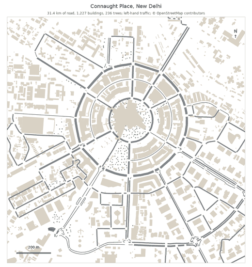 |
| 🇪🇸&nbsp;**Plaza Mayor, Salamanca** | 🇦🇹&nbsp;**Hallstatt** |
| 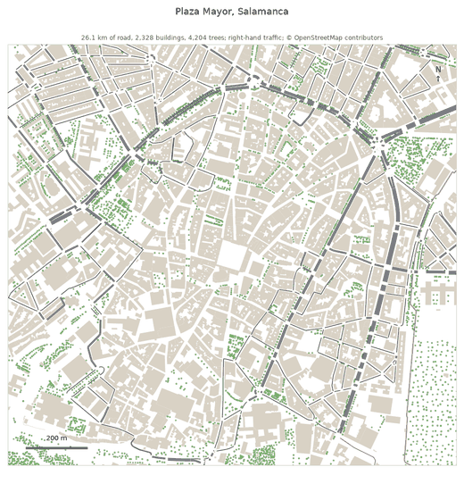 | 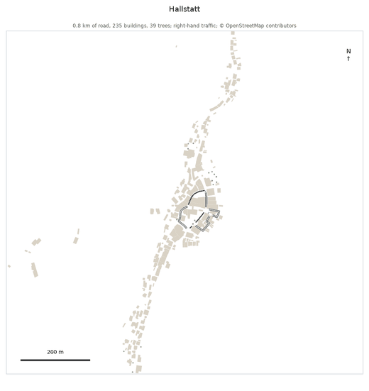 |

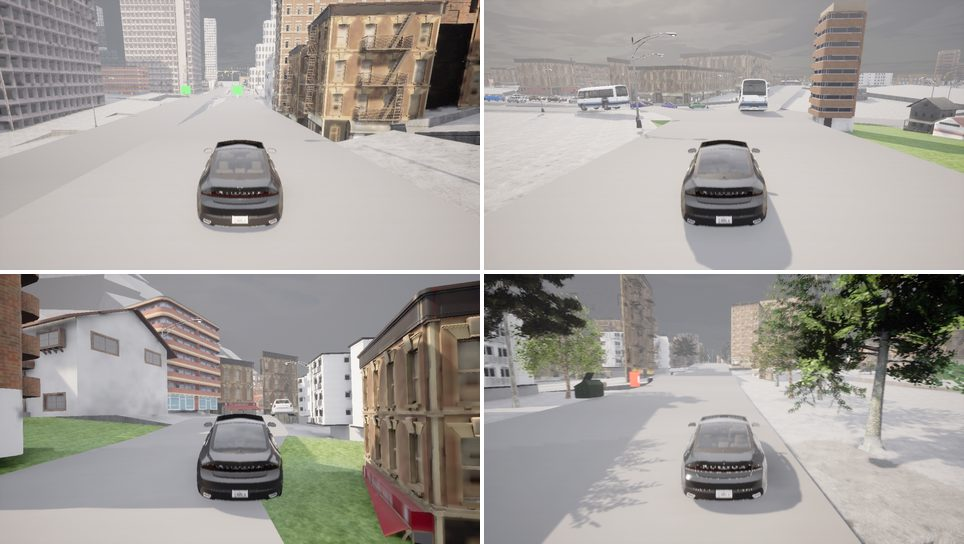

*The test drives in CARLA (chase camera): Seoul and New Delhi (left-hand traffic, buses) above, Hallstatt and
Salamanca below.*

The first run found three problems, now handled: OSM's "New Delhi" is only the NDMC district (0.25 M people), so the
place was taken for a town (now the largest city whose reach covers a place counts: Delhi, or Tokyo for Shibuya); for
"Hallstatt" Nominatim gave the centre of the municipality's boundary, 4 km away in the mountains, and the build
stopped with "No roads found here" (now a town found as its boundary is centred on its own place node); and a square
in the sea showed no error on the page. Hallstatt's 1 km square cuts its one lakeside road at both ends, so only a
0.8 km loop in the centre stays drivable (dead ends are removed so that a car can always drive on); the summary now
says so when less than 2 km of road is left.

**Limits.** The buildings are CARLA's stand-in models at the real footprints and heights, not the real facades
(only the baked Eindhoven twin has those); there are no road markings on these maps. The map is as good as
OpenStreetMap is in that place: detailed in most cities, thin in some towns. Traffic volumes are a guess from the
town's size unless the city publishes counts. Building needs an internet connection and a few minutes (most of it
waiting for the open data services); driving needs a PC with a good graphics card and CARLA 0.9.16 (it does not run
on a Mac: maps made on a Mac can be driven on a PC). The place search sends the typed place to OpenStreetMap's
Nominatim (or Photon); nothing about the user is sent, and the page runs on 127.0.0.1 only.

From a terminal or from Python:

```bash
.venv/bin/python -m coupledcarla.mapmaker "Markt, Eindhoven"                # find, build, summarise
.venv/bin/python -m coupledcarla.mapmaker "51.4416, 5.4697" --size large --open
.venv/bin/python -m coupledcarla.mapmaker "Plaza Mayor, Salamanca" --drive   # then drive it
.venv/bin/python -m coupledcarla.mapmaker --web                             # the page (port 8777)
```

```python
from coupledcarla.mapmaker import make_map
exp = make_map("Shibuya crossing", size="small")   # -> experiments/places/<name>.yaml; map in maps/<name>/
```

Options: `--size small|medium|large|<km>` (above 2.5 km it warns that it gets slow; 4 km at most), `--name`,
`--pedestrians` (a crowd on the pavements, `traffic.walkers.count: auto`), `--open`, `--drive`, `--force`,
`--no-build`, `--build <experiment>`, `--twin` (a baked CARLA 1.0 digital twin instead, below). Without arguments in
a terminal it asks for the place.

**A digital twin instead (`--twin`).** Where a digital-twin toolchain is set up (a CARLA 1.0 source build with the
editor and carla-digitaltwins, named in `~/.config/coupled-carla/twin.json`; [docs/make_a_map.md](docs/make_a_map.md#a-digital-twin-carla-10)),
the map maker makes a CARLA 1.0 twin of the same square: real building shapes with facade styles, the aerial photo
on the ground and roofs, the national terrain, CARLA's road materials with lane markings, from the best open data
of the country ([A twin of any place](#a-twin-of-any-place)). Every twin also gets the buildings' entrances, doors
and steps from OSM, its road and pavement meshes closed where they left gaps (no dark slots across the street),
and brick and cobblestone streets paved in the road surface itself. The page shows a checkbox for it only where the
toolchain is configured. It writes `experiments/places/<name>_twin.yaml` (`map.opendrive`, `map.carla_level`) and
the level `/Game/Carla/Maps/Twins/<Name>/<Name>` in the CARLA 1.0 tree (`coupledcarla/twinmaker.py`).

## Videos

Short clips of what a session looks and sounds like, with sound (9-25 s; the CARLA 0.9.16 clips in full HD, 1920x1080, 15-48 MB; click a picture to play or
download). They are made headless by [`tools/make_videos.py`](tools/make_videos.py) from the clip list
[`experiments/videos/clips.yaml`](experiments/videos/clips.yaml), on CARLA 0.9.16 at Epic quality: frames kept at 25
fps of simulation time, so even a run slower than real time gives a smooth clip; first-person clips carry what the
participant hears (`--record-audio`), outside cameras what can be heard where the camera is. All files:
[release demo-videos](https://github.com/bazilinskyy/coupled-carla/releases/tag/demo-videos). The first five are on CARLA 1.0 digital twins (Eindhoven, the TU/e campus, Salamanca, Shibuya), with each country's road signs and number plates; brick and sett streets are paved in the road surface itself. Watch them in the browser on the [project page](https://bazilinskyy.github.io/coupled-carla/).

<table>
<tr>
<td width="50%" valign="top"><a href="https://github.com/bazilinskyy/coupled-carla/releases/download/demo-videos/twin_eindhoven.mp4">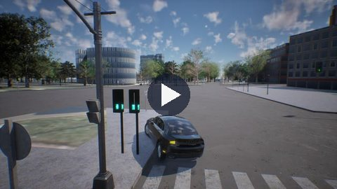</a><br>🇳🇱&nbsp;<b>The Eindhoven digital twin</b><br><sub>Eindhoven centre, CARLA 1.0 twin · driver (autopilot), chase camera · 20 s, 46.0 MB<br>3DBAG buildings with real roofs and facade styles, aerial-photo ground, CARLA road markings, trees and street furniture from open data</sub></td>
<td width="50%" valign="top"><a href="https://github.com/bazilinskyy/coupled-carla/releases/download/demo-videos/twin_tue_campus.mp4">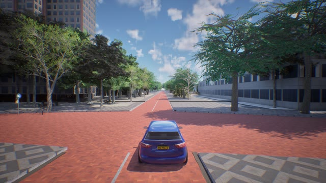</a><br>🇳🇱&nbsp;<b>De Zaale past Atlas, TU/e campus</b><br><sub>TU/e campus, Eindhoven, CARLA 1.0 twin · driver (autopilot), chase camera · 25 s, 65.5 MB<br>through the passage under Atlas and past its glass curtain wall; brick streets in herringbone in the road surface itself, Dutch signs and number plates</sub></td>
</tr>
<tr>
<td width="50%" valign="top"><a href="https://github.com/bazilinskyy/coupled-carla/releases/download/demo-videos/twin_drones.mp4">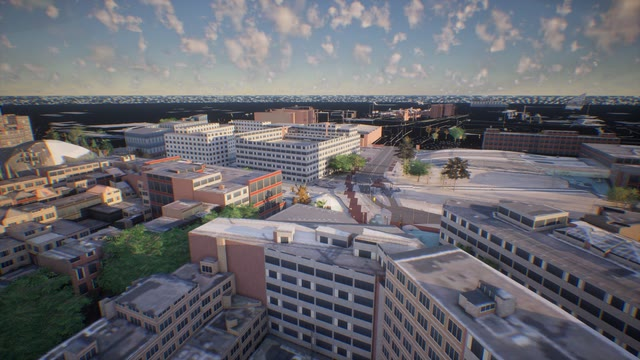</a><br>🇳🇱&nbsp;<b>Drones over the Eindhoven twin</b><br><sub>Eindhoven centre, CARLA 1.0 twin · drone pilot (FPV) · 20 s, 23.8 MB<br>the pilot climbs over the twin's real roof shapes; delivery and swarm drones fly in the cruise band</sub></td>
<td width="50%" valign="top"><a href="https://github.com/bazilinskyy/coupled-carla/releases/download/demo-videos/twin_salamanca.mp4">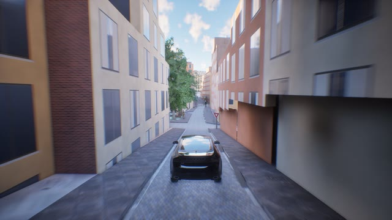</a><br>🇪🇸&nbsp;<b>Plaza Mayor, Salamanca</b><br><sub>Salamanca, Spain, CARLA 1.0 twin · driver (autopilot), chase camera · 20 s, 26.4 MB<br>a twin of any place from Spain's open data: Catastro buildings with their floors, PNOA aerial photo, MDT05 terrain</sub></td>
</tr>
<tr>
<td width="50%" valign="top"><a href="https://github.com/bazilinskyy/coupled-carla/releases/download/demo-videos/twin_shibuya.mp4">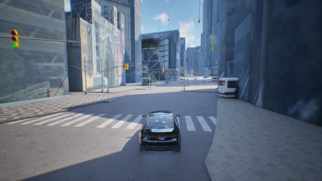</a><br>🇯🇵&nbsp;<b>Shibuya crossing twin</b><br><sub>Tokyo, Japan, CARLA 1.0 twin (left-hand) · driver (autopilot), chase camera · 20 s, 21.6 MB<br>across the scramble crossing in a twin from Japan's open data: PLATEAU buildings with their photo textures, GSI photo and terrain</sub></td>
<td width="50%" valign="top"><a href="https://github.com/bazilinskyy/coupled-carla/releases/download/demo-videos/eindhoven_rush_hour.mp4">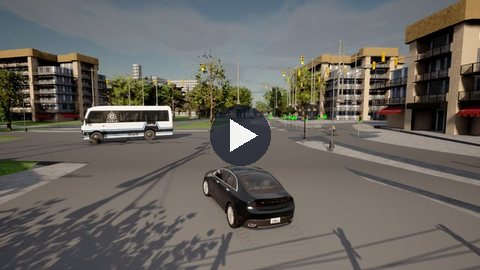</a><br>🇳🇱&nbsp;<b>Rush hour in Eindhoven</b><br><sub>Eindhoven centre, Netherlands · driver (autopilot), chase camera · 20 s, 30.3 MB<br>dense mixed traffic around the station, buses of the real lines, cyclists sharing the road</sub></td>
</tr>
<tr>
<td width="50%" valign="top"><a href="https://github.com/bazilinskyy/coupled-carla/releases/download/demo-videos/eindhoven_pedestrian_ehmi.mp4">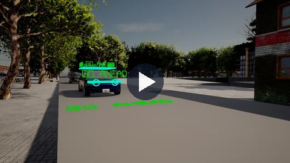</a><br><b>Crossing in front of an automated car</b><br><sub>Eindhoven, east of the station · pedestrian · 9.5 s, 15.0 MB<br>the AV slows, shows I'M STOPPING, then GO AHEAD; its eyes follow the pedestrian</sub></td>
<td width="50%" valign="top"><a href="https://github.com/bazilinskyy/coupled-carla/releases/download/demo-videos/crossing_four_views.mp4">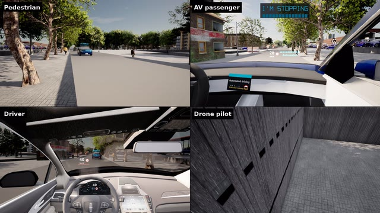</a><br><b>Four people, one street</b><br><sub>Eindhoven, east of the station · pedestrian, AV passenger, driver, drone pilot (four bot stations) · 20 s, 31.6 MB<br>the same moment from four stations, frame-locked in simulation time</sub></td>
</tr>
<tr>
<td width="50%" valign="top"><a href="https://github.com/bazilinskyy/coupled-carla/releases/download/demo-videos/robotaxi_passenger.mp4">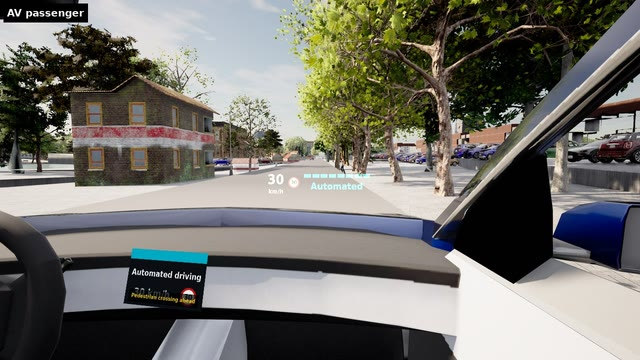</a><br><b>Riding in a robotaxi</b><br><sub>Eindhoven, east of the station · AV passenger (bot station) · 18 s, 47.3 MB<br>the centre screen's message and the eHMI as the AV stops and lets the pedestrian cross</sub></td>
<td width="50%" valign="top"><a href="https://github.com/bazilinskyy/coupled-carla/releases/download/demo-videos/eindhoven_cyclist.mp4">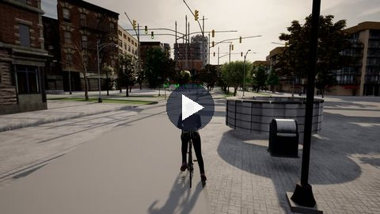</a><br>🇳🇱&nbsp;<b>Riding with Dutch cyclists</b><br><sub>Eindhoven, Vestdijk cycle path · chase camera on a SUMO cyclist · 20 s, 48.1 MB<br>cyclists on the cycle track and the street beside it, overtaking each other</sub></td>
</tr>
<tr>
<td width="50%" valign="top"><a href="https://github.com/bazilinskyy/coupled-carla/releases/download/demo-videos/tokyo_shibuya.mp4">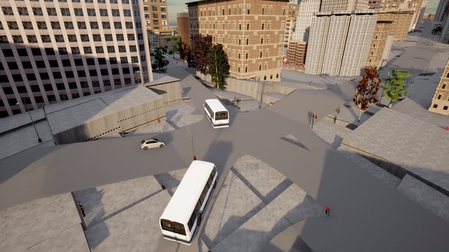</a><br>🇯🇵&nbsp;<b>Shibuya crossing, left-hand traffic</b><br><sub>Tokyo (Shibuya), Japan · orbiting camera above the crossing · 20 s, 19.3 MB<br>traffic keeps left, Toei buses, pedestrians crossing at the junction (80 walkers calibrated for Tokyo)</sub></td>
<td width="50%" valign="top"><a href="https://github.com/bazilinskyy/coupled-carla/releases/download/demo-videos/new_york_avenue.mp4">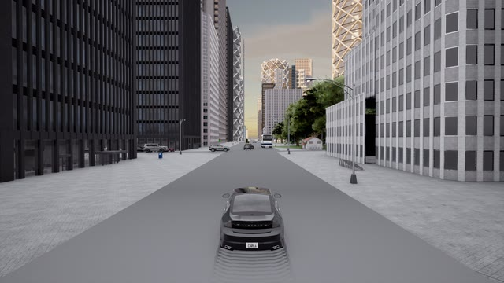</a><br>🇺🇸&nbsp;<b>Up Sixth Avenue</b><br><sub>New York (Midtown), USA · automated driver, chase camera · 20 s, 25.7 MB<br>Midtown's towers at their real heights (NYC Open Data), the avenue's five lanes</sub></td>
</tr>
<tr>
<td width="50%" valign="top"><a href="https://github.com/bazilinskyy/coupled-carla/releases/download/demo-videos/kigali_hills.mp4">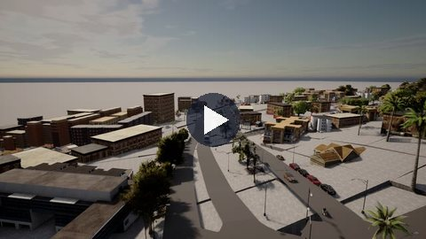</a><br>🇷🇼&nbsp;<b>Kigali's hills</b><br><sub>Kigali, Rwanda · crane camera over the road · 20 s, 21.6 MB<br>the roads climb and fall with the real terrain (AWS Terrain Tiles); Overture buildings on the slopes</sub></td>
<td width="50%" valign="top"><a href="https://github.com/bazilinskyy/coupled-carla/releases/download/demo-videos/lyon_night_rain.mp4">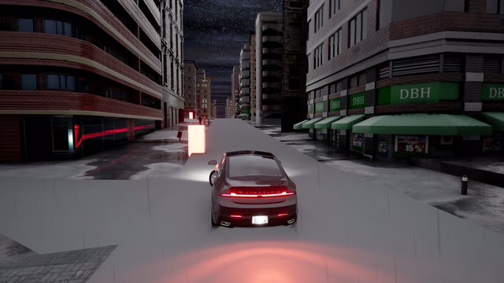</a><br>🇫🇷&nbsp;<b>Rainy night in Lyon</b><br><sub>Lyon (Bellecour), France · driver, chase camera · 20 s, 33.1 MB<br>night after sunset with rain, headlights and lit shop windows (0.9.16's street lamps give no light)</sub></td>
</tr>
<tr>
<td width="50%" valign="top"><a href="https://github.com/bazilinskyy/coupled-carla/releases/download/demo-videos/eindhoven_drones.mp4">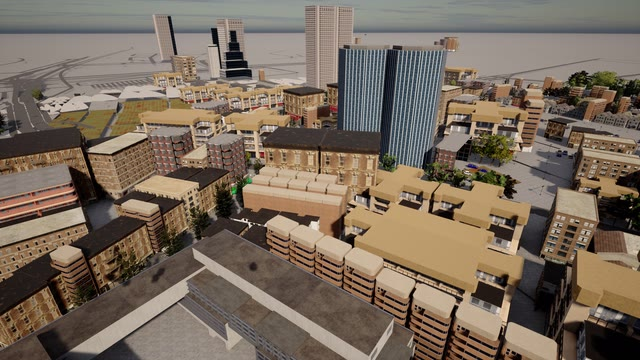</a><br>🇳🇱&nbsp;<b>Drones over Eindhoven</b><br><sub>Eindhoven centre · drone pilot (FPV) · 20 s, 26.9 MB<br>the pilot's gimbal camera climbing out of a square over the roofs to the skyline (coupled-sim's flight model)</sub></td>
<td width="50%" valign="top"><a href="https://github.com/bazilinskyy/coupled-carla/releases/download/demo-videos/chernihiv_avenue.mp4">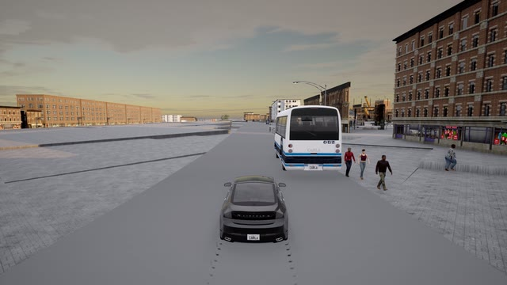</a><br>🇺🇦&nbsp;<b>Down prospekt Myru, Chernihiv</b><br><sub>Chernihiv, Ukraine (made with the map maker) · driver (autopilot), chase camera · 20 s, 22.0 MB<br>a map made by typing "Chernihiv" into the map maker; prospekt Myru towards the centre, a bus stopping, people boarding</sub></td>
</tr>
<tr>
<td width="50%" valign="top"></td>
</tr>
</table>

Re-render a clip (or `--all`), or put new sound on one without re-encoding the picture:

```bash
python tools/make_videos.py render tokyo_shibuya            # --no-launch --port 2000 against a running server
python tools/make_videos.py remux tokyo_shibuya
```

## Screenshots

**The trial viewer** (browser, three.js), same trial as above: oblique view around the participant and the
follow camera with the HUD (speed, next traffic light, time).

| Oblique | Follow camera |
|---|---|
| 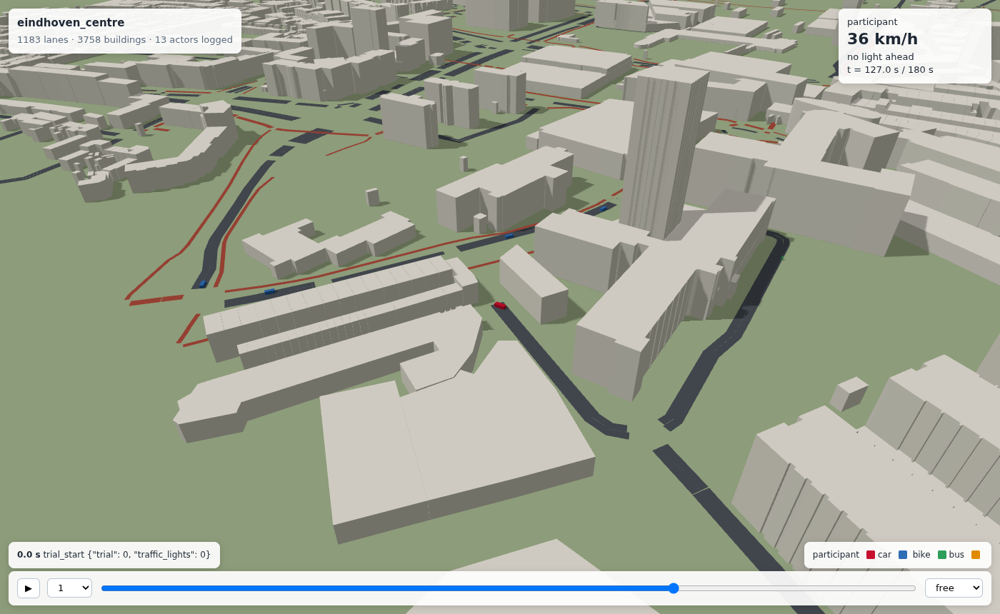 | 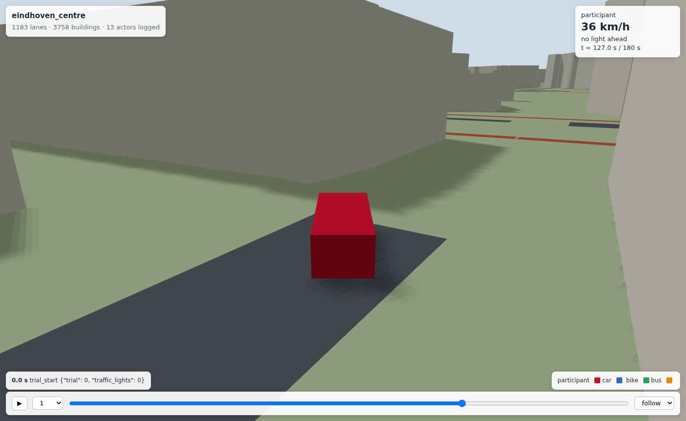 |

**New York (Midtown)** in the viewer: OSM building heights give Midtown's towers; the participant drives
the street grid with SUMO traffic.

| Overview | Oblique |
|---|---|
| 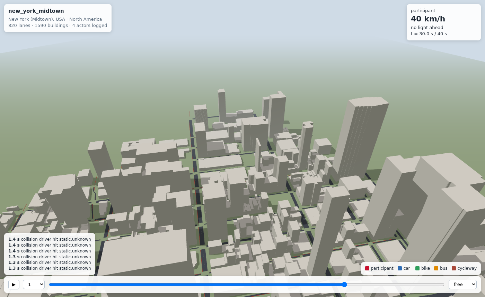 | 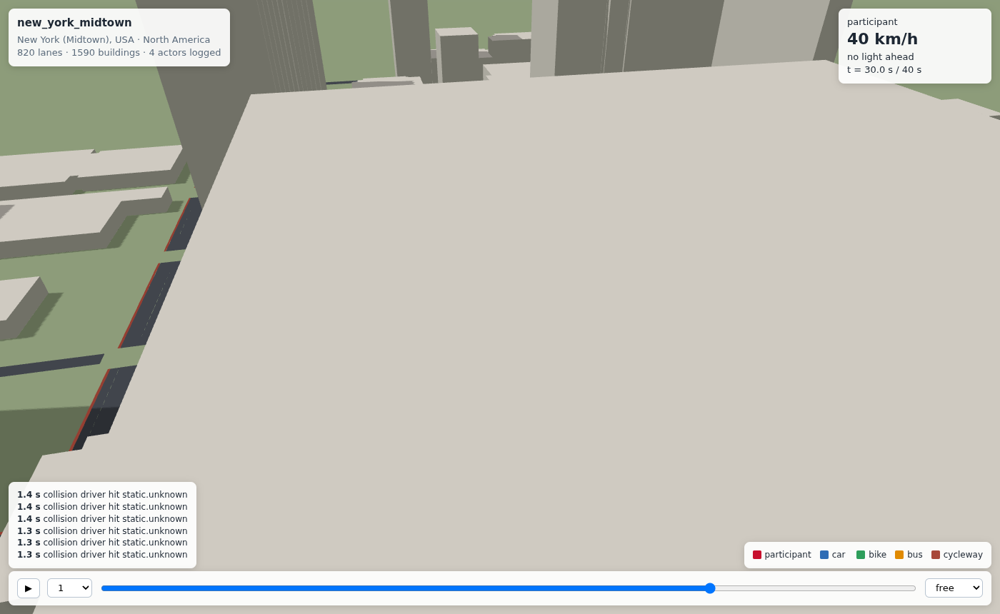 |

**Coupled experiment (phase 2)**, Eindhoven: a pedestrian crosses while an automated vehicle approaches; the
AV yields and its passenger switches the eHMI from "I'M STOPPING" (cyan) to "GO AHEAD" (green); a manual
driver follows. Each view below was rendered by a separate station process (here four bot stations on one machine).

| Pedestrian station: the AV stops, "I'M STOPPING" | Pedestrian station: "GO AHEAD" on its front, roof and the road |
|---|---|
| 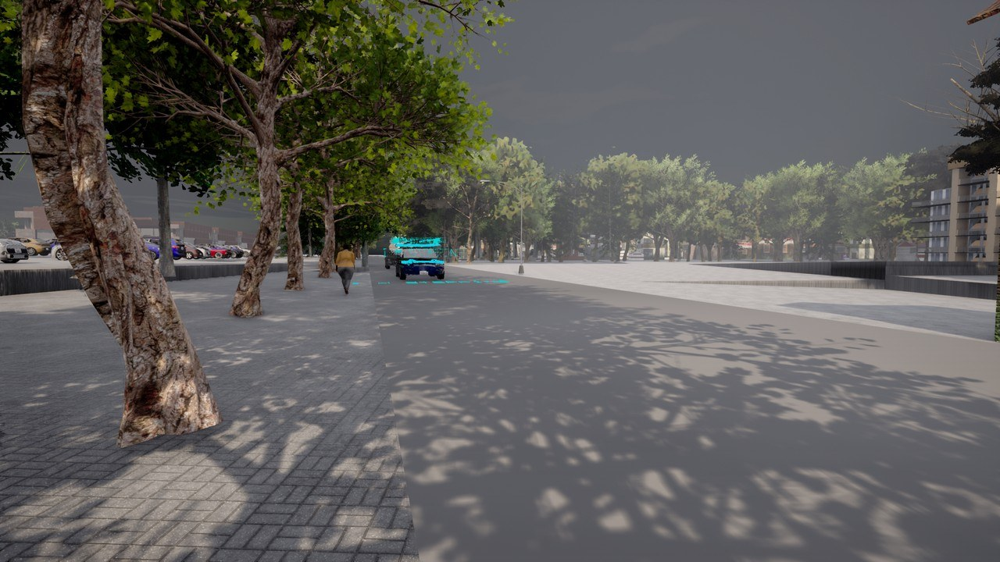 | 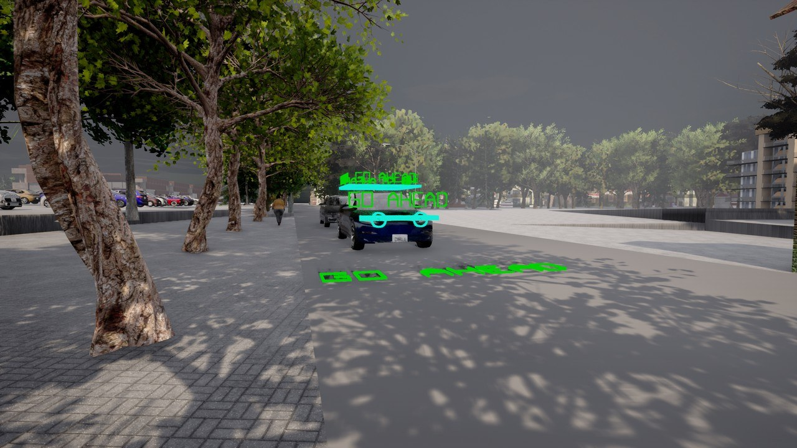 |

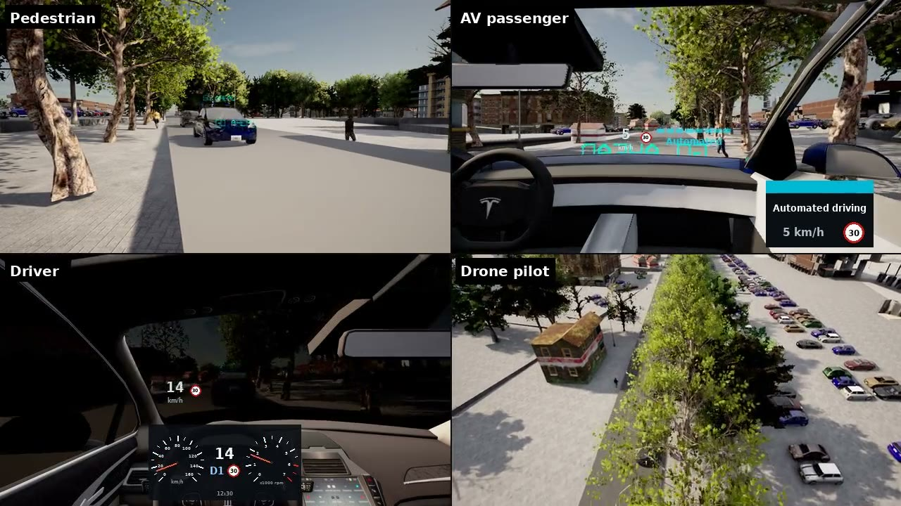

The same moment in the trial viewer: the pedestrian (red) crossing, the AV (dark blue) stopped with its cyan
eHMI bar, an AI walker further down the street; the event list shows the AV stopping, the passenger's eHMI
command and the stations' frame rates and round trips.

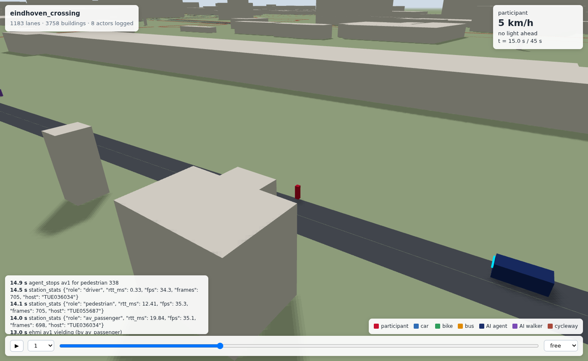

**All 19 maps** (drivable roads, cycleways, OSM buildings; 1.4 km squares, north up):

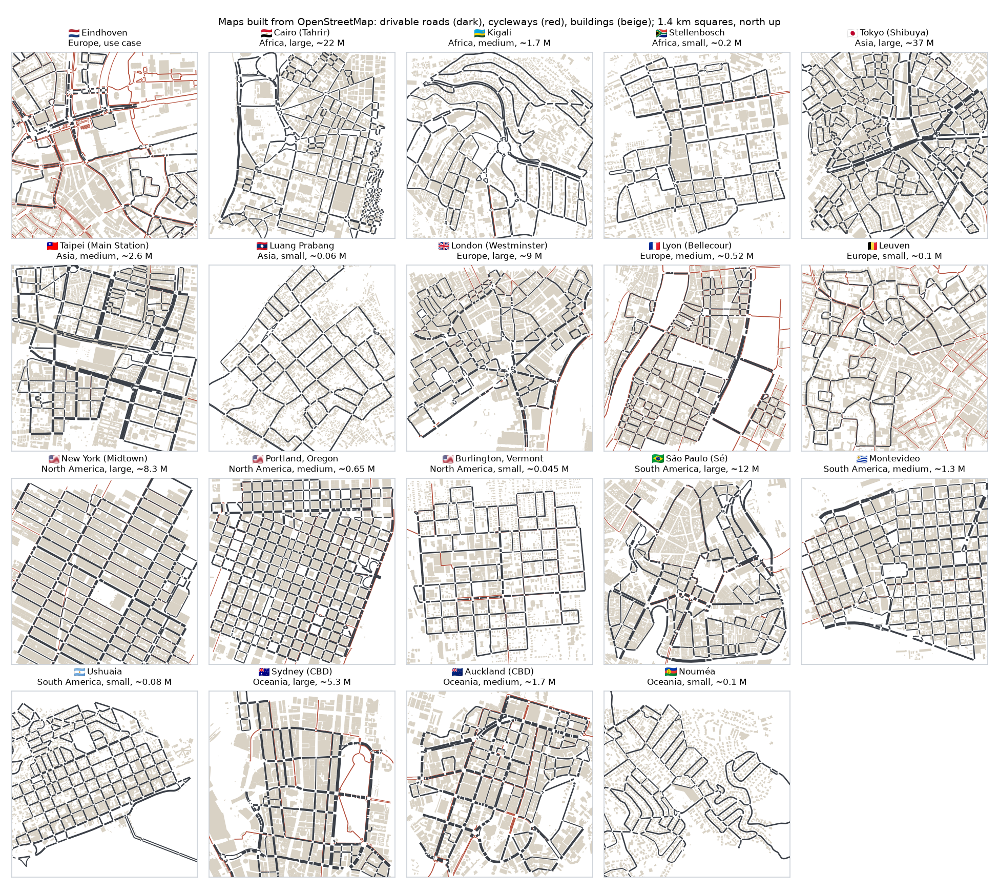

## How it works

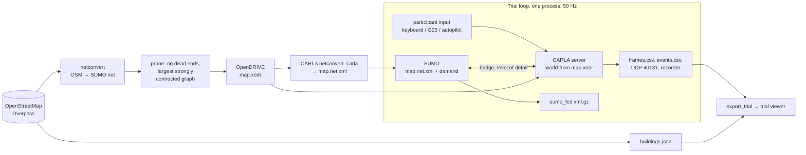

1. **Map** (`coupledcarla/mapbuild.py`). Overpass gives the OSM ways with `highway=*` in the box (cached).
   SUMO's `netconvert` turns them into a network keeping the configured road types and cycleways, guessing
   ramps, roundabouts and signals. The road graph is then **pruned**: dead-end chains are removed and only
   the largest strongly connected part is kept, so a car can always go on (at the cut edge of the box, roads
   would otherwise end in the void). The pruned network is written as OpenDRIVE (`map.xodr`, signals named
   so CARLA's tools keep them) and converted back with CARLA's `netconvert_carla.py` into a SUMO network
   with the same road ids (`map.net.xml`). OSM building footprints with heights go to `buildings.json`.
2. **World.** CARLA builds road meshes from the OpenDRIVE at load time (`generate_opendrive_world`, about
   10 s); a large plane 0.3 m below the roads catches anything that leaves them.
3. **Traffic** (`coupledcarla/traffic.py`). SUMO vehicle types named after CARLA blueprints, random trips
   for cars, bikes and buses, a `.sumocfg` per trial.
4. **Trial loop** (`coupledcarla/run.py`), one process: read each participant's input and apply it; step
   SUMO and CARLA together through the bridge (`coupledcarla/bridge`, vendored from CARLA 0.9.16's
   `Co-Simulation/Sumo` with fixes); draw the traffic lights; log the frame; draw the view; sleep to stay in
   real time.

## Quick start

Needs CARLA 0.9.16 (the release package; the UE 5 line has no SUMO co-simulation), Python 3.12, a GPU.

```bash
git clone https://github.com/bazilinskyy/coupled-carla.git && cd coupled-carla
uv venv --python 3.12 .venv && uv pip install --python .venv/bin/python -r requirements.txt
export CARLA_ROOT=~/carla-eindhoven/CARLA_0.9.16          # the extracted CARLA 0.9.16 release
export SUMO_HOME=$(.venv/bin/python -c "import sumo; print(sumo.SUMO_HOME)")
export PATH=$SUMO_HOME/bin:$PATH PROJ_LIB=$SUMO_HOME/data/proj
```

### The `config` and `secret` files

The machine's own settings and API keys live in two JSON files in the root of the project, `config` and `secret`.
Both are ignored by git, so they are never committed; the templates `default.config` and `default.secret` are. Copy
them once and fill in only what you use (every entry may stay empty; a feature that needs a key says so):

```bash
cp default.config config && cp default.secret secret && chmod 600 secret
.venv/bin/python -m coupledcarla.settings          # which keys are set (names and lengths only, never the keys)
```

| `secret` entry | Used for | Free key from |
|---|---|---|
| `google_maps_api_key` | Google Photorealistic 3D Tiles ([Photorealistic tiles](#photorealistic-tiles-optional)) | console.cloud.google.com (billing on; 1,000 tile sessions a month free) |
| `mapillary_token` | street photos and their detected signs, poles and lamps, to compare and correct the twins | mapillary.com/dashboard/developers |
| `sketchfab_api_token` | openly licensed 3D models of street furniture | sketchfab.com, Settings, Password & API |
| `freesound_api_key` | recordings for the soundscape (engines, horns, rain, city ambience) | freesound.org/apiv2/apply |
| `opentopography_api_key` | elevation outside the countries with national data (Copernicus 30 m, lidar) | portal.opentopography.org |
| `tomtom_api_key` | traffic speeds where no open counts exist | developer.tomtom.com |
| `anthropic_api_key` | optional Claude critiques of street-photo spots (`realism_check.py critique`) | platform.claude.com |

An environment variable with the entry's name in capitals (`GOOGLE_MAPS_API_KEY`, `MAPILLARY_TOKEN`, ...) wins over
`secret`. The CARLA server's photorealistic-tiles plugin runs inside the server and reads its key on the server
machine from `GOOGLE_MAPS_API_KEY` or `~/.config/coupled-carla/google_maps_key` (Windows:
`%USERPROFILE%\.config\coupled-carla\google_maps_key`). `config` holds `mute_sound` (true: nothing is played on
the speakers, as `COUPLED_CARLA_MUTE=1`; recordings still work) and `config_dir` (where the tiles ledger and credits
live).

Build a map once, then run its trials:

```bash
.venv/bin/python -m coupledcarla.mapbuild experiments/eindhoven_centre.yaml
.venv/bin/python -m coupledcarla.run experiments/eindhoven_centre.yaml                    # all trials, keyboard
.venv/bin/python -m coupledcarla.run experiments/eindhoven_centre.yaml --trial 0 --input wheel
```

Headless test drive (autopilot, saves a chase-camera frame every 10 s):

```bash
.venv/bin/python -m coupledcarla.run experiments/eindhoven_centre.yaml --input autopilot --headless --view chase --duration 120 --frames-every 10
```

The figure and screenshot tools need `requirements-tools.txt` as well. The unit tests need no CARLA or SUMO:
`pip install numpy pyyaml pytest && python -m pytest tests`.

The cities: write their experiment files and build every map (Overpass is slow, a few minutes per city), then
smoke-test them all:

```bash
.venv/bin/python -m coupledcarla.cities
.venv/bin/python tools/test_cities.py --duration 40 > docs/city_tests.md
```

Replay a trial in the browser:

```bash
.venv/bin/python -m coupledcarla.export_trial logs/eindhoven_centre/<time>_trial0
python3 -m http.server 8765        # then open http://localhost:8765/viewer/?file=/logs/eindhoven_centre/<time>_trial0/trial.json
```

Command-line options of `coupledcarla.run`: `--trial N` (repeatable), `--input autopilot|keyboard|wheel`,
`--headless`, `--view driver|chase|hood`, `--duration S`, `--frames-every S`, `--quality Low|Epic`,
`--step S`.

## Cities

Three per inhabited continent, by size, each a 1.4 km square around a central point
([`experiments/cities.yaml`](experiments/cities.yaml); `python -m coupledcarla.cities` writes
`experiments/cities/<slug>.yaml`). Traffic demand scales with the size class.

| Continent | Large | Medium | Small |
|---|---|---|---|
| Africa | 🇪🇬&nbsp;Cairo (Tahrir), ~22 M | 🇷🇼&nbsp;Kigali, ~1.7 M | 🇿🇦&nbsp;Stellenbosch, ~0.2 M (left-hand) |
| Asia | 🇯🇵&nbsp;Tokyo (Shibuya), ~37 M (left-hand) | 🇹🇼&nbsp;Taipei (Main Station), ~2.6 M | 🇱🇦&nbsp;Luang Prabang, ~0.06 M |
| Europe | 🇬🇧&nbsp;London (Westminster), ~9 M (left-hand) | 🇫🇷&nbsp;Lyon (Bellecour), ~0.5 M | 🇧🇪&nbsp;Leuven, ~0.1 M |
| North America | 🇺🇸&nbsp;New York (Midtown), ~8.3 M | 🇺🇸&nbsp;Portland, Oregon, ~0.65 M | 🇺🇸&nbsp;Burlington, Vermont, ~0.045 M |
| South America | 🇧🇷&nbsp;São Paulo (Sé), ~12 M | 🇺🇾&nbsp;Montevideo, ~1.3 M | 🇦🇷&nbsp;Ushuaia, ~0.08 M |
| Oceania | 🇦🇺&nbsp;Sydney (CBD), ~5.3 M (left-hand) | 🇳🇿&nbsp;Auckland (CBD), ~1.7 M (left-hand) | 🇳🇨&nbsp;Nouméa, ~0.1 M |

Plus **Eindhoven** (city centre, station to the TU/e campus edge, 1.6 km), the reference use case
([`experiments/eindhoven_centre.yaml`](experiments/eindhoven_centre.yaml)). Populations are approximate and
only order the cities by size.

Left-hand traffic works end to end: the map builder passes `--lefthand` to netconvert, and in Stellenbosch the
autopilot followed the left-hand OSM lanes' direction in 14 of 15 checked samples (the odd one at a junction).

**Smoke test** of every map (40 s headless autopilot trial each; full table in
[`docs/city_tests.md`](docs/city_tests.md)):

Smoke test, 2026-11-14: 40 s headless autopilot trial per map, CARLA 0.9.16 at Epic, 50 Hz, on lin4080 (RTX 4080 SUPER, not shared at the time), with the real-world scenery, terrain and bus lines.

| Map | Continent | Size | Traffic | Lane links | Buildings | Building heights | Relief (m) | Scenery meshes | Bus lines (with timetable) | SUMO vehicles shown | Real-time factor | Left road | Stuck | Put back on lane | Collisions | Result |
|---|---|---|---|---|---|---|---|---|---|---|---|---|---|---|---|---|
| 🇳🇱&nbsp;Eindhoven | Europe | medium | right | 2318 | 2998 | 3dbag | 11 | 16781 | 51 (45) | 11 | 0.992 | 0 | 0 | 0 | 0 | ok |
| 🇪🇬&nbsp;Cairo&nbsp;(Tahrir) | Africa | large | right | 3835 | 1308 | overture | 66 | 10814 | – | 3 | 0.994 | 0 | 1 | 1 | 0 | ok |
| 🇷🇼&nbsp;Kigali | Africa | medium | right | 1655 | 2942 | overture | 188 | 15270 | 18 (0) | 3 | 0.994 | 0 | 0 | 0 | 0 | ok |
| 🇿🇦&nbsp;Stellenbosch | Africa | small | left | 1748 | 1683 | overture | 32 | 8665 | – | 7 | 0.994 | 0 | 9 | 9 | 0 | ok |
| 🇯🇵&nbsp;Tokyo&nbsp;(Shibuya) | Asia | large | left | 5057 | 3833 | overture | 87 | 15735 | 31 (10) | 15 | 0.989 | 0 | 0 | 0 | 0 | ok |
| 🇹🇼&nbsp;Taipei&nbsp;(Main&nbsp;Station) | Asia | medium | right | 2940 | 2679 | overture | 48 | 15461 | 150 (0) | 14 | 0.991 | 0 | 0 | 0 | 0 | ok |
| 🇱🇦&nbsp;Luang&nbsp;Prabang | Asia | small | right | 1418 | 3611 | overture | 87 | 10402 | – | 2 | 0.995 | 0 | 0 | 0 | 0 | ok |
| 🇬🇧&nbsp;London&nbsp;(Westminster) | Europe | large | left | 2751 | 2069 | overture | 30 | 10053 | 31 (0) | 2 | 0.994 | 0 | 1 | 1 | 0 | ok |
| 🇫🇷&nbsp;Lyon&nbsp;(Bellecour) | Europe | medium | right | 2276 | 2518 | bdtopo | 135 | 19667 | 21 (20) | 6 | 0.992 | 0 | 2 | 2 | 0 | ok |
| 🇧🇪&nbsp;Leuven | Europe | small | right | 1537 | 5049 | overture | 26 | 19194 | 26 (26) | 4 | 0.992 | 0 | 2 | 2 | 0 | ok |
| 🇺🇸&nbsp;New&nbsp;York&nbsp;(Midtown) | North America | large | right | 2229 | 1404 | nyc | 14 | 8289 | 67 (54) | 9 | 0.988 | 0 | 0 | 0 | 0 | ok |
| 🇺🇸&nbsp;Portland,&nbsp;Oregon | North America | medium | right | 4368 | 710 | overture | 50 | 14077 | 27 (25) | 5 | 0.99 | 0 | 0 | 0 | 0 | ok |
| 🇺🇸&nbsp;Burlington,&nbsp;Vermont | North America | small | right | 2033 | 1974 | overture | 83 | 12027 | 10 (2) | 5 | 0.993 | 0 | 1 | 1 | 0 | ok |
| 🇧🇷&nbsp;São&nbsp;Paulo&nbsp;(Sé) | South America | large | right | 2164 | 3182 | overture | 85 | 16300 | 64 (56) | 4 | 0.991 | 0 | 0 | 0 | 0 | ok |
| 🇺🇾&nbsp;Montevideo | South America | medium | right | 1917 | 2411 | overture | 64 | 12668 | 3 (0) | 5 | 0.991 | 0 | 0 | 0 | 0 | ok |
| 🇦🇷&nbsp;Ushuaia | South America | small | right | 2404 | 2309 | overture | 129 | 12561 | 2 (0) | 3 | 0.993 | 0 | 0 | 0 | 0 | ok |
| 🇦🇺&nbsp;Sydney&nbsp;(CBD) | Oceania | large | left | 2609 | 985 | overture | 111 | 14600 | 32 (31) | 1 | 0.993 | 0 | 8 | 8 | 0 | ok |
| 🇳🇿&nbsp;Auckland&nbsp;(CBD) | Oceania | medium | left | 3935 | 1142 | overture | 47 | 14635 | 31 (29) | 0 | 0.992 | 0 | 0 | 0 | 0 | ok |
| 🇳🇨&nbsp;Nouméa | Oceania | small | right | 1786 | 2465 | overture | 67 | 18425 | – | 6 | 0.993 | 0 | 2 | 2 | 0 | ok |

All 19 maps load and drive with their scenery. "Scenery meshes" counts the placements on the whole map (about
2,000-2,700 are loaded at a time around the car); "Relief" is the terrain's height range within the box; "Bus
lines" counts the OSM line numbers matched onto the map and, in brackets, those with a GTFS timetable (Nouméa's
three lines have no numbers; see [Public transport](#public-transport)). "SUMO vehicles shown"
counts the SUMO vehicles that came within the level-of-detail radius of the ego during the 40 s (demand starts at
the map edges, so the first 40 s are sparse). "Stuck" and "Put back on lane" are autopilot recoveries (it follows
random lanes). The previous run (2026-11-13, no scenery, GPU shared with another job, spectator not parked) had
real-time factors of 0.55-0.99; see [Performance](#performance) for what changed.

## Real-world scenery, terrain and weather

CARLA builds only the roads of an OpenDRIVE map. Coupled CARLA fills every map with CARLA's own meshes, placed
from real-world data that free services give without an account or key, and runs a trial at the weather and
sun of a real place and time. Everything is fetched once at map build time and cached in `maps/<name>/real/`;
`meta.json` lists the sources a map was built from.

| | |
|---|---|
| 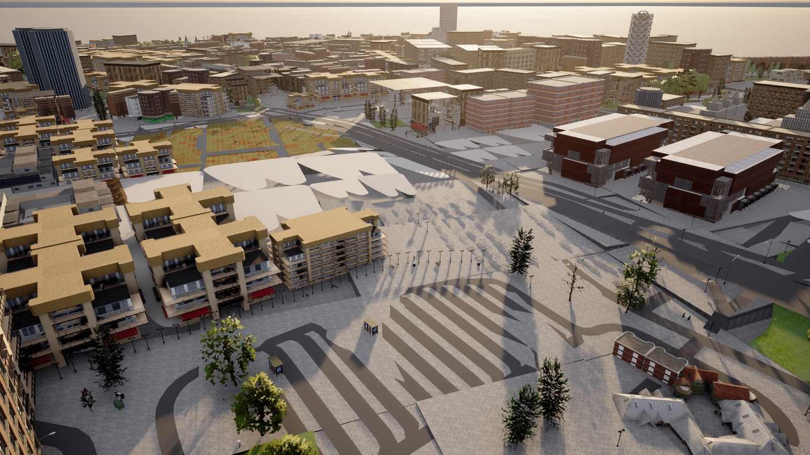 | 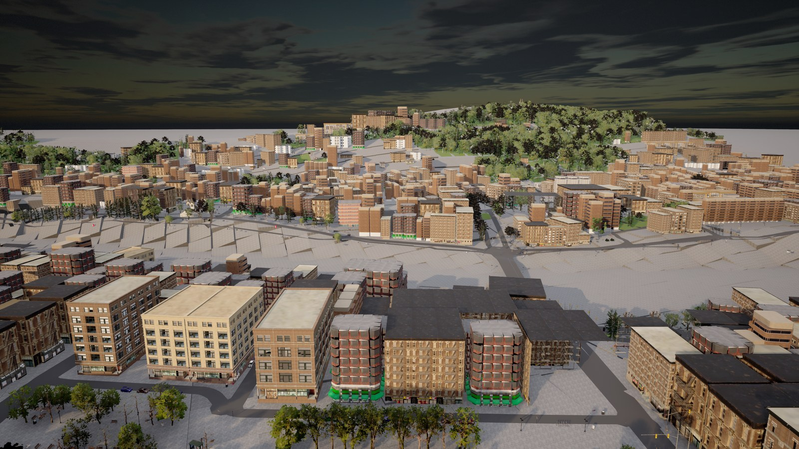 |
| 🇳🇱&nbsp;Eindhoven centre, 13 November 14:30 with that hour's weather: 3DBAG heights, 1,827 OSM street trees, lamps, bus shelters | 🇫🇷&nbsp;Lyon: Place Bellecour, the Saône and the Fourvière hill (135 m of relief), IGN BD TOPO heights |
| 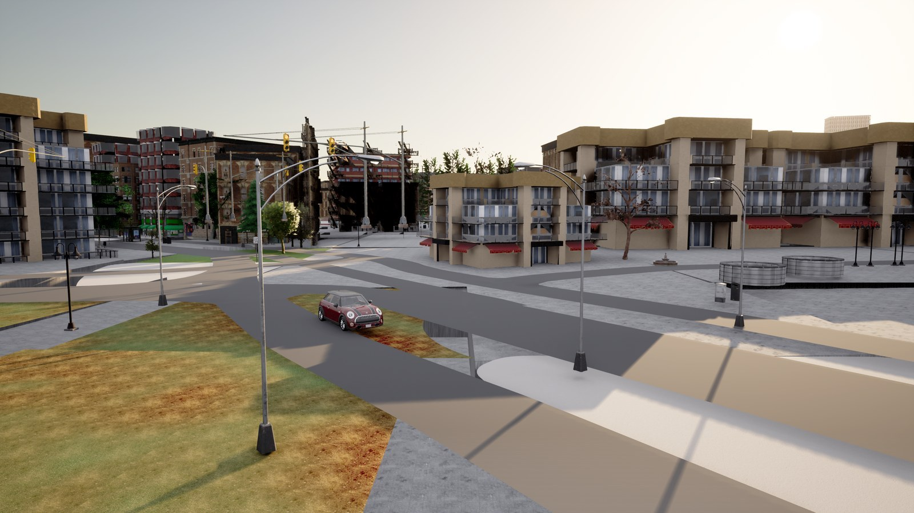 | 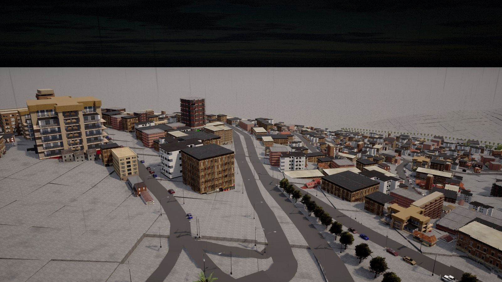 |
| 🇳🇱&nbsp;Eindhoven at street level, sun where it stood at 14:30 | 🇷🇼&nbsp;Kigali: 188 m of relief, Overture (ML) footprints, OSM tree rows |
| 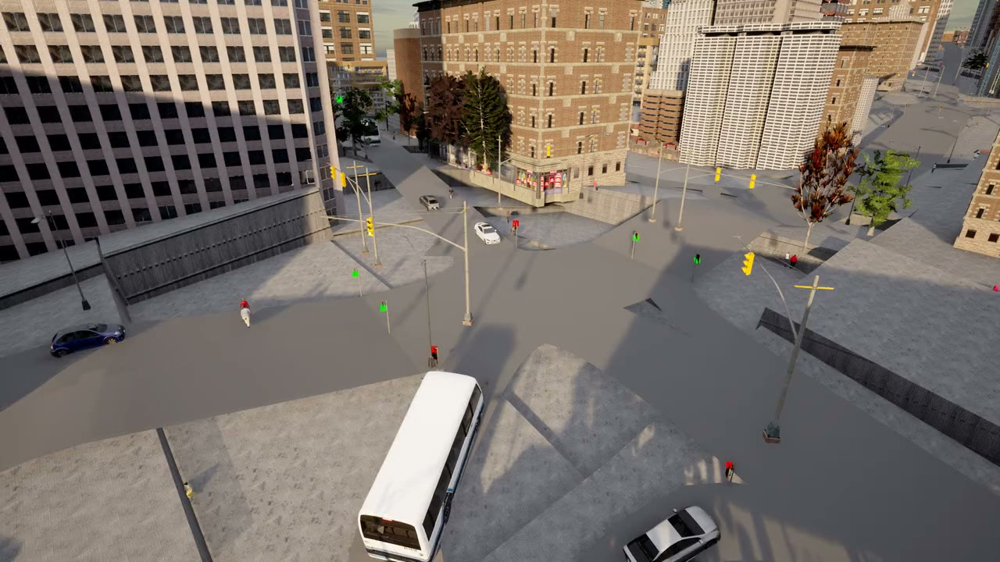 | 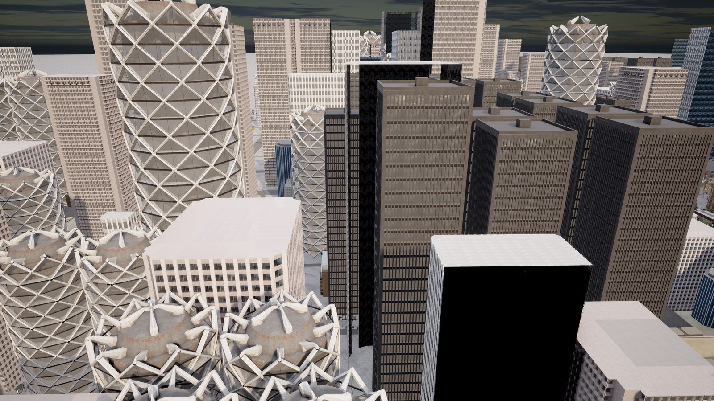 |
| 🇯🇵&nbsp;Tokyo Shibuya: left-hand traffic and Toei buses at the crossing, PLATEAU heights | 🇺🇸&nbsp;New York Midtown with NYC Open Data roof heights |

| What | Source (free, no key) | Used for |
|---|---|---|
| Roads, lanes, speed limits, signals | OpenStreetMap via Overpass | OpenDRIVE and SUMO net (as before) |
| Terrain | [AHN4](https://www.ahn.nl) 0.5 m DTM via PDOK (Netherlands); [AWS Terrain Tiles](https://registry.opendata.aws/terrain-tiles/) (worldwide: SRTM, USGS 3DEP, national lidar) | road heights in the OpenDRIVE and the SUMO net, ground, building and tree bases |
| Building footprints | [Overture Maps](https://overturemaps.org) (OSM, Microsoft and Google ML buildings, Esri), GeoParquet on S3 read with DuckDB | building stand-ins, the trial viewer |
| Building heights | [3DBAG](https://3dbag.nl) (Netherlands, lidar), [IGN BD TOPO](https://geoservices.ign.fr/bdtopo) (France), [NYC Open Data](https://data.cityofnewyork.us) (New York City), [MLIT PLATEAU](https://www.mlit.go.jp/plateau/) (Japan, via Pacific Spatial Solutions' GeoParquet on Source Cooperative); else Overture/OSM heights and floors; else a height by building kind | the height of each stand-in |
| Trees | OSM `natural=tree` with genus, species, leaf type and height; `tree_row`; parks, gardens, woods | a matching CARLA tree (plane, lime, oak, pine, palm, ...) at the mapped size; planting at a density per kind of green |
| Street furniture | OSM lamps, benches, bins, bus shelters, bollards, post boxes, bicycle racks, hydrants, fountains, ad columns, cabinets, flagpoles | the matching prop at the mapped spot, parallel to the road; moved up to 1.5 m to the nearest free spot where the mapped one falls on a lane (Lyon: 268 more pieces) |
| Road signs | OSM `highway=stop/give_way`, `traffic_sign` (NL, DE, FR, US codes; speed limits) | a sign on a post at the edge of the lane it governs, facing its traffic |
| Ground cover | OSM landuse, leisure, natural, water | grass, water or paving tiles |
| Ground cover (NL) | [BGT](https://www.pdok.nl/introductie/-/article/basisregistratie-grootschalige-topografie-bgt-) via PDOK's OGC API (CC0) | what covers the ground beside the roads: grass, bricks or tiles, asphalt or concrete, gravel or sand, water; mixed 40 m tiles split in four |
| Street furniture (NL) | BGT plus objects (IMGeo, from the municipalities) | benches, bicycle racks, bins, waste containers, bollards, cabinets, parking meters, boards, play equipment, and lamps and trees where the city has no register; they replace OSM objects of the same kind within 3-8 m |
| Road signs (NL) | [NDW Verkeersborden](https://docs.ndw.nu/en/data-uitwisseling/interface-beschrijvingen/verkeersborden-api/), the national traffic sign register (CC0); sign faces: the RVV drawings on [Wikimedia Commons](https://commons.wikimedia.org/wiki/Category:Diagrams_of_road_signs_of_the_Netherlands) (public domain / CC0, 13 CC BY-SA 4.0) | every official sign at its position, facing the traffic it governs, plates stacked on posts: CARLA's own stop, give-way and no-entry meshes; on CARLA 1.0 every other sign with its Dutch face on a plate of its shape (248 designs; Eindhoven: 779 of 955 plates), else a blank plate; OSM signs of the same kind within 8 m are dropped |
| Shared bikes and scooters | [GBFS](https://gbfs.org) feeds from [MobilityData's systems catalogue](https://github.com/MobilityData/gbfs/blob/master/systems.csv) (CC BY 3.0), TfL BikePoint, Taipei's YouBike | the bikes at each dock and free-floating bikes, scooters and mopeds where they stand (CARLA's road bike and Vespa meshes); a trial at `time: now` takes a fresh snapshot (9 maps have a system) |
| Tree heights | [Meta/WRI 1 m canopy height map](https://registry.opendata.aws/dataforgood-fb-forests/) (Tolan et al. 2024) | the size of trees without a mapped height (OSM nodes and rows, park planting), corrected against Eindhoven's register |
| City registers | Eindhoven's open data ([bomen](https://data.eindhoven.nl/explore/dataset/bomen/): 127,911 trees with species and height class; [openbare verlichting](https://data.eindhoven.nl/explore/dataset/data-openbare-verlichting/): 58,507 lights with mast, arm, lamp, wattage and lumens); NYC's [2015 Street Tree Census](https://data.cityofnewyork.us/d/uvpi-gqnh) | every public tree and street light where the city lists them (OSM trees within 3 m of one are dropped; register lamps replace OSM and guessed ones; lights on walls, under canopies, on span wires or in the paving get no pole; [night lights](#night-and-rain)) |
| Weather | [Open-Meteo](https://open-meteo.com) forecast and ERA5 archive (back to 1940) | clouds, rain, wet roads, wind and fog of that hour |
| Sun | computed (NOAA solar position) | the sun's altitude and direction for the place and local time; headlights on after dark ([night and rain](#night-and-rain)) |

```yaml
map:
  elevation: true            # real terrain on the roads (default)
  scenery: {buildings: true, trees: true, furniture: true, signs: true, guess_lamps: true, ground: true}
simulation:
  weather: real              # Open-Meteo's weather for the map's place and the time below
  time: "2026-11-13 16:55"   # local time at the place ("HH:MM" today, or "now"); without weather: real only the sun
  scenery: {radius_m: 400}   # scenery cells within this distance of the participants (0: all at once)
```

```bash
python -m coupledcarla.mapbuild experiments/cities/lyon.yaml --force     # roads with terrain, then scenery
python -m coupledcarla.mapbuild experiments/cities/lyon.yaml --scenery   # redo only the scenery (seconds)
```

How it is placed (`coupledcarla/scenery.py`, `coupledcarla/realworld.py`):

- **Terrain.** Every road node of the OSM extract gets its ground height before netconvert (`--osm.elevation`),
  relative to the lowest point of the box, so the OpenDRIVE, the SUMO net and CARLA's road meshes climb and
  fall as the streets do (Kigali: 187 m of relief in the box, Lyon 135 m). Bridges and tunnels keep a straight
  grade between their ends instead of following the river or the hill, and bridges over roads are raised by
  their OSM layer. SUMO vehicles, walkers and the drawn traffic lights all take their height from the road.
- **Buildings.** Each footprint is split into rectangles until they cover it well; each rectangle gets the
  CARLA building whose proportions, height and kind (house, apartment block, commercial, tower, industrial,
  church) fit best (a known roof shape, 3DBAG's or OSM's `roof:shape`, picks pitched or flat-roofed
  kinds; church meshes only where the data says church), turned to the footprint, scaled (0.6 to 1.5) and repeated along long blocks, standing on
  the terrain. Positions, footprints and heights are the real ones; the facades are CARLA's (mostly North
  American towns). Exact geometry and textures are the job of the UE 5.8 digital twin (phase 3).
- **Dutch ground (BGT).** In the Netherlands each ground tile takes the kind of surface that covers most of it
  beside the roads, from the BGT: grass, bricks or tiles (CARLA's sidewalk paving: the 0.9.16 catalogue has no
  brick ground mesh), asphalt or concrete, gravel or sand, water. Tiles with mixed ground are split into four 20 m
  tiles. In central Eindhoven 582 of 2,538 tiles changed kind, and 1,654 pieces of BGT street furniture joined
  OSM's 480, replacing 237 OSM objects. The first build fetches the BGT in about 25 s and caches it in
  `real/bgt.json`; later scenery builds take 4.4 s instead of 3.4 s. `map.scenery.bgt: false` turns it off.
- **Tree sizes.** Where OSM gives no height, a tree takes its size from Meta and WRI's 1 m canopy height map at
  its spot, read from AWS open data (only the needed rows, by HTTP range requests; cached in `real/canopy.npz`).
  The map reads urban trees about 6.5 m low and misses most under 8 m, so its values are corrected with a line
  fitted to Eindhoven's tree register (6 m + 1.1 x canopy, r = 0.34: a rough guide, unproven outside Europe).
  Where it sees no tree, the size stays a guess. `map.scenery.canopy: false` turns it off.
- **Trees nobody maps.** Registers and OSM list public trees; gardens, courtyards and private ground hold many more.
  In central Eindhoven only 44.7 % of the canopy map's cover over 3 m outside buildings had a placed tree within 5 m
  (street-photo comparisons found "missing trees" at 221-307 of 350 spots). The canopy map's crowns (the tallest
  pixel of each 5 m square over 3 m) now get a tree where none stands within 6 m (`map.scenery.canopy_trees`,
  `canopy_tree_gap_m`), sized by the same calibration; over 18 m an oak, beech or ash, under 10 m a small maple or
  sassafras, between the place's usual mix. Eindhoven centre on 0.9.16: 2,511 trees added (6,062 -> 8,573), cover
  44.7 % -> 82.9 %; the twin's scenery with CARLA 1.0's meshes: 2,467 added (5,883 -> 8,350), 43.1 % -> 80.6 %. Cost
  on a headless 0.9.16 trial (90 s, two runs each): 4,510 -> 5,176 meshes within 400 m, 12.1 -> 13.4 ms per tick in
  the bridge's sync, real-time factor 1.47 -> 1.34. In parks without OSM planting (the Dommel valley north of the
  station) the canopy now makes a wood where there was lawn; a tree may stand on a park path (paths are not lanes).
- **Nothing on the lanes.** Every placement is checked against CARLA's map: nothing stands on a lane that is
  driven, ridden, parked or walked; a building that would reach into one is shrunk or dropped.
- **Ground.** 40 m tiles (20 m on maps with more than 40 m of relief), tilted to the terrain and kept under
  the road surface: grass in parks and green landuse, water on rivers and lakes, paving elsewhere.
- **Streaming.** CARLA sends every actor's state to every client on every tick, so the scenery is spawned in
  100 m cells within `radius_m` of the participants and removed behind them, as the SUMO traffic is;
  buildings taller than 40 m stay loaded as the skyline. About 2,000-2,700 meshes are loaded at a time. With
  the spectator parked and the optimised building meshes they cost little: Stellenbosch ran at 0.97 of real
  time with them and 0.99 without ([Performance](#performance)).
- **Weather.** Cloud cover 0 to 100 % maps to CARLA cloudiness 0 to 60 (higher values turn the sky of an
  OpenDRIVE world dark grey to black: sky brightness 66, 18 and 1 of 255 at 60, 80 and 90); rain 1 mm/h to
  precipitation 20; rain over the last three hours to puddles and wet roads; wind 1 km/h to intensity 2;
  visibility under 10 km to fog. CARLA's sun azimuth is the direction the light travels (compass + 90°,
  checked with a pole's shadow). Each trial writes what it applied to `weather.json`.

Built from these sources (the test maps of central Eindhoven, Lyon, Kigali and New York):

| Map | Buildings (heights from) | Trees (OSM street trees) | Lamps (OSM) | Furniture | Signs | Relief |
|---|---|---|---|---|---|---|
| 🇳🇱&nbsp;Eindhoven centre | 3,654 (3DBAG lidar) | 4,091 (1,827) | 1,079 (101) | 480 | 24 | 11 m (AHN) |
| 🇫🇷&nbsp;Lyon (Bellecour) | 2,675 (IGN BD TOPO) | 5,548 (1,268) | 500 | 2,097 | 38 | 135 m |
| 🇷🇼&nbsp;Kigali | 3,027 (Overture, ML footprints) | 1,449 (401) | 1,247 (26) | 4 | 0 | 187 m |
| 🇺🇸&nbsp;New York (Midtown) | 1,406 (NYC Open Data) | 801 (719) | 1,153 (103) | 339 | 2 | 14 m |

Where OSM maps few street lamps, lamps line the roads every 32 m (on by default, `guess_lamps`). The lamp
meshes give no light at night on CARLA 0.9.16, which cannot add lights at run time ([night and rain](#night-and-rain)).

**Seasons.** With `simulation.time` set, deciduous trees follow the date at the place (`coupledcarla/season.py`):
in leaf, in autumn colour (a growing share take CARLA's autumn sugar maple and red Japanese maples) or bare. A bare
tree uses CARLA's leafless meshes (its maples and oaks v6, and 1.0's white ash `_B`) at the tree's own height; for
other families it is the same kind at half size (`simulation.scenery.bare: small`, or `drop`, `keep`). Those
leafless meshes are never used for trees in leaf: before, 22 % of the Eindhoven twin's trees stood bare in summer.
A mapped tree that falls on a lane moves up to 1.5 m to a free spot instead of being dropped, and on a baked level
street trees may stand in parking lanes (the tree pits between the bays). In the Eindhoven twin 2,867 of the
register's 3,071 trees are placed now, up from 2,452. The dates come from latitude: leaf-out on 23 April and leaf fall on 1 November at 50°, later and earlier
towards the poles, half a year apart in the south, none within 25° of the equator (latitude alone misses continental
climates: Burlington leafs out about four weeks early). Evergreen genera and species stay as they are. `leaves:
modis` uses MODIS MCD12Q2 dates (keyless) where they agree with the model; in city centres they mostly measure
lawns. CARLA cannot show snow; Open-Meteo's snow depth is logged.

**Street lamps at night (CARLA 1.0).** A small content pack (`coupledcarla/data/carla_packs`) puts CARLA's
street-light blueprints in the blueprint library (Coupled CARLA adds `-carla-packs=` when it starts the server);
at night the scenery lamps within `lights_radius_m` (200 m) of a participant are spawned as those blueprints and
the server lights them when the sun sets. Headless: 225 lit lamps add 0.2 ms per tick, 781 add 0.7 ms (the cost to
rendering is not measured). CARLA 1.0's OpenDRIVE worlds also bring generic lamps of their own along every road.
The lamps are spawned where they stand: the blueprints' root mesh is Static, so CARLA cannot move them after the
spawn (spawned 100 m up and moved down, they stayed up there with their lights and the street stayed dark). Each
gives 27,000 lm with a 70 m reach (CARLA's light defaults). On the packaged server at the twin, 198 lamps light up
at night, and a lamp lit in front of the camera makes the lower half of the picture 8.8 times brighter.
`tools/lamp_check.py` checks this on a running server: it spawns lamps at night, prints the light manager's view of
each and saves camera frames with the street lights off and on.

**Camera image quality.** Cameras that save frames (`--frames-every`, stations' frames, film cameras,
`tools/scenery_shots.py`) follow `simulation.capture` (`coupledcarla/look.py`): rendered at 2x and downscaled, no
motion blur or lens flare, bloom 0.3, and on CARLA 0.9.x a manual exposure from the sun's altitude and the cloudiness
(EV 11 at a clear noon, 6.2 at night), rendered at 10 Hz so anti-aliasing has history. Measured in Eindhoven: about
twice the sharpness, a grey road instead of a white one, readable dusk. Three headless stations: real-time factor
0.94 → 0.82; set `capture: false` or `supersample: 1` for timing-critical runs. `python tools/look_check.py` measures
camera variants; `python -m coupledcarla.look FRAMES` and the shot tools reject empty worlds (with a
semantic-segmentation camera: too little building, tree, pole or vehicle in view) and dark, blown-out or glaring
frames. On CARLA 0.9.16 the roads generated from OpenDRIVE stay plain grey: their meshes cannot be reached by the
texture API. SUMO's traffic lights show as signal heads on kerb poles (CARLA's own pole and backboard meshes), one
per approach, with the lit lamp in SUMO's colour (`simulation.traffic_lights.style: head`; `marker` for the old
glowing points). On CARLA 1.0 use the `CoupledClean` post-process profile (`coupledcarla/data/postprocess`).

**Placement audit.** `python tools/placement_audit.py <experiment> --port <p> [--radius 300] [--frames 12]` checks
placement on a running server: it spawns the map's scenery, parked stalls and SUMO's signal heads around a point and
flags objects that float or are sunk (box bottom against the ground under it), tilted, duplicated, standing on a lane
or in a junction, inside a building, parked cars in each other, and signs facing away from their traffic; rays down
onto every driving lane find what stands on the road, and it measures how far the ground falls beside the roads.
Output: counts per kind and problem, the worst examples and camera frames in `logs/placement_audit/<map>/`. Within
300 m of the centre it found and the fixes removed, in Eindhoven: 168 of CARLA's own traffic lights hanging at 5 m
(0 left), 45 duplicate signal heads (0), 867 floating objects (20), 35 signs, lamps or poles on a lane or in a
junction (7); New York and Tokyo alike.

#### Street furniture that looks like the place (CARLA 1.0)

With the CoupledCarla content cooked into the server (`/Game/CoupledCarla/Street`, made by `tools/street_props.py`
and `tools/ue_street_props.py`), the scenery uses a country's own props instead of CARLA's generic ones. In the
Netherlands, lamp posts follow the street-light register's mast type and height (Eindhoven: 4 m post-top lamps, 6 m
top-LED masts, 9 and 12 m arms, double arms, cast-iron lanterns). The scenery also places "Model Eindhoven" benches
and bins in the register's colours (places with their own furniture use theirs, `coupledcarla/data/furniture_areas.json`:
the TU/e campus's anthracite post bins), flagpoles where OSM maps them, steel bollards (Amsterdammertjes in
Amsterdam), rows of bike stands by capacity,
shark-teeth give-way lines at NDW B6 signs, red asphalt on BGT cycle paths and cycle lanes, and grey concrete pavers
on BGT open paving. The UK and Japan get their own lamp columns, and the UK cast litter bins. Everywhere there are
cracks, repair patches, potholes (more where OSM tags a bad smoothness), oil spots in parking, autumn leaves under
deciduous trees, and AC units and bulkheads on flat measured roofs of baked twins. OSM give-way and speed signs in
Vienna-convention countries show the Dutch faces (the same design). Options in `map.scenery`: `street_props`,
`shark_teeth`, `red_cycle`, `road_wear`, `leaf_litter`, `roof_clutter` (all on). A server without the content spawns
CARLA's props in their place; CARLA 0.9.16 keeps CARLA's props. At night the regional lamps light as themselves:
`tools/ue_lamp_lights.py` makes a street-light blueprint per lamp (`/Game/CoupledCarla/Street/Lights/BP_CC_<...>`,
CARLA's lit lamp BP_StreetLight06_A with our mesh, its spot light moved to our luminaire, a second one on the double
arm, CARLA's lamp glass on our glass), listed in the content pack as `blueprint.cc_nl_lamparm9` and so on; they light
at the register's colour and lumens like CARLA's lamps ([night and rain](#night-and-rain)). On a -nullrhi server all
eight spawn and register as street lights, on at night. A server without these blueprints gets CARLA's lit lamp in
a regional lamp's place, as before. All meshes are procedural (MIT;
`unreal/StreetProps/SOURCES.md`). Ideas from [BeamNG.Earth](https://github.com/TecnaGamer/BeamNG.Earth) (MIT,
TecnaGamer).


**Street life (CARLA 1.0, the Netherlands first).** Roads the BGT lists as open paving and OSM roads tagged with
bricks or paving stones get red-brown clay clinkers in herringbone (setts for `sett`/`cobblestone`, any country), as
strips across the carriageway at the stones' real size. Gutters get a dirt band, more on shopping streets; litter and
gum stains lie around bins, benches, cafes and stations; puddles stand in the gutters only when the road is wet. Dutch
city bikes (step-through and diamond frames, five colours, 12 % Swapfiets with the blue front tyre) stand in the bike
stands, in rows against facades near shops, cafes and stations, and against lamp posts (at most 4,000 per map). OSM's
advertising columns become Morris columns with posters, and on baked twins each shop and cafe gets a fascia sign with
its trade in Dutch. Options in `map.scenery`: `stone_roads`, `grime`, `parked_bikes`, `shop_signs`. All procedural
(MIT), from OSM and the BGT; nothing from Street View.

## Night and rain

`coupledcarla/nightlights.py` gives the street lamps the light their city lists, drives cars with the lights the Dutch
rules ask for and sends fewer cyclists out in the rain.

**Lamps from the register.** Eindhoven's lighting register lists per light point its mast or bracket, its arm, the
height of the light, the lamp (`SON-T PIA PLUS 150W`, `CorePro LED Urban PLL Mains 13W 830`), its wattage and its
lumens. In the centre (3,129 lights in the map's box) 1,013 are not on a pole of their own: on the walls of the
road tunnels and underpasses (about 350: Kruisstraat, Vestdijk, Boschdijk, Dommel, Elisabeth), in car parks, on facades and
columns, under canopies (the station's), on span wires over shopping streets or set in the paving. Each of them used
to stand as a street lamp on its own pole, rows of them on the streets above the tunnels; now only lamps on masts are
placed (2,343 lamp poles before, 1,816 now). Each placed lamp keeps its colour temperature and flux in `scenery.json` (`lamp_specs`):
the colour from the lamp model's code (LED `830` = 3,000 K, `740` = 4,000 K, `3000K`, `WW`), else from the kind of
lamp (high-pressure sodium 2,000 K, low-pressure sodium 1,800 K, CosmoPolis 2,800 K, ceramic metal halide 3,000 K,
fluorescent and mercury 4,000 K, LED 3,000 K), else the colour word (geel, oranje); the flux from the listed lumens
(median 3,500 lm; 10-90 % 1,800-17,000 lm), else watts times the kind's efficacy, capped at 40,000 lm. In the
centre's lamps: 910 at 3,000 K, 481 sodium at 2,000 K, 347 at 4,000 K, 75 at 2,800 K. OSM lamps with `lamp_type`
(sodium, LED, mercury) and `support` (wall_mounted, suspended, ceiling, ground) are read the same way elsewhere.

On CARLA 1.0 the lit lamps get that colour and flux through the LightManager (`simulation.scenery.lamp_colours`,
`lamp_lumen_scale`, default 1: the real lumens). This needs a fix in CARLA: ue58-dev applies a client's
`set_intensity`/`set_color` to its own record only, not to the light (the lamp blueprints' `UpdateLights` graphs
never reach their light components; only on/off was enforced), so without it every lamp keeps CARLA's 27,000 lm
and warm white. The fix is three lines in `UCarlaLight::SetLightState`:
[`unreal/patches/CarlaLight_SetLightState.patch`](unreal/patches/CarlaLight_SetLightState.patch) (not yet built
into the lin5080 editor or the win5090 package). Lamps under 1,000 lm are sent as 1,000: CARLA reads smaller
street-light values as kilolumens. Why the lamps were dark before: they were spawned 100 m up and moved down, which
a Static root mesh ignores (fixed by spawning them in place, above); CARLA's own fixes in ue58-dev made old
UE4-unit lamps, switched-off light components, light-masking IES profiles and lamp heads that shadowed their own
light render. CARLA 0.9.16 cannot add lights: its lamps stay dark poles, and night there is lit by headlights,
lit shop windows and the sky.

**Vehicle lights** (`simulation.headlights: auto`), after the Dutch traffic rules (RVV 1990): dipped beam at night
and by day when visibility is seriously impaired (art. 32(1)), rear lights whenever the dipped beam is on (art.
32(3)), the rear fog light only in fog or snow under 50 m (art. 34(2)), never for rain. The law gives no number for
seriously impaired; here it is visibility under 1 km (fog) or rain from 2.5 mm/h (the start of moderate rain). Night
is the sun below 3°, as before. This holds for the participants' cars, scripted cars and every SUMO car (before,
SUMO cars at night drove with headlights but dark rear lights: the bridge switched the rear lights only for open
doors). The autopilot driver and scripted cars now light their brake lights while braking (keyboard and wheel did
already; SUMO cars follow SUMO's brake signal). `weather.json` says which lights and why.

**Wet roads and rain.** Rain of the real hour sets CARLA's precipitation (1 mm/h = 20), the rain of the last three hours
its wetness and puddles ([weather](#real-world-scenery-terrain-and-weather) above). CARLA 1.0 also puts rain
on the camera lens and around every camera and makes the roads look wet; 0.9.16 darkens and mirrors wet roads.
Neither CARLA has spray behind vehicles, wipers (no vehicle has a wiper mesh or animation, so the cabin view shows
none; a drawn overlay is not used) or umbrellas (no hand-held umbrella mesh, and walkers cannot hold props through
the API), and its cyclists have no rain gear.

**Fewer cyclists in rain** (`traffic.cycling.weather: auto`). Bike demand (counted or set) is multiplied by the hourly factors of
[Wessel (2020)](https://www.wiwi.uni-muenster.de/ivm/sites/ivm/files/documents/forschung/diskussionspapiere/workingpaper32v2.pdf) from 188 German counting stations: drizzle under 0.5 mm/h 0.85, 0.5-1 mm/h 0.82, 1-2 mm/h
0.77, 2-5 mm/h 0.74, 5 mm/h and more 0.75, times 0.79 when it rained in the three hours before. The rain comes from
Open-Meteo with `weather: real`, else from the preset or the weather's precipitation (MidRainy: 3 mm/h, x 0.74).

`tools/scenery_shots.py --chase NAME:LAT,LON,HEADING --ahead 3 --brake --lights rules|old` renders a car with three
cars ahead in its lane, lit as the rules say or as before (`--scenery-json` spawns another scenery.json, e.g. one
built before a change); `tools/lamp_check.py --scenery MAPDIR` reports the lit lamps and their colour and lumens on
a CARLA 1.0 server.

### Parked cars

Streets have parked cars (`coupledcarla/parking.py`), placed when the scenery is built (`parked.json`) and filled at
the trial's local hour. Where: OSM parking tags (`parking:left/right/both` with orientation, and the older
`parking:lane:*`), BGT "parkeervlak" strips in the Netherlands and OSM street-side parking areas (their depth gives
parallel, diagonal or perpendicular), else a default share of road sides by road class (residential 0.8,
unclassified 0.5, tertiary 0.4, secondary 0.15 in Europe, the Americas and Oceania; none on primary roads, on sides
with two lanes in one direction, or in Japan), and OSM/BGT car parks as rows of stalls. Never within 5 m of a
junction or crossing, 10 m of signals or 12 m of a bus stop, nor beside a bus lane or on a lane. Each stall is taken
when its random number is below its zone's occupancy (residential, centre or mixed, from the buildings within 60 m)
at the local hour, an assumption in the spirit of CROW's presence percentages (`simulation.parked.occupancy`
overrides it). The cars are CARLA's static car meshes (23 in 0.9.16), streamed within 250 m: 300 cost the server
0.8 ms per tick, against 11 ms as vehicle actors. A static mesh keeps its paint, so the register sets the body types
and favours the meshes whose paint is common in it. Eindhoven centre: 5,307 stalls (1,460 at the kerb, 929 of
those from the BGT), 3,180 taken at 03:00 and 3,541 at 14:00 on a weekday; every car off the lanes, RTF 0.991 ->
0.988. CARLA 1.0 has its own measured set (`data/parked_cars.json` "1.0", made by `tools/parked_catalog.py` on a
running server): 23 parked-car meshes, their paint read from each mesh's car-paint material, and the window glass
that 13 of them keep in a second mesh, placed with the car. On a baked level (`map.carla_level`) the level's
OpenDRIVE reaches the real kerbs and has its pavements as sidewalk lanes, so kerb cars stand only in its parking
lanes (the Eindhoven twin has 10.7 km of them), with its crosswalks and traffic signals as no-parking zones.
`python tools/snap_scenery.py <experiment>` stands them on the level's ground with the rest of the scenery and takes
out cars on uneven or obstructed ground; `python tools/parked_check.py <experiment>` checks them on a headless
server. Eindhoven twin: 4,541 stalls (1,275 in parking lanes), none on a driving, cycle or sidewalk lane, bottoms
within 7 mm of the ground for 90% of cars; RTF 1.31 with parked cars and 1.30 without (60 s, headless).

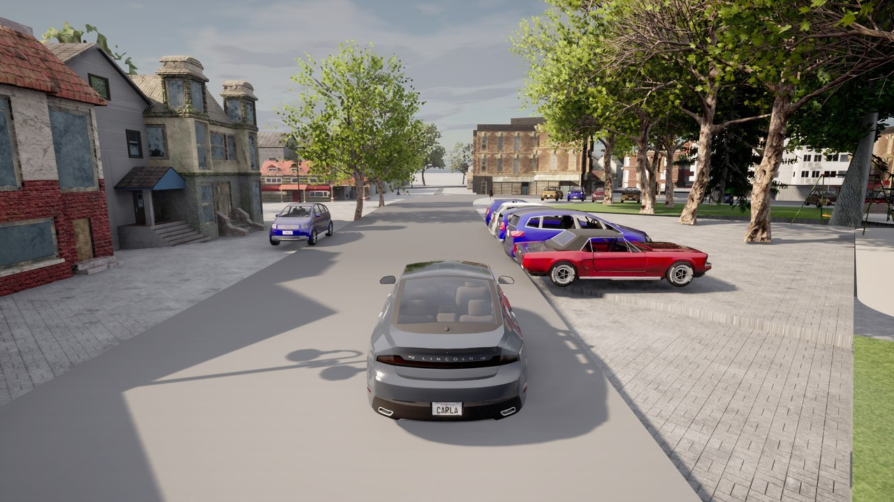

### Scenery on CARLA 1.0 and on baked levels

CARLA 1.0 (Unreal Engine 5.8) renamed and moved most of the meshes the scenery uses (738 of the 969 in the 0.9.16
catalogue), so each CARLA version has its own mesh catalogue (`coupledcarla/data/meshes_0.9.16.json`,
`meshes_1.0.json`, made by `tools/mesh_catalog.py` on a running server), and `coupledcarla/meshes10.py` holds 1.0's
choices: the same trees, lamps, signs and furniture where 1.0 still has them (most under new names, with identical
sizes), plus 1.0's own closed buildings (narrow town houses, new houses and blocks). `map.scenery.catalog: auto`
builds with the catalogue of the CARLA in use; a trial on the other version rebuilds `scenery.json` first (seconds,
from the cached data in `real/`). 0.9.16's scenery is byte for byte what it was. The new UE5 trees are left out
(millions of triangles, 10-170 s each to build on first use).

On a baked level (`map.carla_level`, e.g. the Eindhoven twin) the scenery adds only trees, bushes, lamps, street
furniture and signs (9,578 in the twin), at the terrain model's absolute heights (AHN, base 0).
`python tools/snap_scenery.py <experiment>` then stands them on the level's own ground (needs a server with the
level, or `--export <twin export>/ue` to cast the rays at the export the level was baked from; run it again after
`mapbuild --scenery`). An object with one ground surface under it goes onto it however far the terrain model put it
(Salamanca's is 4-20 m off: 398 objects were left floating or buried); under a bridge or a deck its neighbours'
offset decides. Wear, puddles and leaves that float are put down too (Eindhoven 1,409 bits of litter and stains
0.3-0.8 m over the ground), and a tree under an arcade or an overhang is left out (TU/e 23, Eindhoven 50). `python tools/scenery_check.py <experiment>` checks scenery
heights on a headless (`-nullrhi`) server: meshes the server refuses, and how far each mesh stands from the ground.
Measured headless on lin5080: every mesh within 1 cm of its planned place; RTF 0.69 with and 1.10 without
scenery on `eindhoven_centre` (no real-time sleep), 0.49 / 0.69 on the twin. Still visible in the numbers:
furniture on Eindhoven station's platforms stands at platform height (about 4 m) with no platform under it, and
objects beside lowered ground tiles at sunken roads float.

### Where each object comes from (provenance)

Every placement in `scenery.json` carries a provenance tag and its source (`coupledcarla/provenance.py`), so an
analysis can tell measured scenery from invented detail:

| Tag | Meaning | Examples |
|---|---|---|
| measured | geometry measured by an instrument | 3DBAG, PLATEAU, Catastro, BD TOPO and NYC buildings; AHN terrain; aerial-photo ground |
| register | an object recorded at its own position in a public register or map | the city's tree and lamp registers, NDW signs, BGT surfaces, OSM-mapped trees, lamps, benches and signs, shared bikes |
| inferred | position or form derived by rules from mapped or measured data | OSM or Overture footprints with guessed heights, lamps every 32 m along kerbs, trees from the canopy-height map, tree rows, shop signs |
| generated | invented detail with no evidence at its position | trees and bushes filling parks, parked cars and bikes, road wear, leaves, roof clutter |

Each trial writes `provenance.json` beside its log: counts per tag, kind and source, the share of generated
placements within 50 m of the participants at the start, and for a baked twin its layers (terrain, buildings,
facades, ground photo, roads) with their tags.

### Realism pilot: a score per place

`tools/realism_score.py` scores maps against the real world over a frozen set of places
(`experiments/pilot/realism_pilot.yaml`: five places to tune the rules on and three held out): 80 street-level
views per place against real photos (the street-photo comparison and its realism index,
[docs/street_photos.md](docs/street_photos.md)), and nine 200 m squares rendered straight down against the open
aerial photo of the same square (`coupledcarla/aerial.py`: PDOK in the Netherlands, PNOA in Spain, IGN in France,
Geobasis NRW, GSI in Japan; vegetation cover IoU, colour and DINOv2 similarity). `freeze` draws the views and
squares once, `render` and `score` run a round, `table` puts rounds side by side. A rule change counts as an
improvement only when the tuning places improve and the held-out places do not get worse. Only open data is a
target: Google's 3D tiles and Street View are never used to tune anything.

## Public transport

Buses follow the real lines (`coupledcarla/transit.py`), built with the map:

| Step | Source (free, no key) | What happens |
|---|---|---|
| Lines and stops | OSM route relations (`route=bus/trolleybus/minibus/share_taxi`) via Overpass, clipped to the box | each line's track is laid on the SUMO net (the edge under each track point that runs the line's way; gaps closed by short bus paths); its stop positions, else platforms, become SUMO bus stops |
| Bus-only roads and lanes | OSM `highway=busway`, bus lanes | kept in the map; their OpenDRIVE lanes (`restricted`) are open to buses, taxis and emergency vehicles in SUMO |
| Frequencies | the city's GTFS feed, found in the [Mobility Database](https://mobilitydatabase.org) catalogue by the box (the Dutch national OVapi feed for the Netherlands) | trips of each line entering the box, per hour, for a weekday, a Saturday and a Sunday |

In a trial each line runs at its timetable's frequency for the local hour of `simulation.time` (08:00 on a
weekday when unset), at the OSM `interval` tag where there is no timetable, else every
`default_headway_min`; a line the timetable does not run at that hour has no buses. Buses are already spread
along their line at t = 0 and stop `dwell_s` at each stop; SUMO's `sumo_stops.xml` logs every stop. On maps
without OSM bus lines the old random bus trips run instead. At 08:00 on a weekday a two-minute Eindhoven trial has
106 of its 107 line sections running and 33 buses; a one-minute Taipei trial (150 line numbers, no free
timetable, so every 10 min each) has 186.

| Map | Lines (numbers) | Stops | Timetable |
|---|---|---|---|
| Eindhoven | 51 | 19 | OVapi (NL): 45 lines |
| Lyon | 21 | 40 | SYTRAL Mobilités: 20 |
| Leuven | 26 | 17 | De Lijn: 26 |
| New York | 67 | 34 | MTA (five borough feeds): 54 |
| São Paulo | 64 | 47 | SPTrans: 56 |
| Sydney | 32 | 8 | Transport for NSW: 31 |
| Auckland | 31 | 31 | Auckland Transport: 29 |
| Portland | 27 | 74 | TriMet: 25 |
| Tokyo | 31 | 24 | Toei Bus: 10 (the rest are private operators) |
| London, Taipei, Kigali, Montevideo, ... | | | none free (TfL publishes no GTFS); OSM interval or default |

```yaml
map:
  transit: true                       # build the bus lines with the map (default)
traffic:
  public_transport: {enabled: true, dwell_s: 20, default_headway_min: 10, live: auto}   # live: auto = at time "now"
  fleet: auto                         # body types and colours from the vehicle register where there is one
simulation:
  time: "2026-11-16 17:30"            # the timetable of that day type and hour
```

```bash
python -m coupledcarla.mapbuild experiments/cities/lyon.yaml --transit   # redo only the bus lines (seconds)
```

**Live buses.** With `simulation.time: now` (or `public_transport.live: true`), the lines whose agency publishes
GTFS-Realtime vehicle positions without a key (the Mobility Database lists 1,606 such feeds; OVapi covers all of
the Netherlands) start with their buses where the real ones are at that moment: on their line when within 40 m of
it, else from the nearest bus road (a bus waiting at the station) along the shortest way onto it. The snapshot is
saved as `sumo/pt_live.json`. Timetabled departures follow. "now" is the local time at the place (its UTC offset
from Open-Meteo), so a trial of Auckland run in Eindhoven gets Auckland's hour. On a Saturday at 13:16 the
Eindhoven box had 11 live buses, 9 of them placed (the other two off the matched lines); Leuven, Auckland and
Sydney publish real-time feeds only with a key.

Trams and trains are left out (CARLA has no tram and the maps have no rails); a line that leaves and
re-enters the box runs as separate sections; GTFS frequencies are per line and hour, averaged over its
directions.

## Standard CARLA maps

Coupled CARLA also drives CARLA's own towns, which many CARLA users know: Town01-Town07 and Town10HD with their
`_Opt` (layered) variants on CARLA 0.9.16, and the `_Opt` towns on CARLA 1.0 (which also ships Mine_01). One line
picks a town:

```yaml
map:
  carla_town: Town10HD_Opt
```

The run loads the town's level and builds SUMO's net from the town's own OpenDRIVE, cached in `maps/<town>/` (from
`CARLA_ROOT`, or, as a CARLA 1.0 package keeps its OpenDRIVE inside the pak, from the server's
`get_map().to_opendrive()`; a server is started once for it when none runs). Everything else works as on a real place;
what each feature means in a town ([`coupledcarla/towns.py`](coupledcarla/towns.py) sets the defaults, and anything
the experiment sets itself wins):

| Feature | In a town | |
|---|---|---|
| SUMO traffic | cars, cyclists and buses on the town's lanes; cars per hour by town (Town01 500 ... Town04 2,400), few cyclists (the towns are North American); random buses (the towns have no bus lines or stops) | works |
| Traffic lights | the town's own CARLA traffic-light actors show SUMO's signal states, synced by OpenDRIVE id as in CARLA's SUMO co-simulation; no lights guessed, none drawn | works |
| Parked cars | Coupled CARLA's parked cars in the OpenDRIVE's parking lanes (Town03, Town05) and on 2-3 m kerb shoulders of town streets (Town03, Town04's lakeside road, Town05, Town10HD), clear of crosswalks, signals and junctions; the `_Opt` towns' own parked cars (ParkedVehicles layer) where Coupled CARLA places none (`simulation.parked.town_layer`) | adapted |
| Crowd and AI walkers | the calibrated crowd on the kerbs (`city.country: USA` by default), plus `traffic.walkers.ai`: CARLA's AI walkers (WalkerAIController) on the town's navigation mesh, crossing at the crosswalks; SUMO and scripted cars yield to both | works |
| Participants and stations | driver, pedestrian, AV passenger and drone pilot, host-local or at stations; points as `{lat, lon}` or the town's CARLA coordinates, `{x, y}` dicts and `route_xy` / `path_xy` / `at_xy` lists | works |
| eHMIs and scripted AVs | as anywhere; [`town03_crossing.yaml`](experiments/towns/town03_crossing.yaml) puts the crossing at a town crosswalk | works |
| Weather and sun | presets; real weather (`weather: real`) and the sun of `map.place` at `simulation.time` (default: the towns' geoReference, 0° N 0° E in the Gulf of Guinea, where the sun sets at about 18:00 all year) | adapted |
| Night | the town's own street and building lights (CARLA's LightManager), on after dark (`simulation.town_lights`) | works |
| Sound | building occlusion and facade reflections from the town's buildings (the level's environment objects' boxes, `buildings.json`, written on the first trial) | adapted |
| Drones | roofs from the same `buildings.json`, tree tops from the vegetation boxes (`trees.json`) | adapted |
| Film cameras, videos, logging, analysis, viewer | as anywhere | works |
| Real-world scenery and data | off: the town has its own buildings, trees, furniture, signs and ground, and no real place for OSM, terrain, bus lines, counts, register fleets, cycle routes or urban speed limits | off |

```bash
python -m coupledcarla.run experiments/towns/town10_driver.yaml               # Town10HD at rush hour, keyboard
python -m coupledcarla.run experiments/towns/town03_crossing.yaml --local --headless
python -m coupledcarla.towns list                                             # the towns
python -m coupledcarla.towns latlon Town03_Opt 150.5 -13.3                    # CARLA x, y -> lat, lon
python -m coupledcarla.towns crosswalks Town10HD_Opt                          # crosswalks, for scenarios
python tools/test_towns.py --duration 40 > docs/town_tests.md                 # the smoke test
```

Examples in [`experiments/towns/`](experiments/towns): `town10_driver.yaml` (a driver in Town10HD's rush hour with
traffic, parked cars, a crowd and AI walkers), `town03_crossing.yaml` (a pedestrian and an AV with an eHMI at a
Town03 crosswalk, two stations), `town10_coupled.yaml` (four stations: pedestrian, AV passenger, driver, drone
pilot), `town05_drones.yaml` (a pilot, deliveries, a swarm and a patrol over Town05's roofs), `town01_night_rain.yaml`
(Town01 at night in heavy rain with its street lights).

**Smoke test** (2026-11-15, lin4080, CARLA 0.9.16 at Epic, 50 Hz; 40 s headless autopilot trial per town with SUMO
traffic, the town's lights run by SUMO, parked cars, a crowd of 20 and 20 CARLA AI walkers; full notes in
[`docs/town_tests.md`](docs/town_tests.md)):

| Town | Lane links | Traffic lights run by SUMO | Parking stalls | Parked cars shown | Buildings (sound, drones) | SUMO vehicles shown | Real-time factor | Collisions | Result |
|---|---|---|---|---|---|---|---|---|---|
| Town01_Opt | 160 | 36 of 36 | 0 (the level's own) | 0 | 373 | 7 | 0.908 | 0 | ok |
| Town02_Opt | 112 | 24 of 24 | 0 (the level's own) | 0 | 445 | 7 | 0.905 | 0 | ok |
| Town03_Opt | 503 | 38 of 38 | 335 | 163 | 726 | 19 | 0.985 | 0 | ok |
| Town04_Opt | 559 | 43 of 43 | 77 | 0 | 118 | 19 | 0.982 | 0 | ok |
| Town05_Opt | 604 | 54 of 54 | 107 | 48 | 719 | 17 | 0.975 | 0 | ok |
| Town10HD_Opt | 200 | 15 of 15 | 120 | 61 | 324 | 14 | 0.993 | 0 | ok |

Every town drove its 40 s (the SUMO-driven autopilot) with no collision, no car leaving the road and no recovery, all
20 AI walkers walking; earlier runs with CARLA's BasicAgent gave the same counts.
Town06 and Town07 come with CARLA's AdditionalMaps package, which the test machine does not have: their maps build
and their SUMO traffic runs (167 and 35 vehicles in 300 s SUMO-only runs), and the run says which levels a server
has. CARLA 1.0 is not tested yet: its towns' OpenDRIVE comes from the server, as the package keeps it in the pak.

**Videos of the towns** (made like the [Videos](#videos) above by `tools/make_videos.py` from the `town*` clips of
[`experiments/videos/clips.yaml`](experiments/videos/clips.yaml), on CARLA 0.9.16 at Epic; click a picture to play or
download):

<table>
<tr>
<td width="50%" valign="top"><a href="https://github.com/bazilinskyy/coupled-carla/releases/download/demo-videos/town10_rush_hour.mp4">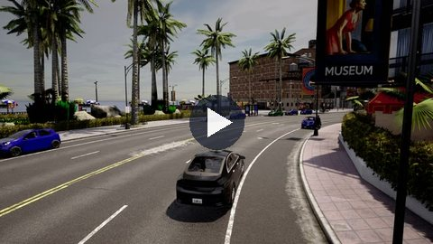</a><br><b>Downtown traffic in Town10</b><br><sub>Town10HD (CARLA's downtown) · driver (autopilot), chase camera · 20 s, 3.8 MB<br>SUMO traffic in a CARLA town, stopping at the town's own traffic lights; parked cars at the kerbs</sub></td>
<td width="50%" valign="top"><a href="https://github.com/bazilinskyy/coupled-carla/releases/download/demo-videos/town03_pedestrian_ehmi.mp4">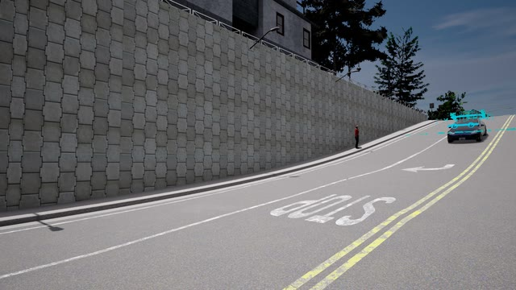</a><br><b>Crossing in front of an automated car in Town03</b><br><sub>Town03, a crosswalk among houses · pedestrian · 15 s, 2.0 MB<br>the AV comes down the hill, shows I'M STOPPING and stops at the crosswalk, then GO AHEAD</sub></td>
</tr>
<tr>
<td width="50%" valign="top"><a href="https://github.com/bazilinskyy/coupled-carla/releases/download/demo-videos/town10_four_views.mp4">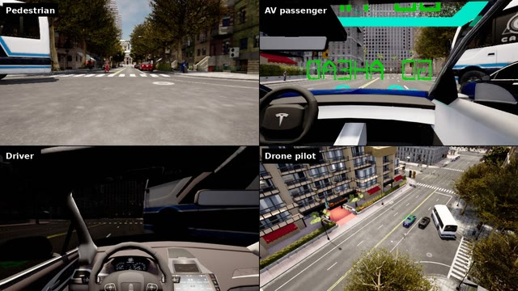</a><br><b>Four people in Town10</b><br><sub>Town10HD, the avenue · pedestrian, AV passenger, driver, drone pilot (four bot stations) · 20 s, 2.9 MB<br>the same moment from four stations in a CARLA town, frame-locked in simulation time</sub></td>
<td width="50%" valign="top"><a href="https://github.com/bazilinskyy/coupled-carla/releases/download/demo-videos/town05_drones.mp4">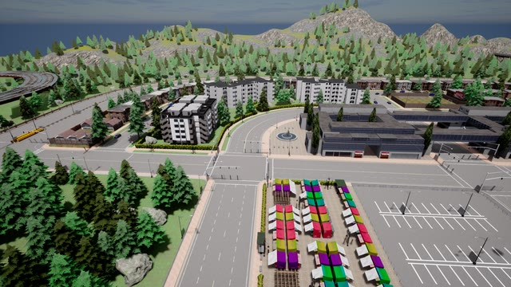</a><br><b>Drones over Town05</b><br><sub>Town05 (CARLA's grid town) · drone pilot (FPV) · 20 s, 3.9 MB<br>the pilot's gimbal camera climbing from a junction over the grid's roofs (coupled-sim's flight model)</sub></td>
</tr>
<tr>
<td width="50%" valign="top"><a href="https://github.com/bazilinskyy/coupled-carla/releases/download/demo-videos/town01_night_rain.mp4">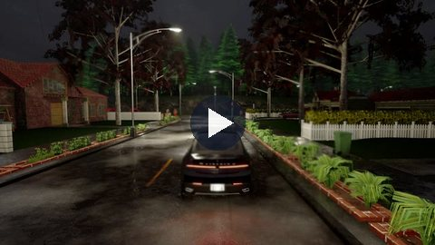</a><br><b>Rainy night in Town01</b><br><sub>Town01 (CARLA's river town) · driver, chase camera · 20 s, 5.6 MB<br>night with the town's own street lights on (LightManager), wet roads, headlights</sub></td>
</tr>
</table>

In the four-view clip the driver's view inside the car is dark (the avenue lies in the towers' shade), and the AV
passenger sees the eHMI mirrored through the windshield, as on every map ([Known limits](#known-limits)).

## Experiment files

An experiment is one YAML file; anything left out takes the default from
[`coupledcarla/config.py`](coupledcarla/config.py).

```yaml
name: eindhoven_centre
map:
  bbox: [51.4360, 5.4700, 51.4500, 5.4930]   # south, west, north, east
  # road_types: [motorway, ..., residential, living_street]
  # cycleways: true        # keep highway=cycleway (SUMO cyclists ride them)
  # trim_dead_ends: true   # prune dead ends, keep the largest strongly connected road graph
  # lefthand: false        # left-hand traffic
  # carla: {wall_height: 0.0, ground: true, ...}   # OpenDRIVE mesh options, ground plane
  # elevation: true, scenery: {...}, overture: true, national_buildings: true   # real-world data
server:
  quality: Epic            # Epic | Low
  # host: 127.0.0.1, port: 2000, tm_port: 8100, launch: true, offscreen: true
simulation:
  step: 0.02               # 50 Hz, like coupled-sim's fixed-time log
  weather: CloudyNoon      # a carla.WeatherParameters preset, a dict of its fields, or real (Open-Meteo)
  # time: "2026-11-13 08:30" (the sun at that local time), sun_altitude: 4, real_time: true,
  # tls_manager: sumo, lod_radius_m: 250, scenery: {radius_m: 400}
traffic:
  cars_per_hour: 2400
  bikes_per_hour: 1200
  buses_per_hour: 12
  # car_following: EIDM, car_types: {blueprint: weight}, bike_types: {...}, bus_type: ..., seed: 42
participants:
  - role: driver
    vehicle: vehicle.lincoln.mkz_2020
    input: keyboard        # keyboard | wheel | autopilot
    view: driver           # driver | chase | hood
    spawn: {lat: 51.44453, lon: 5.47883}   # optional; also heading (compass degrees); else a random lane
pois:
  - {name: eindhoven_centraal, lat: 51.4433, lon: 5.4797, heading: 0, radius_m: 10}   # heading, radius: optional
logging:
  radius_m: 150            # AI actors within this distance of a participant are logged every frame
  # udp: {host: 127.0.0.1, port: 40131, interval: 0.2}, carla_recorder: true, frames_every_s: 0
trials:                    # run in order; each may override simulation, traffic, participants, logging
  - {duration_s: 300}
  - {duration_s: 300, simulation: {weather: WetCloudySunset, sun_altitude: 4}, traffic: {cars_per_hour: 3600}}
```

Every trial writes its merged configuration to `config.yaml` next to its logs, so a trial can always be traced
back to the exact settings it ran with.

## Participants, inputs and views

| Input | What it does |
|---|---|
| `keyboard` | W/S or arrows to drive, A/D to steer (rate-limited), Q reverse, Space hand brake, Z/X blinkers, R puts the car back on the nearest lane, Esc ends the trial. |
| `wheel` | Logitech G25 (or a similar wheel) via [`steering_wheel.py`](coupledcarla/inputs/steering_wheel.py): steering with a 7:1 ratio, pedals, shifter, and force feedback modelled on a real car (aligning torque from tyre slip, speed-dependent power steering, road rumble, collision jolts). The keyboard keys above still work. |
| `autopilot` | SUMO drives the car (`simulation.autopilot: sumo`, the default; `sumodriver.py`) with the traffic's rules, along `route: [[lat, lon], ...]` or to `destination: {lat, lon}`, else to random destinations; the bridge moves the CARLA car. `autopilot: carla` keeps CARLA's BasicAgent on random lanes (take-over bots always use it). |

Views: `driver` (left-hand-drive seat, eye height), `hood`, `chase`. With a window (keyboard, wheel) the view is
shown in a pygame window with a HUD (speed, time, next light).

Spawning: a `spawn: {lat, lon}` snaps to the nearest driving lane (1.5 m off for the Eindhoven example);
without it a random driving lane outside junctions is used. A car that leaves the road (falls onto the ground
plane) is logged (`left_road`) and, for the autopilot, put back on the nearest lane (`reset_to_lane`).

**VR.** `view: vr` (or `--display vr` at the station) shows a station's view in a headset through OpenXR
(`pip install -e ".[vr]"`; `python -m coupledcarla.vrxr` checks the headset). The station renders two cameras at the
participant's eyes, 63 mm apart (`vr.ipd_mm`), moved every tick from the head pose on the seat's eye point and
predicted ahead by the measured latency; in-car displays are drawn in each eye, the station's text on a panel 1.5 m
ahead, and head pose and motion-to-photon are logged per frame. CARLA renders each eye as a camera, so expect about
45 Hz images that the runtime reprojects to the headset's rate (on CARLA 0.9.16 two 960x1056 eyes cost 13 ms of
server time; pose to images 30-70 ms). Tested with a simulated headset (Monado); a real headset is still to be
tried. Install per headset and numbers: [lab guide, VR stations](docs/lab_guide.md#vr-stations).

## Coupled experiments (phase 2)

Several humans and AI participants share one world, as in coupled-sim. The **host**
(`python -m coupledcarla.run`) owns the CARLA world, SUMO, the AI agents and the log; each human sits at a
**station** (`python -m coupledcarla.station`) on any machine of the LAN.

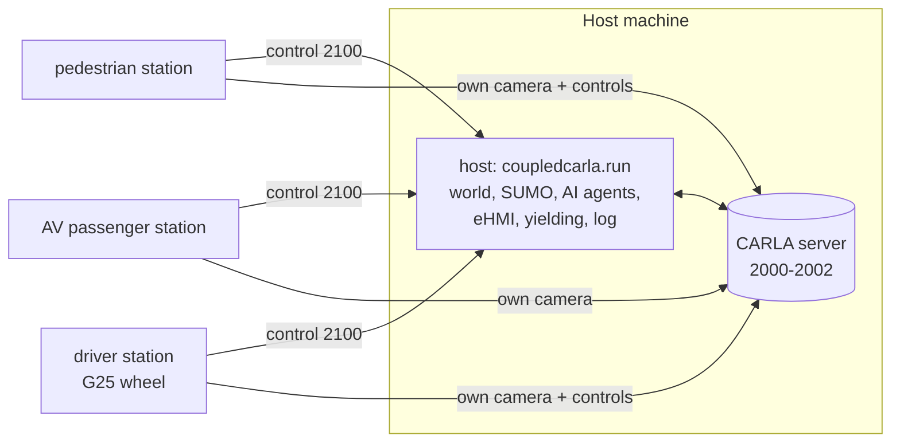

- **Stations** connect twice: to the CARLA server, to render their own camera and apply their own controls
  directly (no detour through the host), and to the host's **control channel** (TCP, JSON lines, port 2100) for
  everything else: their role and actor, trial start and end, visual-sync flashes, eHMI commands, round trips.
  The host waits for every `station: true` participant before a trial starts; stations stay connected across
  the trial sequence (each trial runs in a fresh child process, see [Lessons learned](#lessons-learned-gotchas)).
- **Roles** (`participants[].kind`): `driver` (a manual car: keyboard or G25 wheel, R puts the car back on its
  lane), `pedestrian` (a walker: W/S/A/D, mouse or arrows to look, Shift to run; camera at eye height) and
  `av_passenger` (rides in a scripted AV, front passenger seat; keys 1-9 choose the eHMI message, 0 switches it
  off). Every station has F for a visual sync and Esc to leave.
- **AI participants** (`agents`, [`coupledcarla/ai.py`](coupledcarla/ai.py)):
  - `kind: car`: follows a route through lat/lon points, planned on the lanes, at a speed profile set by
    **triggers** along the route, after coupled-sim's SpeedSettings: `{at: [lat, lon] | at_m: metres,
    speed_kmh, accel, yield_s, blinker: left|right|hazard, ehmi: state}`. It stops for SUMO red lights and, with
    `yield_to_pedestrians`, for pedestrians (human or AI) in its path, braking to rest ~4 m short and holding
    until the path has been clear for 0.8 s. Its eHMI is `manual` (set by an AV-passenger station or by
    triggers), `auto` ("I'M STOPPING" while it yields, "DRIVING" otherwise) or `off`.
  - `kind: walker`: walks a path of lat/lon points (`speed`, `start_s`, `loop`) with direct walker control,
    so it needs no CARLA navigation mesh.
- **eHMI** states and colours are configurable (`ehmi.states`), and so is where a car shows them
  (`ehmi.slots` for every car, `agents[].ehmi_slots` per car; coupled-sim had top and hood slots):

  | Slot | What | Read by |
  |---|---|---|
  | `front` (default) | light bar across the front, the text above it | someone in front of the car |
  | `rear` | the same on the back | a cyclist or driver behind |
  | `roof` | a light ring round the roof, the text on all four sides | anyone around the car |
  | `road` | the text projected on the road 3 m ahead | a pedestrian about to cross |
  | `eyes` | two eyes on the front whose pupils follow the nearest pedestrian (within 40 m), in the state's colour | eye contact with the AV ("eyes on a car") |

  CARLA renders debug *text* only in the spectator view, so the text is drawn with debug *lines* in a small
  line font, which every camera sees. The Eindhoven crossing's AV uses `[front, roof, road, eyes]`.
- **Eye contact** (`eye_contact: {angle_deg: 20, distance_m: 30}`): the host logs `eye_contact_start` and
  `eye_contact_end` whenever a pedestrian and a vehicle face each other within the angle and distance, with
  both angles. A pedestrian station sends where its camera looks; a vehicle faces along its heading (no head
  tracking yet, so for a driver this is "the car points at the pedestrian").
- **Pedestrian crowd** (`traffic.walkers`, `coupledcarla/crowdpeds.py`, [`experiments/eindhoven_crowd.yaml`](experiments/eindhoven_crowd.yaml)):
  pedestrians near the participants who behave like the real pedestrians of the map's country, calibrated with
  [CROWD](https://github.com/crowd-dataset/crowd) (dashcam videos from 238 countries with automatic pedestrian
  tracks). `count: auto` gives `walkers_per_km` (8) per km of kerb, scaled by CROWD's pedestrians per minute of the
  city (else country, continent, world: 18.1) and its night/day ratio. Speeds are the place's median crossing speed
  and quartiles (crowd-city). Walkers cross `crossings_per_km` (2.0) times per km, scaled by the share of tracked
  pedestrians that crossed; a crossing is mid-block with the country's measured share (crowd-jaywalking: Japan
  0.45%, France 1.5%, Netherlands 7.1%, Vietnam 30%, Bangladesh 77%; modelled from pedestrians per minute
  elsewhere, a weak fit), else at the nearest OSM crossing, else at the junction. At the kerb a walker waits for the
  HCM critical gap (width / speed + 2 s, shrinking to 60% after a minute); at a marked crossing it also steps out
  when every approaching car can still stop. On the road, SUMO traffic and scripted cars yield to them
  (`crowd_crosses` events). Walkers start where Overture places, bus stops and open pedestrian counts (NYC DOT,
  City of Sydney) are dense. `behaviour: off` keeps the old crowd that never crosses. Not CARLA's walker AI:
  CARLA 0.9.16 serves no navigation mesh for an OpenDRIVE world. `python tools/crowdpeds_check.py <experiment>
  [--sumo]` shows a map's plan:

  | Map | Walkers | Speed (m/s) | Crossings/km | Mid-block share |
  |---|---|---|---|---|
  | Eindhoven | 41 | 1.35 | 2.2 | 7.1% (measured) |
  | New York (Midtown) | 67 | 1.29 | 4.3 | 0.6% (modelled) |
  | Cairo (Tahrir) | 76 | 1.36 | 1.2 | 4.7% (modelled) |
  | Tokyo (Shibuya) | 80 | 1.30 | 6.1 | 0.45% (measured) |
  | Sydney (CBD) | 28 | 1.40 | 1.6 | 0.5% (modelled) |

- **SUMO traffic yields to pedestrians**: SUMO vehicles near a pedestrian brake for one in their path and drive
  on when it is clear (`sumo_yields` events). SUMO itself only yields to persons on crossings, and CARLA
  pedestrians are not in SUMO.
- **Visual sync**: `coupling.visual_sync_at_s` (or F at any station) shows a red bar on every station for 1 s
  and logs `visual_sync` with the frame, to align screen recordings, eye trackers or physiology afterwards.
- **Latency**: the host sends every tick's frame number and wall time to the stations; each station estimates
  the clock offset to the host from its pings (the shortest round trip, as NTP does) and measures, on the
  host's clock, when it saw that frame's world snapshot (`tick_to_station_ms`) and when that frame's camera
  image arrived (`tick_to_image_ms`). Per frame in the station CSV, as median and 95th percentile in the
  `station_stats` events and in `summary.json`. Display lag (monitor, VR headset) comes on top; a photodiode
  on the visual-sync bar measures it.
- **Logging**: agents get rows every frame (`kind = agent`, with an `ehmi` column), and the events include
  `station_joined`, `station_left`, `station_stats` (round trip to the host and rendered fps, every 5 s),
  `ehmi` (with who set it), `trigger`, `agent_stops` / `agent_goes` (with the reason), `sumo_yields`,
  `visual_sync`, and `collision` for every participant and agent. Each station also writes
  `logs/stations/<role>_<time>.csv`: one row per rendered frame with wall-clock time, CARLA frame, simulation
  time, round trip, visual-sync flag, speed and eHMI.

### Running the Eindhoven crossing

[`experiments/eindhoven_crossing.yaml`](experiments/eindhoven_crossing.yaml): a straight two-way street east of
the station (OSM way 7157413, 392 m, no lights). The AV starts 130 m before the crossing at 30 km/h; the
pedestrian waits at the north kerb; the driver starts 38 m behind the AV; an oncoming AI car with an automatic
eHMI, two AI walkers and SUMO traffic fill the street; two trials (day, dusk).

```bash
# host (the machine with the GPU)
.venv/bin/python -m coupledcarla.run experiments/eindhoven_crossing.yaml
# one station per human, on any machine of the LAN (needs only the carla client, pygame, numpy)
.venv/bin/python -m coupledcarla.station --host <host ip> --role pedestrian
.venv/bin/python -m coupledcarla.station --host <host ip> --role av_passenger
.venv/bin/python -m coupledcarla.station --host <host ip> --role driver --input wheel
```

**A station on the Windows PC that runs the server: run it on Windows itself, not in WSL.** The camera images come
from the server raw; WSL's network bridge carries about 140 MB/s, which is 17-18 fps at 1920x1080 and 38 fps at
1280x720, while a client on Windows itself got 69 fps at 1920x1080 and 77 fps at 1280x720 from the same server (CARLA
1.0 package, Epic, RTX 5090, 2026-11-20, `tools/camera_stream_test.py`). The station shows each frame straight from
the camera's buffer (no copy per frame). Setup once (everything under `C:\cc58`, nothing system-wide: a Python 3.10
for the package's cp310 wheel, a venv with it, pygame, numpy, pyyaml, requests, pillow; needs uv), then run:

```bat
tools\station_win_setup.cmd
tools\station_win.cmd --role driver --input wheel --size 1920x1080 --fullscreen
```

The host (`python -m coupledcarla.run ...`) may stay in WSL on the same PC: with mirrored networking both reach
127.0.0.1. Keys (`secret`, or `%USERPROFILE%\.config\coupled-carla`) and `COUPLED_CARLA_MUTE` work the same.

`--input bot` runs a station without a human (the experiment's `bot` entry: the pedestrian's path and gaze
target, the passenger's eHMI schedule, the driver on autopilot), with `--headless --frames-every 0.5` to save
its view; `run ... --local` runs every station role as a bot on the host, for a quick test without stations.

**Test run** (13 Nov 2026): host and CARLA on lin4080 (RTX 4080 SUPER, shared with another job); driver and AV
passenger stations on lin4080; the pedestrian station on a different PC (wsl5090, wired LAN), all as bots;
both trials:

| | |
|---|---|
| Stations | all three joined in ~3 s, rejoined for trial 2, left cleanly at the end |
| Round trip to the host | 0.3-20 ms (local stations), 12-23 ms (other PC) |
| Station frame rate | ~35 fps each (the host's tick rate) |
| Real-time factor | 0.69-0.70 (host plus three cameras at 50 Hz on the shared GPU) |
| AV | stopped for the pedestrian at 14.9 s, drove on at 19.5 s; eHMI yielding 13.0 s, go 16.0 s, driving 21.0 s (passenger station) |
| Oncoming AI car | stopped for AI walker 1 at 9.1 s, drove on at 11.8 s; its automatic eHMI followed |
| Collisions | 0 in both trials |
| Latency (rerun with the latency log, all stations local) | tick to station snapshot 0.1 ms; tick to camera image 106-197 ms median (CARLA renders and reads back a camera 4-6 frames after its tick) |
| Eye contact | pedestrian and AV from 29.5 m to 13.5 m; pedestrian and driver from 29.6 m to 20.3 m |

**Network**: stations need the host's ports 2000-2002 (CARLA) and 2100 (control) on a wired LAN. A station on
Wi-Fi (lin5080) could talk to the host but received no camera frames: its path dropped packets above ~1,350
bytes without telling the sender (a path-MTU black hole), so CARLA's image stream stalled. A remote station
receives its camera as raw images over the network (960x540 at 35 fps is about 70 MB/s), so gigabit Ethernet
carries about one full-HD remote station; CARLA's multi-GPU secondary servers, rendering on the station's own
GPU, are the next step for more.

## Phase 3: CARLA 1.0 and the Eindhoven digital twin

Phase 3 brings real looks: CARLA 1.0 on Unreal Engine 5.8 (Lumen, World Partition, the Digital Twin baker)
and Eindhoven built from Dutch national open data instead of OSM alone.

### Running on CARLA 1.0

Coupled CARLA takes the same experiment files on CARLA 0.9.16 and CARLA 1.0. CARLA 1.0 renamed or dropped
most vehicle blueprints; [`compat.py`](coupledcarla/compat.py) maps every 0.9 name used here to the closest 1.0
blueprint (by body type and size, then by `base_type`, then by wheel count) and logs each substitution once.
The SUMO conversion script that CARLA 1.0 no longer ships is vendored in `bridge/util/`. Set up a second
environment next to the 0.9.16 one:

```bash
# the CARLA 1.0 release package (CARLA_1.0.tar.gz, 14.1 GB; see the content pack section below), extracted
uv venv --python 3.12 .venv10
grep -v '^carla' requirements.txt > /tmp/req10.txt
VIRTUAL_ENV=.venv10 uv pip install -r /tmp/req10.txt <package>/PythonAPI/carla/dist/carla-1.0-cp312-cp312-linux_x86_64.whl
# env10.sh: CARLA_ROOT=<package>, SUMO_HOME, PATH and PROJ_LIB as in env.sh
bash tools/run_coupled_test.sh experiments/eindhoven_crossing.yaml env10.sh .venv10/bin/python
```

The 1.0 server needs a recent NVIDIA driver. With driver 560 (lin4080) it stops at start-up ("Vulkan device
could not be created at the project's supported feature levels"), even with only the NVIDIA Vulkan driver
visible; lin5080 (driver 595, RTX 5080) is the 1.0 machine.

**Source build (2026-11-14).** CARLA `ue58-dev` (38b72cc52) builds on lin5080 with the CMake presets in
about 15 minutes once the UE 5.8 engine fork is built (`cmake --preset Release`, then the `carla-server`,
`carla-client`, `carla-python-api-install`, `carla-unreal` and `carla-unreal-editor` targets; the venv needs
`build` installed). The server is the editor binary in `-game` mode; the first start spends a few minutes building
derived data. The first Coupled CARLA run on it: `eindhoven_centre.yaml`, 40 s, autopilot driver with SUMO traffic,
RTF 0.82, 0 collisions, every 0.9 blueprint mapped to a 1.0 stand-in. That run used `-nullrhi` (no rendering, so no
cameras or stations), because the RTX 5080 was full with other jobs. The real-world scenery has its own 1.0 mesh
catalogue ([Scenery on CARLA 1.0](#scenery-on-carla-10-and-on-baked-levels)). Install the 1.0 wheel after
`requirements.txt`, which pins `carla==0.9.16`.

### CARLA 1.0 release + content pack

CARLA 1.0 was released on 2026-11-17 (tag `1.0`). Its package
([`CARLA_1.0.tar.gz`](https://downloads.carlasim.com/Linux/CARLA_1.0.tar.gz), 14.1 GB; Windows: `CARLA_1.0.zip`)
ships Python wheels for 3.10 to 3.15 in `PythonAPI/carla/dist/` and installs [content
packs](https://carla-ue5.readthedocs.io/en/latest/content_authoring_packs/): cooked maps and assets that a package of
the same release mounts without being rebuilt. Coupled CARLA's own CARLA 1.0 content comes as packs, so the
official package is all you need to download besides them: one with the street content, which every map uses, and
one per baked twin, each with its OpenDRIVE, Traffic Manager cache and `Config/<Twin>-ATTRIBUTION.md`:

| Pack | What is in it | Size |
|---|---|---|
| `CoupledCarlaStreet` | everything under `/Game/CoupledCarla`: the Dutch sign faces, the regional street furniture, signal heads and paving that [street furniture](#street-furniture-that-looks-like-the-place-carla-10) places, the UK and Japanese signal poles, the lit regional lamps and CARLA's street lights as `blueprint.cc_*`, the quadrotor drones; by default also the CARLA meshes that Coupled CARLA places and the package lacks (below) | 1.21 GB (24 MB with `--carla-assets lamps`) |
| `CoupledCarlaEhvCentre` | the `EhvCentre` twin (Eindhoven city centre) | 1.83 GB |
| `CoupledCarlaTUeCampus` | the `TUeCampus` twin (the TU/e campus) | 0.70 GB |
| `CoupledCarlaShibuyaCrossing` | the `ShibuyaCrossing` twin (the Shibuya scramble crossing, Tokyo) | 0.83 GB |
| `CoupledCarlaZurichHB` | the `ZurichHB` twin (Zürich main station) | 0.81 GB |
| `CoupledCarlaSalamancaPlaza` | the `SalamancaPlaza` twin (Plaza Mayor, Salamanca) | 0.97 GB |
| `CoupledCarlaHelsinkiSenate` | the `HelsinkiSenate` twin (Senate Square, Helsinki) | 0.66 GB |
| `CoupledCarlaAmsterdamDam` | the `AmsterdamDam` twin (Dam Square, Amsterdam) | 1.22 GB |
| `CoupledCarlaNycMidtown` | the `NycMidtown` twin (Midtown Manhattan) | 1.51 GB |

```bash
# the official package, unpacked, and a client environment with its wheel
mkdir ~/carla-1.0 && tar xzf CARLA_1.0.tar.gz -C ~/carla-1.0 --strip-components=1
uv venv --python 3.10 .venv10 && grep -v '^carla' requirements.txt > /tmp/req10.txt
VIRTUAL_ENV=.venv10 uv pip install -r /tmp/req10.txt ~/carla-1.0/PythonAPI/carla/dist/carla-1.0-cp310-cp310-linux_x86_64.whl
# the packs (checksums, platform and base release are checked), then start the server as usual
.venv10/bin/python -m tools.content_pack install CoupledCarlaStreet-1.0.0-carla-1.0-Linux.tar.gz \
    CoupledCarlaEhvCentre-1.0.0-carla-1.0-Linux.tar.gz --server ~/carla-1.0
CARLA_ROOT=~/carla-1.0 .venv10/bin/python -m coupledcarla.run experiments/eindhoven_twin.yaml
```

The packs are built on a CARLA 1.0 source build (tag `1.0`, with the editor) against the release's metadata
(`CARLA_1.0_release-metadata.tar.gz`, 2.5 MB, next to the package on the download page):
`python -m tools.content_pack build --carla <tree> --base CARLA_1.0_release-metadata.tar.gz`
([`tools/content_pack.py`](tools/content_pack.py); `--dry-run` prints each step). Nothing in a map refers to the
street content (Coupled CARLA spawns it by path at runtime), so the build first writes a holder level into the
street pack ([`tools/ue_pack_holder.py`](tools/ue_pack_holder.py)) that the cook follows. A pack fits only the
release it was cooked against: CARLA 1.0.1 means building them again. They are meant as assets of a GitHub
release of this repository (GitHub allows 2 GB per file); they are not published yet.

What a pack cannot carry is code, so two things need a CARLA build of your own: the `CoupledPhotoreal` plugin
(`map.photoreal`, Google's Photorealistic 3D Tiles; without it the twin is shown as baked, and the log says so)
and the CarlaLight patch (`unreal/patches/`; without it lamps keep CARLA's default intensity instead of the
register's lumens). Without the street pack, CARLA's own lamps stand in for the regional ones and the regional
furniture is left out (`blueprint.cc_nl_*`, the drones and `/Game/CoupledCarla` meshes do not spawn on the bare
package).

The official package cooks only what its default maps (Town10HD, Town12, Town15) use: of the 1,557 CARLA meshes
Coupled CARLA's scenery catalogue and fallbacks name, 1,272 are not in it, among them most of CARLA's trees (on the
TU/e campus 4,496 of 9,310 placements, nearly all trees; in central Eindhoven 6,447 of 39,930). The street pack
therefore holds every CARLA asset Coupled CARLA spawns by path that the release did not cook (1,145 meshes found in
the 1.0 tree; the cook skips what the base already has), which makes it 1.21 GB. With CARLA's own `AdditionalMaps`
pack installed (the classic towns, 6.8 GB) 430 of the 1,272 come back; of the 842 still missing, 759 are 0.9 names
that CARLA 1.0 does not have and 83 are in the 1.0 tree (legacy trees such as `SM_PlatanusBase01`,
`SM_QuercusRubra01`, `SM_TreePine01_Lod1`, and two trash cans). With AdditionalMaps installed, build the street pack
with `--carla-assets additionalmaps` (0.37 GB: those 83 and what they use). Placements on missing meshes, measured
on lin4080: TU/e campus 4,496 of 9,310 on the bare package, 90 with AdditionalMaps; central Eindhoven 6,447 and 476
of 39,930; Shibuya 51 and 1 of 806. The scenery log line and the trial summary count the placements a server
refuses (`scenery_refused`, and `scenery_refused.json` in the trial folder names the meshes). CARLA 1.0 has no stand-alone traffic-light pole
(0.9's `SM_TrafficLight__VPole_Main` is gone), so the UK and Japanese heads bring their own poles, like the Dutch
ones.

**Tested on 2026-11-17** (lin4080, RTX 4080 SUPER): the official package installed both kinds of pack in under a second
(street) and 5.4 s (TUeCampus, 0.70 GB), checksums included, and its server came up in 10 s and reported client and
server 1.0. With driver 560 it stops at start-up like the source build above, so the trials below ran without
rendering (`-nullrhi`) until lin4080 got driver 580: then it renders (`-RenderOffScreen`, Epic). With
AdditionalMaps, the street pack and the redirector fix, 60 s trials with a driver camera (1280x720, a still every
15 s): TU/e campus RTF 0.546, Shibuya 0.471, 0 collisions, 0 scenery placements refused (4,996 and 645 placed).
60 s trials, autopilot driver with SUMO traffic: `Town10HD_Opt` RTF 0.995 and 0.996 (without and with the street
pack), 0 collisions; `TUeCampus` from its pack RTF 0.993, 0 collisions, Dutch signal programmes on 12 controllers,
1,613 scenery meshes near the participant. With the street pack 27 of the 29 `blueprint.cc_*` and street meshes spawn
on the official package (without it only CARLA's own lamps: 8 of 29); the two that do not are
`cc_photoreal_google` (code) and CARLA's `BP_StreetLight06_C`. With it the TU/e campus shows its 51 Dutch signal
heads and the Dutch sign faces (1,638 scenery meshes, RTF 0.987, 0 collisions); without it 55 sign meshes fall back
to CARLA's blank plates. With the UK and Japanese poles in the street pack, Shibuya's 129 heads are all Japanese ones
(they fell back to drawn heads before: CARLA 1.0 has no pole of its own); 60 s, RTF 0.829 (0.918 before, with drawn
heads; lin4080 was also busy, load 16), 0 collisions. `BP_StreetLight06_C` is in the release's own asset registry,
so a pack cannot replace it, yet the packaged server refuses it ("invalid actor description"); Coupled CARLA does not
use it (its lit lamps are 06_A, 03 and the regional ones). The packs were cooked on lin5080 in 35-42 s (street, 24 MB:
347 meshes, 352 materials, 22 blueprints; 3 min and 1.21 GB with CARLA's meshes) and
1-14 min per twin, 10-17 GB of memory each; all eight twins in one cook needed over 30 GB.

### Tested on CARLA 1.0

`python tools/test_carla10.py --port <port>` runs the features first built on 0.9.16 against a 1.0 server, one
short trial each, and prints a table ([results](docs/carla10_tests.md); `--launch CMD` starts and restarts the server
itself under a memory watchdog). On lin5080 (`ue58-dev` editor server, `-nullrhi`, 60 s trials, 2026-11-15) all 13
passed: the Eindhoven twin with `--local` bots, SUMO traffic, parked cars, snapped scenery, signals and CROWD
pedestrians (RTF 1.15 without real-time sleep, `carla_to_sumo` 0.9 ms per tick), `generate_opendrive_world` maps
(`eindhoven_centre` and a map-maker map), `--record-audio` for a driver and a pedestrian (exactly one step of
samples per tick), drones (3 deliveries, 4.4 ms per tick), real weather, night lights, winter trees, film cameras and
bot stations. A `-nullrhi` server refuses to stream cameras ("this server cannot render"); Coupled CARLA's cameras then
go on without images, so film keeps its camera path, timing grid and sound, and stations run and report why they
have no images. What needs frames (film images, station image rate and latency, drone FPV, night and winter
frames) runs on a rendering server with `bash tools/render_checks_carla10.sh`.

### The Eindhoven digital twin

The twin is built with CARLA's [Digital Twin pipeline](https://github.com/carla-simulator/carla-digitaltwins)
(`ue58-twins`), extended with Dutch open data in the fork
[bazilinskyy/carla-digitaltwins](https://github.com/bazilinskyy/carla-digitaltwins/tree/nl-data) (branch
`nl-data`; offered upstream as carla-simulator/carla-digitaltwins#122):

| Layer | Source | Resolution |
|---|---|---|
| Road network, signs, crossings | OpenStreetMap via Overpass (fetched in quarters when a server times out) | |
| Terrain | [AHN](https://www.ahn.nl) DTM via the PDOK WCS, heights in NAP | 0.5 m |
| Aerial photo (road surfaces, refinement, ground texture) | [PDOK Luchtfoto](https://www.pdok.nl/introductie/-/article/pdok-luchtfoto-rgb-open-) RGB, current year | 8 cm, resampled to 25 cm |
| Buildings | [3DBAG](https://3dbag.nl) LoD 2.2 (BAG footprints with AHN lidar roofs) | per building |

```bash
python -m twinmodel build --bbox 51.4360 5.4700 51.4500 5.4930 --name EhvCentre --out build/ehv_centre --profile nl_urban
python -m twinmodel bake-export build/ehv_centre EhvCentre
python TwinModel/tools/threedbag_buildings.py build/ehv_centre      # OSM boxes -> 3DBAG roofs
```

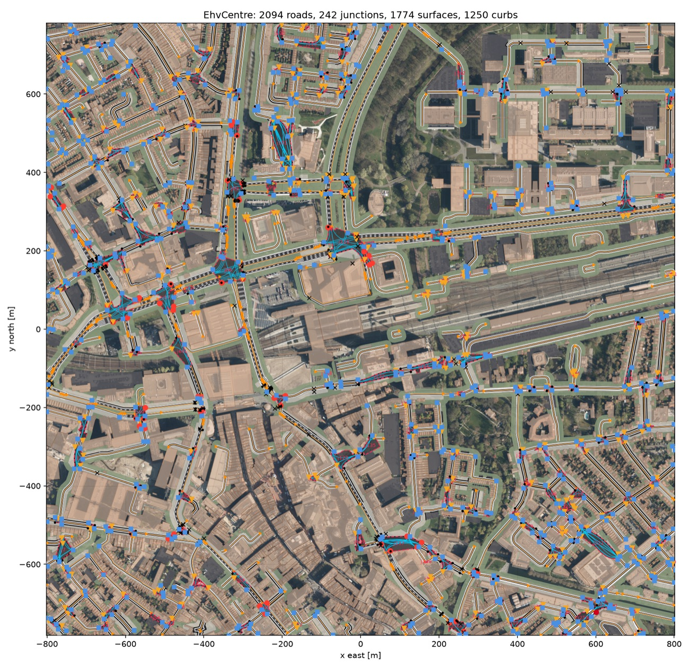

*The Eindhoven centre twin (1.6 x 1.6 km, the same area as `eindhoven_centre.yaml`): 2,094 roads, 242
junctions and 1,578 signals over the 8 cm PDOK aerial photo; terrain from AHN (12.1-23.9 m NAP); the OpenDRIVE
validates in CARLA (98,920 waypoints). Bake input: 623 meshes, 0.9 M triangles.*

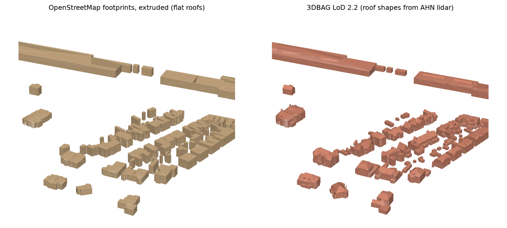

*Buildings near the Eindhoven crossing: OSM footprints extruded to a guessed height (left) and 3DBAG LoD 2.2
with the real roof shapes (right). The centre twin has 3,654 3DBAG buildings (274k triangles in 63 tiles).*

**Baked into a CARLA 1.0 level (2026-11-14).** Stage 3 of the pipeline imports the bake input into the UE 5.8
source tree as the World Partition level `/Game/Carla/Maps/Twins/EhvCentre/EhvCentre`, headless on lin5080 in
7 minutes: 623 Nanite meshes (roads, lane markings, kerbs and risers, sidewalks, crossings, parking, islands,
3DBAG buildings, ground) with CARLA's road, sidewalk, marking and facade materials, 400 vehicle spawn points, the
OpenDRIVE and the Traffic Manager cache next to the level; 65 MB of content.

```bash
UnrealEditor-Cmd <carla>/Unreal/CarlaUnreal/CarlaUnreal.uproject -run=pythonscript -unattended -nosplash -nullrhi \
    -script="<carla-digitaltwins>/TwinModel/ue/bake_level.py --manifest <abs>/build/ehv_centre/ue/manifest.json \
             --name EhvCentre --python-bin <venv with the carla 1.0 wheel>/bin/python"
```

The baked level's folders (`Content/Carla/Maps/Twins/EhvCentre`, `Content/Carla/Static/*/Twins/EhvCentre` and the
level's `__ExternalActors__`) are plain uasset files: copied into another CARLA 1.0 tree (win5090) the level loads
there too, and `-DCARLA_MAPS_TO_COOK=.../Twins/EhvCentre/EhvCentre` cooks it into a package.

Coupled CARLA drives it with [`experiments/eindhoven_twin.yaml`](experiments/eindhoven_twin.yaml):
`map.opendrive` names the twin's OpenDRIVE (copy `build/ehv_centre/EhvCentre.xodr` to `twins/`) and
`map.carla_level` the level. `mapbuild` then makes the SUMO net from that same OpenDRIVE (so SUMO and the level
share their roads; the real bus lines and GTFS timetables are matched onto it as on any map), and the trial
loads the level by name instead of generating an OpenDRIVE-only world. First run, headless on lin5080 (no
GPU): 90 s, 35 SUMO vehicles shown in CARLA, 0 collisions, RTF 0.72 with the machine's other jobs running.

**The map must be built from the level's own OpenDRIVE.** Everything coupled-carla adds to a baked level (SUMO's
net, surface tiles, paving, parked cars, signs) comes from `maps/<name>/map.xodr`; the level drives on its own copy.
When the level is rebaked or carla-digitaltwins marks its paving afterwards, `twins/<Name>.xodr` goes stale (on
2026-11-24 a clinker tile stood 13 m up across the De Zaale passage, placed on a road the level no longer has).
After loading a level the run compares the server's OpenDRIVE with `map.xodr` (roads, lanes, junctions and the
paving mark; not the sign signals the bake drops) and stops on a difference, saving the level's copy as
`maps/<name>/level.xodr` (`map.level_xodr: warn` runs anyway). `python tools/level_xodr.py <experiment> --from
<the bake's input, e.g. EhvCentre_pave.xodr>` (or without `--from`: from a running server) replaces `twins/<Name>.xodr`
(old file kept as `.before-xodr-refresh`) and rebuilds the map; then run `tools/snap_scenery.py`. A package needs the
same file as `Content/Carla/Maps/Twins/<Name>/OpenDrive/<Name>.xodr` and `Content/Carla/Maps/OpenDrive/<Name>.xodr`.

**Rendered on Windows (2026-11-14).** CARLA 1.0 also builds natively on Windows 11 (win5090: VS 2022, the
engine fork with `GenerateProjectFiles` and msbuild, CARLA with CMake and Ninja) and packages: a Shipping
server cooked with `-DCARLA_MAPS_TO_COOK=.../Town10HD_Opt+.../OpenDriveMap+.../TestMaps/EmptyMap+.../Twins/EhvCentre/EhvCentre`
(9.9 GB; copy the twin's `OpenDrive/` and `TM/` folders next to the package's `Content/Carla/Maps/Twins/EhvCentre/`,
since the cook stages only CARLA's own towns' OpenDRIVE). The packaged server starts in 30 s and uses 9.7 GB of RAM
and 2.6 GB of GPU memory (the editor in `-game` mode: 21.6 GB and 7.5 GB); at the twin it ticks in 15 ms, 16 ms with
a 1280x720 camera. A coupled trial with the client in WSL on the same machine (`server.host: 127.0.0.1`, mirrored
networking): 120 s, SUMO traffic on the twin, 0 collisions, but RTF 0.32: the server takes 16 ms of the 55 ms per
tick and the SUMO bridge's calls over the CARLA 1.0 API the rest (the same loop runs at 0.99 on 0.9.16), so the
bridge needs profiling on 1.0.

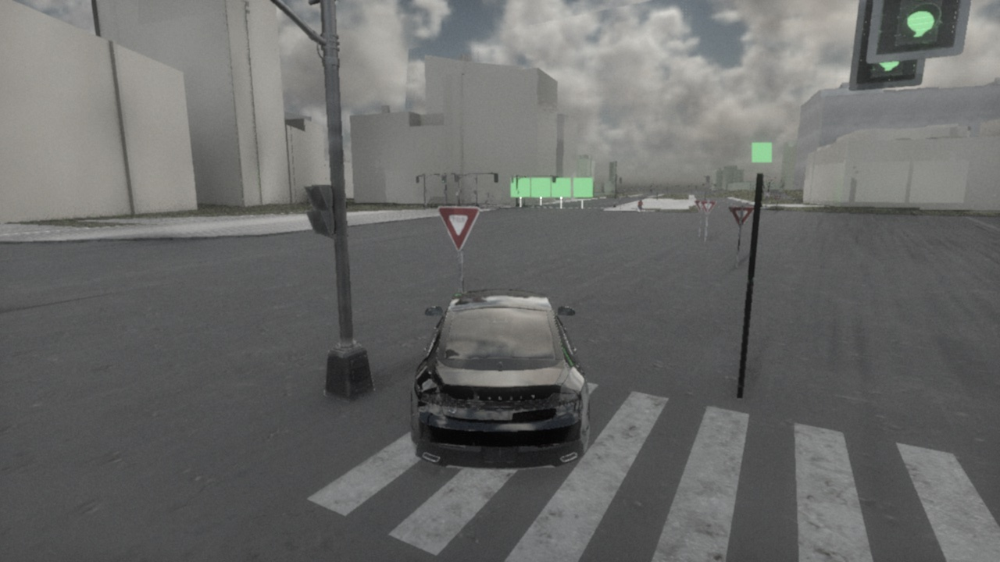

*The baked Eindhoven twin in CARLA 1.0 on win5090: lane markings, a zebra crossing, yield signs, a CARLA traffic
light, snapped scenery, SUMO's bus, 3DBAG buildings with CARLA's plain facade material (the twin's facades are
slabs; `--buildings procedural` would use the modular facade generator).*

**Styled buildings and the photo ground (2026-11-15).** `EhvCentre` is the styled twin: every 3DBAG building has a
facade style from its BAG construction year and use (brick of three periods, render, concrete and glass offices,
industrial cladding, shopfront ground floors, plain party walls) and a roof from the PDOK aerial photo. The ground
(open lots, courtyards, gardens, block interiors) carries the 8 cm photo too, one 2048 px texture per 250 m tile,
while roads, sidewalks and markings keep CARLA's materials. Trees and other objects standing more than 2 m above
the AHN terrain are replaced by the ground around them (the scenery places the trees in 3D), and cast shadows are
brightened (carla-digitaltwins `tools/ground_photo.py`, reusing coupled-sim's PDOK aerial-photo code). Baked in 5
minutes (peak 18 GB) with `bake_level.py --no-nav-build` and the two navigation builders run separately afterwards:
1,348 actors, 143 textured materials, 230 MB of content; [`experiments/eindhoven_twin.yaml`](experiments/eindhoven_twin.yaml)
drives it. A packaged server needs the scenery's folders in the cook (`+DirectoriesToAlwaysCook` for
`/Game/Carla/Static/Vegetation`, `StreetLight`, `Static`, `TrafficSign`, `Pole`, `Bicycle`, `Motorcycle`, and
`/Game/CoupledCarla` for the Dutch sign faces): without them trees render as black leaf cards and the lamp
blueprints do not exist. The procedural-facade variant (`--buildings procedural`) also bakes, but needs the
digitaltwins content (8.8 GB) in the tree that cooks it.

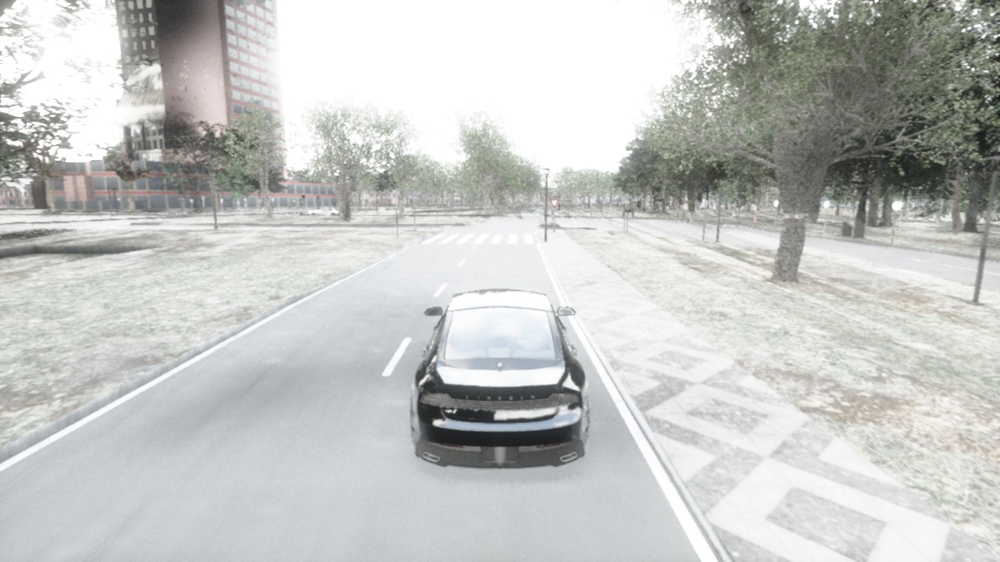

**Real time on CARLA 1.0.** CARLA 1.0 builds rpclib without TCP_NODELAY (0.9.16's rpclib set it on both ends):
two fire-and-forget calls in a row (debug draws, `apply_control`, `set_light_state`) then hold up the next
blocking call (`world.tick()`) by about 40 ms, a delayed ACK. So the runner sends debug drawings, traffic-light
states and the spectator over a second connection (`coupledcarla/side.py`), and controls and light states of
participants, agents and crowds go with the bridge's one batch per tick. The bridge also caches its traffic-light
index and the light states it sets, subscribes SUMO vehicles outside CARLA to their position only, and snaps
CARLA-driven cars to SUMO lanes with its own lane index (`coupledcarla/lanesnap.py`: the same point as SUMO's
`convertRoad`, checked on 104,000 points, without its 1.6 ms scan). `simulation.profile: true` prints the
milliseconds per tick of each part of the loop. Eindhoven twin on lin5080 (`-nullrhi`, 60 s, headless): 18.9 ->
7.7 ms per tick, the client's own 15.0 -> 4.5 ms; RTF 1.06 -> 2.59. On Windows (win5090, the packaged server
rendering, client in WSL) a fire-and-forget batch before the tick still waited for the delayed ACK (43 ms per tick
against the server's 17 ms), so the bridge sends its batch with `apply_batch_sync`: the Eindhoven twin with
styled buildings and a 1280x720 camera then runs in real time, 13-14 ms per tick (the server 6-7 ms of it).

The rpclib stall is reported upstream as carla-simulator/carla#10305, with the two-line fix in
carla-simulator/rpclib#2 (tested in a CARLA ue58-dev build: 41 ms -> 0.2-0.4 ms; the server side alone is enough).

**Stations on the rendering server (2026-11-15).** The crossing study (`eindhoven_crossing_study.yaml`) with the host
in WSL and three bot stations (pedestrian, AV passenger, driver) against the packaged server on win5090: all three
joined within a second, ran the practice trial with responses and left cleanly.

**Camera exposure on CARLA 1.0 (2026-11-15).** CARLA 1.0's RGB camera has no exposure attributes: exposure comes
from a post-process profile (`Content/Carla/Config/PostProcess`), and every profile uses histogram auto exposure,
which adapts over consecutive frames. Cameras that rendered only every few seconds never adapted (a cloudy day
clipped 25 % of the frame to white, night was 99.7 % black). On 1.0 Coupled CARLA's cameras now render every tick
and keep frames at the requested interval, with `simulation.camera_profile` (default `Dashcam`, the best of CARLA's
profiles at the twin: day mean brightness 105-116 of 255 with nothing clipped, night 30 with 1 % crushed).

**Lit windows at night.** The twin's facades light their windows at night: CARLA's weather sets `NightFactor` (0 by
day, 1 by night, from the sun's altitude) in a material parameter collection, and the facade material
(`/Game/CoupledCarla/Materials/M_TwinFacadeNight`, a copy of CARLA's `M_GeneralMaster`) lights a window when its rank
in a night mask is below the lit share of its building's use times `NightFactor`, so windows come on one by one at
dusk and none are lit by day. The masks are drawn per facade style by carla-digitaltwins (8 x 8 windows, shifted per
building and wall); the shares by use are a plausible Dutch weekday evening, not measured (20:00: homes 52 %,
offices 12 %, shop windows 60 %, industry 8 %; `bake_level.py --window-hour H`). `tools/window_lights_check.py`
saves day, dusk and night frames to check it.

**How close is the twin to the real street? (`tools/realism_check.py`)** Real street-level photos with position and
heading from open sources that need no key: Panoramax (1,734 in the twin's box, CC BY-SA 4.0, mostly 360°
panoramas from a cyclist), KartaView (87, CC BY-SA 4.0) and Wikimedia Commons (218 with a camera heading, per-file
CC licences); 350 daytime views are kept. Each is rendered in CARLA at the same place, height, heading and field of
view under the real weather and sun of the photo's hour, both images are segmented (SegFormer-B2, Cityscapes), and
the layouts are compared (coarse and fine IoU, class areas, skyline) along with simple image statistics; photo
headings are often off by up to about 20°, so each view is also scored at its best alignment. The same metrics
between real photos set the scale: two photos of the same street 10-25 m apart reach a coarse IoU of 0.54 and a
skyline error of 3.8°, photos of random places 0.26 and 9.1°. CROWD's Eindhoven videos have no positions inside
the box (their GPS overlays stay on the ring roads), so they are not used. Photographers are credited in
`ATTRIBUTION.csv` next to the views.

```bash
python tools/realism_check.py prepare experiments/eindhoven_twin.yaml --labels   # photos (internet)
python tools/realism_check.py render  experiments/eindhoven_twin.yaml            # CARLA server, GPU
python tools/realism_check.py compare                                            # CPU: compare.csv, summary.json, sheets/
python tools/realism_check.py pairs   experiments/eindhoven_twin.yaml            # real-vs-real baseline
```

Results (2026-11-15, EhvCentre on the Windows package, 201 of the 350 views rendered; `logs/realism/summary.json`).
On a scale where 0 is a photo of a random place and 1 a second photo of the same street:

| Measure (best alignment) | Twin vs photo | Same street | Random place | Scale |
|---|---|---|---|---|
| Coarse IoU (road, sidewalk, building, vegetation, sky, ...) | 0.451 | 0.54 | 0.26 | 0.69 |
| Coarse pixel accuracy | 0.678 | | | 0.73 |
| Skyline error | 3.5° | 3.8° | 9.1° | 1.07 |
| Colour histogram similarity | 0.28 | | | -0.3 |

The layout of the street (where road, buildings, trees and sky are) is close to that of a real photo of the same
street, and the skyline as close as two real photos. What gives the twin away is the look: renders have half the
contrast (luminance spread 35 against 62) and a third of the fine detail (edge density 0.04 against 0.13), more road
and less greenery in view (33 % against 21 % road, 15 % against 22 % vegetation: street trees are smaller than the
real ones), and no parked or moving cars (0 % against 1 %: the render tool spawns none). KartaView's car-mounted
views score best (coarse IoU 0.50), Commons photos worst (0.28; often taken from squares and parks).

**Second round (2026-11-16, `tools/realism_window.sh`).** Each change was rendered at the same 349 views on the
Windows package and compared against the photos. Three changes went in:

- Trees in leaf: no leafless meshes for trees in summer (see Seasons).
- Cars in view: the render tool spawns parked cars and 20 moving cars per km of lane. At that rate 45 % of renders
  have more than 0.5 % car in view, against 58 % of photos.
- `CoupledReal`: a CARLA 1.0 camera profile fitted to the photos (`coupledcarla/lookfit.py` models the part of
  Unreal 5's tone mapping a profile controls; `tools/look_fit.py` fits it on half the views and scores it on the
  other half).

| Measure | Photos | Before | + trees in leaf | + cars | + `CoupledReal` | + overcast sky |
|---|---|---|---|---|---|---|
| Coarse IoU | | 0.440 | 0.441 | 0.439 | 0.435 | 0.429 |
| Skyline error (°) | | 3.73 | 3.63 | 3.67 | 3.77 | 3.83 |
| Colour histogram similarity | | 0.280 | 0.282 | 0.284 | **0.387** | 0.336 |
| Luminance mean | 105 | 119 | 119 | 118 | 88 | 83 |
| Luminance spread | 62.5 | 35.1 | 35.1 | 35.3 | 32.8 | 39.0 |
| Saturation | 0.235 | 0.182 | 0.191 | 0.186 | **0.238** | 0.285 |
| Edge density | 0.130 | 0.039 | 0.038 | 0.040 | 0.068 | 0.065 |
| Vegetation share | 0.216 | 0.137 | 0.150 | 0.151 | 0.167 | 0.176 |
| Vehicle share | 0.008 | 0.000 | 0.000 | **0.009** | 0.009 | 0.006 |

What each change did:

- The layout scores stay at the level of two real photos of the same street.
- Trees in leaf and cars bring greenery and vehicles closer to the photos. Cars now match.
- `CoupledReal` gives the biggest gain: the colours become clearly closer to the photos (0.28 → 0.39), saturation
  matches, and fine detail rises by 70 %. The fit predicted 0.43, and the renders came out darker than predicted
  (88 against the photos' 105).
- An overcast sky (`simulation.cloud_scale` 1.0) made it worse.
- Still missing: the contrast between sky and ground (spread 33 against 62), which no tone curve can add.
- Fitting again on all 349 views, from either set of renders, reaches the same colour score (0.38-0.39) only by
  giving up saturation for brightness, so `CoupledReal` stays as fitted.

Use it on CARLA 1.0 by copying `coupledcarla/data/postprocess/*.json` into the server's
`Content/Carla/Config/PostProcess`, then setting `simulation.camera_profile: CoupledReal`.

**Street photos: Mapillary, a score per spot and street objects ([docs/street_photos.md](docs/street_photos.md)).**
The check takes Mapillary as a fourth source when the `mapillary_token` key is set: its photos, and its map
features (lamps, signs, poles, bins, benches) placed from many photos. It scores every spot:

- an edge alignment (boundary F-score of road, building, tree and sky outlines);
- a perceptual similarity (DINOv2, the whole view and patch by patch);
- a spot score from those and the layout IoU;
- the main differences in words, such as "missing building on the left", "road too wide" or "skyline 6° too low".

Each spot gets a side-by-side image in `spots/`. Each map gets a score (median spot score × 100: about 50 is as
alike as two photos of the same street, about 30 as a photo of somewhere else). `realism_check.py objects`
matches the map's lamps, signs and furniture with Mapillary's features, or with poles found in Panoramax
panoramas. It reports what a correction would move, add or remove, and `--apply` (or
`map.scenery.photo_corrections`) does it. Registers (city lamps, NDW signs) are never touched.

Tested against Eindhoven's lighting register, the photo evidence (Mapillary lamps lie a median 2.6 m from the
register's) makes good positions worse. It helps only where the map's lamps are guesses, as in Chernihiv, so the
corrections are off by default. Results per map are in the doc.

**New York twin (`experiments/nyc_twin.yaml`).** The same pipeline baked NycMidtown, the box of
`experiments/cities/new_york_midtown.yaml`: the NYC 3D Building Model's 1,761 buildings with facade styles from
their PLUTO construction year and use, USGS 3DEP ground under the NYS orthophoto, and OSM roads with US lane
markings, kerbs and sidewalks; SUMO drives on the twin's own OpenDRIVE. A 40 s trial on the Windows package ran at
RTF 0.75 with 707 parked cars and 1,004 scenery meshes around the participant.

**The whole city: EhvCity (`experiments/eindhoven_city_twin.yaml`, `eindhoven_city_real.yaml`).** One World
Partition level for everything inside Eindhoven's Ring plus Veldhoven (51.395-51.465 N, 5.380-5.509 E, about
7.8 x 9.0 km): the centre, the TU/e campus, Strijp-S, the PSV stadium, Meerhoven and Veldhoven with ASML. It is the
carla-digitaltwins city twin (branch `citytwin`): the same data as EhvCentre, with distance-based detail (the
centre and the campus get 2048 px photo ground tiles, 12 cm, the rest 1024 px; 3DBAG LoD 2.2 inside the Ring and
LoD 1.3 blocks outside it), building geometry cut clear of the driving lanes and sidewalks (passages with a soffit,
slivers trimmed to the kerb), and a chunked bake (`ue/bake_city.py`: one editor run per block of 6 x 6 tiles,
memory-watched and resumable). Its trials start the driver by the station, on the campus (De Zaale) and in
Veldhoven (De Run by ASML). The level's OpenDRIVE goes to `twins/EhvCity.xodr` (not in git). The Ring phase
(51.416-51.465 N, 5.434-5.509 E) was built first: 25,923 roads, 2,792 junctions, 74,959 3DBAG buildings, 11,277
meshes; its map here has 119,229 trees, 16,313 street lamps from the city's register, 11,469 pieces of furniture
and 32,540 parking stalls streamed around the participants.

**A quick stand-in world (`map.standin`, `experiments/eindhoven_city_quick.yaml`).** A baked city level takes
minutes to load and CARLA's OpenDRIVE-only world of a whole city builds meshes for every road. `map.standin:
{radius_m: 800}` generates only the roads within that distance of the first participant from the map's own
OpenDRIVE (`coupledcarla/standin.py`, an idea from BeamNG.Earth's quick world after a teleport): same road and lane
ids as the full map, so SUMO's traffic and the logs line up. On the Ring twin (CARLA 0.9.16,
lin4080): 1,861 of 25,923 roads around the station and 1,568 around the campus, two 60 s trials at RTF 0.98 and
0.975 with no collisions.

**Real time on a city-sized map.** On EhvCity the plain bridge ran at RTF 0.22-0.26 (win5090, 60 s trials): SUMO
simulates the whole city (at 20,000 cars and 6,000 bikes an hour it fills by ~400 vehicles a minute, and a 0.02 s
step costs ~0.021 ms per vehicle with the sublane model: 78 ms at 3,700 vehicles), and TraCI reports every vehicle and
every traffic light each tick. The city experiments therefore turn on four switches (all off by default, so the
other maps run as before):
`traffic.crop_radius_m` (SUMO on the roads within 1.5 km of the participants' starts, the city's demand cut to them
with SUMO's cutRoutes.py so that trips enter at the cut edge when they would have reached it; `coupledcarla/
sumocrop.py`; "auto" crops maps of 25 km2 or more), `simulation.sumo_step: 0.1` (SUMO every 5th tick, its cars
interpolated between two SUMO steps and shown 0.1 s late), `simulation.sumo_thread` (that step runs in a thread while
CARLA ticks; every TraCI call happens at the step boundary or waits for the step, so the results are the same with or
without the thread) and `simulation.sumo_near` (one context subscription per participant instead of one per vehicle,
and only the traffic lights near the participants), plus `simulation.scenery.radius_m: 200`
(`coupledcarla/bridge/pipeline.py`). `tools/bridge_bench.py` measures the SUMO side without a server (lin4080,
300 s, a stand-in CARLA tick of 12.4 ms, win5090's empty EhvCity tick): whole city plain 60.0 ms per tick (SUMO step
44.3 ms), cropped 21.2, cropped at 0.1 s 14.8, plus near 13.9, plus the thread 12.8 ms (SUMO's share 0.4 ms).
`tools/tick_probe.py` measures what the scenery's actors cost the server's tick.

#### Photorealistic tiles (optional)

`map.photoreal: google` ([`experiments/eindhoven_twin_photoreal.yaml`](experiments/eindhoven_twin_photoreal.yaml))
streams Google's Photorealistic 3D Tiles into a baked level with [Cesium for
Unreal](https://github.com/CesiumGS/cesium-unreal) (v2.31.0, Apache 2.0) and the `CoupledPhotoreal` plugin
([`unreal/`](unreal/)), after the approach of the open-source flight simulator
[FableFlight](https://github.com/Rolandjg/fableflight). The photogrammetry mesh replaces the twin's buildings and
ground on screen; CARLA's roads (smooth surface, lane markings) stay, as the mesh is clipped above the twin's
carriageway cut from its OpenDRIVE. Collision, LiDAR and navigation keep the twin's geometry, so cars drive on CARLA's
roads and walkers on its sidewalks. At night the twin's buildings with their lit windows come back inside a cut along
their footprints, and CARLA's street lamps light the photo streets. Heights are NAP + NLGEO2018 (43.93 m at
Eindhoven) plus the ETRS89 → ITRF drift (0.90 m north-east in 2026).

It needs your own Google Maps Platform key with billing, on the server machine only (`GOOGLE_MAPS_API_KEY` or
`~/.config/coupled-carla/google_maps_key`, mode 600; never stored in a file of ours, a log or content). Photorealistic
3D Tiles is an Enterprise SKU: 1,000 billable root requests a month are free, then USD 6.00 per 1,000, each opening a
session of up to three hours (Google's pricing, November 2026). Each level load sends one root request; the server
counts them (`~/.config/coupled-carla/google_tiles_usage.json`) and stops at `day_cap` (50) and `month_cap` (1,000).
Also set a Cloud quota cap of about 50 root requests a day so a bug cannot run up a bill. Tiles stream and are never
stored beyond their Cache-Control lifetime, baked into packages or content packs, or redistributed; saved frames
carry Google's attribution. Limits: it is photogrammetry (parked cars and people baked into the streets, no semantic
labels for sensors, sun and shadows baked in, so they double when relit by day). Without a key, the plugin or the
level data the trial runs on the normal twin. Status (2026-11-16, with a key on the Windows package): the
Development and Shipping builds load the tiles and a full trial runs with them. From the air (drone and overview
cameras) the city looks real. At street level it does not yet beat the plain twin: the mesh is soft close up,
blue holes show where the twin is hidden before its tiles arrive, and the mesh sits a little too high (a drone
on the ground sees under it). Cesium loads tiles for the spectator's view, so the spectator follows the active
camera; with that, a drone's camera gets the tiles as soon as it climbs. Streaming them is costly: a drone flight
ran at a real-time factor of 0.05 and a street-level trial at 0.24, so for now use it for recorded aerial and
drone views rather than live studies.


*A drone's camera over Eindhoven's centre with `map.photoreal: google` (CARLA 1.0, Windows package). Imagery © Google.* Shareable open alternatives:
[PLATEAU](https://www.mlit.go.jp/plateau/)'s textured LoD2 buildings for Japan (used by the twin of any place),
[Helsinki's reality mesh](https://hel.fi/3d) and Espoo's (CC BY 4.0), [Rotterdam 3D](https://data.overheid.nl/dataset/10230-rotterdam-3d)
(public domain, LoD2 textured from aerial photos).

#### A twin of any place

The same pipeline now makes a twin of any place, with the best open data of its country (carla-digitaltwins branch
[`anytwin`](https://github.com/bazilinskyy/carla-digitaltwins/tree/anytwin), `twinmodel/regions.py`): national aerial photos, terrain models and building registers where they are open and need
no key (PDOK/AHN/3DBAG in the Netherlands; PNOA, MDT05 and the Catastro's buildings with their floors, year and use in
Spain; BD ORTHO, RGE ALTI and BD TOPO in France; the Flemish orthophoto; SWISSIMAGE and swissALTI3D; NAIP and 3DEP in
the US; GSI's photo and DEM and PLATEAU in Japan), Overture Maps' buildings and the AWS Terrain Tiles elsewhere (there
is no open global aerial photo at street scale, so there the ground keeps CARLA's materials). Footprint buildings get
roof shapes where the data has them and facade styles by region (sandstone and warm render in southern Europe).
Left-hand countries get left-hand twins: the lane graph is built in the mirror image of the place and mirrored back,
and the OpenDRIVE says `rule="LHT"`, which CARLA 1.0 reads. One command makes the twin and, on a machine with the CARLA
1.0 editor, bakes it; the map maker's `--twin` runs it and writes the experiment
([Make a map of any place](#make-a-map-of-any-place)):

```bash
python -m twinmodel twin "Plaza Mayor, Salamanca" --name SalamancaPlaza --bake \
    --carla-root ~/carla58/carla --engine ~/carla58/UnrealEngine5_carla --carla-python ~/carla58/venv/bin/python
python -m coupledcarla.mapmaker "Plaza Mayor, Salamanca" --twin --size small     # the same from the map maker
```

Tested on two places (2026-11-15, lin5080, 1 km and 0.9 km squares, baked headless with `-nullrhi`):

| Twin | Data | Roads | Buildings | Textures | Python stages | Bake (peak RAM) | Content | 60 s trial (`--local`, headless) |
|---|---|---|---|---|---|---|---|---|
| 🇪🇸&nbsp;`SalamancaPlaza` (Plaza Mayor, Salamanca) | IGN PNOA 25 cm photo, IGN MDT05 terrain, Catastro buildings | 568 | 1,221 (5,615 parts; 1,215 with their year: 252 sandstone, 830 render, ...) | 82 (50 MB) | 9 min | 5 min, 7.8 GB | 90 MB | RTF 1.16, 0 collisions, 33 SUMO vehicles, 371 spawn points |
| 🇯🇵&nbsp;`ShibuyaCrossing` (the scramble crossing, Tokyo) | GSI photo and 5 m DEM, PLATEAU LoD 2 with its photo textures, left-hand | 1,399 | 1,648 (54,501 photo-textured surfaces in 18 atlases) | 54 (72 MB) | 38 min (5 with the downloads cached) | 3 min, 7.5 GB | 117 MB | RTF 1.18, 0 collisions, 46 SUMO vehicles, 400 spawn points; the driver kept left for 34 s, then left the lanes on the stacked roads by the station |

The levels load in a CARLA 1.0 server and drive with SUMO traffic; what they look like must still be checked on a
rendering server (`-nullrhi` renders nothing): the PLATEAU photo facades (taken from oblique aerial photos: right in
colour and layout, soft at street level), the scramble's zebras (drawn along OSM's crossing ways: the five legs and
one diagonal), Shibuya's stacked roads and plazas (the autopilot left the lanes there and circled on a paved area),
and the scenery, which stands at the AWS Terrain Tiles' heights until `tools/snap_scenery.py` puts it on the level's
ground. The map maker ran the whole chain with `--twin` for a third place (Grote Markt, Leuven, 0.5 km, without the
bake): the Flemish orthophoto, 849 Overture buildings, the experiment and its SUMO net in 29 minutes. Shibuya's large video screens and billboards (Q-Front, the 109 tower's signs) are not in any
open data: PLATEAU models them as part of the facade photo at best; screens playing video would need emissive
media-texture materials placed by hand or from a sign inventory.

**Roads clear of buildings.** Open building models are solids down to the ground, so where a street runs under a
building (Shibuya's bus terminal, station halls, the Park Avenue viaduct) or a footprint overlaps the carriageway,
the baked walls stood on the lanes and SUMO's buses drove through them. The twin tool now cuts the building meshes
clear of every driving lane (4.6 m, or OSM `maxheight`) and sidewalk lane (2.5 m), closes the cuts as passages
(ceiling and side walls in the building's own wall material) or trims slivers back to the kerb, and checks CARLA's
lane samples before the bake (carla-digitaltwins `tools/road_clearance.py`, results per twin in its README). It
also writes `<Name>.buildings.json`, the solid footprints minus the passages: copy it next to the twin's OpenDRIVE in
`twins/`; the map build copies it to `maps/<name>/twin_buildings.json`. Before publishing a clip, check its trial:

```bash
python tools/trial_buildings.py logs/shibuya_twin/<trial> [--start 30 --duration 20]   # exit 1: actors inside
```

It tests every vehicle (two corners of its body, shrunk by 0.3 m) and walker (its centre, 0.2 m inside) of
`frames.csv` against those footprints (`buildings.json` for maps without them) and lists each stay with its time and
place (`coupledcarla/inbuildings.py`; `footprints_path()` gives the clip checks the same file).

**Download the Eindhoven twin.** The release
[twin-eindhoven-2026-11-15](https://github.com/bazilinskyy/coupled-carla/releases/tag/twin-eindhoven-2026-11-15)
has EhvCentre as a CARLA content pack for Linux and Windows (about 1.7 GB each; release assets, not in git), cooked
against CARLA's official weekly build of 2026-11-13 (`a1770de89`). Install it with the package's own tool
(`python Tools/carla_pack.py install EindhovenTwin-...tar.gz --server <package>`, which checks checksums, platform
and base release) and load `EhvCentre`; a pack works only with the CARLA build it was cooked against. The release
notes list the exact package downloads.

**Still to do in phase 3:** realistic contrast and detail in the twin's look (see the results above), human stations
at the rendering server (see the [lab guide](docs/lab_guide.md)), multi-GPU secondaries on real GPUs, VR.

## Study tools

Tools for running studies with participants, ported from coupled-sim (#80, #88, #92, #94, #130); the example
[`experiments/eindhoven_crossing_study.yaml`](experiments/eindhoven_crossing_study.yaml) uses all of them.

- **Trial plans and counterbalancing** (`coupledcarla/study.py`). Conditions are named once and used by trials
  (`condition:` / `conditions:`), or crossed into a full factorial by `design.factors`; `design.order` is `latin`
  (a balanced Williams Latin square with the same rows as coupled-sim, so participant N gets the same order in both
  simulators), `full`, `random` (repeatable per participant) or `none`, with practice trials first and `after:` trials
  last. `python -m coupledcarla.run exp.yaml --participant 7` runs participant 7's order; logs go to
  `logs/<experiment>/<time>_P07_trial<i>`, each `config.yaml` gets a `study:` block, and `session_P07_<time>.csv`
  lists the order.
- **Validator** (`python -m coupledcarla.validate exp.yaml [--participants 1-12]`): unknown keys (with the nearest
  known one), whether the map is built, spawn, route and POI points inside the map and near a lane, cars starting
  within 4 m of each other, roles, agents, eHMI states used but undefined, durations and schedules, the design; it
  prints every participant's plan and exits 1 on errors. `run` prints the same problems at its start.
- **Continuous responses** (`response:` on a participant, `coupledcarla/responses.py`): a hold-to-respond button and
  a 0-100 slider sampled every frame (keys B and N/M, a gamepad's shoulder button and d-pad, a wheel's buttons and
  paddles), shown as a small panel; `<trial>/responses.csv` has coupled-sim's columns
  (`utc;time;frame;button;button_value;presses;slider`) plus role, station frame and sample age.
- **Automated driving and take-over requests** (`automation:` on a driver, `coupledcarla/takeover.py`): the car
  drives itself along a route; a take-over request (at a time, on a route trigger, from T at the station or the
  dashboard) shows a flashing TAKE OVER with beeps; the driver takes over by steering, braking, throttle or Enter,
  or the car brakes to a stop without a reaction. `<trial>/takeover.csv` uses coupled-sim's TakeOver columns.
- **Experimenter dashboard** (`--dashboard`, `coupledcarla/dashboard.py`): a dependency-free page at
  http://127.0.0.1:8780/ with the plan, the trial's state and real-time factor, every participant (station, speed,
  round trip, responses, automation), collisions and events; buttons Start trial, Pause, End trial, Stop session,
  Visual sync and Take-over request. Localhost only unless `--dashboard-host` (then with a token in the link). It
  watches one host run; the [session dashboard](#session-dashboard) runs a whole session, stations and live map
  included.
- **Running sessions with people** ([docs/lab_guide.md](docs/lab_guide.md), [docs/session_checklist.md](docs/session_checklist.md)):
  machines, what a station PC needs (Python 3.10, the carla 1.0 wheel of the server's build, pygame, a wired link),
  ports and Windows firewall rules, start order, calibration, what to watch, where the data goes, troubleshooting.
  `tools/station_dryrun.py` runs a short trial with bot stations (here, over ssh, or on another PC) and checks each
  station: time to join and to its first image, round trip, loop and camera rates, tick-to-image latency, missed
  ticks and images, and whether sound, displays and station-drawn eHMIs are on; exit 1 when a threshold is missed,
  `--report <trial>` checks a real session. New station options: `--display N --fullscreen`, `--audio-device`,
  `--list-devices`, `--camera-hz`. A remote station's camera crosses the LAN as raw pixels: 1280x720 at 50 Hz is
  184 MB/s against 117 MB/s measured from win5090 to lin4080, so remote stations need `--camera-hz 25` or a smaller
  `--size`. Stations send their controls, lights and camera moves in one batch per tick (CARLA 1.0's RPC stall).
- **Multi-GPU secondaries (CARLA 1.0)** (`server.multigpu`, `coupledcarla/multigpu.py`): secondary
  servers render the cameras of a `-nullrhi` primary, on another GPU or on a station's own PC. CARLA hands cameras
  to secondaries in turn and gives stream tokens no address, so a station takes a camera turn and respawns its camera
  until it lands on its own secondary, and reaches secondaries on other machines through a relay on 127.0.0.1.
  Debug drawings are not mirrored: use `ehmi.render: station` with secondaries.
  Tested on win5090 (2026-11-16, `tools/multigpu_win5090.ps1`): a `-nullrhi` primary and one rendering
  secondary on the same RTX 5090, three bot stations at 1280x720, 40 s of the crossing study. The protocol works:
  the secondary switches the primary to synchronous 0.05 s, and `guard_settings` puts 0.02 s back. The trial
  ran at a real-time factor of 0.75 against 0.36 on the single server, but only because rendering no longer held
  the tick back. The secondary could not keep up on the same GPU: the stations got 44 % of their images, a median of
  4.4 s late (single server: all images, 90 ms). So a secondary helps only on a GPU of its own (another card, or a
  station's PC); that is not yet tested.
- **Analysis**: `python -m coupledcarla.analysis` also summarises responses and take-overs per trial and writes
  `study_responses.csv` and `study_takeovers.csv` per experiment; the viewer shows the responses.

## Session dashboard

`python -m coupledcarla.session` serves one page from which the experimenter runs a whole session with several
participants, in a browser on the host machine or (with `--host 0.0.0.0`) on a tablet or another PC of the lab
network: Coupled CARLA's counterpart of coupled-sim's experimenter dashboard. Unlike `run --dashboard`, which watches
one host run, it stays up for the whole session. Every trial still runs in its own host process, so a trial that
crashes does not take the dashboard or the stations with it.

```bash
python -m coupledcarla.session --experiment experiments/eindhoven_session.yaml       # opens http://127.0.0.1:8790/
python -m coupledcarla.station --host <dashboard machine>     # on every station PC, without --role
```


*The dashboard 42 s into a trial of [`experiments/eindhoven_session.yaml`](experiments/eindhoven_session.yaml) on
lin4080: the pedestrian crosses in front of the stopped AV while the driver waits behind it, the drone pilot flies
35 m up, two AI drones circle, the crowd walks the pavements.*

**Before the trial (Session):**
- choose the experiment (`experiments/`, the cities, places made with the map maker, the twins), or make a map of any
  place: type a name, an address or `lat,lon[,radius in m]` and the map maker builds it with its steps shown; the new
  place is then chosen;
- the participant number gives that participant's counterbalanced trial plan ([study tools](#study-tools)); the
  experiment is checked (`validate.py`) and its problems are listed in plain words;
- the CARLA server: a fresh one started here for every trial (`CARLA_ROOT` or `--carla-root`), or one that is already
  running (`--attach host:port`); quality, real time, a window on the host, the trial length;
- stations started without `--role` join a lobby (up to 8) and are listed with their machine, address, input devices
  (keyboard, wheel, gamepad), GPU and round trip; give each a role from the experiment's participants (pedestrian,
  AV passenger, driver, drone pilot, ...) by dropdown; a station is ready when it waits for the trial. Roles without a
  station run as bots on the host (or the host waits for them). Stations started with `--role` still work and show
  up with their role fixed. `Add a bot station` starts a station without a human on this machine, for tests;
- `Initialise` loads the trial (CARLA world, SUMO, agents) and waits for the stations, `Start` starts it on every
  station at once, `Next trial` ends the current trial (if one runs) and loads the next; with "go on to the next
  trial by itself" the plan runs without pressing.

**During the trial:**
- a live map from above, updated five times a second: the map's own roads (cycleways in red) and buildings over an
  open aerial photo (PDOK in the Netherlands, IGN in France, USGS in the US, GSI in Japan; OpenStreetMap elsewhere),
  with every participant ringed and labelled with their speed (a drone pilot with their height), AVs with their eHMI
  state, scripted cars and walkers, SUMO cars, bicycles and buses, the pedestrian crowd, AI drones with their height
  and the state of every traffic light; click on anything for its details;
- the agents table: kind, name, speed and position, and for participants whether the station is connected, its round
  trip, frame rate, image lag, responses and automation state; the header shows the state, the map, trial n of N,
  simulation time, real-time factor and frame rate;
- eHMI: every AV at once (off and each state the experiment defines) or one car; a take-over request per automated
  driver; the weather (CARLA's presets) and the time of day (the sun at that place and hour) for everyone at once;
  visual sync; the latest events and collisions; Pause, End trial, Stop session.

**After the trial:** every finished trial with its numbers (simulation time, real-time factor, collisions, SUMO
vehicles, stations), opened in the [trial viewer](#trial-viewer) (exported when asked) or downloaded as a zip of its
log folder; earlier trials of the experiment are listed too.

How it works: the stations connect to the dashboard (port 2100, `--stations-port`) instead of to a host, and stay
connected across trials and participants (`coupledcarla/hub.py`). A station without `--role` says hello without a
role and waits in the lobby (`coupledcarla/lobby.py`); once it has a role it runs each trial in a child process with
that role, as a station started with `--role` does. Each trial's host is `run --trial N --control-relay ...`, which
attaches to the dashboard over a loopback link instead of listening for stations; the dashboard passes the messages
both ways, sends the experimenter's commands and gets back the trial's state and the positions for the map
(`coupledcarla/livemap.py`). A plain `run` answers a station without `--role` with a message to start it with one.
Security as `run --dashboard`: it listens on 127.0.0.1 unless `--host` says otherwise, and then every request needs
the token in the link it prints (kept in a SameSite cookie for the viewer and zip links); commands are POSTs with a
custom header, which a page on another site cannot send; a local dashboard answers only requests addressed to
localhost. The page needs the internet for Leaflet and the map tiles; the logs are in `logs/sessions/`.

**Test run** (15 Nov 2026, lin4080, CARLA 0.9.16 at Low quality on a GPU shared with three other CARLA servers; the
dashboard driven by Playwright in headless Chromium, as an experimenter would click):

| | |
|---|---|
| Stations | four bot stations added on the page as pedestrian, AV passenger, driver and drone pilot; in the lobby and ready within 5 s; round trip 0.1-0.2 ms; 31-35 fps each |
| Trials | participant 1's plan (day, dusk): trial 1 loaded in 15-20 s (server attached), ended early with Next trial at 22.8 s, which loaded trial 2; trial 2 ran its 40 s; both trials with all four stations, 0 collisions |
| Real-time factor | 0.61-0.73 (host plus four station cameras on the shared GPU) |
| Commands applied | eHMI "yielding" on both AVs (6.4 s), weather WetCloudySunset at 19:30 (7.0 s, sun -25 deg), visual sync (7.7 s), End trial, Next trial; each logged in events.csv |
| Live map | 38-39 things five times a second (participants, AVs, AI walkers, SUMO cars and bicycles, 29 crowd walkers, two AI drones) and 210 signal heads |
| After the trial | viewer export 1 s (trial.json 1.1 MB), zip 2.0 MB |

Not yet: the page cannot edit an experiment file or a station's options (screen, sound device), a station's role
can change only between trials, live weather leaves the cars' headlights as they were at the start, and without
internet the page has no map tiles or Leaflet.

## Simulated humans (optional)

Two optional models from Mark Colley's open-source projects put simulated humans into a trial. Both need extra
packages on the host only (best in a separate venv); without them a trial runs as before, with one log line.
[`experiments/eindhoven_myosuite.yaml`](experiments/eindhoven_myosuite.yaml) uses both.

- **A musculoskeletal driver** (`input: myosuite`, `coupledcarla/myodriver.py`), built on
  [myosuite-carla](https://github.com/M-Colley/myosuite-carla): MyoSuite's seated full body (`preset: fast` keeps
  the 114 muscles that drive; `full`: all 416) presses spring-loaded pedals and turns a steering wheel; what they
  measure becomes the car's controls, and the car's acceleration loads the body. Its reflex driver (two-point
  steering, Salvucci & Gray 2004; the Intelligent Driver Model, Treiber et al. 2000) gets the lane ahead, the SUMO
  car ahead and red lights, and slows for bends. `myodriver.csv` has intent, measured controls, mechanism travel and
  contact forces per tick, `myodriver_muscles.csv` every driving muscle's activation and force,
  `myodriver_summary.json` lane and speed keeping. Measured (15 Nov 2026, Eindhoven, 150 s, SUMO traffic): lane RMS
  0.05 m on a straight street, 30.0 km/h for 30, 0 collisions on CARLA 1.0 and 0.9.16; the muscles cost 4-5 ms per
  tick (real-time factor 0.99). It sees only SUMO traffic, keeps its lane, goes straight on at junctions and needs
  bends of 15 m radius or more. Install: MyoSuite's dev branch, `myosuite-carla` and `mujoco>=3.7,<4`.
- **Crowd walkers that cross on what they see** (`traffic.walkers.perception: {model: embodied}`,
  `coupledcarla/embodiedped.py`), with [embodied-human](https://github.com/M-Colley/embodied-human)'s eyes
  (saccade latency and duration), peripheral vision (noisier away from the gaze) and reaction times: each walker
  looks both ways and judges a car's time to arrival from its looming (above 0.003 rad/s, Hoffmann & Mortimer
  1994), a far car's from its distance and an assumed speed, then applies the crowd's own critical gap. Replayed
  through the same SUMO traffic (`python tools/embodiedped_check.py`, 4 maps), these walkers accept shorter gaps
  from faster cars, as people do (Lobjois & Cavallo 2007), where the crowd's rule on true positions shows no such
  effect; their overall risk level is not calibrated (in 45 of 130 replayed crossings a car would have had to brake),
  so treat it as a research option. `crowd_gaze.csv` has where each walker at the kerb looks, its believed and the
  true gap. Install: `embodied-human` (numpy and scipy only).

[embodied-ui](https://github.com/M-Colley/embodied-ui) (simulated controls for MuJoCo bodies) is not used: the
stations have real controls.

## Sound, in-car displays and designed eHMIs

Ported from coupled-sim (#95, #131, #133, #135, #157) into the stations; all off unless an experiment turns them on
([`experiments/eindhoven_station_ux.yaml`](experiments/eindhoven_station_ux.yaml) is a demo).

- **Sound** (`sound`, `coupledcarla/soundscape.py`, models in `acoustics.py`, sources in `synth.py`): what a
  participant hears, in calibrated dB SPL, from published acoustic models. Each vehicle has the CNOSSOS-EU sound
  power per octave band (63 Hz-8 kHz; Directive (EU) 2015/996 as amended in 2021) for its category (car, van,
  bus/truck, moped, motorbike): rolling noise with the road surface (`road_surface`, e.g. Dutch paving blocks), air
  temperature and, on wet roads, IMAGINE's wet-road increase, and propulsion noise with the acceleration and the
  engine speed of a gearbox model (idling when stopped). The engine is heard from recordings of real engines, the
  game-audio way (`engine_sound: recorded`, `coupledcarla/soundsamples.py`): a few steady-rpm loops per engine type
  (petrol for cars, diesel for vans, buses and trucks, a twin for motorbikes; `data/sounds/engines`, cut by
  `tools/sound_samples.py`), the two around the wanted engine speed resampled to it and cross-faded, each split into
  the octave bands so that it plays at exactly CNOSSOS's band levels (the recording gives the timbre only); a
  cruising or coasting engine is up to 6 dB quieter than CNOSSOS's average (`engine_part_load_db`), so steady urban
  traffic is mostly tyres. `engine_sound: synth` keeps the older additive model (firing orders, formants, jitter,
  after Pieren et al. 2016 and Baldan et al. 2015), also the fallback when the loops cannot be decoded. A car at
  50 km/h measures 72.9 dB(A) at 7.5 m (measured pass-bys 70-73). Electric cars have tyres and an AVAS (on by default: UN R138, 56 dB(A) at 2 m up to 20
  km/h); bicycles a freewheel and now and then a bell; emergency vehicles a siren with their special lights; buses
  an air hiss at stops; `horn: true` makes a car braking hard before a pedestrian sound its horn.
  Every source reaches the ears by a direct path and two first-order reflections off the nearest facades, each
  attenuated per band by spherical spreading, ISO 9613-1 air absorption at the trial's temperature and humidity,
  the ISO 9613-2 ground effect and, with the map's real buildings, the ISO 9613-2 barrier over the roofs and round
  the sides; a reverberant tail is sized by the street canyon around the listener. Output is panned stereo, or
  binaural for headphones (`spatial: binaural`: MIT KEMAR HRTFs, fetched once; else a spherical head model). A
  limiter keeps the sum from clipping.
  Inside a car (driver, AV passenger) the own tyres and engine come through the cabin's insertion loss (about 50
  dB(A) at idle, 60 at 50 km/h, 70 at 100 km/h), with wind noise, the recorded indicator relay (also for the hazard
  lights), rain on the roof and windscreen (a recording in a parked car under the synthesised drops) and the wipers
  while it rains (intermittent below 1 mm/h, 45 sweeps a minute, 65 above 4 mm/h; `wipers: off`). An **electric own
  car** (e.g. `vehicle: vehicle.tesla.model3`, [`experiments/eindhoven_ev_driver.yaml`](experiments/eindhoven_ev_driver.yaml))
  has no engine: the traction motor and reduction gear whine at orders of the motor speed (72 rpm per km/h), rising
  with speed and louder when accelerating (`ev_motor_db`, 38 dB(A) at 50 km/h), tyres and wind, and its own AVAS
  faintly through the cabin below 20 km/h; its cluster shows a power meter (`cluster_ev`) instead of the rev counter.
  Pedestrians hear recorded footsteps (`footsteps`: shoes, trainers or grass; heel and toe, a random step each time
  with a little pitch and level variation; about 60 dB(A) at the ears with hard soles), rain on their umbrella
  (`umbrella: true`) and accessible pedestrian signals at signalised crossings (ticking once a second while red,
  eight a second while green, as Dutch and German signals do). Wet roads add IMAGINE's tyre hiss (up to +12 dB above
  2 kHz).
- **Sound events** (`Soundscape.event(name, body_id, kind=...)`): what other parts of the simulator ask for, heard
  from where that actor is: `horn` (short, long, double, or `seconds=`; recorded car horns, one per car, bus horns
  and a truck's air horn, 95-108 dB(A) at 7 m; `body_id` None is the participant's own horn in the cabin), `bell` (a
  bicycle's, recorded), `shout` (a pedestrian's "hey!"), `hazard` (on/off: the own car's relay ticks) and
  `indicator` (left/right/off). Each is logged as a `sound_event` cue.
- **The city's own sounds** (`coupledcarla/soundplaces.py`, `places: true`): recordings at real places of the map,
  through the same propagation (occlusion, reflections, the street's reverb): voices and cutlery at the nearest cafe
  terrace (Overture places, 8-23 h), people talking around a pedestrian (by the walkers near), construction at OSM
  construction sites (working days 7-17 h), fountains, church bells striking the hour from the nearest church (7-22
  h), crickets on warm summer nights and cicadas on hot days near green, leaves in the wind among trees, and a long
  echo inside tunnels and passages under buildings. Places are cached in `maps/<name>/sound_places.json`. The ambience follows the trial's real conditions (`weather:
  real`, `time`): birds by dawn, season and the trees around, wind in the leaves, rain from the rain rate, the far
  traffic as a distant hum. Bird, rain and bicycle-bell recordings come from Wikimedia Commons (CC0, public domain,
  CC BY, CC BY-SA; fetched at run time and cached, never in the repository, credited in `audio_credits.txt`);
  offline everything is synthesised. Drones: blade-passing tones over broadband noise at their EU 2019/945 sound
  power. Auditory eHMIs, the 1 kHz calibration tone (F3, `reference_db`) and spoken messages are as before. On
  lin4080 the sound costs 5-7 ms per 50 ms tick. Models, recordings and licences: [sound
  credits](coupledcarla/data/sound_credits.md).

  
- **Audio for videos** (`run --record-audio`, or `sound.record: true`): the host renders the first participant's
  soundscape (the driver in the car, the AV passenger, the pedestrian's head, the drone pilot's camera) in
  simulation time and writes `audio.wav` (44.1 kHz stereo) to the trial's folder. Sample 0 is simulation time 0 and
  each tick renders exactly its own step, so sound and saved frames stay together however slowly the run goes
  (`audio.json` has the frame rule). `python -m coupledcarla.soundrec <trial>` renders a finished trial's sound
  again from its `frames.csv` without CARLA; `python tools/sound_check.py <wav>` draws the spectrogram and the
  A-weighted level over time.
- **In-car displays** (`displays`, `coupledcarla/incar.py`): an instrument cluster (speed, revs, gear, the speed limit
  from the map's OpenDRIVE, turn signals), a HUD and a centre screen over a driver's or AV passenger's view, from
  design files in coupled-sim's format (`data/incar/`), timed messages, and the take-over state of `takeover.py`.
- **Haptic cues** (`haptics`, `coupledcarla/haptics.py`): take-over requests, messages and configured cues as wheel
  vibration (G25), gamepad rumble or a UDP datagram to an external device.
- **The AV's own eHMI from inside** (`ehmi.inside`, `coupledcarla/ehmi_inside.py`): debug lines have no back face, so
  an AV passenger used to read the car's own message mirrored over the hood. Panels the front seats see from behind
  (designed front, hood, windshield and roof panels; the plain eHMI's front and roof text) are now drawn by the
  stations: everyone outside sees them as before, the passenger by `inside: hide` (default, the back of an opaque
  display), `dim` (a see-through display at a quarter of the light) or `mirror` (as before). `ehmi.indicator`
  (default on) shows the passenger the eHMI the right way round on a strip at the top of the view.
- **Designed eHMIs** (`ehmi.design`, `coupledcarla/ehmi_design.py`): eHMIs from design files (coupled-sim's format:
  light bars, shapes, arrows, text, pulse/blink/sweep animations) on the front, rear, roof, windshield, bumper or
  projected on the road, drawn in the world or over each station's camera image; examples in `data/ehmi/`.

**In-car views (driver and AV passenger).** Every car has its own seat: `coupledcarla/data/driver_eyes.json` holds
the driver's and the front passenger's eye point for each CARLA 0.9.16 car, measured by `tools/cabin_measure.py`
(depth cameras find the steering wheel, the seat cushion and the roof lining; the eye goes where SAE J941/J1100 put
it, about 0.635 m above the seat's hip point and 0.65 m behind the wheel's centre); 32 of 34 cars measured, the rest
scaled defaults. On left-hand-traffic maps both seats change sides (CARLA's cars are all left-hand drive, so a
right-hand-drive driver sees the wheel on the passenger's side). The view is 90 degrees wide unless a participant sets
`fov` or `screens`. The cluster and the centre screen are drawn on the car's own panels (`displays.style: dashboard`),
warped into perspective and hidden where the wheel's rim or the dashboard stands in front; the HUD is light on the
windscreen, a virtual image 2.5 m ahead. CARLA 0.9.16's cars have no steering-wheel bone, so the station turns the
wheel's pixels with the steering (7:1 like the G25, up to 450 degrees). Cabin views on 0.9.x use an exposure one stop
brighter than the street's, plus the car's measured glass tint (at most 2.5 EV), so the dashboard reads and the
windscreen keeps its detail. `displays.style: overlay` keeps the old flat panels; `python tools/cockpit_shots.py`
renders before/after frames.


**Right-hand drive** (`displays.rhd: mirror`, `coupledcarla/rhd.py`, left-hand-traffic maps): CARLA's cars are all
left-hand drive. The station renders a second camera at the mirrored seat and takes its cabin mirrored, and the street
through the glass from the real seat (which pixels are glass is found once at the start from 25 depth cameras round
the car); the wheel turns and the cluster sits behind it. It costs a second camera per frame, and the cabin's light
and the lettering on the mesh's own screens are mirrored too.


## Drones

A participant can fly a quadrotor (`kind: drone`) and AI drones fly missions (`drones:`), all with coupled-sim's
drone model ported to numpy ([`dronemodel.py`](coupledcarla/dronemodel.py)): a rigid body with rotor thrust and
torque ∝ ω², motor lag, drag and gyroscopic terms; a PX4-style cascade (position → velocity PI with anti-windup →
geometric attitude after Lee, Leok & McClamroch 2010 → rates → mixer) at 500 Hz, vectorised over the fleet (1.2 ms
per 50 Hz tick on lin5080 for 1, 8 or 30 drones); Consumer (0.9 kg) and Industrial (6.3 kg) airframes; Dryden
turbulence (MIL-F-8785C) from the wind (Open-Meteo's with `weather: real`); a battery from momentum theory with a
figure of merit (Leishman 2006; about 33 and 51 min hover). The host integrates every drone and moves a pilot
station's camera in the same tick's batch, so picture and drone always agree.

```yaml
participants:
  - role: pilot
    kind: drone
    input: gamepad            # keyboard | gamepad | rc (a transmitter as a joystick) | bot
    airframe: consumer        # consumer | industrial
    mode: position            # position (sticks set the velocity, release holds) | attitude (sticks tilt it)
    view: fpv                 # fpv (level gimbal camera) | los (from the pilot's eyes) | chase
    spawn: {lat: 51.43898, lon: 5.47870, heading: 0}
    geofence: {radius_m: 600, max_altitude_m: 120}
    bot: {path: [[lat, lon, height_m], ...], speed: 7, land: true}   # headless runs fly this
drones:
  missions:
    - {kind: delivery, count: 3, airframe: industrial, drop: winch}   # depot → homes (3DBAG/OSM buildings) → depot
    - {kind: swarm, count: 8, flocking: vasarhelyi2018}               # or coupled_sim, or your own parameters
    - {kind: patrol}                                                  # a loop above the roofs (route: [[lat, lon]])
    - {kind: hover, point: {lat, lon, height_m: 50}, look: {lat, lon}, orbit_speed: 2.5}
  cameras: [{name: square, lat, lon, height_m: 1.7, look: nearest}]   # observers saving frames
```

| Keys (mode 2) | |
|---|---|
| W/S, A/D | forward/back, sideways (right stick) |
| ↑/↓ (Space/Shift), ←/→ (Q/E) | climb/descend, turn (left stick) |
| I/K, C, M, H | gimbal up/down, view, position/attitude mode, return to home |

Delivery and patrol drones cruise in a fixed band, 40-60 m above the ground by default (`drones.routing.band_m`;
Wing cruises at about 45 m, Manna at 50-80 m, Amazon's MK30 at 55-115 m, all under the EU's 120 m), in a layer by
their heading so that opposite directions never meet (Doole et al. 2021, Aerospace 8(2) 38), and descend to land or
lower the parcel on a winch. Buildings and trees that reach into the band are kept at SORA's operational-volume
clearances (GNSS, position-hold and map errors, the reaction distance and the stopping distance; FOCA GM SORA
13.3.2): 34 m sideways and 16.5 m above for the industrial drone at 12 m/s. Routes go round them (A* on a 4 m grid,
smoothed into arcs flown at √(a·r)) and climb over only when the battery model says the way round costs more;
no-fly polygons and OSM aerodromes, helipads and military land can be added (`no_fly`, `no_fly_osm`). On Eindhoven's
3DBAG heights this keeps every cruise at 40-60 m (before: up to 122 m), with routes 2 % longer and 8 % less energy
([`tools/drone_routes.py`](tools/drone_routes.py)). `routing: {mode: over}` keeps the old way: 20 m above the
highest roof under a straight route.


Swarms flock by Vásárhelyi et al. (2018,
Science Robotics 3(20)): `coupled_sim` (6 m/s, 15 m apart) or `vasarhelyi2018` (the authors'
[robotsim](https://github.com/csviragh/robotsim) parameter set, 4 m/s, 26 m apart); buildings that reach up to them
act through shill agents. AI drones keep 10 m from each other and from the pilots' drones. A pilot crashes into what
CARLA's `cast_ray` hits (building, tree, pole) or a vehicle's or walker's box, and hard landings (over 3 m/s) count
too: rotors off, it falls, and it can fly again from the ground. Position mode slows the descent below 5 m, as
consumer drones' downward sensors do. Logs: `drones.csv` (pilots every frame, AI every 0.1 s: pose, height above
ground, rotors, blade-passing frequency, thrust, power, battery, sticks, view), `frames.csv` rows (`kind` drone /
drone_ai) and `drone_*` events (spawn, phase, delivery, crash, landed, geofence, battery, rth, view, mode). Stations
with sound hear the rotors: the blade-passing tone with harmonics and broadband noise at the sound power limits of
EU Delegated Regulation 2019/945 (81 dB(A) for a C1 drone, about 59 dB(A) at 5 m in hover), rising with the thrust;
the industrial drone's 96.6 dB(A) extends the C2 mass law to 6.3 kg (an extrapolation, not a measurement).

Looks: on CARLA 1.0 with the content pack, `blueprint.cc_drone_consumer` / `_industrial`
(`/Game/CoupledCarla/Drones`, made headless by `tools/drone_mesh.py` and `tools/ue_drone_assets.py`): navigation
lights, a strobe, spinning blades and blur discs, still props when landed. CARLA has no drone, and 0.9.16 cannot move
a mesh prop, so 0.9.16 gets basic shapes (a static.prop.mesh spawned with a mass, physics then off) and debug-line
arms and rotor discs. [`experiments/eindhoven_drones.yaml`](experiments/eindhoven_drones.yaml) flies them all over the
Eindhoven twin: on lin5080 (CARLA 1.0, `-nullrhi`, 120 s) 14 drones cost 3.1 ms per tick, 3 parcels were delivered,
every AI drone stayed 19-43 m above the roofs, and the pilot bot flew 587 m and landed at 0.5 m/s. Not yet checked:
the rendered looks and views, the rotor sound by ear, a station pilot with a real camera, and the 0.9.16 fallback on
a 0.9.16 server.

## Traffic

- **Driving behaviour** (`coupledcarla/drivers.py`): EIDM (Salles et al. 2020) for cars, buses and bikes (Krauss's
  random dawdling at the 0.02 s step gave bikes a new acceleration 50 times a second: jerk p95 6.8 → 1.0 m/s³);
  planned deceleration 3.4 m/s² for cars (AASHTO), 2.0 for buses (standing passengers), 2.5 for bikes; tau 1.2 s,
  minGap 2 m (Treiber & Kesting); no pushing into junctions (impatience 0). Vehicle sizes are the CARLA bodies'. A
  SUMO collision is logged, not teleported; buses start their line from standstill. `python tools/traffic_check.py`
  measures teleports, collisions, emergency braking, red-light entries, accelerations, jerk, time gaps and speeds per
  vehicle class; `tools/drive_check.py <trial>` measures a CARLA trial (the ego's events, jerk, overlapping vehicles,
  walker contacts, heading jumps). With SUMO driving the autopilot, the ego got stuck 0 times in 8 runs of 150 s
  (before: 3-31 times per run).
- **Junctions without internal stops** (`map.internal_junctions`, default false). `tools/junction_check.py` found
  that most SUMO collisions hit a vehicle waiting at an internal junction (a turning vehicle's waiting point inside
  the junction). On junctions rebuilt from OpenDRIVE that point often lies within a neighbouring lane its path does
  not cross. SUMO's vehicles only watch lanes that cross theirs, so they drove into it (NYC: a cyclist waiting to
  turn 1 m from a car lane's centre, hit 7 times in 4 runs). SUMO's net is now built without internal junctions, so
  vehicles wait at the stop line; the OpenDRIVE, lanes and signal programs are unchanged. On the 19 maps (300 s, two
  seeds): collisions 179 → 57, vehicles standing > 5 s inside a junction 1,521 → 845, teleports 189 → 179,
  emergency braking 564 → 582, trip times unchanged. A map built before this change gets the new net with
  `python -m coupledcarla.mapbuild <experiment> --sumo-net`.
- **Animation**: within `simulation.animate_radius_m` (60 m) of a participant, SUMO vehicles move with physics on,
  following their SUMO pose by velocity, so wheels roll and steer and cyclists pedal (+0.1 ms per tick).
- **Pedestrians**: SUMO vehicles brake for every walker in or entering their path, using SUMO's own speeds (CARLA
  reads 0 m/s for a vehicle placed with physics off), comfortably when possible and as an emergency stop otherwise
  (`yielding.py`). Crowd walkers cross at signals only when the cars crossing them have red; OSM scramble crossings get
  an all-pedestrian phase (`pedsignals.py`; Shibuya: 30 s a cycle at the crossing's light. The programmes are read
  from the net as XML: sumolib's reader failed on our nets, and the phase was off until 2026-11-16). Tokyo, 2 runs: vehicle-walker contacts 25 → 0.

- **Models.** SUMO's Extended IDM (EIDM) for car following (human-like reaction and drive-off) with
  `tau = 1.2 s`, `minGap = 2 m`, speed factor N(1.0, 0.1); the sublane model (`--lateral-resolution 0.25`)
  for lane changing, which lets cyclists ride at the right edge and cars overtake them.
- **Fleet.** Where an open vehicle register covers the map (`traffic.fleet: auto`, `coupledcarla/fleet.py`),
  the car body types and colours are the register's: the RDW's 9.9 M insured Dutch passenger cars (hatchback
  38%, estate 31%, MPV 22%; grey, black, white, blue) and the NY DMV's Manhattan registrations (SUV 67%, sedan
  22%, 3% yellow cabs), Waka Kotahi's Motor Vehicle Register for New Zealand (Auckland: 1.4 M light vehicles, SUV
  30%, hatchback 31%, utes 8.5%; station wagons split into SUV, MPV and estate by model) and Senatran's monthly
  fleet for São Paulo, Rio and Brasília (car 81%, SUV 8%, pickup 7%; colours of all vehicles). Body types are spread over the CARLA models that look like them; each SUMO car gets a
  colour drawn from the register's shares and the bridge gives it to the CARLA car. A register counts the fleet
  that is registered, not the mix on the street. Elsewhere a weighted mix of compact European-style CARLA models
  with a world colour mix. Gazelle omafiets, BH crossbike and Diamondback bikes (cyclists at about 5 m/s with
  spread); buses in their line's OSM colour.
- **Demand.** Random trips (`randomTrips.py --validate`) per class and hour, with a fringe factor so traffic
  enters at the edges of the map. Buses run the real lines (see [Public transport](#public-transport)).
- **Measured counts.** Where open traffic counts cover the map (`traffic.counts: auto`, `coupledcarla/counts.py`),
  the cars follow them: each counter is matched to the SUMO edge it counts (position, direction, OSM name or road
  number), its count becomes the flow of the trial's local hour and day type, and SUMO's `routeSampler` picks car
  routes from many random candidates so that the counted edges carry those flows, then tops up to `cars_per_hour`
  with routes that pass no counter. Daily totals are spread over the day with a typical urban profile (after DfT
  TRA0307; within 0.5 percentage points per hour of Montevideo's weekday detectors). Cached in `real/counts.json`;
  `python tools/counts_check.py <experiment>` measures the fit in a SUMO-only run. At 08:00 on a weekday:

  | Map | Counts (source) | Counters matched | Median GEH, random trips -> counts |
  |---|---|---|---|
  | Montevideo | Intendencia video detectors | 19 of 25 | 25.5 -> 2.2 |
  | Burlington, Vermont | VTrans AADT stations | 62 of 101 | 15.0 -> 2.2 |
  | Portland, Oregon | PBOT counts | 149 of 278 | 19.4 -> 3.6 |
  | Auckland | Auckland Transport counts | 452 of 661 | 13.3 -> 4.6 |
  | Lyon | Criter loops | 27 of 34 | 20.4 -> 6.2 |
  | London (Westminster) | DfT AADF by direction | 34 of 42 | 22.7 -> 6.9 |
  | New York (Midtown) | NYC DOT automated counts | 16 of 20 | 38.6 -> 9.6 |

  New York and London stay higher because a trial starts with empty streets and the inner counters fill in its
  first minutes. None open for Eindhoven (NDW's nearest site is 3.6 km away), Leuven (motorway loops only),
  Tokyo, Taipei (live feed only), São Paulo (PDF reports) or Sydney (needs a key).
- **Demand without counts.** `traffic.cars_per_hour: auto` derives the cars per hour from the map: lane-km by road
  class x the median daily flow per lane measured on the counted maps (primary 3,400, secondary and tertiary
  2,600, other 1,000 cars) x the hour's share / the mean trip length, capped at 5,000 cars/h (above that random
  trips jam SUMO's junctions). The city files keep their explicit numbers.
- **Cyclists** (`coupledcarla/cycling.py`, `traffic.cycling`). Bike trips follow the real cycle network: OSM
  bicycle route relations (LCN/RCN/NCN, the Dutch and Belgian knooppunten) and cycle tracks, lanes and cycle
  streets are laid on the SUMO net's bike lanes (cached as `cycling.json`). 70% of bike trips start and end on
  that network, and every cyclist prefers cycle routes and tracks when choosing a route; the rest are random
  trips, so side streets keep their cyclists. Where open bike counters lie in or near the box, `bikes_per_hour` is
  fitted to their typical count for the trial's day type and hour (capped at `max_bikes_per_hour`, 3000: a
  cyclist costs CARLA about 3 ms per tick). Bike edges within 30 m of a shared-bike dock draw three times the trip
  starts and ends (`dock_weight`: Lyon 21 -> 41% of trips starting near a dock, London 18 -> 40%, Taipei 25 -> 48%).

  | Map | Cycle routes matched | Bike-km on cycle routes (random -> cycling) | Counters | Bikes/h at 08:00 weekday |
  |---|---|---|---|---|
  | Eindhoven | 19 (11 knooppunten) | 22% -> 34% | none keyless (NDW needs an account) | 1200 (as set) |
  | Lyon | 9 | 11% -> 21% | 6 (Métropole de Lyon) | 3000 (counted 4277, capped) |
  | New York | 14 | 49% -> 70% | 1 (NYC DOT, 8th Ave) | 300, 107 of them entering on 8th Ave |
  | Sydney | 8 | 13% -> 45% | 13 (City of Sydney) | 1503 |
  | Leuven | 9 (5 knooppunten) | 22% -> 27% | 2 nearby (AWV), outside the net | 1200 (as set) |

- **Speed limits and driving style** (`coupledcarla/urbanspeeds.py`, `coupledcarla/speeds.py`). Where OSM gives a
  road no `maxspeed`, netconvert would use its rural defaults (100 km/h on trunk, primary and secondary roads, 80 on
  tertiary: 61 edges of Midtown Manhattan, 218 around Taipei Main Station, 189 in Cairo). The map build gives these
  roads the country's legal urban default instead, in SUMO's net and CARLA's OpenDRIVE alike (`map.urban_speeds:
  auto`; `urban.typ.xml` in the map folder): 50 km/h in NL, BE, FR, NC, AU, NZ and elsewhere, 30 mph in the UK,
  25 mph in US cities, 60 in ZA and EG, 40 in RW, 45 in UY, Brazil and Argentina by road function, Japan 60 and
  Taiwan 50 with 30 on residential streets. Mapped limits stay as tagged; speeds are only lowered. Maps built
  before get the same limits per trial through variable speed signs (`traffic.speed_limits: auto`). CARLA's own
  drivers read limits only from speed-limit signals, which netconvert does not write. Where open speed
  measurements cover the map (`traffic.speed_factor: auto`), the cars' speed factor is fitted in SUMO-only runs so
  that simulated spot speeds match them (`tools/speeds_check.py --calibrate`, `data/speed_calibration.json`):
  Portland (PBOT speed counts, factor 0.91, MAPE 36.6 -> 32.7%), Taipei (live detectors, 1.06, 44.2 -> 30.1%),
  Montevideo (video detectors, 0.80, 24.4 -> 13.1% at night; daytime congestion SUMO does not make). Eindhoven's
  NDW floating-car speeds check the default (median simulated / measured 1.01). Elsewhere N(1.0, 0.1) in [0.8, 1.2].
- **Interaction.** The participant's car is mirrored into SUMO each tick (`moveToXY`), so SUMO vehicles brake
  for it, queue behind it and yield to it.
- **Level of detail.** SUMO simulates the whole map; a SUMO vehicle exists in CARLA only within
  `simulation.lod_radius_m` (250 m) of a participant and is removed beyond 280 m.

### Smooth traffic and clip QA

SUMO moves each vehicle's front bumper along its lane's centre line, and netconvert's lanes have kinks, junction lanes
drawn as straight chords and sideways jumps where a road widens, so CARLA vehicles copying that pose jerked (83 % of
SUMO vehicles in 19 cities had a moment over 4 m/s²). `map.smooth_net` (netsmooth.py, map.net.xml only) redraws
junction lanes as curves inside the junction, rounds lane corners (≤ 0.5 m), drops sharp lane shifts that have a
straighter alternative, and slows turns and bends to about 3 m/s²; `python -m coupledcarla.mapbuild <experiment>
--sumo-net` rebuilds a net. `simulation.smooth_paths` drives cars and bikes in CARLA along a smoothed copy of their
SUMO path (a bicycle model aiming 0.6 s ahead on the lanes they will take); the participant on the SUMO driver gets
gentler limits (in the Eindhoven rush hour clip its peak lateral acceleration fell from 22.2 to 1.4 m/s²). Buses keep
SUMO's pose, with CARLA's measured 3.18 m width in SUMO. `traffic.driver_mix` gives every SUMO driver their own time
gap, gaps, acceleration and lane-change eagerness, and Dutch bikes e-bike speeds (27 % e-bikes, KiM 2023).
`tools/traffic_check.py` reports a SUMO-only run against targets from the literature; `tools/crowd_validate.py`
compares the crowd's crossings with CROWD's. Demo clips are checked before encoding (`tools/clip_check.py`, also run by
`make_videos.py`, `--force` to override): overlapping bodies, vehicles in buildings, swerves, jumps and pop-ins in
view, SUMO teleports and collisions, camera shake. Follow cameras steady their target's position and view direction
(`pos_smooth_s`, `turn_smooth_s`). A SUMO vehicle held back by something in CARLA (a kerb, a pole, another body) is placed with physics off for a
while and slides back onto its SUMO pose (at most 0.2 m and 4° per tick) instead of jumping. Cars and bikes whose trip
starts within `simulation.depart_hide_m` (60 m) of a participant or free camera are left out, so nothing appears out
of nowhere in front of them. The clip QA counts a vehicle as inside a building only where the scenery shows one, holds
a drone's own camera to 0.3° (it turns with the drone), and reports SUMO's collisions without blocking (their visible
part is an overlap, which blocks).

## Traffic lights

SUMO runs the signal programs (`simulation.tls_manager: sumo`). CARLA's own traffic-light actors are unusable
in a world built from OpenDRIVE: they have no OpenDRIVE id, so they cannot be linked to SUMO, and
`set_state()` does not change them (they stay red). SUMO is therefore the only source of truth:

- each signalled lane's light is **drawn in the world** at its stop line (a pole with a lamp, right of the
  lane), coloured from SUMO, for lights near a participant; the drawing shows in every camera, so the driver
  sees it. On CARLA 1.0 with the street content (`map.scenery.street_props`), the heads are the country's: in the
  Netherlands the black-and-white banded pole with a car head (300 mm lenses on a yellow back plate) or, over a cycle
  lane, the cyclist head; the UK's and Japan's (horizontal) car heads on CARLA's pole; the lit lens is the mesh's
  own. On eindhoven_centre all 148 heads were Dutch (70 for cyclists; lin5080, CARLA 1.0 -nullrhi). CARLA 0.9.16 and
  servers without the content keep CARLA's pole and backboard;
- each participant's **next light** (id, distance, state) comes from the lane their SUMO twin is on; it drives
  the autopilot, the HUD, the per-frame log (`next_tl*` columns) and a `next_light` event whenever it changes.

**Programmes** (`traffic.signals`, `coupledcarla/signalplan.py`; details, sources and formats in
[docs/signals.md](docs/signals.md)):

| `traffic.signals` | What runs |
|---|---|
| `dutch` (`auto` in the Netherlands) | one controller per junction, matched to the city's list of signalised junctions (Eindhoven: the 180 of [`locaties-verkeerlichten`](https://data.eindhoven.nl/explore/dataset/locaties-verkeerlichten/), public domain, with the VRI numbers of the Nota Verkeerslichten 2024); Dutch signal groups (a protected left from its own lane, through and right, cyclists, buses), conflict-free stages from SUMO's own conflict matrix (a turning stream may share a green it yields in, as a 'g'), CROW 2022 amber (3.5 s at 50 km/h to 5.0 s at 80, turning and cyclists 3.0 s), all-red from the paths' distances to the conflict point (rounded up to 0.5 s), vehicle-actuated greens within the Nota's cycles (at most 90 s inside the Ring, 120 s on main roads) |
| `real` (`auto` when `traffic.signal_data` is set) | recorded phases of a chosen date and hour (a phase log of state changes plus the junction's signal groups): per junction its cycle, splits and offset, actuated where the cycles vary, or every recorded state at its time (`replay: exact`); or a live feed of the same rows through TraCI. Junctions without data run `dutch` |
| `sumo` (`auto` elsewhere) | netconvert's: one light per OpenDRIVE signal, 42 s green, 3 s amber, 3 s red, all in step (every stream of a junction green together) |

**Real data.** None is open for Eindhoven: the city publishes where its 180 signals are, not their timings, and
none of the 13 Eindhoven iVRIs (all on the Ring; 2 at the TU/e campus, none in `eindhoven_centre`) streams openly.
Recorded phases (V-Log) and control programmes (CCOL) are the municipality's (ask data@eindhoven.nl; a Woo request
is the formal route); live SPaT/MAP comes through UDAP (Talking Traffic) with the municipality's permission and an
account from the Ministerie van IenW (info@talking-traffic.com). Exactly what to ask for: [docs/signals.md](docs/signals.md#what-you-would-have-to-request-nothing-has-been-requested).
Nothing has been requested.

**Checks on `eindhoven_centre`** (weekday 08:00, 2,400 cars and 1,200 bikes an hour). SUMO only
(`tools/signal_check.py`), 900 s after a 120 s warm-up, mean of seeds 42, 7, 1 and 3:

| | `sumo` (before) | `dutch` (after) |
|---|---|---|
| Lights / signalised approach lanes | 210 one-link lights / 76 | 18 junctions (13 matched to the city's list, 2 added from it, 3 OSM-only; 14 of the 16 listed in the box) / 178 |
| Crossing links green at once, neither yielding | 10 | 0 |
| Halting vehicles per signalised lane: mean, 95th pct, longest queue | 0.45, 1.25, 34 | 0.31, 2, 17 |
| Stops at a red or amber light; mean wait per stop | 101; 26 s | 1,481; 31 s |
| Waiting time per trip: car, bike, bus | 34 s, 25 s, 22 s | 74 s, 50 s, 39 s |
| Trips ended (cars) | 302 | 244 |
| Red-light entries; amber entries | 0; 6.5 | 0; 26.5 |
| SUMO teleports; collisions; emergency braking | 38.5; 15.5; 134 | 62.8; 13.5; 162 |

Before, the lights barely stopped anyone (every stream green 42 of 48 s, sorted out by right of way); now the
traffic waits at reds as in the city: 31 s per stop, inside the Nota's targets of 20-45 s per junction, the longest
queue halved, no conflicting greens. The price is SUMO's: more teleports (vehicles waiting over 120 s, mostly at
unsignalised junctions behind the queues and at the net's known spots), as the signals cut the network's capacity.
A round trip of the real-data path (the Dutch run's own record of its lights turned into a phase log and replayed as
`real`, seed 3) gave the same traffic (stops 1,558 against 1,537, car wait 71 s against 67 s, teleports 52 against
57).

With CARLA (lin4080, CARLA 0.9.16, 300 s each, the driver on SUMO's autopilot through five signalised junctions,
`simulation.traffic_lights.log: true`): before, 0 teleports, 2 SUMO collisions, 21 emergency brakes, 17 red-light
stops, mean wait per car trip 5.5 s; after, 0 teleports, 2 SUMO collisions, 3 emergency brakes, 258 red-light stops,
16.5 s; the participant had no collision in either. Every drawn head showed SUMO's state for its links
(`tools/signal_heads.py` against SUMO's own record `tls_states.xml`: 16,483 of 16,483 and 32,941 of 32,941 samples;
61 and 219 of them drawn at the very step their light switched, showing the step before).
## Logging and data

Each trial writes to `logs/<experiment>/<YYYYmmdd-HHMMSS>_trial<k>/`:

| File | Content |
|---|---|
| `config.yaml` | The merged configuration of this trial. |
| `frames.csv` | Semicolon-separated like coupled-sim's CSV; one row per actor per frame at the simulation rate (50 Hz). Participants and scripted agents every frame; SUMO vehicles, cyclists, buses and crowd walkers every frame while within `logging.radius_m` of a participant. |
| `events.csv` | `trial_start`, `spawn` (with SUMO id), `next_light`, `collision`, `left_road`, `reset_to_lane`, `trial_end` (with a summary). Line-buffered, so it survives a crash. |
| `summary.json` | Ticks, simulated and wall time, real-time factor, rows, collisions, SUMO vehicles shown. |
| `analysis/` | Encounter measures, POI passes and a timeline plot, written after the trial (see [Analysis](#analysis)). |
| `sumo/` | The trial's demand and SUMO config, `sumo_fcd.xml.gz` (**every** vehicle on the map at 10 Hz with lat/lon and signals), `sumo_tripinfo.xml`, `sumo.log`. |
| `view_*.jpg` | Snapshots of the first participant's view when `--frames-every` is set. |
| CARLA recorder | `coupledcarla_<experiment>_<time>_trial<k>.log` on the server machine, for replay from any viewpoint with CARLA's replayer. |
| UDP 40131 | Every 0.2 s a JSON frame shaped like coupled-sim's live data (`Driver [i]`, `Pedestrian [i]`, `CarLight [id]` entries with position, rotation, lat/lon, speed, lights). |

Both CSV files time rows in seconds of trial time (0 at the first tick), so a frame and an event line up by
`timestamp` or by `frame`. (Logs before 2026-11-14 wrote CARLA's server time in `frames.csv`; the analysis
lines them up by frame.)

`frames.csv` columns: `timestamp; frame; actor_id; kind` (participant, car, bike, bus, walker)`; role; type_id;
pos_x; pos_y; pos_z` (CARLA metres: x east, y south, z up)`; rot_pitch; rot_yaw; rot_roll; lat; lon; vel_x;
vel_y; vel_z; speed_kmh; acc_x; acc_y; acc_z; blinkers` (0 none, 1 left, 2 right, 3 hazard)`; front_lights;
stop_lights; throttle; steer; brake; reverse; hand_brake` (participants)`; next_tl; next_tl_dist;
next_tl_state` (participants and agents)`; ehmi` (agents). `kind` is `agent` for scripted AI cars and walkers,
logged every frame like participants.

Unlike coupled-sim's wide CSV (one column block per agent, fixed agents), this is a long table: SUMO spawns
and removes hundreds of vehicles, so one row per actor per frame is the shape that works (and loads directly
into pandas or R).

## Analysis

After every trial the host measures each encounter between a pedestrian (the participant's and the scripted
walkers) and a vehicle (the driver, scripted cars, SUMO traffic) that came within 30 m, and writes
`analysis/encounters.csv`, `analysis/poi.csv` and `analysis/timeline.png` next to the logs. The same runs by hand
on one trial or on a whole experiment, which also collects every trial in `logs/<experiment>/analysis.csv`:

```bash
.venv/bin/python -m coupledcarla.analysis logs/eindhoven_crossing
.venv/bin/python -m coupledcarla.analysis logs/eindhoven_crowd/<time>_trial0 --all-walkers --poi-frames
```

| Column | Meaning |
|---|---|
| `min_gap_m`, `t_min_gap` | Closest distance between the pedestrian (a 0.3 m disc) and the vehicle's box (size by blueprint: car, van, bus, bicycle). |
| `min_ttc_s`, `t_min_ttc` | Shortest time to collision, both keeping their velocity, while the vehicle moves (under 10 s, else empty). |
| `pet_s`, `first` | Post-encroachment time: the shortest time between the pedestrian being at a spot and the vehicle's box covering it (10 Hz); who was there first. |
| `t_in_path`, `veh_speed_in_path_kmh`, `veh_dist_in_path_m`, `ehmi_in_path` | When the pedestrian first stepped into the vehicle's path (its width plus 0.5 m, ahead, within 60 m), and the vehicle's speed, distance and eHMI then: the gap the pedestrian accepted. |
| `stopped`, `t_stop`, `stop_gap_m` | Whether the vehicle came to a stop with the pedestrian ahead, when, and how far away. |
| `eye_contact_s`, `t_eye_contact` | Total eye contact (the `eye_contact_*` events) and when it began. |
| `ehmi_states`, `collision` | The vehicle's eHMI changes (`time:state`), and whether the two collided. |

`poi.csv` gives, for every participant and scripted agent, its closest distance to each point of interest and
the first time within the POI's radius (`radius_m`, default 10 m); with `--poi-frames`, `frames_poi.csv` has
the participants' positions in each POI's reference frame (x forward along its `heading`, compass degrees,
y to its left), as coupled-sim's reference frames.

From the coupled test of the Eindhoven crossing (trial 1): when the participant pedestrian stepped into av1's
path, av1 was 21.9 m away at 28.8 km/h with its eHMI on "yielding"; it stopped 10.2 m before the pedestrian,
who crossed first (PET 5.6 s, shortest time to collision 4.97 s), after 5.2 s of eye contact. The pedestrian
also crossed before the human-driven car (PET 7.6 s), which stopped 18.8 m away.


*`analysis/timeline.png`: one panel per conflict, the gap (blue), time to collision (red), the vehicle's and the
pedestrian's speed, eHMI changes (orange), the scripted car's stop and go (dotted) and eye contact (yellow).*

## Trial viewer

[`viewer/index.html`](viewer/index.html) replays a trial in the browser with three.js (inspired by the
browser-built cities shared in the project channel, e.g. mrdoob's procedurally generated New York and the
OSM-massed Berlin demo): roads as ribbons, cycleways in red, OSM buildings extruded to their tagged height
(or 3.2 m per level), actors as boxes coloured by kind, a timeline with play/speed, free / follow / top
cameras, the participant's speed and next light, and the events so far.

```bash
.venv/bin/python -m coupledcarla.export_trial logs/eindhoven_centre/<time>_trial0   # -> trial.json
python3 -m http.server 8765
# open http://localhost:8765/viewer/?file=/logs/eindhoven_centre/<time>_trial0/trial.json
```

Three demo trials are included: `http://localhost:8765/viewer/?file=data/eindhoven_centre.json` (180 s),
`?file=data/new_york_midtown.json` (40 s) and `?file=data/eindhoven_crossing.json` (the coupled crossing,
45 s: agents in dark blue with their eHMI bar, AI walkers in purple). A file can also be
dropped onto the page. `window.viewer.renderAt(t, camera)` renders a given moment;
[`tools/viewer_shots.py`](tools/viewer_shots.py) uses it to make the screenshots in this README in headless
Chromium.

## Performance

Measured on lin4080 (RTX 4080 SUPER 16 GB, **shared with another job using ~60 % of the GPU** unless noted),
CARLA 0.9.16 at Epic, 50 Hz. The rows before 2026-11-14 ran with the spectator rendering (see below):

| Setup | Real-time factor |
|---|---|
| Eindhoven, 180 s, level of detail 250 m, ~5-10 SUMO actors in CARLA at a time | 0.78 |
| Same, no level of detail (all ~100 SUMO vehicles in CARLA) | 0.26 |
| 20 Hz, cars only (no cyclists), all in CARLA | 1.00 |
| The 19 maps, 40 s each, before the spectator was parked (2026-11-13) | 0.55-0.99 (small towns fastest) |
| The 19 maps with full scenery, spectator parked (2026-11-14, GPU not shared at the time) | 0.98-0.995 |
| Coupled crossing: host + 3 stations with 50 Hz cameras + 4 agents | 0.69-0.70 |

**The spectator.** An off-screen CARLA server still renders its spectator view, and in our worlds it looked at the
whole map from its start position. The host now parks it in the sky looking up (when `server.offscreen`).
Stellenbosch, 40 s, same GPU: 0.70 without scenery before, **0.99** after; with its 2,379 scenery meshes 0.40
before (buildings alone 0.39), **0.97** after. The full Town buildings would cost even with that fixed, so the
scenery uses CARLA's optimised (`_Opt`) versions where they exist (64 of 70).

Each SUMO vehicle in CARLA costs server time every tick: about 0.4 ms for a car and **about 3 ms for a
cyclist** (the bike carries an animated rider), which is why the level of detail matters. The base frame time at
Epic is about 20 ms, which is the whole budget at 50 Hz; on an unshared GPU (or at `--quality Low`) the trial
runs in real time. Map building takes 2-4 s per city plus the Overpass downloads.

**Static scenery and CARLA's per-tick world state (CARLA 1.0).**
- **The cost.** Every scenery mesh is a CARLA actor, and a stock server sends every actor to every client on every
  tick. On TUeCampus, 7,971 actors within 400 m cost about 8 ms per tick, mostly in sending and parsing that state.
- **Upstream since 24 Nov 2026.** CARLA's `ue58-dev` from commit f5fb36aed
  ([carla-simulator/carla#10381](https://github.com/carla-simulator/carla/pull/10381), built on our
  [carla-simulator/carla#10377](https://github.com/carla-simulator/carla/pull/10377)) always leaves static actors
  out: `static.prop.mesh` without `mass` (our scenery) and traffic signs. There is no flag; its client wheel lists
  them with `world.get_static_actors()` and in `world.get_actors()`.
- **Our own tree.** A server built from the `cc-static-snapshot` change of win5090's CARLA tree does the same only
  when started with `-carla-omit-static-actors`: `server.omit_static_actors: true` (off by default) adds the flag to
  the server we launch. A server from upstream ignores the flag.
- **Measured** on win5090, 2026-11-21:
  - a synchronous tick with 7,971 actors: 9.2 → 1.8 ms;
  - a 60 Hz TUeCampus trial with the native station: real-time factor 0.54 → 0.93.
- **Client and server from the same tree.** The two versions say which static actors changed in different ways,
  and a stock client sees none of them.
  - With the setting on, a stock client wheel stops the run at start-up with a message that says which wheel to
    install.
  - Whatever the setting, a server that leaves the props out while this client's `world.get_actors()` does not list
    them stops the run after the first scenery spawn (`coupledcarla/staticactors.py`).
- **What changes.** `world.get_actors()`, provenance and toggling keep working. Only `world.get_snapshot()` no longer
  lists static props (and, upstream, traffic signs): code that follows a static actor reads `actor.get_transform()`
  (a film's `look_at` does).

## coupled-sim features in Coupled CARLA

| coupled-sim | Coupled CARLA | Status |
|---|---|---|
| Roles: manual driver, AV passenger, pedestrian | `participants` with kind driver / av_passenger / pedestrian, each host-local or at a station | done |
| Experiment definitions, trial sequence, run automatically | YAML experiment, `trials` with overrides, run in order | done |
| Input: keyboard, steering wheel | keyboard, G25 with force feedback | done |
| Input: Xsens motion suit | walker bone control | to do |
| Output: screen | pygame window, driver/hood/chase | done |
| Output: HMD (VR) | OpenXR / DReyeVR-style | phase 3 |
| AI cars on waypoint circuits with speed/yield triggers | scripted agents on lat/lon routes with triggers (speed, accel, yield, blinker, eHMI) + SUMO traffic | done |
| AI pedestrians on waypoint circuits | scripted walkers on lat/lon paths (no navigation mesh needed) | done; SUMO persons as walkers: to do |
| eHMI on the AV (top, windshield, hood) | light bar + line-font text on the front or rear, a roof ring, text projected on the road, or "eyes" that look at the nearest pedestrian; set by passenger, triggers or automatically | done |
| Traffic lights, switchable | SUMO signal programs, drawn in the world | done (Dutch programmes per junction; real phase data when available) |
| Day/night | weather presets, sun altitude | done |
| Networking host + 3 clients | host + one station per human on the LAN, no fixed limit | done; multi-GPU secondaries: to do |
| Binary log 50 Hz + CSV conversion | `frames.csv` at 50 Hz directly | done |
| Live data UDP 40131 | JSON frames on UDP 40131 | done |
| Driver eye contact | `eye_contact_start` / `_end` events when a pedestrian and a vehicle face each other (vehicle heading; no head tracking yet) | done |
| Round-trip time in the log | `station_stats` events + per-frame station logs, with tick-to-station and tick-to-image latency | done |
| Points of interest as CSV reference frames | `pois` in lat/lon with `heading` and `radius_m`; passes in `poi.csv`, positions per POI frame in `frames_poi.csv` | done |
| Analysis scripts | `coupledcarla.analysis` after every trial: gaps, time to collision, PET, accepted gaps, stops, eye contact per encounter, timeline plot | done |
| Visual sync (red bar) | red bar on every station, scheduled or on F, logged with the frame | done |
| Video recording | CARLA recorder + re-render from any viewpoint | recorder done |
| A small fictional US town | any place on Earth, 19 cities ready | done |
| Trial files, counterbalancing, validator (#80, #92) | conditions, factorial designs, Latin-square orders per participant, `coupledcarla.validate` | done |
| Experimenter dashboard (#88, #200) | session dashboard: experiment and place, station lobby with roles, live map over aerial photos, eHMI, weather, take-over, trials with viewer and zip | done |
| Take-over requests (#94) | automated driving with scheduled or triggered take-over requests, reaction times | done |
| Continuous responses (#130) | hold button and slider per frame, coupled-sim's CSV columns | done |
| Soundscape, AVAS, auditory eHMIs (#95, #135) | station soundscape from the CARLA world, synthesised sounds, spoken cues | done |
| In-car displays, timed messages, haptics (#133, #157) | cluster / HUD / centre screen, messages, wheel/gamepad/UDP cues | done |
| eHMI designer (#131) | design files drawn on the car or the road (world or station overlay) | done |
| Real 3D buildings, facades by building age, aerial photos (#108, #120, #152) | the Eindhoven twin: 3DBAG with facade styles, photo roofs and ground | done (Eindhoven) |

## Known limits

- **Stacked roads** (`coupledcarla/levels.py`): a SUMO-driven car is put back when more than 3 m off CARLA's road on
  its SUMO level or tipped beyond 40 degrees, and lanes and route points are picked by height as well (on when SUMO's
  heights match CARLA's). On the Shibuya twin the time off the road fell from 19 % to 2 % in a 150 s trial; that
  level's terrain still rises above some roads.
- **Looks:** the scenery uses CARLA 0.9.16's own meshes: real positions, footprints and heights, but CARLA's
  facades, tree models and props, and flat or tilted ground tiles (steps between tiles on steep maps). No road
  markings or crossings on OSM maps, and lamps give no light on 0.9.16 (on CARLA 1.0 they do). Exact buildings, aerial-photo ground and markings
  need the UE 5.8 digital twin (phase 3).
- **Pedestrians:** human pedestrians, scripted AI walkers and the crowd walk by direct control (no navigation
  mesh). Crowd walkers keep to one street, cross at OSM crossings, junctions or mid-block, and ignore pedestrian lights. Walkers off the road walk on the ground plane,
  0.3 m below the road surface. `map.sidewalks: true` puts sidewalk lanes into the OpenDRIVE (not into SUMO's
  net, where they crash SUMO), but walkers fall through CARLA 0.9.16's generated sidewalk meshes, so it stays
  off. SUMO persons are not mirrored: SUMO needs sidewalks for them.
- **eHMI:** drawn with debug lines, so it glows (bloom) and the passenger sees it mirrored through the
  windshield.
- **CARLA 1.0** needs a recent NVIDIA driver: on lin4080 (driver 560) the UE 5.8 package stops at start-up with
  "Vulkan device could not be created at the project's supported feature levels"; lin5080 (595) is the 1.0
  machine.
- **Remote stations** receive their camera as raw images (about one full-HD station per gigabit link) and need a
  wired LAN; multi-GPU secondaries are not used yet.
- **Signal programs:** Dutch maps run a Dutch programme per junction ([Traffic lights](#traffic-lights)); real
  timings need the municipality's data (none is open). Not modelled: green waves on the Ring, public-transport
  priority, a second green for cyclists, night programmes, skipping a stage without demand. Other countries run
  CARLA's converter defaults (per approach green 42 s, yellow 3 s, red 3 s).
- **Public transport** is buses only (no trams or trains), with frequencies per hour rather than the exact
  departures; cities without a free GTFS feed (London, Taipei, Kigali, ...) use OSM intervals or a default.
- **Traffic:** SUMO still logs junction collisions at a few junctions with faulty internal lanes from netconvert's
  OpenDRIVE import; vehicles that SUMO inserts at speed inside the level-of-detail radius can come too close to a
  walker to stop.
- **CARLA towns:** Town06 and Town07 need CARLA 0.9.16's AdditionalMaps package; the towns on CARLA 1.0 are not
  tested yet. The towns have no bus lines or stops (random buses), and real weather comes from a place you choose
  (`map.place`), since their geoReference lies in the sea.
- **CARLA 0.9.16 only:** the UE 5 line (0.10 / ue58-dev) has no SUMO co-simulation; porting the vendored
  bridge is part of phase 3.

## Roadmap

1. **Phase 1 (done):** any OSM area, single driver, SUMO traffic, logging, viewer, 19 cities.
2. **Phase 2 (done):** coupled experiments: stations for driver, pedestrian and AV passenger on any machine
   of the LAN, scripted AI cars and walkers with coupled-sim-style triggers, eHMI, SUMO traffic yielding to
   pedestrians, visual sync, round-trip logging; then eHMI slots (front, rear, roof, road, eyes), eye-contact
   events, tick-to-station and tick-to-image latency, a pedestrian crowd. **Still open from phase 2:** CARLA
   multi-GPU secondaries for station rendering, Xsens suit, SUMO persons, head tracking for the driver's gaze,
   a human (not bot) pilot study.
3. **Phase 3, looks (in progress):** CARLA 1.0 on UE 5.8: Coupled CARLA runs on it with scenery (its own mesh
   catalogue), the Eindhoven digital twin (AHN terrain, PDOK aerial photos, 3DBAG buildings) is baked into a
   CARLA 1.0 level and driven with the SUMO bridge on its own OpenDRIVE, and CARLA 1.0 builds and renders on
   Windows (win5090), where a packaged server renders the styled twin (facades, photo ground, Dutch sign faces,
   lit lamps at night) in real time with SUMO traffic and bot stations. Next: camera exposure on 1.0, human
   stations at the rendering server, VR.
4. **Phase 4, more real data:** done: real bus lines at timetable frequencies, live bus positions (GTFS-RT),
   register fleets (NL, NYC, NZ, Brazil), municipal trees and lights, BGT ground and street furniture (NL), PLATEAU
   buildings (Tokyo), canopy tree heights, cyclists on the real cycle network with counted volumes, car demand
   fitted to open counts with `routeSampler` (7 cities). Next, from a survey of free sources (2026-11-14): NDW and
   Telraam (token) for counts in NL and Leuven, JARTIC once a counter falls inside the Tokyo box, an archive of
   Taipei's live detectors, Overture's roof and facade attributes, leaf state by date (Copernicus HR-VPP), GBFS
   bike-share docks, night radiance (NASA Black Marble), a brick ground mesh for Dutch klinkers. Real signal timings
   (SPaT) are not open in the Netherlands or Flanders (UDAP and Mobilidata admit certified parties only).

## Lessons learned (gotchas)

What cost time while building phases 1 and 2, so it does not again:

- `carla.Osm2Odr.convert` segfaults in CARLA 0.9.16 on real city extracts (Linux and Windows); call SUMO's
  `netconvert` directly (it is what Osm2Odr wraps).
- `carla.Client("localhost")` hangs on Windows (it tries `::1`; CARLA listens on IPv4): use `127.0.0.1`. A
  client created before the server listens never recovers: wait for the port first.
- Port 8000 (Traffic Manager default) is often taken; the bridge's TM port is configurable here.
- netconvert writes OpenDRIVE `<signal>`s without a name and CARLA's `netconvert_carla.py` skips unnamed
  signals, so SUMO gets no traffic lights; name them.
- An OpenDRIVE with a UTM georeference makes `map.net.xml`'s `netOffset` the whole UTM shift, and CARLA's bridge
  then puts every SUMO vehicle ~5,700 km away (and moving the ego there crashes SUMO). The real shift is the
  difference between the two networks' offsets.
- CARLA's traffic-light actors in OpenDRIVE-generated worlds are inert (no OpenDRIVE id, `set_state` ignored).
- A SUMO cyclist costs CARLA ~3 ms per tick; level of detail is essential at city scale.
- `moveToXY` far from any lane, or on a network with guessed sidewalks, crashes SUMO.
- Creating CARLA's Traffic Manager builds its own map of the network and segfaulted on Luang Prabang; it is
  off unless `simulation.traffic_manager: true` (SUMO drives the traffic anyway).
- A camera that renders every few seconds never adapts its auto-exposure (dark frames): use manual exposure.
- CARLA's spawn points in OpenDRIVE-generated worlds do not always face along the lane.
- CARLA's GlobalRoutePlanner walks each topology segment until it reaches the segment's exit, always taking the
  first successor; on OSM maps that walk can branch away and never end (out of memory). `routing.py` bounds it.
- The bridge names the SUMO type of a CARLA-driven car after its blueprint, which clashes (fatally) with SUMO's
  own fleet types of the same name; CARLA-driven cars get `carla:<blueprint>` types.
- `world.debug.draw_string` shows only in the spectator view, never in camera sensors; draw text with lines.
- A CARLA client whose server goes away (the host restarts the server for every trial) can hang or abort the
  whole process; stations run each trial in a child process that exits as soon as the trial ends.
- CARLA 1.0 (UE 5.8) renamed or dropped most vehicle blueprints (`vehicle.lincoln.mkz_2020` is
  `vehicle.lincoln.mkz`, the Audi A2 is gone, walkers start at 0015) and no longer ships `Co-Simulation/`;
  `compat.py` maps the old names and `bridge/util/netconvert_carla.py` is vendored.
- CARLA 0.9.16 writes an OpenDRIVE world's navigation mesh (`OpenDriveMap.bin`) but never serves it: 
  `get_random_location_from_navigation()` stays `None`, even after loading the world again. And a client keeps
  the empty mesh it got on its first request. Walkers also fall through the generated sidewalk meshes.
- Public Overpass servers time out (504) on a 1.6 km city centre with buildings; four quarters, merged, work.
  The 3DBAG API returns at most 50 buildings a page and repeats buildings across pages (its `numberMatched`
  counts each about twice): keep each building once, by id.
- A station on Wi-Fi received no camera frames: a path-MTU black hole (packets above ~1,350 bytes dropped
  silently) stalls CARLA's image stream while the small RPC packets still pass. Use wired stations.
- A scripted car that stops for a pedestrian only while the pedestrian is within its (speed-dependent)
  look-ahead flickers stop/go; hold the stop until the path has been clear for a moment.

- Scenery: `static.prop.mesh` actors cannot be moved after spawning (`set_transform` is ignored), so every
  placement is computed in advance from measured mesh sizes, including the pivot offset (many CARLA meshes are
  not centred) and, for tilted ground tiles, the rotation about the pivot.
- An actor's location reads (0, 0, 0) until the first tick after its spawn: load anything around the
  participants after that tick.
- CARLA's `sun_azimuth_angle` is the direction the light travels, not where the sun stands (compass + 90°), and
  cloudiness above about 60 turns an OpenDRIVE world's sky black.
- Ground meshes of the Town maps (`Ground/Town03`) are cooked without their materials (checkerboard); the
  `SideWalkCube` scaled and sunk works as paving, `Terrain/Town03/SM_Square_60` as grass.
- `sumolib`'s `lane.getShape(True)` includes junctions; the 3D shape is `getShape3D()`.
- `pkill -f "CarlaUE4...port=2000"` inside `ssh host '...'` matches the ssh command line itself and kills it.
- SUMO 1.27/1.28 segfaults (`MSVehicle::getBackPositionOnLane`, found with a debug build and a replayed TraCI
  trace) when a vehicle placed with `moveToXY` straddles two lanes under the sublane model: it gets a shadow
  lane but no further lanes, and the next vehicle that looks at it across a junction crashes SUMO. CARLA's
  junction paths are not SUMO's internal lanes, so the participant's car did straddle them (Taipei, and
  Leuven). The bridge now keeps CARLA-driven vehicles within 0.6 m of their SUMO lane's centre.
- `moveToXY(..., keepRoute=2)` (CARLA's bridge default) ignores lane permissions: where the nearest lane is
  closed to cars (an internal bike or bus lane), SUMO lists the car but puts it on no lane, and the next query or
  FCD record dereferences the missing lane (Leuven segfaulted at the first step; it was built flat for this until
  now). The bridge maps with `keepRoute=0` first and falls back to 2 only off the road.
  `COUPLED_SUMO_TRACE=1` records a trial's TraCI calls, which replay without CARLA, for such hunts.
- netconvert writes OSM bus-only lanes as OpenDRIVE `restricted`, and SUMO's OpenDRIVE import closes those to
  everything, buses included; the vendored type map opens them to buses.
- Overpass `out geom(bbox)` returns `null` for the points of a way outside the box: split the way there.
- GTFS line names need Unicode folding to match OSM (Tokyo writes `都０１（Ｔ０１）`, OSM `都01(T01)`), and the
  Mobility Database files some feeds under a wrong country or box (OVapi's gtfs-nl as AT; Sydney's box covers
  Taipei): sort feeds by box size and count a feed only when it has stops inside the map.
- netconvert reads OpenDRIVE as right-hand traffic: the SUMO net it re-made from a left-hand map's OpenDRIVE fell
  apart (Auckland's largest strongly connected part: 8 of 582 car edges; London 21 of 530), so those maps got
  almost no SUMO cars (24 of 400 trips passed validation). CARLA's own graph of the same file was fine. Left-hand
  maps now run SUMO on `geo.net.xml`, the net the OpenDRIVE was written from.
- netconvert joins junction ids into OpenDRIVE signal ids of up to 158 characters; CARLA 1.0 warns about every id
  over 32 characters on every lookup (2.7 GB of server log in 20 minutes). Signals get short ids now.
- A CARLA 1.0 package cook on a content checkout with LFS pointers (maps whose content was never pulled: Town11-15,
  the content repo's demo twins) reports each pointer as an unloadable package (527,000 errors) and fails on the
  count: move those `__ExternalActors__` folders out of the tree. On Windows it also compiles D3D11 SM5 shaders,
  where CARLA's `M_RoadMaster` exceeds 16 samplers; the server runs D3D12 SM6, so drop
  `D3D11TargetedShaderFormats=PCD3D_SM5`.
- A baked World Partition level streams its cells (ground and roads with their collision) around the spectator;
  the off-screen run loop parked it over the origin, so it now follows the first participant.
- CARLA 1.0's rpclib (branch `carla`) lacks TCP_NODELAY: two fire-and-forget calls in a row stall the next blocking
  call by ~40 ms (200 ms is Windows' usual delayed ACK). Send one batch per tick and debug drawings over a second
  connection.
- An OSM road without `maxspeed` gets netconvert's rural default (100 km/h on a city primary road).
- CARLA's `get_waypoint` with driving and bike lane types together picks the nearest bike lane: a point on a
  driving lane beside a cycle lane then counts as free. Ask for each lane type separately.
- Shortening OpenDRIVE signal ids must rename the `<control signalId>` and `<signalReference id>` entries that point
  at them too, or the CARLA 0.9.16 server aborts while loading the map (`unordered_map::at`).
- A package cook can treat newly copied uassets as missing ("depends on a package which does not exist") when their
  file times are older than the cook's cached asset registry (tar keeps the source's times): delete
  `Intermediate/CachedAssetRegistry*.bin` and touch the files.
- Light blueprints spawned with CARLA cannot be moved afterwards (their root mesh is Static): spawn them in place.
- A CARLA 1.0 editor server (`-game`) grows with every world it loads: one reached 40.9 GB and was OOM-killed.
  Restart it between maps, or watch it.
- A drone's ground is the highest *landable* surface below it (ground, road, roof) from `cast_ray`, not
  `ground_projection`, which stops on tree canopies; on a World Partition level both find nothing in unloaded cells.
- Unreal's glTF import turns glTF (x, y, z) into Unreal (x, z, y): write the model's (x forward, y left, z up) as
  glTF (x, z, -y). Interchange also makes placeholder material assets for glTF slots even with materials off.
- CARLA 0.9.16 builds its own traffic-light actors from an OpenDRIVE's dynamic signals: hung at the signal's zOffset
  (netconvert writes 5 m), a pole only for the first head of a group, red forever. `run.load_world` leaves them out
  of the xodr CARLA gets.
- `debug.draw_point` keeps its size on screen: a lamp 100 m away is a glowing block. Draw world-sized things with a
  short thick `draw_line`.
- On 0.9.16 a static mesh's `bounding_box` is not its own box turned with it; use the catalogue's boxes.
- A generated map paves its junctions all over: objects mapped on real islands stand in the cars' path. The scenery
  counts a junction's paved area as road.
- Ground tiles lie under the roads, so objects must stand on the tiles (`ground_planes` in `scenery.json`), not on
  the terrain model.
- CARLA 0.9.16 reports 0 m/s for a vehicle placed with physics off, and its wheels and a bike's pedals do not move;
  take speeds from SUMO, and to animate a vehicle drive it with physics on (a target velocity plus throttle).
- Without `departSpeed`, SUMO inserts a vehicle at the lane's speed, also in the middle of the map.

## Project layout

```
coupledcarla/
  config.py          experiment files and defaults
  mapbuild.py        OSM (+ terrain heights) -> pruned SUMO net -> OpenDRIVE -> CARLA-consistent SUMO net
  realworld.py       real-world data: OSM features, Overture, 3DBAG, BD TOPO, NYC, AHN, Terrain Tiles, Open-Meteo, sun
  scenery.py         buildings, trees, furniture, signs and ground placed from it; streamed in at run time
  transit.py         bus lines and stops from OSM on the SUMO net, GTFS frequencies (Mobility Database), live positions
  fleet.py           car body types and colours from open vehicle registers (RDW, NY DMV, Waka Kotahi, Senatran)
  counts.py          open traffic counts -> SUMO edges -> routeSampler car routes; demand estimate without counts
  cycling.py         cyclists on the OSM cycle network, fitted to open bike counters
  bgt.py             the Dutch BGT: ground surfaces and municipal street furniture
  canopy.py          tree heights from Meta/WRI's 1 m canopy height map
  meshes10.py        CARLA 1.0's mesh choices for scenery.py
  crowdpeds.py       the pedestrian crowd calibrated with CROWD per country (speeds, crossings, gaps, places)
  parking.py         parked cars at the kerbs and on car parks
  ndwsigns.py        the Dutch national traffic sign register (NDW) and Rijkswaterstaat's speed limits
  season.py          leaf state by date and place; lit street lamps on CARLA 1.0
  speeds.py          urban speed limits and speed factors fitted to open speed data
  gbfs.py            shared bikes and scooters (GBFS)
  side.py            a second CARLA connection for drawings (CARLA 1.0's rpclib stalls)
  lanesnap.py        SUMO lane snapping without convertRoad
  towns.py           CARLA's standard maps (map.carla_town): OpenDRIVE, defaults per feature, AI walkers, lights
  urbanspeeds.py     urban default speeds per country for netconvert (urban.typ.xml)
  study.py           trial plans: conditions, factorial designs, Latin-square/full/random orders per participant
  validate.py        experiment validator (python -m coupledcarla.validate)
  responses.py       continuous participant responses (hold button, slider)
  takeover.py        automated driving with take-over requests
  dashboard.py       experimenter dashboard (local web page) for one host run
  session.py         session dashboard: run a whole experiment from a browser (hub.py stations and trial host,
                     lobby.py stations without --role, livemap.py the live map and live commands)
  soundscape.py      station sound: vehicles, own car, ambience, AVAS, auditory eHMIs (audio.py synthesises)
  incar.py           cluster, HUD, centre screen, timed messages; haptics.py: wheel/gamepad/UDP cues
  ehmi_design.py     eHMIs from design files (designs.py loads coupled-sim's format)
  realism.py         street-level photos (Panoramax, KartaView, Commons, Mapillary), view matching and layout metrics
  streetphotos.py    Mapillary (tiles, map features), edge/perceptual scores, differences, street objects + corrections
  labcheck.py        station readiness numbers and thresholds; multigpu.py: CARLA 1.0 secondaries
  data/              meshes_0.9.16.json, meshes_1.0.json: sizes of the CARLA meshes scenery.py places (tools/mesh_catalog.py)
  cities.py          experiment files and maps for experiments/cities.yaml
  mapmaker.py        make a map of any place: place search, guesses, experiment file, build with plain progress
  mapmaker_web.py    the map maker's local web page (data/mapmaker.html); preview.py: pictures of built maps
  traffic.py         SUMO vehicle types and demand per trial
  run.py             the host: trial loop, participants, agents, stations
  dronemodel.py      drone flight model (coupled-sim port): rigid body, PX4 cascade, flocking, Dryden, battery
  droneinput.py      drone sticks (keyboard, gamepad, RC), bot pilot, pilot commands
  droneplan.py       drone obstacles (roofs, trees) and missions (delivery, patrol, swarm, hover)
  drones.py          the drones on the host: flight, crashes, views, HUD, logs
  station.py         a participant's station (driver, pedestrian, AV passenger; keyboard, wheel or bot)
  coupling.py        host <-> station control channel (TCP, JSON lines)
  ai.py              scripted AI cars and walkers, eHMI slots, eye contact, the crowd, SUMO yielding
  compat.py          CARLA 0.9.x and 1.0: blueprint stand-ins, renamed calls
  routing.py         CARLA's route planner with a bounded topology walk
  server.py          start / attach to the CARLA server
  bridge/            SUMO <-> CARLA bridge, vendored from CARLA 0.9.16 (MIT) with fixes (batching,
                     level of detail, traffic lights, offsets, TM port); util/netconvert_carla.py
  signals.py         SUMO traffic lights drawn in CARLA, next light per participant
  signalplan.py      a programme per junction: controllers matched to the city's signals, Dutch timings
  signaldata.py      real signal data: phase logs replayed (programme or exact), live feeds through TraCI
  inputs/            keyboard, G25 wheel (steering_wheel.py), autopilot
  display.py         participant view (pygame window or saved frames)
  logger.py          frames.csv, events.csv, UDP
  analysis.py        encounter measures (gap, TTC, PET, stops, eye contact), POI passes, timeline plot
  geo.py             WGS84 <-> CARLA coordinates
  export_trial.py    trial -> trial.json for the viewer
experiments/         eindhoven_centre.yaml, eindhoven_crossing.yaml and eindhoven_crowd.yaml (coupled), eindhoven_twin.yaml,
                     cities.yaml, cities/<slug>.yaml, places/<name>.yaml (made by the map maker), towns/ (CARLA towns)
viewer/              index.html (three.js trial viewer), data/ (demo trials)
tools/               test_cities.py, test_towns.py, run_coupled_test.sh, mesh_catalog.py, plot_maps.py, viewer_shots.py,
                     render_twin_buildings.py, counts_check.py, scenery_check.py, snap_scenery.py,
                     crowdpeds_check.py, crowd_table.py, speeds_check.py, signal_check.py, signal_heads.py
docs/                city_tests.md, town_tests.md, make_a_map.md (the map maker, step by step), street_photos.md, signals.md, img/
make_map.bat, make_map.sh, "Make a map.command"   double-click launchers of the map maker (Windows, Linux, macOS)
tests/               unit tests (pytest; no CARLA needed), run by GitHub Actions
maps/, logs/         built maps and trial logs (not in git)
```

## Support Coupled CARLA

Coupled CARLA is free and stays free. If it is useful to you and you would like to give something back, you can
[sponsor it on GitHub](https://github.com/sponsors/bazilinskyy) (monthly or once) or
[buy me a coffee on Ko-fi](https://ko-fi.com/bazilinskyy). Bug reports, ideas, new cities and pull requests help
just as much; how to report bugs, propose features and run the tests: [CONTRIBUTING.md](CONTRIBUTING.md). If you use it in research, please cite it (the "Cite this repository" button on GitHub, from
[`CITATION.cff`](CITATION.cff)).

## Credits, data and licences

- Simulated humans: Mark Colley's [myosuite-carla](https://github.com/M-Colley/myosuite-carla) (Apache-2.0) with
  [MyoSuite](https://github.com/MyoHub/myosuite) (Apache-2.0) on [MuJoCo](https://mujoco.org) (Apache-2.0), and
  [embodied-human](https://github.com/M-Colley/embodied-human) (Apache-2.0 AND MIT), used as separately installed packages.
- Coupled CARLA's own code is released under the [MIT License](LICENSE).
- Recorded sounds in `coupledcarla/data/sounds/` (engines, footsteps, horns, bells, wipers, rain in a car, city
  ambience; 3.8 MB): openly licensed recordings from [Freesound](https://freesound.org), CC0 or CC BY. The CC BY ones:
  Soundholder (Renault Master 2.8 dTi engine, CC BY 3.0), klankbeeld (pedestrian area, cafe terrace, construction
  site, wind in trees, a shout; CC BY 4.0), arundasstp (bus horns, CC BY 4.0), dibko (a belfry's strike, CC BY
  4.0). Every file, its source, author, licence and cut: [SOURCES.md](coupledcarla/data/sounds/SOURCES.md).

- Map data © [OpenStreetMap](https://www.openstreetmap.org/copyright) contributors, ODbL. Built maps and
  `buildings.json` are derived databases under the ODbL.
- [CARLA](https://github.com/carla-simulator/carla) (MIT); the SUMO bridge in `coupledcarla/bridge` is
  vendored from CARLA 0.9.16 `Co-Simulation/Sumo` (MIT, © CVC) and modified.
- [Eclipse SUMO](https://eclipse.dev/sumo/) (EPL-2.0), used as a separate program and through TraCI.
- Vehicle registers: [RDW open data](https://opendata.rdw.nl) (CC0), [NY DMV registrations](https://data.ny.gov/d/w4pv-hbkt)
  (NY Open Data). City registers: [Gemeente Eindhoven open data](https://data.eindhoven.nl) (public domain; trees,
  street lights, signalised junctions),
  [NYC 2015 Street Tree Census](https://data.cityofnewyork.us/d/uvpi-gqnh) (NYC Open Data).
- More registers: [Waka Kotahi Motor Vehicle Register](https://opendata-nzta.opendata.arcgis.com) (CC BY 4.0),
  [Senatran frota de veículos](https://www.gov.br/transportes/pt-br/assuntos/transito/conteudo-Senatran) (gov.br,
  CC BY-ND 3.0 site terms; only aggregate counts are used, nothing is redistributed).
- Traffic lights: Gemeente Eindhoven, Nota Verkeerslichten 2024 (VRI numbers, cycle times, maximum waits); CROW,
  Handboek verkeerslichtenregelingen 2022 (amber times); the iVRI list of [map.udap.nl](https://map.udap.nl) (UDAP,
  NDW / Ministerie van IenW; no licence stated, used only to mark which junctions publish SPaT).
- Traffic counts: [NYC DOT Automated Traffic Volume Counts](https://data.cityofnewyork.us/d/7ym2-wayt) (NYC Open
  Data), [DfT road traffic statistics](https://roadtraffic.dft.gov.uk) (OGL v3.0), [Métropole de Lyon
  Criter](https://data.grandlyon.com) (Licence Ouverte 2.0), [Intendencia de Montevideo](https://catalogodatos.gub.uy)
  (Licencia de Datos Abiertos de Uruguay), Auckland Transport traffic counts (CC BY 4.0), City of Portland PBOT
  counts, VTrans AADT stations.
- Bicycle counts: [Métropole de Lyon](https://data.grandlyon.com) comptages (ODbL), [NYC DOT Bicycle and
  Pedestrian Counts](https://data.cityofnewyork.us/d/ct66-47at) (NYC Open Data), [TfL Active Travel Counts
  Programme](https://cycling.data.tfl.gov.uk) (TfL Open Data), [AWV fietstellingen](https://opendata.apps.mow.vlaanderen.be/fietstellingen/)
  (Modellicentie Gratis Hergebruik v1.0), [City of Sydney cycling counts](https://data.cityofsydney.nsw.gov.au) (CC BY 4.0).
- Pedestrian behaviour: CROWD (Alam, Bazilinska & Bazilinskyy 2026, arXiv:2604.01044; CC BY 4.0), with crowd-city
  crossing speeds and crowd-jaywalking crossing checks; [Overture Maps](https://overturemaps.org) places (CDLA
  Permissive 2.0); [NYC DOT Bi-Annual Pedestrian Counts](https://data.cityofnewyork.us/d/cqsj-cfgu); [City of Sydney
  walking counts](https://data.cityofsydney.nsw.gov.au) (CC BY 4.0).
- Signs and speeds (NL): [NDW Verkeersborden](https://docs.ndw.nu) (CC0), Rijkswaterstaat Wegkenmerkendatabase
  maximum speeds (CC0), NDW floating-car speeds. Speeds elsewhere: PBOT speed counts (Portland), Taipei Traffic
  Control Center detectors (Taiwan OGDL 1.0), Intendencia de Montevideo.
- Shared mobility: GBFS feeds via MobilityData's systems catalogue (CC BY 3.0) under each operator's terms (Citi
  Bike, BIKETOWN, Dott, Felyx and Bike Itaú state none), TfL BikePoint, YouBike (Taiwan OGDL 1.0), Vélo'v (JCDecaux
  open licence), docomo and Flamingo (CC BY 4.0), OV-fiets (CC BY-SA 3.0 NL). Phenology: Rötzer & Chmielewski
  (2001), MODIS MCD12Q2 (NASA, public domain).
- More scenery data: [BGT](https://www.pdok.nl) via PDOK (CC0), PLATEAU (MLIT, PLATEAU terms of use) via
  [Flateau](https://source.coop/pacificspatial/flateau) by Pacific Spatial Solutions (CC BY 4.0), [Meta/WRI canopy
  heights](https://registry.opendata.aws/dataforgood-fb-forests/) (CC BY 4.0).
- Live bus positions: GTFS-Realtime feeds of the agencies (OVapi for the Netherlands).
- Public transport: the GTFS feeds of the transit agencies (each feed's licence is recorded in the map's
  `transit.json`), found through the [Mobility Database](https://mobilitydatabase.org) catalogue (MobilityData).
- Scenery data: [Overture Maps](https://overturemaps.org) buildings (ODbL / CDLA Permissive 2.0),
  [IGN BD TOPO](https://geoservices.ign.fr/bdtopo) (Licence Ouverte 2.0), [NYC Open Data](https://data.cityofnewyork.us)
  building footprints, [AWS Terrain Tiles](https://registry.opendata.aws/terrain-tiles/) (Mapzen; SRTM, USGS 3DEP and
  others, see their attribution), [Open-Meteo](https://open-meteo.com) (CC BY 4.0).
- Digital twin and scenery data for the Netherlands: [AHN](https://www.ahn.nl) (CC0), [PDOK Luchtfoto](https://www.pdok.nl) (Beeldmateriaal
  Nederland, CC BY 4.0), [3DBAG](https://3dbag.nl) (3D geoinformation group, TU Delft, CC BY 4.0).
- [three.js](https://threejs.org) (MIT), loaded from a CDN by the viewer.
- The map maker: place search by [Nominatim](https://nominatim.org) (OpenStreetMap data, ODbL; used within the
  [usage policy](https://operations.osmfoundation.org/policies/nominatim/): at most one request a second, cached)
  and [Photon](https://photon.komoot.io) by Komoot as a fallback; its page uses [Leaflet](https://leafletjs.com)
  (BSD-2-Clause, from unpkg) and OpenStreetMap's standard tiles.
- Successor of [coupled-sim](https://github.com/bazilinskyy/coupled-sim): Bazilinskyy, P., Kooijman, L.,
  Dodou, D., & De Winter, J. C. F. (2020). Coupled simulator for research on the interaction between pedestrians
  and (automated) vehicles. 19th Driving Simulation Conference (DSC), Antibes, France.
