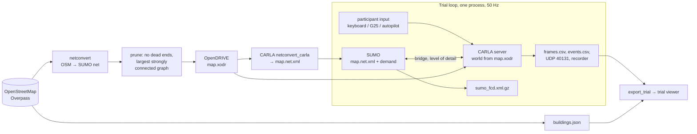
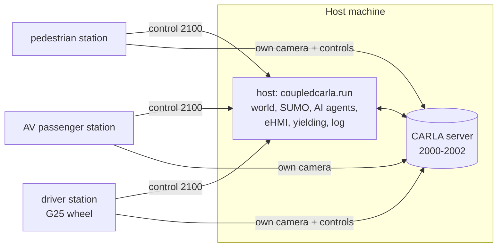

# coupled-carla

**A human-factors driving simulator for real places.** coupled-carla builds a drivable [CARLA](https://carla.org)
world for any bounding box on Earth from OpenStreetMap, fills it with traffic from [SUMO](https://eclipse.dev/sumo/)
(cars, cyclists, buses with proper car-following and lane-change models), puts a participant at the wheel
(keyboard, Logitech G25 with force feedback, or an autopilot for tests) and logs every trial at 50 Hz in the
spirit of [coupled-sim](https://github.com/bazilinskyy/coupled-sim). Eindhoven is the reference city; 18 more
cities, three per inhabited continent from megacity to small town, are ready to drive.

**Phase 1** brought one human (or autopilot) and SUMO traffic to any city. **Phase 2** adds coupled
experiments in coupled-sim's sense: 2+ humans at their own stations (driver, pedestrian, AV passenger with
eHMI controls) and n AI participants (scripted cars with coupled-sim-style triggers and eHMIs, scripted
walkers) in the same world, with visual sync, latency logging and stations on other machines (see
[Coupled experiments](#coupled-experiments-phase-2)). **Phase 3** (in progress) moves to CARLA 1.0 on Unreal
Engine 5.8 with a Dutch digital twin of Eindhoven: AHN terrain, 8 cm aerial photos and 3DBAG buildings with
real roof shapes (see [Phase 3](#phase-3-carla-10-and-the-eindhoven-digital-twin)); the code is ready for both
CARLA 0.9.16 and 1.0.


*Eindhoven city centre, replayed in the browser trial viewer (three.js) from a logged trial: 3,758 OSM buildings,
the drivable road network, cycleways in red, the participant in red and SUMO traffic in blue.*

---

## Contents

- [What you get](#what-you-get)
- [Screenshots](#screenshots)
- [How it works](#how-it-works)
- [Quick start](#quick-start)
- [Cities](#cities)
- [Experiment files](#experiment-files)
- [Participants, inputs and views](#participants-inputs-and-views)
- [Coupled experiments (phase 2)](#coupled-experiments-phase-2)
- [Phase 3: CARLA 1.0 and the Eindhoven digital twin](#phase-3-carla-10-and-the-eindhoven-digital-twin)
- [Traffic](#traffic)
- [Traffic lights](#traffic-lights)
- [Logging and data](#logging-and-data)
- [Trial viewer](#trial-viewer)
- [Performance](#performance)
- [coupled-sim features in coupled-carla](#coupled-sim-features-in-coupled-carla)
- [Known limits](#known-limits)
- [Roadmap](#roadmap)
- [Lessons learned (gotchas)](#lessons-learned-gotchas)
- [Project layout](#project-layout)
- [Credits, data and licences](#credits-data-and-licences)

---

## What you get

| | |
|---|---|
| **Any place** | `map.bbox: [south, west, north, east]` -> OSM download -> pruned road graph -> OpenDRIVE for CARLA + matching SUMO network, in seconds (2.6 s for 1.6 km of central Eindhoven, plus the download). Left- and right-hand traffic. |
| **19 cities** | Eindhoven plus 18 cities on six continents, from Tokyo and Cairo to Luang Prabang and Ushuaia ([Cities](#cities)). |
| **Traffic models** | SUMO drives everything that is not a participant: EIDM car following, the sublane lane-change model (cyclists and cars share and overtake), a Dutch-flavoured fleet with Gazelle bikes and buses, random demand by city size. The participant's car is mirrored into SUMO, so traffic reacts to them. |
| **City-scale, real time** | SUMO simulates the whole map; only actors within 250 m of a participant exist in CARLA (level of detail), which keeps a city real time on one GPU. |
| **Participants** | Keyboard, Logitech G25 wheel with force feedback, or autopilot; driver, hood or chase view. |
| **Logging** | coupled-sim-style per-frame CSV at 50 Hz (participants always, AI actors near them), events, live JSON over UDP 40131, SUMO's trajectory output for the whole network, CARLA's recorder for replay. |
| **Trial viewer** | Browser replay of any trial in 3D with the OSM buildings, timeline, follow camera, light state and events. |
| **Experiment files** | YAML: map, server, simulation, traffic, participants, points of interest, logging, a trial sequence with per-trial overrides. |
| **Coupled experiments** | Stations for a driver, a pedestrian and an AV passenger on any machine of the LAN; scripted AI cars (routes, coupled-sim-style triggers, eHMI on the front, rear, roof, road or as "eyes") and walkers; a pedestrian crowd; SUMO traffic yields to pedestrians; eye-contact events; visual sync; round trips and frame latency logged. |
| **Two CARLA generations** | The same experiment files for CARLA 0.9.16 (UE 4.26) and CARLA 1.0 (UE 5.8): renamed blueprints are mapped to their closest stand-ins. |

## Screenshots

**The trial viewer** (browser, three.js), same trial as above: oblique view around the participant and the
follow camera with the HUD (speed, next traffic light, time).

| Oblique | Follow camera |
|---|---|
|  |  |

**In CARLA** (chase camera, Epic quality): the roads are CARLA's meshes generated from the OpenDRIVE; traffic
lights are drawn from SUMO's signal states (pole with lamp at each stop line); SUMO vehicles appear near the
participant. There are no buildings or road markings in CARLA yet ([Known limits](#known-limits)).

| Cairo (Tahrir) | Tokyo (Shibuya) |
|---|---|
|  |  |

**New York (Midtown)** in the viewer: OSM building heights give Midtown's towers; the participant drives
the street grid with SUMO traffic.

| Overview | Oblique |
|---|---|
|  |  |

**Coupled experiment (phase 2)**, Eindhoven: a pedestrian crosses while an automated vehicle approaches; the
AV yields and its passenger switches the eHMI from "I'M STOPPING" (cyan) to "GO AHEAD" (green); a manual
driver follows. Each view below was rendered by a separate station process, the pedestrian's on another PC.

| Pedestrian station: the AV stops, "I'M STOPPING" | Pedestrian station: "GO AHEAD" (dusk trial) |
|---|---|
|  |  |

| AV passenger station: their eHMI, seen from inside | Driver station: following the yielding AV at dusk |
|---|---|
|  |  |

The same moment in the trial viewer: the pedestrian (red) crossing, the AV (dark blue) stopped with its cyan
eHMI bar, an AI walker further down the street; the event list shows the AV stopping, the passenger's eHMI
command and the stations' frame rates and round trips.


**All 19 maps** (drivable roads, cycleways, OSM buildings; 1.4 km squares, north up):


## How it works



1. **Map** (`coupledcarla/mapbuild.py`). Overpass gives the OSM ways with `highway=*` in the box (cached).
   SUMO's `netconvert` turns them into a network keeping the configured road types and cycleways, guessing
   ramps, roundabouts and signals. The road graph is then **pruned**: dead-end chains are removed and only
   the largest strongly connected part is kept, so a car can always go on (at the cut edge of the box, roads
   would otherwise end in the void). The pruned network is written as OpenDRIVE (`map.xodr`, signals named
   so CARLA's tools keep them) and converted back with CARLA's `netconvert_carla.py` into a SUMO network
   with the same road ids (`map.net.xml`). OSM building footprints with heights go to `buildings.json`.
2. **World.** CARLA builds road meshes from the OpenDRIVE at load time (`generate_opendrive_world`, about
   10 s); a large plane 0.3 m below the roads catches anything that leaves them.
3. **Traffic** (`coupledcarla/traffic.py`). SUMO vehicle types named after CARLA blueprints, random trips
   for cars, bikes and buses, a `.sumocfg` per trial.
4. **Trial loop** (`coupledcarla/run.py`), one process: read each participant's input and apply it; step
   SUMO and CARLA together through the bridge (`coupledcarla/bridge`, vendored from CARLA 0.9.16's
   `Co-Simulation/Sumo` with fixes); draw the traffic lights; log the frame; draw the view; sleep to stay in
   real time.

## Quick start

Needs CARLA 0.9.16 (the release package; the UE 5 line has no SUMO co-simulation), Python 3.12, a GPU.

```bash
git clone https://github.com/bazilinskyy/coupled-carla.git && cd coupled-carla
uv venv --python 3.12 .venv && uv pip install --python .venv/bin/python -r requirements.txt
export CARLA_ROOT=~/carla-eindhoven/CARLA_0.9.16          # the extracted CARLA 0.9.16 release
export SUMO_HOME=$(.venv/bin/python -c "import sumo; print(sumo.SUMO_HOME)")
export PATH=$SUMO_HOME/bin:$PATH PROJ_LIB=$SUMO_HOME/data/proj
```

Build a map once, then run its trials:

```bash
.venv/bin/python -m coupledcarla.mapbuild experiments/eindhoven_centre.yaml
.venv/bin/python -m coupledcarla.run experiments/eindhoven_centre.yaml                    # all trials, keyboard
.venv/bin/python -m coupledcarla.run experiments/eindhoven_centre.yaml --trial 0 --input wheel
```

Headless test drive (autopilot, saves a chase-camera frame every 10 s):

```bash
.venv/bin/python -m coupledcarla.run experiments/eindhoven_centre.yaml --input autopilot --headless --view chase --duration 120 --frames-every 10
```

The figure and screenshot tools need `requirements-tools.txt` as well.

The cities: write their experiment files and build every map (Overpass is slow, a few minutes per city), then
smoke-test them all:

```bash
.venv/bin/python -m coupledcarla.cities
.venv/bin/python tools/test_cities.py --duration 40 > docs/city_tests.md
```

Replay a trial in the browser:

```bash
.venv/bin/python -m coupledcarla.export_trial logs/eindhoven_centre/<time>_trial0
python3 -m http.server 8765        # then open http://localhost:8765/viewer/?file=/logs/eindhoven_centre/<time>_trial0/trial.json
```

Command-line options of `coupledcarla.run`: `--trial N` (repeatable), `--input autopilot|keyboard|wheel`,
`--headless`, `--view driver|chase|hood`, `--duration S`, `--frames-every S`, `--quality Low|Epic`,
`--step S`.

## Cities

Three per inhabited continent, by size, each a 1.4 km square around a central point
([`experiments/cities.yaml`](experiments/cities.yaml); `python -m coupledcarla.cities` writes
`experiments/cities/<slug>.yaml`). Traffic demand scales with the size class.

| Continent | Large | Medium | Small |
|---|---|---|---|
| Africa | Cairo (Tahrir), ~22 M | Kigali, ~1.7 M | Stellenbosch, ~0.2 M (left-hand) |
| Asia | Tokyo (Shibuya), ~37 M (left-hand) | Taipei (Main Station), ~2.6 M | Luang Prabang, ~0.06 M |
| Europe | London (Westminster), ~9 M (left-hand) | Lyon (Bellecour), ~0.5 M | Leuven, ~0.1 M |
| North America | New York (Midtown), ~8.3 M | Portland, Oregon, ~0.65 M | Burlington, Vermont, ~0.045 M |
| South America | São Paulo (Sé), ~12 M | Montevideo, ~1.3 M | Ushuaia, ~0.08 M |
| Oceania | Sydney (CBD), ~5.3 M (left-hand) | Auckland (CBD), ~1.7 M (left-hand) | Nouméa, ~0.1 M |

Plus **Eindhoven** (city centre, station to the TU/e campus edge, 1.6 km), the reference use case
([`experiments/eindhoven_centre.yaml`](experiments/eindhoven_centre.yaml)). Populations are approximate and
only order the cities by size.

Left-hand traffic works end to end: the map builder passes `--lefthand` to netconvert, and in Stellenbosch the
autopilot followed the left-hand OSM lanes' direction in 14 of 15 checked samples (the odd one at a junction).

**Smoke test** of every map (40 s headless autopilot trial each; full table in
[`docs/city_tests.md`](docs/city_tests.md)):

Smoke test, 2026-11-13: 40 s headless autopilot trial per map, CARLA 0.9.16 at Epic, 50 Hz, on lin4080 (RTX 4080 SUPER shared with another job).

| Map | Continent | Size | Traffic | Lane links | Buildings | SUMO vehicles shown | Real-time factor | Left road | Stuck | Put back on lane | Collisions | Result |
|---|---|---|---|---|---|---|---|---|---|---|---|---|
| Eindhoven | Europe | medium | right | 2248 | 3758 | 8 | 0.878 | 0 | 0 | 0 | 14 | ok |
| Cairo (Tahrir) | Africa | large | right | 3837 | 650 | 8 | 0.813 | 2 | 0 | 2 | 6 | ok |
| Kigali | Africa | medium | right | 1655 | 1741 | 1 | 0.866 | 1 | 0 | 1 | 0 | ok |
| Stellenbosch | Africa | small | left | 1748 | 1291 | 3 | 0.822 | 0 | 0 | 0 | 26 | ok |
| Tokyo (Shibuya) | Asia | large | left | 5076 | 3770 | 1 | 0.678 | 17 | 0 | 17 | 152 | ok |
| Taipei (Main Station) | Asia | medium | right | 2902 | 2558 | 3 | 0.735 | 0 | 0 | 0 | 0 | ok |
| Luang Prabang | Asia | small | right | 1418 | 1144 | 1 | 0.989 | 2 | 0 | 2 | 0 | ok |
| London (Westminster) | Europe | large | left | 2756 | 2086 | 0 | 0.846 | 1 | 0 | 1 | 160 | ok |
| Lyon (Bellecour) | Europe | medium | right | 2312 | 2481 | 3 | 0.86 | 2 | 0 | 2 | 171 | ok |
| Leuven | Europe | small | right | 1537 | 5030 | 4 | 0.993 | 2 | 0 | 2 | 65 | ok |
| New York (Midtown) | North America | large | right | 2213 | 1590 | 11 | 0.657 | 1 | 0 | 1 | 7 | ok |
| Portland, Oregon | North America | medium | right | 4356 | 703 | 2 | 0.549 | 0 | 0 | 0 | 7 | ok |
| Burlington, Vermont | North America | small | right | 2034 | 1849 | 4 | 0.882 | 2 | 0 | 2 | 0 | ok |
| São Paulo (Sé) | South America | large | right | 2181 | 2977 | 2 | 0.751 | 1 | 0 | 1 | 0 | ok |
| Montevideo | South America | medium | right | 1917 | 741 | 3 | 0.675 | 0 | 0 | 0 | 0 | ok |
| Ushuaia | South America | small | right | 2403 | 1024 | 1 | 0.941 | 3 | 0 | 3 | 1 | ok |
| Sydney (CBD) | Oceania | large | left | 2598 | 1021 | 0 | 0.663 | 0 | 0 | 0 | 0 | ok |
| Auckland (CBD) | Oceania | medium | left | 3923 | 1140 | 0 | 0.669 | 0 | 0 | 0 | 4 | ok |
| Nouméa | Oceania | small | right | 1784 | 2468 | 3 | 0.97 | 0 | 0 | 0 | 1 | ok |

All 19 maps load and drive. "SUMO vehicles shown" counts the SUMO vehicles that came within the
level-of-detail radius of the ego during the 40 s (SUMO simulates many more on the whole map; demand starts at
the map edges, so the first 40 s are sparse). "Left road", "Stuck" and "Put back on lane" are autopilot
recoveries (it follows random lanes; dense junction areas such as Shibuya cost the most); collisions are mostly
the car touching a road edge before it is put back. The real-time factor is below 1 because the GPU was shared
([Performance](#performance)).

## Experiment files

An experiment is one YAML file; anything left out takes the default from
[`coupledcarla/config.py`](coupledcarla/config.py).

```yaml
name: eindhoven_centre
map:
  bbox: [51.4360, 5.4700, 51.4500, 5.4930]   # south, west, north, east
  # road_types: [motorway, ..., residential, living_street]
  # cycleways: true        # keep highway=cycleway (SUMO cyclists ride them)
  # trim_dead_ends: true   # prune dead ends, keep the largest strongly connected road graph
  # lefthand: false        # left-hand traffic
  # carla: {wall_height: 0.0, ground: true, ...}   # OpenDRIVE mesh options, ground plane
server:
  quality: Epic            # Epic | Low
  # host: 127.0.0.1, port: 2000, tm_port: 8100, launch: true, offscreen: true
simulation:
  step: 0.02               # 50 Hz, like coupled-sim's fixed-time log
  weather: CloudyNoon      # a carla.WeatherParameters preset or a dict of its fields
  # sun_altitude: 4, real_time: true, tls_manager: sumo, lod_radius_m: 250
traffic:
  cars_per_hour: 2400
  bikes_per_hour: 1200
  buses_per_hour: 12
  # car_following: EIDM, car_types: {blueprint: weight}, bike_types: {...}, bus_type: ..., seed: 42
participants:
  - role: driver
    vehicle: vehicle.lincoln.mkz_2020
    input: keyboard        # keyboard | wheel | autopilot
    view: driver           # driver | chase | hood
    spawn: {lat: 51.44453, lon: 5.47883}   # optional; also heading (compass degrees); else a random lane
pois:
  - {name: eindhoven_centraal, lat: 51.4433, lon: 5.4797}
logging:
  radius_m: 150            # AI actors within this distance of a participant are logged every frame
  # udp: {host: 127.0.0.1, port: 40131, interval: 0.2}, carla_recorder: true, frames_every_s: 0
trials:                    # run in order; each may override simulation, traffic, participants, logging
  - {duration_s: 300}
  - {duration_s: 300, simulation: {weather: WetCloudySunset, sun_altitude: 4}, traffic: {cars_per_hour: 3600}}
```

Every trial writes its merged configuration to `config.yaml` next to its logs, so a trial can always be traced
back to the exact settings it ran with.

## Participants, inputs and views

| Input | What it does |
|---|---|
| `keyboard` | W/S or arrows to drive, A/D to steer (rate-limited), Q reverse, Space hand brake, Z/X blinkers, R puts the car back on the nearest lane, Esc ends the trial. |
| `wheel` | Logitech G25 (or a similar wheel) via [`steering_wheel.py`](coupledcarla/inputs/steering_wheel.py): steering with a 7:1 ratio, pedals, shifter, and force feedback modelled on a real car (aligning torque from tyre slip, speed-dependent power steering, road rumble, collision jolts). The keyboard keys above still work. |
| `autopilot` | CARLA's BasicAgent following random lanes, stopping for vehicles and for red/yellow lights from SUMO. For tests and as an AI driver. |

Views: `driver` (left-hand-drive seat, eye height), `hood`, `chase`. With a window (keyboard, wheel) the view is
shown in a pygame window with a HUD (speed, time, next light).

Spawning: a `spawn: {lat, lon}` snaps to the nearest driving lane (1.5 m off for the Eindhoven example);
without it a random driving lane outside junctions is used. A car that leaves the road (falls onto the ground
plane) is logged (`left_road`) and, for the autopilot, put back on the nearest lane (`reset_to_lane`).

## Coupled experiments (phase 2)

Several humans and AI participants share one world, as in coupled-sim. The **host**
(`python -m coupledcarla.run`) owns the CARLA world, SUMO, the AI agents and the log; each human sits at a
**station** (`python -m coupledcarla.station`) on any machine of the LAN.



- **Stations** connect twice: to the CARLA server, to render their own camera and apply their own controls
  directly (no detour through the host), and to the host's **control channel** (TCP, JSON lines, port 2100) for
  everything else: their role and actor, trial start and end, visual-sync flashes, eHMI commands, round trips.
  The host waits for every `station: true` participant before a trial starts; stations stay connected across
  the trial sequence (each trial runs in a fresh child process, see [Lessons learned](#lessons-learned-gotchas)).
- **Roles** (`participants[].kind`): `driver` (a manual car: keyboard or G25 wheel, R puts the car back on its
  lane), `pedestrian` (a walker: W/S/A/D, mouse or arrows to look, Shift to run; camera at eye height) and
  `av_passenger` (rides in a scripted AV, front passenger seat; keys 1-9 choose the eHMI message, 0 switches it
  off). Every station has F for a visual sync and Esc to leave.
- **AI participants** (`agents`, [`coupledcarla/ai.py`](coupledcarla/ai.py)):
  - `kind: car`: follows a route through lat/lon points, planned on the lanes, at a speed profile set by
    **triggers** along the route, after coupled-sim's SpeedSettings: `{at: [lat, lon] | at_m: metres,
    speed_kmh, accel, yield_s, blinker: left|right|hazard, ehmi: state}`. It stops for SUMO red lights and, with
    `yield_to_pedestrians`, for pedestrians (human or AI) in its path, braking to rest ~4 m short and holding
    until the path has been clear for 0.8 s. Its eHMI is `manual` (set by an AV-passenger station or by
    triggers), `auto` ("I'M STOPPING" while it yields, "DRIVING" otherwise) or `off`.
  - `kind: walker`: walks a path of lat/lon points (`speed`, `start_s`, `loop`) with direct walker control,
    so it needs no CARLA navigation mesh.
- **eHMI** states and colours are configurable (`ehmi.states`), and so is where a car shows them
  (`ehmi.slots` for every car, `agents[].ehmi_slots` per car; coupled-sim had top and hood slots):

  | Slot | What | Read by |
  |---|---|---|
  | `front` (default) | light bar across the front, the text above it | someone in front of the car |
  | `rear` | the same on the back | a cyclist or driver behind |
  | `roof` | a light ring round the roof, the text on all four sides | anyone around the car |
  | `road` | the text projected on the road 3 m ahead | a pedestrian about to cross |
  | `eyes` | two eyes on the front whose pupils follow the nearest pedestrian (within 40 m), in the state's colour | eye contact with the AV ("eyes on a car") |

  CARLA renders debug *text* only in the spectator view, so the text is drawn with debug *lines* in a small
  line font, which every camera sees. The Eindhoven crossing's AV uses `[front, roof, road, eyes]`.
- **Eye contact** (`eye_contact: {angle_deg: 20, distance_m: 30}`): the host logs `eye_contact_start` and
  `eye_contact_end` whenever a pedestrian and a vehicle face each other within the angle and distance, with
  both angles. A pedestrian station sends where its camera looks; a vehicle faces along its heading (no head
  tracking yet, so for a driver this is "the car points at the pedestrian").
- **Pedestrian crowd** (`traffic.walkers: {count, radius_m, seed}`, [`experiments/eindhoven_crowd.yaml`](experiments/eindhoven_crowd.yaml)):
  pedestrians walking up and down beside the roads near the participants (on sidewalk lanes when the map has
  them, else 1.5 m beyond the outermost lane). They never step onto the road, so no car yields to them. Not
  CARLA's walker AI: CARLA 0.9.16 serves no navigation mesh for an OpenDRIVE world (see
  [Lessons learned](#lessons-learned-gotchas)). 30 walkers cost the server about 12 ms per tick on lin4080.

  
- **SUMO traffic yields to pedestrians**: SUMO vehicles near a pedestrian brake for one in their path and drive
  on when it is clear (`sumo_yields` events). SUMO itself only yields to persons on crossings, and CARLA
  pedestrians are not in SUMO.
- **Visual sync**: `coupling.visual_sync_at_s` (or F at any station) shows a red bar on every station for 1 s
  and logs `visual_sync` with the frame, to align screen recordings, eye trackers or physiology afterwards.
- **Latency**: the host sends every tick's frame number and wall time to the stations; each station estimates
  the clock offset to the host from its pings (the shortest round trip, as NTP does) and measures, on the
  host's clock, when it saw that frame's world snapshot (`tick_to_station_ms`) and when that frame's camera
  image arrived (`tick_to_image_ms`). Per frame in the station CSV, as median and 95th percentile in the
  `station_stats` events and in `summary.json`. Display lag (monitor, VR headset) comes on top; a photodiode
  on the visual-sync bar measures it.
- **Logging**: agents get rows every frame (`kind = agent`, with an `ehmi` column), and the events include
  `station_joined`, `station_left`, `station_stats` (round trip to the host and rendered fps, every 5 s),
  `ehmi` (with who set it), `trigger`, `agent_stops` / `agent_goes` (with the reason), `sumo_yields`,
  `visual_sync`, and `collision` for every participant and agent. Each station also writes
  `logs/stations/<role>_<time>.csv`: one row per rendered frame with wall-clock time, CARLA frame, simulation
  time, round trip, visual-sync flag, speed and eHMI.

### Running the Eindhoven crossing

[`experiments/eindhoven_crossing.yaml`](experiments/eindhoven_crossing.yaml): a straight two-way street east of
the station (OSM way 7157413, 392 m, no lights). The AV starts 130 m before the crossing at 30 km/h; the
pedestrian waits at the north kerb; the driver starts 38 m behind the AV; an oncoming AI car with an automatic
eHMI, two AI walkers and SUMO traffic fill the street; two trials (day, dusk).

```bash
# host (the machine with the GPU)
.venv/bin/python -m coupledcarla.run experiments/eindhoven_crossing.yaml
# one station per human, on any machine of the LAN (needs only the carla client, pygame, numpy)
.venv/bin/python -m coupledcarla.station --host <host ip> --role pedestrian
.venv/bin/python -m coupledcarla.station --host <host ip> --role av_passenger
.venv/bin/python -m coupledcarla.station --host <host ip> --role driver --input wheel
```

`--input bot` runs a station without a human (the experiment's `bot` entry: the pedestrian's path and gaze
target, the passenger's eHMI schedule, the driver on autopilot), with `--headless --frames-every 0.5` to save
its view; `run ... --local` runs every station role as a bot on the host, for a quick test without stations.

**Test run** (13 Nov 2026): host and CARLA on lin4080 (RTX 4080 SUPER, shared with another job); driver and AV
passenger stations on lin4080; the pedestrian station on a different PC (wsl5090, wired LAN), all as bots;
both trials:

| | |
|---|---|
| Stations | all three joined in ~3 s, rejoined for trial 2, left cleanly at the end |
| Round trip to the host | 0.3-20 ms (local stations), 12-23 ms (other PC) |
| Station frame rate | ~35 fps each (the host's tick rate) |
| Real-time factor | 0.69-0.70 (host plus three cameras at 50 Hz on the shared GPU) |
| AV | stopped for the pedestrian at 14.9 s, drove on at 19.5 s; eHMI yielding 13.0 s, go 16.0 s, driving 21.0 s (passenger station) |
| Oncoming AI car | stopped for AI walker 1 at 9.1 s, drove on at 11.8 s; its automatic eHMI followed |
| Collisions | 0 in both trials |
| Latency (rerun with the latency log, all stations local) | tick to station snapshot 0.1 ms; tick to camera image 106-197 ms median (CARLA renders and reads back a camera 4-6 frames after its tick) |
| Eye contact | pedestrian and AV from 29.5 m to 13.5 m; pedestrian and driver from 29.6 m to 20.3 m |

**Network**: stations need the host's ports 2000-2002 (CARLA) and 2100 (control) on a wired LAN. A station on
Wi-Fi (lin5080) could talk to the host but received no camera frames: its path dropped packets above ~1,350
bytes without telling the sender (a path-MTU black hole), so CARLA's image stream stalled. A remote station
receives its camera as raw images over the network (960x540 at 35 fps is about 70 MB/s), so gigabit Ethernet
carries about one full-HD remote station; CARLA's multi-GPU secondary servers, rendering on the station's own
GPU, are the next step for more.

## Phase 3: CARLA 1.0 and the Eindhoven digital twin

Phase 3 brings real looks: CARLA 1.0 on Unreal Engine 5.8 (Lumen, World Partition, the Digital Twin baker)
and Eindhoven built from Dutch national open data instead of OSM alone.

### Running on CARLA 1.0

coupled-carla takes the same experiment files on CARLA 0.9.16 and CARLA 1.0. CARLA 1.0 renamed or dropped
most vehicle blueprints; [`compat.py`](coupledcarla/compat.py) maps every 0.9 name used here to the closest 1.0
blueprint (by body type and size, then by `base_type`, then by wheel count) and logs each substitution once.
The SUMO conversion script that CARLA 1.0 no longer ships is vendored in `bridge/util/`. Set up a second
environment next to the 0.9.16 one:

```bash
# the CARLA 1.0 package (UE5 weekly, ~14 GB), extracted to e.g. ~/carla58-pkg/CARLA_1.0
uv venv --python 3.12 .venv10
grep -v '^carla' requirements.txt > /tmp/req10.txt
VIRTUAL_ENV=.venv10 uv pip install -r /tmp/req10.txt <package>/PythonAPI/carla/dist/carla-1.0-cp312-cp312-linux_x86_64.whl
# env10.sh: CARLA_ROOT=<package>, SUMO_HOME, PATH and PROJ_LIB as in env.sh
bash tools/run_coupled_test.sh experiments/eindhoven_crossing.yaml env10.sh .venv10/bin/python
```

The 1.0 server needs a recent NVIDIA driver. With driver 560 (lin4080) it stops at start-up ("Vulkan device
could not be created at the project's supported feature levels"), even with only the NVIDIA Vulkan driver
visible; lin5080 (driver 595, RTX 5080) is the 1.0 machine.

### The Eindhoven digital twin

The twin is built with CARLA's [Digital Twin pipeline](https://github.com/carla-simulator/carla-digitaltwins)
(`ue58-twins`), extended with Dutch open data in the fork
[bazilinskyy/carla-digitaltwins](https://github.com/bazilinskyy/carla-digitaltwins/tree/nl-data) (branch
`nl-data`):

| Layer | Source | Resolution |
|---|---|---|
| Road network, signs, crossings | OpenStreetMap via Overpass (fetched in quarters when a server times out) | |
| Terrain | [AHN](https://www.ahn.nl) DTM via the PDOK WCS, heights in NAP | 0.5 m |
| Aerial photo (road surfaces, refinement, ground texture) | [PDOK Luchtfoto](https://www.pdok.nl/introductie/-/article/pdok-luchtfoto-rgb-open-) RGB, current year | 8 cm, resampled to 25 cm |
| Buildings | [3DBAG](https://3dbag.nl) LoD 2.2 (BAG footprints with AHN lidar roofs) | per building |

```bash
python -m twinmodel build --bbox 51.4360 5.4700 51.4500 5.4930 --name EhvCentre --out build/ehv_centre --profile nl_urban
python -m twinmodel bake-export build/ehv_centre EhvCentre
python TwinModel/tools/threedbag_buildings.py build/ehv_centre      # OSM boxes -> 3DBAG roofs
```


*The Eindhoven centre twin (1.6 x 1.6 km, the same area as `eindhoven_centre.yaml`): 2,094 roads, 242
junctions and 1,578 signals over the 8 cm PDOK aerial photo; terrain from AHN (12.1-23.9 m NAP); the OpenDRIVE
validates in CARLA (98,920 waypoints). Bake input: 623 meshes, 0.9 M triangles.*


*Buildings near the Eindhoven crossing: OSM footprints extruded to a guessed height (left) and 3DBAG LoD 2.2
with the real roof shapes (right). The centre twin has 3,654 3DBAG buildings (274k triangles in 63 tiles).*

**Still to do in phase 3:** bake the twin into a UE 5.8 level (`bake_level.py`, needs the CARLA source build,
under way on lin5080), load it as the map instead of an OpenDRIVE world (the SUMO network then comes from the
twin's OpenDRIVE), BGT road surfaces, VR.

## Traffic

- **Models.** SUMO's Extended IDM (EIDM) for car following (human-like reaction and drive-off) with
  `tau = 1.2 s`, `minGap = 2 m`, speed factor N(1.0, 0.1); the sublane model (`--lateral-resolution 0.25`)
  for lane changing, which lets cyclists ride at the right edge and cars overtake them.
- **Fleet.** Cars from a weighted mix of compact European-style CARLA models; Gazelle omafiets,
  BH crossbike and Diamondback bikes (cyclists at about 5 m/s with spread); a bus.
- **Demand.** Random trips (`randomTrips.py --validate`) per class and hour, with a fringe factor so traffic
  enters at the edges of the map; the cities scale demand by size.
- **Interaction.** The participant's car is mirrored into SUMO each tick (`moveToXY`), so SUMO vehicles brake
  for it, queue behind it and yield to it.
- **Level of detail.** SUMO simulates the whole map; a SUMO vehicle exists in CARLA only within
  `simulation.lod_radius_m` (250 m) of a participant and is removed beyond 280 m.

## Traffic lights

SUMO runs the signal programs (`simulation.tls_manager: sumo`). CARLA's own traffic-light actors are unusable
in a world built from OpenDRIVE: they have no OpenDRIVE id, so they cannot be linked to SUMO, and
`set_state()` does not change them (they stay red). SUMO is therefore the only source of truth:

- each signalled lane's light is **drawn in the world** at its stop line (a pole with a lamp, right of the
  lane), coloured from SUMO, for lights near a participant; the drawing shows in every camera, so the driver
  sees it;
- each participant's **next light** (id, distance, state) comes from the lane their SUMO twin is on; it drives
  the autopilot, the HUD, the per-frame log (`next_tl*` columns) and a `next_light` event whenever it changes.

The signal programs are CARLA's converter defaults for now (per approach 42 s green, 3 s yellow, 3 s red), not
the coordinated programs SUMO derives from OSM ([Known limits](#known-limits)).

## Logging and data

Each trial writes to `logs/<experiment>/<YYYYmmdd-HHMMSS>_trial<k>/`:

| File | Content |
|---|---|
| `config.yaml` | The merged configuration of this trial. |
| `frames.csv` | Semicolon-separated like coupled-sim's CSV; one row per actor per frame at the simulation rate (50 Hz). Participants every frame; AI vehicles, cyclists and buses every frame while within `logging.radius_m` of a participant. |
| `events.csv` | `trial_start`, `spawn` (with SUMO id), `next_light`, `collision`, `left_road`, `reset_to_lane`, `trial_end` (with a summary). Line-buffered, so it survives a crash. |
| `summary.json` | Ticks, simulated and wall time, real-time factor, rows, collisions, SUMO vehicles shown. |
| `sumo/` | The trial's demand and SUMO config, `sumo_fcd.xml.gz` (**every** vehicle on the map at 10 Hz with lat/lon and signals), `sumo_tripinfo.xml`, `sumo.log`. |
| `view_*.jpg` | Snapshots of the first participant's view when `--frames-every` is set. |
| CARLA recorder | `coupledcarla_<experiment>_<time>_trial<k>.log` on the server machine, for replay from any viewpoint with CARLA's replayer. |
| UDP 40131 | Every 0.2 s a JSON frame shaped like coupled-sim's live data (`Driver [i]`, `Pedestrian [i]`, `CarLight [id]` entries with position, rotation, lat/lon, speed, lights). |

`frames.csv` columns: `timestamp; frame; actor_id; kind` (participant, car, bike, bus, walker)`; role; type_id;
pos_x; pos_y; pos_z` (CARLA metres: x east, y south, z up)`; rot_pitch; rot_yaw; rot_roll; lat; lon; vel_x;
vel_y; vel_z; speed_kmh; acc_x; acc_y; acc_z; blinkers` (0 none, 1 left, 2 right, 3 hazard)`; front_lights;
stop_lights; throttle; steer; brake; reverse; hand_brake` (participants)`; next_tl; next_tl_dist;
next_tl_state` (participants and agents)`; ehmi` (agents). `kind` is `agent` for scripted AI cars and walkers,
logged every frame like participants.

Unlike coupled-sim's wide CSV (one column block per agent, fixed agents), this is a long table: SUMO spawns
and removes hundreds of vehicles, so one row per actor per frame is the shape that works (and loads directly
into pandas or R).

## Trial viewer

[`viewer/index.html`](viewer/index.html) replays a trial in the browser with three.js (inspired by the
browser-built cities shared in the project channel, e.g. mrdoob's procedurally generated New York and the
OSM-massed Berlin demo): roads as ribbons, cycleways in red, OSM buildings extruded to their tagged height
(or 3.2 m per level), actors as boxes coloured by kind, a timeline with play/speed, free / follow / top
cameras, the participant's speed and next light, and the events so far.

```bash
.venv/bin/python -m coupledcarla.export_trial logs/eindhoven_centre/<time>_trial0   # -> trial.json
python3 -m http.server 8765
# open http://localhost:8765/viewer/?file=/logs/eindhoven_centre/<time>_trial0/trial.json
```

Three demo trials are included: `http://localhost:8765/viewer/?file=data/eindhoven_centre.json` (180 s),
`?file=data/new_york_midtown.json` (40 s) and `?file=data/eindhoven_crossing.json` (the coupled crossing,
45 s: agents in dark blue with their eHMI bar, AI walkers in purple). A file can also be
dropped onto the page. `window.viewer.renderAt(t, camera)` renders a given moment;
[`tools/viewer_shots.py`](tools/viewer_shots.py) uses it to make the screenshots in this README in headless
Chromium.

## Performance

Measured on lin4080 (RTX 4080 SUPER 16 GB, **shared with another job using ~60 % of the GPU**), CARLA
0.9.16 at Epic, 50 Hz:

| Setup | Real-time factor |
|---|---|
| Eindhoven, 180 s, level of detail 250 m, ~5-10 SUMO actors in CARLA at a time | 0.78 |
| Same, no level of detail (all ~100 SUMO vehicles in CARLA) | 0.26 |
| 20 Hz, cars only (no cyclists), all in CARLA | 1.00 |
| The 19 maps, 40 s each (table above) | 0.55-0.99 (small towns fastest) |
| Coupled crossing: host + 3 stations with 50 Hz cameras + 4 agents | 0.69-0.70 |

Each SUMO vehicle in CARLA costs server time every tick: about 0.4 ms for a car and **about 3 ms for a
cyclist** (the bike carries an animated rider), which is why the level of detail matters. The base frame time at
Epic is about 20 ms, which is the whole budget at 50 Hz; on an unshared GPU (or at `--quality Low`) the trial
runs in real time. Map building takes 2-4 s per city plus the Overpass downloads.

## coupled-sim features in coupled-carla

| coupled-sim | coupled-carla | Status |
|---|---|---|
| Roles: manual driver, AV passenger, pedestrian | `participants` with kind driver / av_passenger / pedestrian, each host-local or at a station | done |
| Experiment definitions, trial sequence, run automatically | YAML experiment, `trials` with overrides, run in order | done |
| Input: keyboard, steering wheel | keyboard, G25 with force feedback | done |
| Input: Xsens motion suit | walker bone control | to do |
| Output: screen | pygame window, driver/hood/chase | done |
| Output: HMD (VR) | OpenXR / DReyeVR-style | phase 3 |
| AI cars on waypoint circuits with speed/yield triggers | scripted agents on lat/lon routes with triggers (speed, accel, yield, blinker, eHMI) + SUMO traffic | done |
| AI pedestrians on waypoint circuits | scripted walkers on lat/lon paths (no navigation mesh needed) | done; SUMO persons as walkers: to do |
| eHMI on the AV (top, windshield, hood) | light bar + line-font text on the front, set by passenger, triggers or automatically | done (front only) |
| Traffic lights, switchable | SUMO signal programs, drawn in the world | done (default programs) |
| Day/night | weather presets, sun altitude | done |
| Networking host + 3 clients | host + one station per human on the LAN, no fixed limit | done; multi-GPU secondaries: to do |
| Binary log 50 Hz + CSV conversion | `frames.csv` at 50 Hz directly | done |
| Live data UDP 40131 | JSON frames on UDP 40131 | done |
| Driver eye contact | – | to do |
| Round-trip time in the log | `station_stats` events + per-frame station logs | done |
| Points of interest as CSV reference frames | `pois` in lat/lon | stored; reference-frame conversion: to do |
| Visual sync (red bar) | red bar on every station, scheduled or on F, logged with the frame | done |
| Video recording | CARLA recorder + re-render from any viewpoint | recorder done |
| A small fictional US town | any place on Earth, 19 cities ready | done |

## Known limits

- **Looks:** CARLA shows only the road meshes generated from OpenDRIVE, on a pale ground plane: no
  buildings, markings, vegetation or signs. The buildings exist (OSM footprints in the viewer); bringing them
  and real terrain into CARLA needs the UE 5.8 Digital Twin route (phase 3).
- **Pedestrians:** human pedestrians, scripted AI walkers and the crowd walk by direct control (no navigation
  mesh). Crowd walkers stay beside the roads and do not cross. Walkers off the road walk on the ground plane,
  0.3 m below the road surface. `map.sidewalks: true` puts sidewalk lanes into the OpenDRIVE (not into SUMO's
  net, where they crash SUMO), but walkers fall through CARLA 0.9.16's generated sidewalk meshes, so it stays
  off. SUMO persons are not mirrored: SUMO needs sidewalks for them.
- **eHMI:** drawn with debug lines, so it glows (bloom) and the passenger sees it mirrored through the
  windshield.
- **CARLA 1.0** needs a recent NVIDIA driver: on lin4080 (driver 560) the UE 5.8 package stops at start-up with
  "Vulkan device could not be created at the project's supported feature levels"; lin5080 (595) is the 1.0
  machine.
- **Remote stations** receive their camera as raw images (about one full-HD station per gigabit link) and need a
  wired LAN; multi-GPU secondaries are not used yet.
- **Signal programs:** CARLA's converter replaces SUMO's OSM-derived, junction-coordinated programs with one
  default program per approach (green 42 s, yellow 3 s, red 3 s). Real programs are a follow-up.
- **Buses** run on random routes, not the real lines (GTFS feeds are the follow-up).
- **Autopilot:** the test autopilot follows random lanes; on a few lane drops it leaves the road and is put back
  (logged). Scripted agents use routes (CARLA's route planner with a bounded topology walk, see Lessons
  learned); on some maps (New York) a route between two given points is not found and the agent follows lanes.
- **CARLA 0.9.16 only:** the UE 5 line (0.10 / ue58-dev) has no SUMO co-simulation; porting the vendored
  bridge is part of phase 3.

## Roadmap

1. **Phase 1 (done):** any OSM area, single driver, SUMO traffic, logging, viewer, 19 cities.
2. **Phase 2 (done):** coupled experiments: stations for driver, pedestrian and AV passenger on any machine
   of the LAN, scripted AI cars and walkers with coupled-sim-style triggers, eHMI, SUMO traffic yielding to
   pedestrians, visual sync, round-trip logging; then eHMI slots (front, rear, roof, road, eyes), eye-contact
   events, tick-to-station and tick-to-image latency, a pedestrian crowd. **Still open from phase 2:** CARLA
   multi-GPU secondaries for station rendering, Xsens suit, SUMO persons, head tracking for the driver's gaze,
   a human (not bot) pilot study.
3. **Phase 3, looks (in progress):** CARLA 1.0 on UE 5.8 (coupled-carla is ready for it; the source build for the
   Digital Twin baker is under way on lin5080), the Digital Twin pipeline with Dutch national data for
   Eindhoven (AHN terrain, PDOK aerial photos and 3DBAG buildings done, BGT road surfaces next), the baked
   level loaded with the SUMO bridge, VR.
4. **Phase 4, live data:** real signal programs (Eindhoven's smart traffic lights), real bus lines and
   near-live vehicles from open feeds (GTFS-RT/OVapi, NDW counts for demand), more cities.

## Lessons learned (gotchas)

What cost time while building phases 1 and 2, so it does not again:

- `carla.Osm2Odr.convert` segfaults in CARLA 0.9.16 on real city extracts (Linux and Windows); call SUMO's
  `netconvert` directly (it is what Osm2Odr wraps).
- `carla.Client("localhost")` hangs on Windows (it tries `::1`; CARLA listens on IPv4): use `127.0.0.1`. A
  client created before the server listens never recovers: wait for the port first.
- Port 8000 (Traffic Manager default) is often taken; the bridge's TM port is configurable here.
- netconvert writes OpenDRIVE `<signal>`s without a name and CARLA's `netconvert_carla.py` skips unnamed
  signals, so SUMO gets no traffic lights; name them.
- An OpenDRIVE with a UTM georeference makes `map.net.xml`'s `netOffset` the whole UTM shift, and CARLA's bridge
  then puts every SUMO vehicle ~5,700 km away (and moving the ego there crashes SUMO). The real shift is the
  difference between the two networks' offsets.
- CARLA's traffic-light actors in OpenDRIVE-generated worlds are inert (no OpenDRIVE id, `set_state` ignored).
- A SUMO cyclist costs CARLA ~3 ms per tick; level of detail is essential at city scale.
- `moveToXY` far from any lane, or on a network with guessed sidewalks, crashes SUMO.
- Creating CARLA's Traffic Manager builds its own map of the network and segfaulted on Luang Prabang; it is
  off unless `simulation.traffic_manager: true` (SUMO drives the traffic anyway).
- A camera that renders every few seconds never adapts its auto-exposure (dark frames): use manual exposure.
- CARLA's spawn points in OpenDRIVE-generated worlds do not always face along the lane.
- CARLA's GlobalRoutePlanner walks each topology segment until it reaches the segment's exit, always taking the
  first successor; on OSM maps that walk can branch away and never end (out of memory). `routing.py` bounds it.
- The bridge names the SUMO type of a CARLA-driven car after its blueprint, which clashes (fatally) with SUMO's
  own fleet types of the same name; CARLA-driven cars get `carla:<blueprint>` types.
- `world.debug.draw_string` shows only in the spectator view, never in camera sensors; draw text with lines.
- A CARLA client whose server goes away (the host restarts the server for every trial) can hang or abort the
  whole process; stations run each trial in a child process that exits as soon as the trial ends.
- CARLA 1.0 (UE 5.8) renamed or dropped most vehicle blueprints (`vehicle.lincoln.mkz_2020` is
  `vehicle.lincoln.mkz`, the Audi A2 is gone, walkers start at 0015) and no longer ships `Co-Simulation/`;
  `compat.py` maps the old names and `bridge/util/netconvert_carla.py` is vendored.
- CARLA 0.9.16 writes an OpenDRIVE world's navigation mesh (`OpenDriveMap.bin`) but never serves it: 
  `get_random_location_from_navigation()` stays `None`, even after loading the world again. And a client keeps
  the empty mesh it got on its first request. Walkers also fall through the generated sidewalk meshes.
- Public Overpass servers time out (504) on a 1.6 km city centre with buildings; four quarters, merged, work.
  The 3DBAG API returns at most 50 buildings a page and repeats buildings across pages (its `numberMatched`
  counts each about twice): keep each building once, by id.
- A station on Wi-Fi received no camera frames: a path-MTU black hole (packets above ~1,350 bytes dropped
  silently) stalls CARLA's image stream while the small RPC packets still pass. Use wired stations.
- A scripted car that stops for a pedestrian only while the pedestrian is within its (speed-dependent)
  look-ahead flickers stop/go; hold the stop until the path has been clear for a moment.

## Project layout

```
coupledcarla/
  config.py          experiment files and defaults
  mapbuild.py        OSM -> pruned SUMO net -> OpenDRIVE -> CARLA-consistent SUMO net, buildings
  cities.py          experiment files and maps for experiments/cities.yaml
  traffic.py         SUMO vehicle types and demand per trial
  run.py             the host: trial loop, participants, agents, stations
  station.py         a participant's station (driver, pedestrian, AV passenger; keyboard, wheel or bot)
  coupling.py        host <-> station control channel (TCP, JSON lines)
  ai.py              scripted AI cars and walkers, eHMI slots, eye contact, the crowd, SUMO yielding
  compat.py          CARLA 0.9.x and 1.0: blueprint stand-ins, renamed calls
  routing.py         CARLA's route planner with a bounded topology walk
  server.py          start / attach to the CARLA server
  bridge/            SUMO <-> CARLA bridge, vendored from CARLA 0.9.16 (MIT) with fixes (batching,
                     level of detail, traffic lights, offsets, TM port); util/netconvert_carla.py
  signals.py         SUMO traffic lights drawn in CARLA, next light per participant
  inputs/            keyboard, G25 wheel (steering_wheel.py), autopilot
  display.py         participant view (pygame window or saved frames)
  logger.py          frames.csv, events.csv, UDP
  geo.py             WGS84 <-> CARLA coordinates
  export_trial.py    trial -> trial.json for the viewer
experiments/         eindhoven_centre.yaml, eindhoven_crossing.yaml and eindhoven_crowd.yaml (coupled),
                     cities.yaml, cities/<slug>.yaml
viewer/              index.html (three.js trial viewer), data/ (demo trials)
tools/               test_cities.py, run_coupled_test.sh, plot_maps.py, viewer_shots.py,
                     render_twin_buildings.py
docs/                city_tests.md, img/
maps/, logs/         built maps and trial logs (not in git)
```

## Credits, data and licences

- coupled-carla's own code is released under the [MIT License](LICENSE).

- Map data © [OpenStreetMap](https://www.openstreetmap.org/copyright) contributors, ODbL. Built maps and
  `buildings.json` are derived databases under the ODbL.
- [CARLA](https://github.com/carla-simulator/carla) (MIT); the SUMO bridge in `coupledcarla/bridge` is
  vendored from CARLA 0.9.16 `Co-Simulation/Sumo` (MIT, © CVC) and modified.
- [Eclipse SUMO](https://eclipse.dev/sumo/) (EPL-2.0), used as a separate program and through TraCI.
- Digital twin data: [AHN](https://www.ahn.nl) (CC0), [PDOK Luchtfoto](https://www.pdok.nl) (Beeldmateriaal
  Nederland, CC BY 4.0), [3DBAG](https://3dbag.nl) (3D geoinformation group, TU Delft, CC BY 4.0).
- [three.js](https://threejs.org) (MIT), loaded from a CDN by the viewer.
- Successor of [coupled-sim](https://github.com/bazilinskyy/coupled-sim): Bazilinskyy, P., Kooijman, L.,
  Dodou, D., & De Winter, J. C. F. (2020). Coupled simulator for research on the interaction between pedestrians
  and (automated) vehicles. 19th Driving Simulation Conference (DSC), Antibes, France.
