# coupled-carla

[](https://github.com/bazilinskyy/coupled-carla/actions/workflows/tests.yml)

**A human-factors driving simulator for real places.** coupled-carla builds a drivable [CARLA](https://carla.org)
world for any bounding box on Earth from OpenStreetMap, fills it with traffic from [SUMO](https://eclipse.dev/sumo/)
(cars, cyclists, buses with proper car-following and lane-change models), puts a participant at the wheel
(keyboard, Logitech G25 with force feedback, or an autopilot for tests) and logs every trial at 50 Hz in the
spirit of [coupled-sim](https://github.com/bazilinskyy/coupled-sim). Eindhoven is the reference city; 18 more
cities, three per inhabited continent from megacity to small town, are ready to drive.

**Phase 1** brought one human (or autopilot) and SUMO traffic to any city. **Phase 2** adds coupled
experiments in coupled-sim's sense: 2+ humans at their own stations (driver, pedestrian, AV passenger with
eHMI controls) and n AI participants (scripted cars with coupled-sim-style triggers and eHMIs, scripted
walkers) in the same world, with visual sync, latency logging and stations on other machines (see
[Coupled experiments](#coupled-experiments-phase-2)). **Phase 3** (in progress) moves to CARLA 1.0 on Unreal
Engine 5.8 with a Dutch digital twin of Eindhoven: AHN terrain, 8 cm aerial photos and 3DBAG buildings with
real roof shapes (see [Phase 3](#phase-3-carla-10-and-the-eindhoven-digital-twin)); the code is ready for both
CARLA 0.9.16 and 1.0.

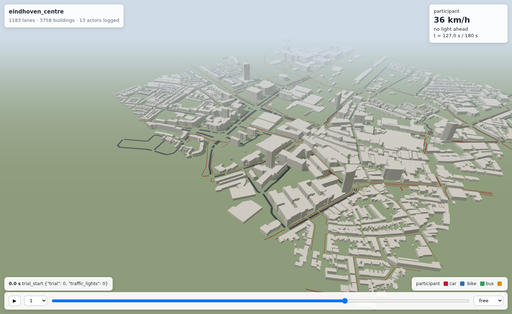

*Eindhoven city centre, replayed in the browser trial viewer (three.js) from a logged trial: 3,758 OSM buildings,
the drivable road network, cycleways in red, the participant in red and SUMO traffic in blue.*

---

## Contents

- [License](#license)
- [What you get](#what-you-get)
- [Screenshots](#screenshots)
- [How it works](#how-it-works)
- [Quick start](#quick-start)
- [Cities](#cities)
- [Real-world scenery, terrain and weather](#real-world-scenery-terrain-and-weather)
- [Public transport](#public-transport)
- [Experiment files](#experiment-files)
- [Participants, inputs and views](#participants-inputs-and-views)
- [Coupled experiments (phase 2)](#coupled-experiments-phase-2)
- [Phase 3: CARLA 1.0 and the Eindhoven digital twin](#phase-3-carla-10-and-the-eindhoven-digital-twin)
- [Traffic](#traffic)
- [Traffic lights](#traffic-lights)
- [Logging and data](#logging-and-data)
- [Analysis](#analysis)
- [Trial viewer](#trial-viewer)
- [Performance](#performance)
- [coupled-sim features in coupled-carla](#coupled-sim-features-in-coupled-carla)
- [Known limits](#known-limits)
- [Roadmap](#roadmap)
- [Lessons learned (gotchas)](#lessons-learned-gotchas)
- [Project layout](#project-layout)
- [Credits, data and licences](#credits-data-and-licences)

---

## License

The source code of coupled-carla is released under the [MIT License](LICENSE). Third-party code and data used by
it are not covered by this license and remain under the licenses of their developers: the SUMO bridge vendored in
`coupledcarla/bridge` (CARLA, MIT, © CVC), CARLA and Eclipse SUMO themselves (MIT, EPL-2.0), and the map and
city data (OpenStreetMap under the ODbL, so built maps are derived databases under the ODbL; the other sources
under CC0, CC BY 4.0, Licence Ouverte, ODbL or their open data terms). See
[Credits, data and licences](#credits-data-and-licences) for each.

## What you get

| | |
|---|---|
| **Any place** | `map.bbox: [south, west, north, east]` -> OSM download -> pruned road graph -> OpenDRIVE for CARLA + matching SUMO network, in seconds (2.6 s for 1.6 km of central Eindhoven, plus the download). Left- and right-hand traffic. |
| **Real-world scenery** | Every map is filled from free open data: real terrain on the roads (AHN lidar in the Netherlands, AWS Terrain Tiles elsewhere), buildings at their real footprints and heights (3DBAG, IGN BD TOPO, NYC Open Data, PLATEAU, Overture Maps), OSM street trees by species and height (sized from Meta/WRI canopy heights where OSM has none), the Dutch BGT's ground surfaces and street furniture, parks, water, lamps, benches, bus shelters, bollards and road signs, and the weather and sun of a real place and time (Open-Meteo) ([Real-world scenery](#real-world-scenery-terrain-and-weather)). |
| **19 cities** | Eindhoven plus 18 cities on six continents, from Tokyo and Cairo to Luang Prabang and Ushuaia ([Cities](#cities)). |
| **Traffic models** | SUMO drives everything that is not a participant: EIDM car following, the sublane lane-change model (cyclists and cars share and overtake), a Dutch-flavoured fleet with Gazelle bikes and buses, car demand fitted to open traffic counts where cities publish them (7 maps, SUMO's routeSampler), cyclists on the real cycle network at counted volumes. The participant's car is mirrored into SUMO, so traffic reacts to them. |
| **Real public transport** | The bus lines of OpenStreetMap run on their real streets and stop at their real stops (16 of the 19 maps have OSM bus lines); where the city publishes a GTFS timetable (10 maps) they come as often as that timetable says for the trial's hour and day; at `time: now` the real buses start where they are at that moment (GTFS-Realtime, e.g. all of the Netherlands) ([Public transport](#public-transport)). |
| **Real car fleet** | Car body types and colours from open vehicle registers (RDW for the Netherlands, NY DMV for Manhattan with its yellow cabs, Waka Kotahi for New Zealand, Senatran for Brazil), mapped onto CARLA's models; each SUMO car's colour is the CARLA car's ([Traffic](#traffic)). |
| **City-scale, real time** | SUMO simulates the whole map; only actors within 250 m of a participant exist in CARLA (level of detail), which keeps a city real time on one GPU. |
| **Participants** | Keyboard, Logitech G25 wheel with force feedback, or autopilot; driver, hood or chase view. |
| **Logging** | coupled-sim-style per-frame CSV at 50 Hz (participants always, AI actors near them), events, live JSON over UDP 40131, SUMO's trajectory output for the whole network, CARLA's recorder for replay. |
| **Trial viewer** | Browser replay of any trial in 3D with the OSM buildings, timeline, follow camera, light state and events. |
| **Experiment files** | YAML: map, server, simulation, traffic, participants, points of interest, logging, a trial sequence with per-trial overrides. |
| **Coupled experiments** | Stations for a driver, a pedestrian and an AV passenger on any machine of the LAN; scripted AI cars (routes, coupled-sim-style triggers, eHMI on the front, rear, roof, road or as "eyes") and walkers; a pedestrian crowd; SUMO traffic yields to pedestrians; eye-contact events; visual sync; round trips and frame latency logged. |
| **Two CARLA generations** | The same experiment files for CARLA 0.9.16 (UE 4.26) and CARLA 1.0 (UE 5.8): renamed blueprints are mapped to their closest stand-ins, and the scenery has a mesh catalogue per version. |
| **Eindhoven digital twin** | Central Eindhoven baked into a CARLA 1.0 level from Dutch open data (AHN terrain, 3DBAG buildings, OSM roads with lane markings, kerbs and sidewalks), driven with SUMO traffic on its own OpenDRIVE ([The Eindhoven digital twin](#the-eindhoven-digital-twin)). |

## Screenshots

**The trial viewer** (browser, three.js), same trial as above: oblique view around the participant and the
follow camera with the HUD (speed, next traffic light, time).

| Oblique | Follow camera |
|---|---|
| 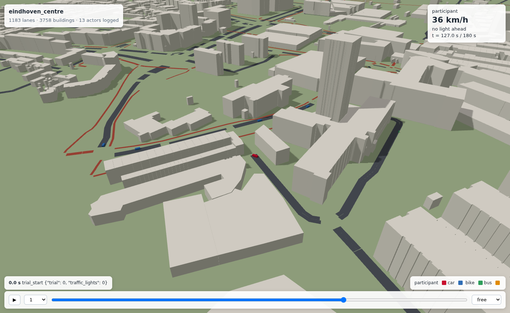 | 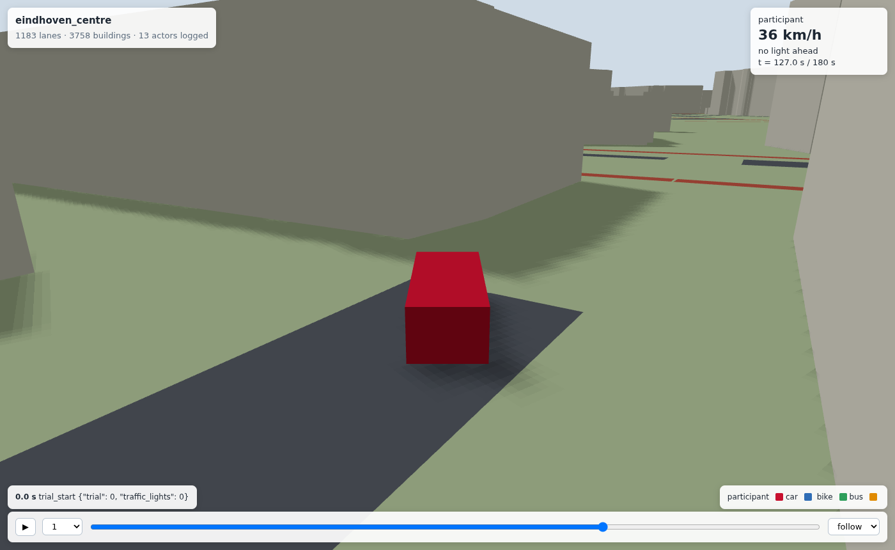 |

**In CARLA** (chase camera, Epic quality): the roads are CARLA's meshes generated from the OpenDRIVE; traffic
lights are drawn from SUMO's signal states (pole with lamp at each stop line); SUMO vehicles appear near the
participant. There are no buildings or road markings in CARLA yet ([Known limits](#known-limits)).

| Cairo (Tahrir) | Tokyo (Shibuya) |
|---|---|
| 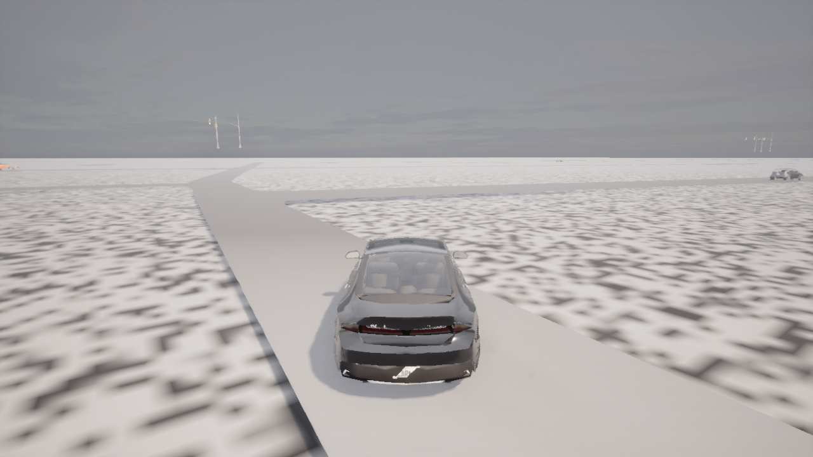 | 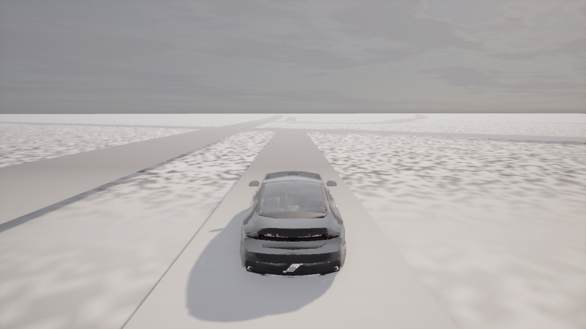 |

**New York (Midtown)** in the viewer: OSM building heights give Midtown's towers; the participant drives
the street grid with SUMO traffic.

| Overview | Oblique |
|---|---|
| 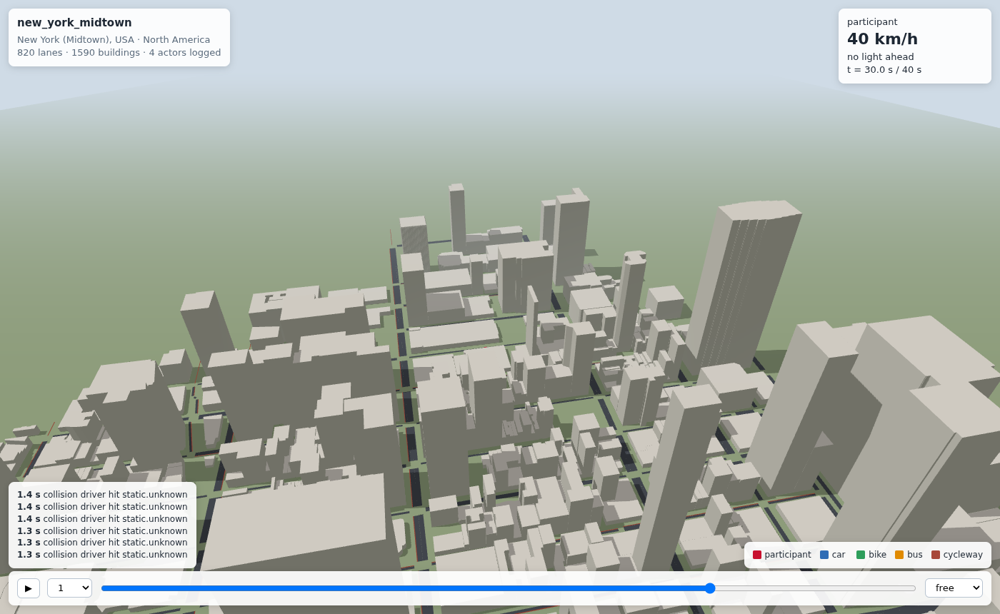 | 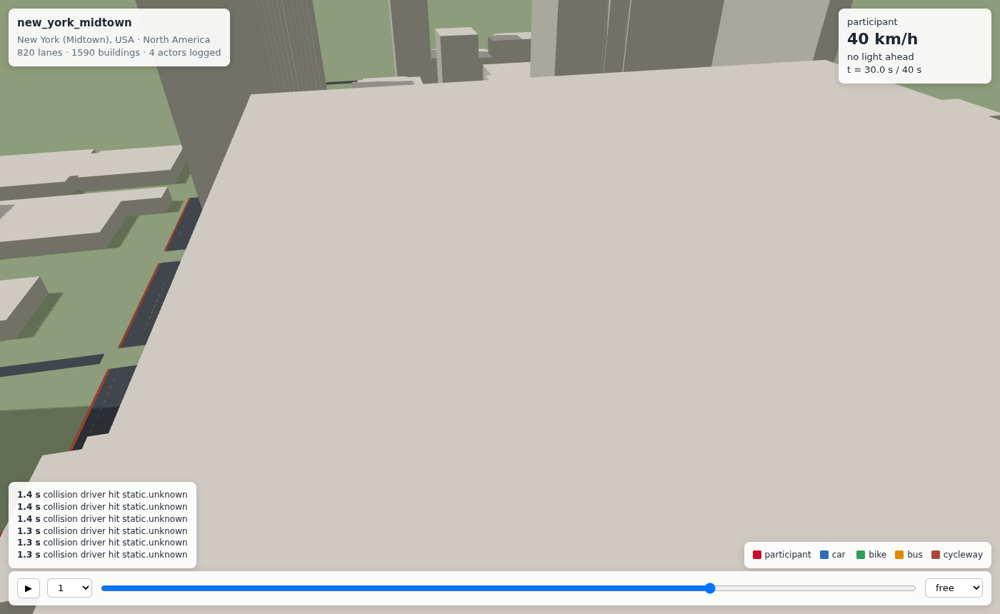 |

**Coupled experiment (phase 2)**, Eindhoven: a pedestrian crosses while an automated vehicle approaches; the
AV yields and its passenger switches the eHMI from "I'M STOPPING" (cyan) to "GO AHEAD" (green); a manual
driver follows. Each view below was rendered by a separate station process, the pedestrian's on another PC.

| Pedestrian station: the AV stops, "I'M STOPPING" | Pedestrian station: "GO AHEAD" (dusk trial) |
|---|---|
| 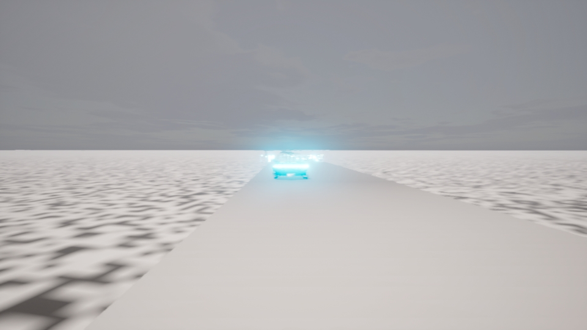 | 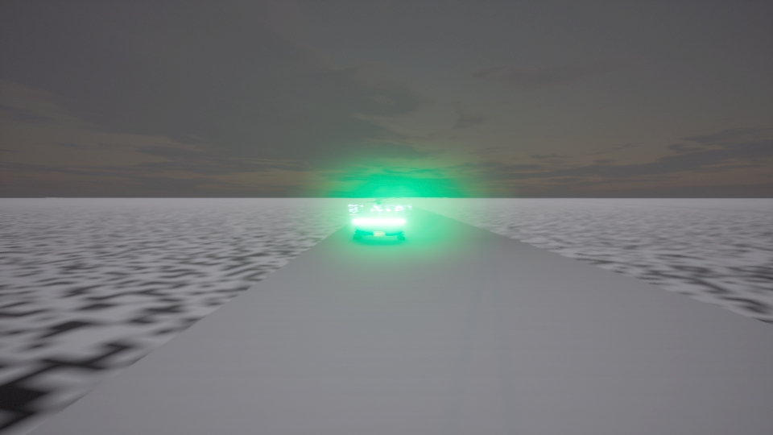 |

| AV passenger station: their eHMI, seen from inside | Driver station: following the yielding AV at dusk |
|---|---|
| 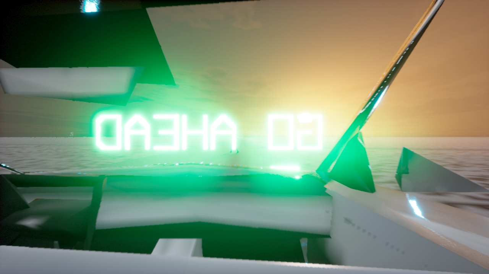 | 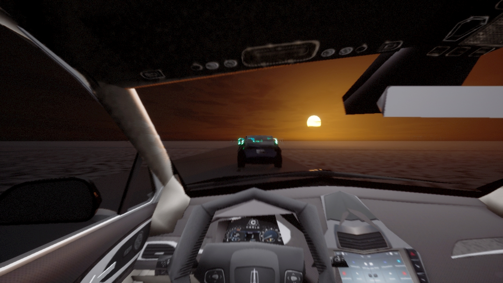 |

The same moment in the trial viewer: the pedestrian (red) crossing, the AV (dark blue) stopped with its cyan
eHMI bar, an AI walker further down the street; the event list shows the AV stopping, the passenger's eHMI
command and the stations' frame rates and round trips.

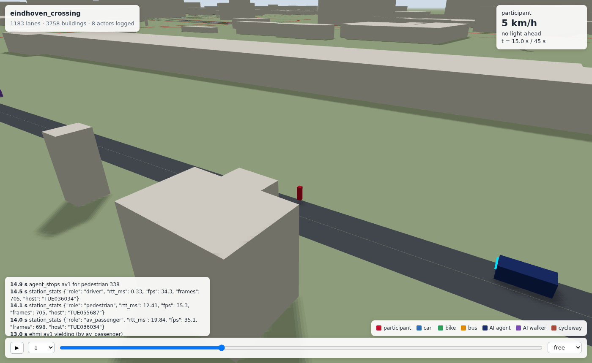

**All 19 maps** (drivable roads, cycleways, OSM buildings; 1.4 km squares, north up):

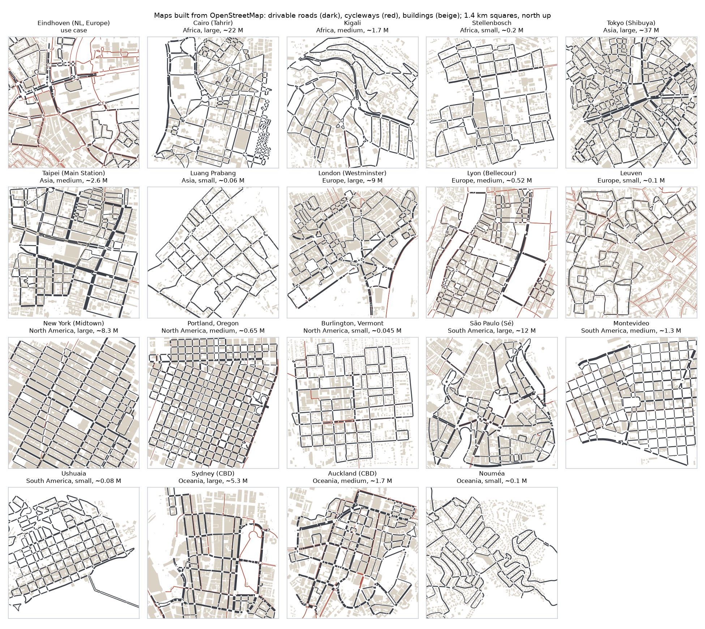

## How it works

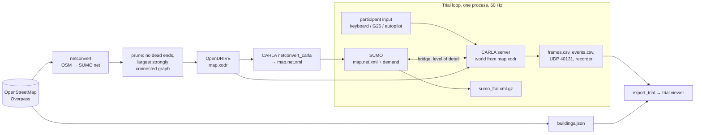

1. **Map** (`coupledcarla/mapbuild.py`). Overpass gives the OSM ways with `highway=*` in the box (cached).
   SUMO's `netconvert` turns them into a network keeping the configured road types and cycleways, guessing
   ramps, roundabouts and signals. The road graph is then **pruned**: dead-end chains are removed and only
   the largest strongly connected part is kept, so a car can always go on (at the cut edge of the box, roads
   would otherwise end in the void). The pruned network is written as OpenDRIVE (`map.xodr`, signals named
   so CARLA's tools keep them) and converted back with CARLA's `netconvert_carla.py` into a SUMO network
   with the same road ids (`map.net.xml`). OSM building footprints with heights go to `buildings.json`.
2. **World.** CARLA builds road meshes from the OpenDRIVE at load time (`generate_opendrive_world`, about
   10 s); a large plane 0.3 m below the roads catches anything that leaves them.
3. **Traffic** (`coupledcarla/traffic.py`). SUMO vehicle types named after CARLA blueprints, random trips
   for cars, bikes and buses, a `.sumocfg` per trial.
4. **Trial loop** (`coupledcarla/run.py`), one process: read each participant's input and apply it; step
   SUMO and CARLA together through the bridge (`coupledcarla/bridge`, vendored from CARLA 0.9.16's
   `Co-Simulation/Sumo` with fixes); draw the traffic lights; log the frame; draw the view; sleep to stay in
   real time.

## Quick start

Needs CARLA 0.9.16 (the release package; the UE 5 line has no SUMO co-simulation), Python 3.12, a GPU.

```bash
git clone https://github.com/bazilinskyy/coupled-carla.git && cd coupled-carla
uv venv --python 3.12 .venv && uv pip install --python .venv/bin/python -r requirements.txt
export CARLA_ROOT=~/carla-eindhoven/CARLA_0.9.16          # the extracted CARLA 0.9.16 release
export SUMO_HOME=$(.venv/bin/python -c "import sumo; print(sumo.SUMO_HOME)")
export PATH=$SUMO_HOME/bin:$PATH PROJ_LIB=$SUMO_HOME/data/proj
```

Build a map once, then run its trials:

```bash
.venv/bin/python -m coupledcarla.mapbuild experiments/eindhoven_centre.yaml
.venv/bin/python -m coupledcarla.run experiments/eindhoven_centre.yaml                    # all trials, keyboard
.venv/bin/python -m coupledcarla.run experiments/eindhoven_centre.yaml --trial 0 --input wheel
```

Headless test drive (autopilot, saves a chase-camera frame every 10 s):

```bash
.venv/bin/python -m coupledcarla.run experiments/eindhoven_centre.yaml --input autopilot --headless --view chase --duration 120 --frames-every 10
```

The figure and screenshot tools need `requirements-tools.txt` as well. The unit tests need no CARLA or SUMO:
`pip install numpy pyyaml pytest && python -m pytest tests`.

The cities: write their experiment files and build every map (Overpass is slow, a few minutes per city), then
smoke-test them all:

```bash
.venv/bin/python -m coupledcarla.cities
.venv/bin/python tools/test_cities.py --duration 40 > docs/city_tests.md
```

Replay a trial in the browser:

```bash
.venv/bin/python -m coupledcarla.export_trial logs/eindhoven_centre/<time>_trial0
python3 -m http.server 8765        # then open http://localhost:8765/viewer/?file=/logs/eindhoven_centre/<time>_trial0/trial.json
```

Command-line options of `coupledcarla.run`: `--trial N` (repeatable), `--input autopilot|keyboard|wheel`,
`--headless`, `--view driver|chase|hood`, `--duration S`, `--frames-every S`, `--quality Low|Epic`,
`--step S`.

## Cities

Three per inhabited continent, by size, each a 1.4 km square around a central point
([`experiments/cities.yaml`](experiments/cities.yaml); `python -m coupledcarla.cities` writes
`experiments/cities/<slug>.yaml`). Traffic demand scales with the size class.

| Continent | Large | Medium | Small |
|---|---|---|---|
| Africa | Cairo (Tahrir), ~22 M | Kigali, ~1.7 M | Stellenbosch, ~0.2 M (left-hand) |
| Asia | Tokyo (Shibuya), ~37 M (left-hand) | Taipei (Main Station), ~2.6 M | Luang Prabang, ~0.06 M |
| Europe | London (Westminster), ~9 M (left-hand) | Lyon (Bellecour), ~0.5 M | Leuven, ~0.1 M |
| North America | New York (Midtown), ~8.3 M | Portland, Oregon, ~0.65 M | Burlington, Vermont, ~0.045 M |
| South America | São Paulo (Sé), ~12 M | Montevideo, ~1.3 M | Ushuaia, ~0.08 M |
| Oceania | Sydney (CBD), ~5.3 M (left-hand) | Auckland (CBD), ~1.7 M (left-hand) | Nouméa, ~0.1 M |

Plus **Eindhoven** (city centre, station to the TU/e campus edge, 1.6 km), the reference use case
([`experiments/eindhoven_centre.yaml`](experiments/eindhoven_centre.yaml)). Populations are approximate and
only order the cities by size.

Left-hand traffic works end to end: the map builder passes `--lefthand` to netconvert, and in Stellenbosch the
autopilot followed the left-hand OSM lanes' direction in 14 of 15 checked samples (the odd one at a junction).

**Smoke test** of every map (40 s headless autopilot trial each; full table in
[`docs/city_tests.md`](docs/city_tests.md)):

Smoke test, 2026-11-14: 40 s headless autopilot trial per map, CARLA 0.9.16 at Epic, 50 Hz, on lin4080 (RTX 4080 SUPER, not shared at the time), with the real-world scenery, terrain and bus lines.

| Map | Continent | Size | Traffic | Lane links | Buildings | Building heights | Relief (m) | Scenery meshes | Bus lines (with timetable) | SUMO vehicles shown | Real-time factor | Left road | Stuck | Put back on lane | Collisions | Result |
|---|---|---|---|---|---|---|---|---|---|---|---|---|---|---|---|---|
| Eindhoven | Europe | medium | right | 2318 | 2998 | 3dbag | 11 | 16781 | 51 (45) | 11 | 0.992 | 0 | 0 | 0 | 0 | ok |
| Cairo (Tahrir) | Africa | large | right | 3835 | 1308 | overture | 66 | 10814 | – | 3 | 0.994 | 0 | 1 | 1 | 0 | ok |
| Kigali | Africa | medium | right | 1655 | 2942 | overture | 188 | 15270 | 18 (0) | 3 | 0.994 | 0 | 0 | 0 | 0 | ok |
| Stellenbosch | Africa | small | left | 1748 | 1683 | overture | 32 | 8665 | – | 7 | 0.994 | 0 | 9 | 9 | 0 | ok |
| Tokyo (Shibuya) | Asia | large | left | 5057 | 3833 | overture | 87 | 15735 | 31 (10) | 15 | 0.989 | 0 | 0 | 0 | 0 | ok |
| Taipei (Main Station) | Asia | medium | right | 2940 | 2679 | overture | 48 | 15461 | 150 (0) | 14 | 0.991 | 0 | 0 | 0 | 0 | ok |
| Luang Prabang | Asia | small | right | 1418 | 3611 | overture | 87 | 10402 | – | 2 | 0.995 | 0 | 0 | 0 | 0 | ok |
| London (Westminster) | Europe | large | left | 2751 | 2069 | overture | 30 | 10053 | 31 (0) | 2 | 0.994 | 0 | 1 | 1 | 0 | ok |
| Lyon (Bellecour) | Europe | medium | right | 2276 | 2518 | bdtopo | 135 | 19667 | 21 (20) | 6 | 0.992 | 0 | 2 | 2 | 0 | ok |
| Leuven | Europe | small | right | 1537 | 5049 | overture | 26 | 19194 | 26 (26) | 4 | 0.992 | 0 | 2 | 2 | 0 | ok |
| New York (Midtown) | North America | large | right | 2229 | 1404 | nyc | 14 | 8289 | 67 (54) | 9 | 0.988 | 0 | 0 | 0 | 0 | ok |
| Portland, Oregon | North America | medium | right | 4368 | 710 | overture | 50 | 14077 | 27 (25) | 5 | 0.99 | 0 | 0 | 0 | 0 | ok |
| Burlington, Vermont | North America | small | right | 2033 | 1974 | overture | 83 | 12027 | 10 (2) | 5 | 0.993 | 0 | 1 | 1 | 0 | ok |
| São Paulo (Sé) | South America | large | right | 2164 | 3182 | overture | 85 | 16300 | 64 (56) | 4 | 0.991 | 0 | 0 | 0 | 0 | ok |
| Montevideo | South America | medium | right | 1917 | 2411 | overture | 64 | 12668 | 3 (0) | 5 | 0.991 | 0 | 0 | 0 | 0 | ok |
| Ushuaia | South America | small | right | 2404 | 2309 | overture | 129 | 12561 | 2 (0) | 3 | 0.993 | 0 | 0 | 0 | 0 | ok |
| Sydney (CBD) | Oceania | large | left | 2609 | 985 | overture | 111 | 14600 | 32 (31) | 1 | 0.993 | 0 | 8 | 8 | 0 | ok |
| Auckland (CBD) | Oceania | medium | left | 3935 | 1142 | overture | 47 | 14635 | 31 (29) | 0 | 0.992 | 0 | 0 | 0 | 0 | ok |
| Nouméa | Oceania | small | right | 1786 | 2465 | overture | 67 | 18425 | – | 6 | 0.993 | 0 | 2 | 2 | 0 | ok |

All 19 maps load and drive with their scenery. "Scenery meshes" counts the placements on the whole map (about
2,000-2,700 are loaded at a time around the car); "Relief" is the terrain's height range within the box; "Bus
lines" counts the OSM line numbers matched onto the map and, in brackets, those with a GTFS timetable (Nouméa's
three lines have no numbers; see [Public transport](#public-transport)). "SUMO vehicles shown"
counts the SUMO vehicles that came within the level-of-detail radius of the ego during the 40 s (demand starts at
the map edges, so the first 40 s are sparse). "Stuck" and "Put back on lane" are autopilot recoveries (it follows
random lanes). The previous run (2026-11-13, no scenery, GPU shared with another job, spectator not parked) had
real-time factors of 0.55-0.99; see [Performance](#performance) for what changed.

## Real-world scenery, terrain and weather

CARLA builds only the roads of an OpenDRIVE map. coupled-carla fills every map with CARLA's own meshes, placed
from real-world data that free services give without an account or key, and runs a trial at the weather and
sun of a real place and time. Everything is fetched once at map build time and cached in `maps/<name>/real/`;
`meta.json` lists the sources a map was built from.

| | |
|---|---|
| 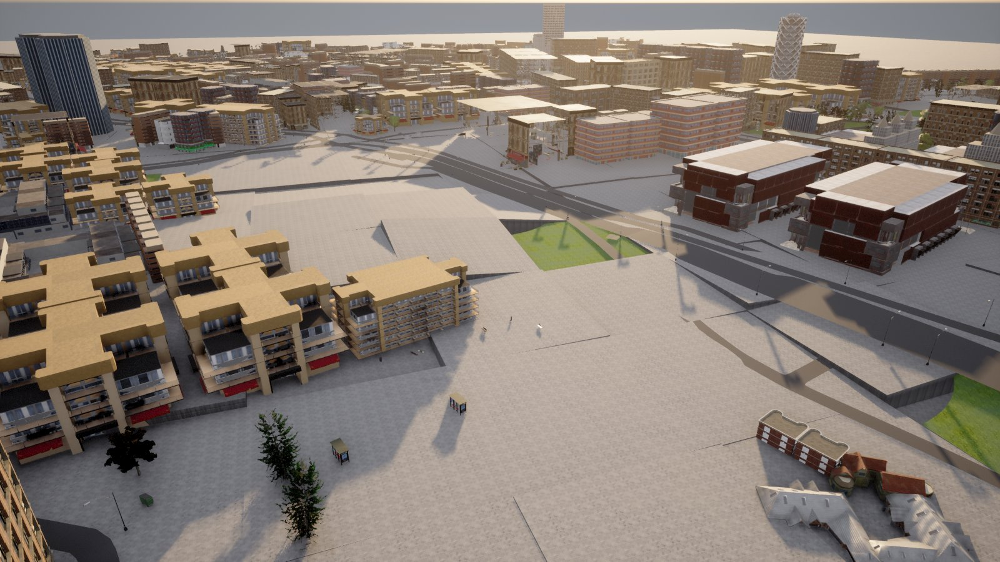 | 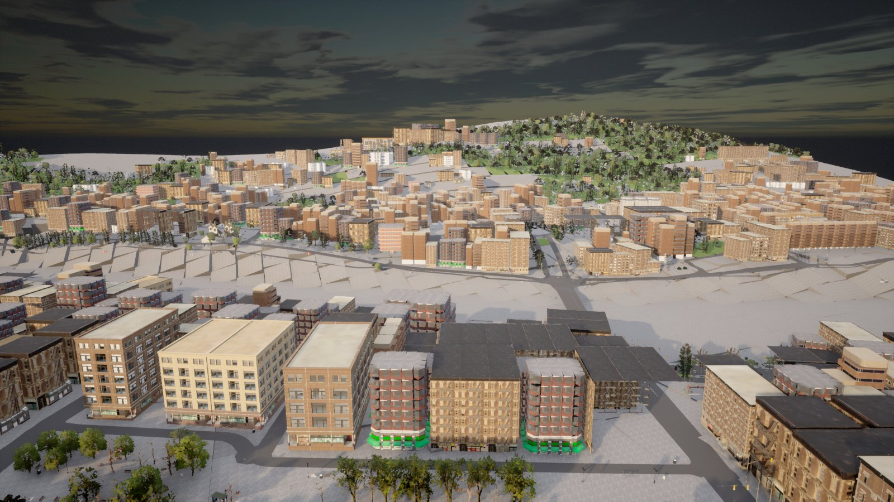 |
| Eindhoven centre, 13 November 14:30 with that hour's weather: 3DBAG heights, 1,827 OSM street trees, lamps, bus shelters | Lyon: Place Bellecour, the Saône and the Fourvière hill (135 m of relief), IGN BD TOPO heights |
| 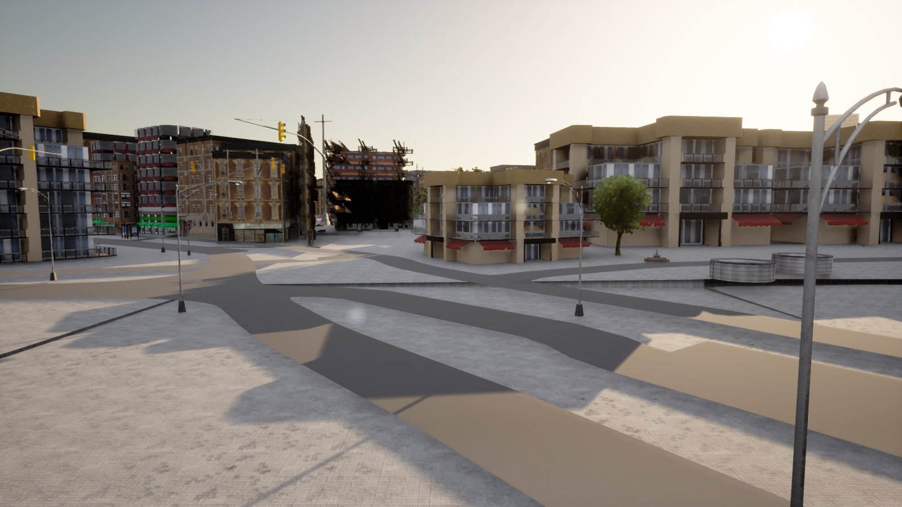 | 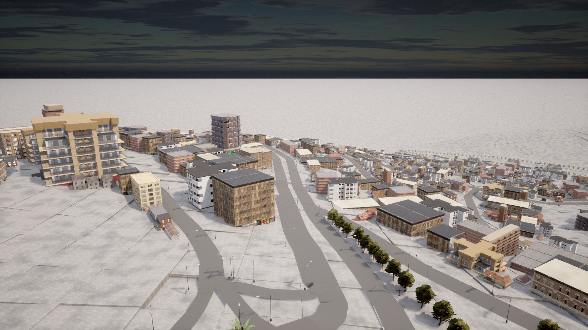 |
| Eindhoven at street level, sun where it stood at 14:30 | Kigali: 188 m of relief, Overture (ML) footprints, OSM tree rows |
| 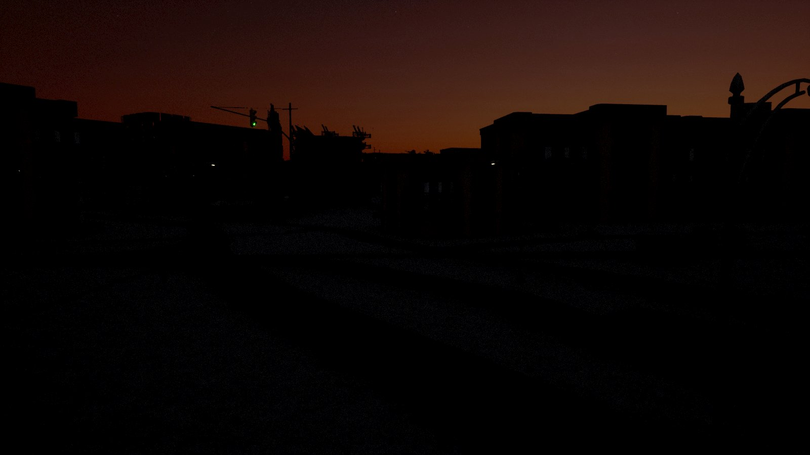 | 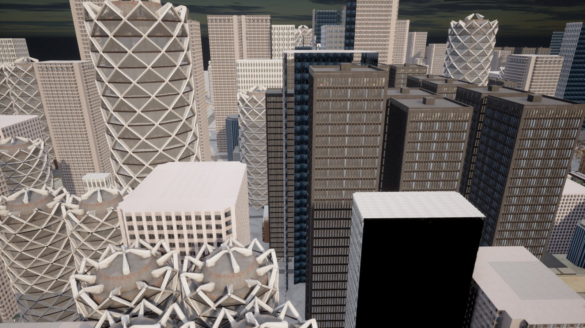 |
| The same street at 16:55, after sunset that day | New York Midtown with NYC Open Data roof heights |

| What | Source (free, no key) | Used for |
|---|---|---|
| Roads, lanes, speed limits, signals | OpenStreetMap via Overpass | OpenDRIVE and SUMO net (as before) |
| Terrain | [AHN4](https://www.ahn.nl) 0.5 m DTM via PDOK (Netherlands); [AWS Terrain Tiles](https://registry.opendata.aws/terrain-tiles/) (worldwide: SRTM, USGS 3DEP, national lidar) | road heights in the OpenDRIVE and the SUMO net, ground, building and tree bases |
| Building footprints | [Overture Maps](https://overturemaps.org) (OSM, Microsoft and Google ML buildings, Esri), GeoParquet on S3 read with DuckDB | building stand-ins, the trial viewer |
| Building heights | [3DBAG](https://3dbag.nl) (Netherlands, lidar), [IGN BD TOPO](https://geoservices.ign.fr/bdtopo) (France), [NYC Open Data](https://data.cityofnewyork.us) (New York City), [MLIT PLATEAU](https://www.mlit.go.jp/plateau/) (Japan, via Pacific Spatial Solutions' GeoParquet on Source Cooperative); else Overture/OSM heights and floors; else a height by building kind | the height of each stand-in |
| Trees | OSM `natural=tree` with genus, species, leaf type and height; `tree_row`; parks, gardens, woods | a matching CARLA tree (plane, lime, oak, pine, palm, ...) at the mapped size; planting at a density per kind of green |
| Street furniture | OSM lamps, benches, bins, bus shelters, bollards, post boxes, bicycle racks, hydrants, fountains, ad columns, cabinets | the matching CARLA prop at the mapped spot, parallel to the road |
| Road signs | OSM `highway=stop/give_way`, `traffic_sign` (NL, DE, FR, US codes; speed limits) | a sign on a post at the edge of the lane it governs, facing its traffic |
| Ground cover | OSM landuse, leisure, natural, water | grass, water or paving tiles |
| Ground cover (NL) | [BGT](https://www.pdok.nl/introductie/-/article/basisregistratie-grootschalige-topografie-bgt-) via PDOK's OGC API (CC0) | what covers the ground beside the roads: grass, bricks or tiles, asphalt or concrete, gravel or sand, water; mixed 40 m tiles split in four |
| Street furniture (NL) | BGT plus objects (IMGeo, from the municipalities) | benches, bicycle racks, bins, waste containers, bollards, cabinets, parking meters, boards, play equipment, and lamps and trees where the city has no register; they replace OSM objects of the same kind within 3-8 m |
| Road signs (NL) | [NDW Verkeersborden](https://docs.ndw.nu/en/data-uitwisseling/interface-beschrijvingen/verkeersborden-api/), the national traffic sign register (CC0) | every official sign at its position, facing the traffic it governs, plates stacked on posts: CARLA's own mesh where it has one (stop, give way, the posted speed, no entry on 1.0), else on CARLA 1.0 a blank plate of the sign's shape; OSM signs of the same kind within 8 m are dropped |
| Shared bikes and scooters | [GBFS](https://gbfs.org) feeds from [MobilityData's systems catalogue](https://github.com/MobilityData/gbfs/blob/master/systems.csv) (CC BY 3.0), TfL BikePoint, Taipei's YouBike | the bikes at each dock and free-floating bikes, scooters and mopeds where they stand (CARLA's road bike and Vespa meshes); a trial at `time: now` takes a fresh snapshot (9 maps have a system) |
| Tree heights | [Meta/WRI 1 m canopy height map](https://registry.opendata.aws/dataforgood-fb-forests/) (Tolan et al. 2024) | the size of trees without a mapped height (OSM nodes and rows, park planting), corrected against Eindhoven's register |
| City registers | Eindhoven's open data ([bomen](https://data.eindhoven.nl/explore/dataset/bomen/): 127,911 trees with species and height class; [openbare verlichting](https://data.eindhoven.nl/explore/dataset/data-openbare-verlichting/): 58,430 lamps with mast height); NYC's [2015 Street Tree Census](https://data.cityofnewyork.us/d/uvpi-gqnh) | every public tree and street light where the city lists them (OSM trees within 3 m of one are dropped; register lamps replace OSM and guessed ones) |
| Weather | [Open-Meteo](https://open-meteo.com) forecast and ERA5 archive (back to 1940) | clouds, rain, wet roads, wind and fog of that hour |
| Sun | computed (NOAA solar position) | the sun's altitude and direction for the place and local time; headlights on after dark |

```yaml
map:
  elevation: true            # real terrain on the roads (default)
  scenery: {buildings: true, trees: true, furniture: true, signs: true, guess_lamps: true, ground: true}
simulation:
  weather: real              # Open-Meteo's weather for the map's place and the time below
  time: "2026-11-13 16:55"   # local time at the place ("HH:MM" today, or "now"); without weather: real only the sun
  scenery: {radius_m: 400}   # scenery cells within this distance of the participants (0: all at once)
```

```bash
python -m coupledcarla.mapbuild experiments/cities/lyon.yaml --force     # roads with terrain, then scenery
python -m coupledcarla.mapbuild experiments/cities/lyon.yaml --scenery   # redo only the scenery (seconds)
```

How it is placed (`coupledcarla/scenery.py`, `coupledcarla/realworld.py`):

- **Terrain.** Every road node of the OSM extract gets its ground height before netconvert (`--osm.elevation`),
  relative to the lowest point of the box, so the OpenDRIVE, the SUMO net and CARLA's road meshes climb and
  fall as the streets do (Kigali: 187 m of relief in the box, Lyon 135 m). Bridges and tunnels keep a straight
  grade between their ends instead of following the river or the hill, and bridges over roads are raised by
  their OSM layer. SUMO vehicles, walkers and the drawn traffic lights all take their height from the road.
- **Buildings.** Each footprint is split into rectangles until they cover it well; each rectangle gets the
  CARLA building whose proportions, height and kind (house, apartment block, commercial, tower, industrial,
  church) fit best (a known roof shape, 3DBAG's or OSM's `roof:shape`, picks pitched or flat-roofed
  kinds; church meshes only where the data says church), turned to the footprint, scaled (0.6 to 1.5) and repeated along long blocks, standing on
  the terrain. Positions, footprints and heights are the real ones; the facades are CARLA's (mostly North
  American towns). Exact geometry and textures are the job of the UE 5.8 digital twin (phase 3).
- **Dutch ground (BGT).** In the Netherlands each ground tile takes the kind of surface that covers most of it
  beside the roads, from the BGT: grass, bricks or tiles (CARLA's sidewalk paving: the 0.9.16 catalogue has no
  brick ground mesh), asphalt or concrete, gravel or sand, water. Tiles with mixed ground are split into four 20 m
  tiles. In central Eindhoven 582 of 2,538 tiles changed kind, and 1,654 pieces of BGT street furniture joined
  OSM's 480, replacing 237 OSM objects. The first build fetches the BGT in about 25 s and caches it in
  `real/bgt.json`; later scenery builds take 4.4 s instead of 3.4 s. `map.scenery.bgt: false` turns it off.
- **Tree sizes.** Where OSM gives no height, a tree takes its size from Meta and WRI's 1 m canopy height map at
  its spot, read from AWS open data (only the needed rows, by HTTP range requests; cached in `real/canopy.npz`).
  The map reads urban trees about 6.5 m low and misses most under 8 m, so its values are corrected with a line
  fitted to Eindhoven's tree register (6 m + 1.1 x canopy, r = 0.34: a rough guide, unproven outside Europe).
  Where it sees no tree, the size stays a guess. `map.scenery.canopy: false` turns it off.
- **Nothing on the lanes.** Every placement is checked against CARLA's map: nothing stands on a lane that is
  driven, ridden, parked or walked; a building that would reach into one is shrunk or dropped.
- **Ground.** 40 m tiles (20 m on maps with more than 40 m of relief), tilted to the terrain and kept under
  the road surface: grass in parks and green landuse, water on rivers and lakes, paving elsewhere.
- **Streaming.** CARLA sends every actor's state to every client on every tick, so the scenery is spawned in
  100 m cells within `radius_m` of the participants and removed behind them, as the SUMO traffic is;
  buildings taller than 40 m stay loaded as the skyline. About 2,000-2,700 meshes are loaded at a time. With
  the spectator parked and the optimised building meshes they cost little: Stellenbosch ran at 0.97 of real
  time with them and 0.99 without ([Performance](#performance)).
- **Weather.** Cloud cover 0 to 100 % maps to CARLA cloudiness 0 to 60 (higher values turn the sky of an
  OpenDRIVE world dark grey to black: sky brightness 66, 18 and 1 of 255 at 60, 80 and 90); rain 1 mm/h to
  precipitation 20; rain over the last three hours to puddles and wet roads; wind 1 km/h to intensity 2;
  visibility under 10 km to fog. CARLA's sun azimuth is the direction the light travels (compass + 90°,
  checked with a pole's shadow). Each trial writes what it applied to `weather.json`.

Built from these sources (the test maps of central Eindhoven, Lyon, Kigali and New York):

| Map | Buildings (heights from) | Trees (OSM street trees) | Lamps (OSM) | Furniture | Signs | Relief |
|---|---|---|---|---|---|---|
| Eindhoven centre | 3,654 (3DBAG lidar) | 4,091 (1,827) | 1,079 (101) | 480 | 24 | 11 m (AHN) |
| Lyon (Bellecour) | 2,675 (IGN BD TOPO) | 5,548 (1,268) | 500 | 2,097 | 38 | 135 m |
| Kigali | 3,027 (Overture, ML footprints) | 1,449 (401) | 1,247 (26) | 4 | 0 | 187 m |
| New York (Midtown) | 1,406 (NYC Open Data) | 801 (719) | 1,153 (103) | 339 | 2 | 14 m |

Where OSM maps few street lamps, lamps line the roads every 32 m (on by default, `guess_lamps`). The lamp
meshes give no light at night: CARLA 0.9.16 cannot add lights at run time.

**Seasons.** With `simulation.time` set, deciduous trees follow the date at the place (`coupledcarla/season.py`):
in leaf, in autumn colour (a growing share take CARLA's autumn sugar maple and red Japanese maples) or bare. CARLA
has no bare tree mesh, so a bare tree is the same kind at half size (`simulation.scenery.bare: small`, or `drop`,
`keep`). The dates come from latitude: leaf-out on 23 April and leaf fall on 1 November at 50°, later and earlier
towards the poles, half a year apart in the south, none within 25° of the equator (latitude alone misses continental
climates: Burlington leafs out about four weeks early). Evergreen genera and species stay as they are. `leaves:
modis` uses MODIS MCD12Q2 dates (keyless) where they agree with the model; in city centres they mostly measure
lawns. CARLA cannot show snow; Open-Meteo's snow depth is logged.

**Street lamps at night (CARLA 1.0).** A small content pack (`coupledcarla/data/carla_packs`) puts CARLA's
street-light blueprints in the blueprint library (coupled-carla adds `-carla-packs=` when it starts the server);
at night the scenery lamps within `lights_radius_m` (200 m) of a participant are spawned as those blueprints and
the server lights them when the sun sets. Headless: 225 lit lamps add 0.2 ms per tick, 781 add 0.7 ms (the cost to
rendering is not measured). CARLA 1.0's OpenDRIVE worlds also bring generic lamps of their own along every road.
On the packaged server at the twin, 198 lamps spawn with their light blueprints at night (spawned 100 m up and moved
into place, as their collision touches the level's ground), but the rendered frames stay dark apart from car
lights, even after switching the street lights on through the light manager: not working yet.

### Parked cars

Streets have parked cars (`coupledcarla/parking.py`), placed when the scenery is built (`parked.json`) and filled at
the trial's local hour. Where: OSM parking tags (`parking:left/right/both` with orientation, and the older
`parking:lane:*`), BGT "parkeervlak" strips in the Netherlands and OSM street-side parking areas (their depth gives
parallel, diagonal or perpendicular), else a default share of road sides by road class (residential 0.8,
unclassified 0.5, tertiary 0.4, secondary 0.15 in Europe, the Americas and Oceania; none on primary roads, on sides
with two lanes in one direction, or in Japan), and OSM/BGT car parks as rows of stalls. Never within 5 m of a
junction or crossing, 10 m of signals or 12 m of a bus stop, nor beside a bus lane or on a lane. Each stall is taken
when its random number is below its zone's occupancy (residential, centre or mixed, from the buildings within 60 m)
at the local hour, an assumption in the spirit of CROW's presence percentages (`simulation.parked.occupancy`
overrides it). The cars are CARLA's static car meshes (23 in 0.9.16), streamed within 250 m: 300 cost the server
0.8 ms per tick, against 11 ms as vehicle actors. A static mesh keeps its paint, so the register sets the body types
and favours the meshes whose paint is common in it. Eindhoven centre: 5,307 stalls (1,460 at the kerb, 929 of
those from the BGT), 3,180 taken at 03:00 and 3,541 at 14:00 on a weekday; every car off the lanes, RTF 0.991 ->
0.988. Not yet on CARLA 1.0 (its parked meshes are unmeasured) or on baked levels.

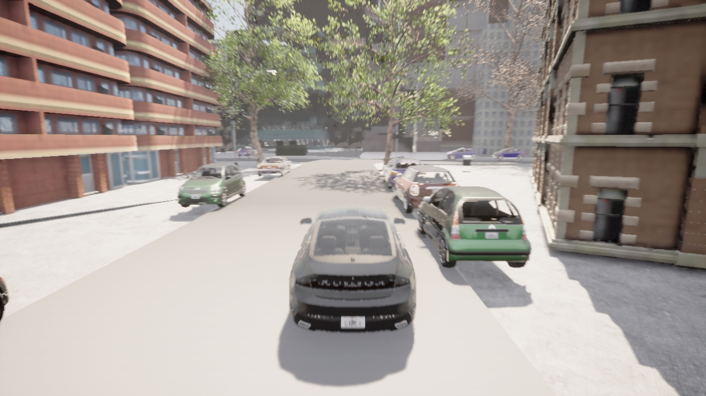

### Scenery on CARLA 1.0 and on baked levels

CARLA 1.0 (Unreal Engine 5.8) renamed and moved most of the meshes the scenery uses (738 of the 969 in the 0.9.16
catalogue), so each CARLA version has its own mesh catalogue (`coupledcarla/data/meshes_0.9.16.json`,
`meshes_1.0.json`, made by `tools/mesh_catalog.py` on a running server), and `coupledcarla/meshes10.py` holds 1.0's
choices: the same trees, lamps, signs and furniture where 1.0 still has them (most under new names, with identical
sizes), plus 1.0's own closed buildings (narrow town houses, new houses and blocks). `map.scenery.catalog: auto`
builds with the catalogue of the CARLA in use; a trial on the other version rebuilds `scenery.json` first (seconds,
from the cached data in `real/`). 0.9.16's scenery is byte for byte what it was. The new UE5 trees are left out
(millions of triangles, 10-170 s each to build on first use).

On a baked level (`map.carla_level`, e.g. the Eindhoven twin) the scenery adds only trees, bushes, lamps, street
furniture and signs (9,578 in the twin), at the terrain model's absolute heights (AHN, base 0).
`python tools/snap_scenery.py <experiment>` then stands them on the level's own ground (needs a server with the
level; run it again after `mapbuild --scenery`). `python tools/scenery_check.py <experiment>` checks scenery
heights on a headless (`-nullrhi`) server: meshes the server refuses, and how far each mesh stands from the ground.
Measured headless on lin5080: every mesh within 1 cm of its planned place; RTF 0.69 with and 1.10 without
scenery on `eindhoven_centre` (no real-time sleep), 0.49 / 0.69 on the twin. Still visible in the numbers:
furniture on Eindhoven station's platforms stands at platform height (about 4 m) with no platform under it, and
objects beside lowered ground tiles at sunken roads float.

## Public transport

Buses follow the real lines (`coupledcarla/transit.py`), built with the map:

| Step | Source (free, no key) | What happens |
|---|---|---|
| Lines and stops | OSM route relations (`route=bus/trolleybus/minibus/share_taxi`) via Overpass, clipped to the box | each line's track is laid on the SUMO net (the edge under each track point that runs the line's way; gaps closed by short bus paths); its stop positions, else platforms, become SUMO bus stops |
| Bus-only roads and lanes | OSM `highway=busway`, bus lanes | kept in the map; their OpenDRIVE lanes (`restricted`) are open to buses, taxis and emergency vehicles in SUMO |
| Frequencies | the city's GTFS feed, found in the [Mobility Database](https://mobilitydatabase.org) catalogue by the box (the Dutch national OVapi feed for the Netherlands) | trips of each line entering the box, per hour, for a weekday, a Saturday and a Sunday |

In a trial each line runs at its timetable's frequency for the local hour of `simulation.time` (08:00 on a
weekday when unset), at the OSM `interval` tag where there is no timetable, else every
`default_headway_min`; a line the timetable does not run at that hour has no buses. Buses are already spread
along their line at t = 0 and stop `dwell_s` at each stop; SUMO's `sumo_stops.xml` logs every stop. On maps
without OSM bus lines the old random bus trips run instead. At 08:00 on a weekday a two-minute Eindhoven trial has
106 of its 107 line sections running and 33 buses; a one-minute Taipei trial (150 line numbers, no free
timetable, so every 10 min each) has 186.

| Map | Lines (numbers) | Stops | Timetable |
|---|---|---|---|
| Eindhoven | 51 | 19 | OVapi (NL): 45 lines |
| Lyon | 21 | 40 | SYTRAL Mobilités: 20 |
| Leuven | 26 | 17 | De Lijn: 26 |
| New York | 67 | 34 | MTA (five borough feeds): 54 |
| São Paulo | 64 | 47 | SPTrans: 56 |
| Sydney | 32 | 8 | Transport for NSW: 31 |
| Auckland | 31 | 31 | Auckland Transport: 29 |
| Portland | 27 | 74 | TriMet: 25 |
| Tokyo | 31 | 24 | Toei Bus: 10 (the rest are private operators) |
| London, Taipei, Kigali, Montevideo, ... | | | none free (TfL publishes no GTFS); OSM interval or default |

```yaml
map:
  transit: true                       # build the bus lines with the map (default)
traffic:
  public_transport: {enabled: true, dwell_s: 20, default_headway_min: 10, live: auto}   # live: auto = at time "now"
  fleet: auto                         # body types and colours from the vehicle register where there is one
simulation:
  time: "2026-11-16 17:30"            # the timetable of that day type and hour
```

```bash
python -m coupledcarla.mapbuild experiments/cities/lyon.yaml --transit   # redo only the bus lines (seconds)
```

**Live buses.** With `simulation.time: now` (or `public_transport.live: true`), the lines whose agency publishes
GTFS-Realtime vehicle positions without a key (the Mobility Database lists 1,606 such feeds; OVapi covers all of
the Netherlands) start with their buses where the real ones are at that moment: on their line when within 40 m of
it, else from the nearest bus road (a bus waiting at the station) along the shortest way onto it. The snapshot is
saved as `sumo/pt_live.json`. Timetabled departures follow. "now" is the local time at the place (its UTC offset
from Open-Meteo), so a trial of Auckland run in Eindhoven gets Auckland's hour. On a Saturday at 13:16 the
Eindhoven box had 11 live buses, 9 of them placed (the other two off the matched lines); Leuven, Auckland and
Sydney publish real-time feeds only with a key.

Trams and trains are left out (CARLA has no tram and the maps have no rails); a line that leaves and
re-enters the box runs as separate sections; GTFS frequencies are per line and hour, averaged over its
directions.

## Experiment files

An experiment is one YAML file; anything left out takes the default from
[`coupledcarla/config.py`](coupledcarla/config.py).

```yaml
name: eindhoven_centre
map:
  bbox: [51.4360, 5.4700, 51.4500, 5.4930]   # south, west, north, east
  # road_types: [motorway, ..., residential, living_street]
  # cycleways: true        # keep highway=cycleway (SUMO cyclists ride them)
  # trim_dead_ends: true   # prune dead ends, keep the largest strongly connected road graph
  # lefthand: false        # left-hand traffic
  # carla: {wall_height: 0.0, ground: true, ...}   # OpenDRIVE mesh options, ground plane
  # elevation: true, scenery: {...}, overture: true, national_buildings: true   # real-world data
server:
  quality: Epic            # Epic | Low
  # host: 127.0.0.1, port: 2000, tm_port: 8100, launch: true, offscreen: true
simulation:
  step: 0.02               # 50 Hz, like coupled-sim's fixed-time log
  weather: CloudyNoon      # a carla.WeatherParameters preset, a dict of its fields, or real (Open-Meteo)
  # time: "2026-11-13 08:30" (the sun at that local time), sun_altitude: 4, real_time: true,
  # tls_manager: sumo, lod_radius_m: 250, scenery: {radius_m: 400}
traffic:
  cars_per_hour: 2400
  bikes_per_hour: 1200
  buses_per_hour: 12
  # car_following: EIDM, car_types: {blueprint: weight}, bike_types: {...}, bus_type: ..., seed: 42
participants:
  - role: driver
    vehicle: vehicle.lincoln.mkz_2020
    input: keyboard        # keyboard | wheel | autopilot
    view: driver           # driver | chase | hood
    spawn: {lat: 51.44453, lon: 5.47883}   # optional; also heading (compass degrees); else a random lane
pois:
  - {name: eindhoven_centraal, lat: 51.4433, lon: 5.4797, heading: 0, radius_m: 10}   # heading, radius: optional
logging:
  radius_m: 150            # AI actors within this distance of a participant are logged every frame
  # udp: {host: 127.0.0.1, port: 40131, interval: 0.2}, carla_recorder: true, frames_every_s: 0
trials:                    # run in order; each may override simulation, traffic, participants, logging
  - {duration_s: 300}
  - {duration_s: 300, simulation: {weather: WetCloudySunset, sun_altitude: 4}, traffic: {cars_per_hour: 3600}}
```

Every trial writes its merged configuration to `config.yaml` next to its logs, so a trial can always be traced
back to the exact settings it ran with.

## Participants, inputs and views

| Input | What it does |
|---|---|
| `keyboard` | W/S or arrows to drive, A/D to steer (rate-limited), Q reverse, Space hand brake, Z/X blinkers, R puts the car back on the nearest lane, Esc ends the trial. |
| `wheel` | Logitech G25 (or a similar wheel) via [`steering_wheel.py`](coupledcarla/inputs/steering_wheel.py): steering with a 7:1 ratio, pedals, shifter, and force feedback modelled on a real car (aligning torque from tyre slip, speed-dependent power steering, road rumble, collision jolts). The keyboard keys above still work. |
| `autopilot` | CARLA's BasicAgent following random lanes, stopping for vehicles and for red/yellow lights from SUMO. For tests and as an AI driver. |

Views: `driver` (left-hand-drive seat, eye height), `hood`, `chase`. With a window (keyboard, wheel) the view is
shown in a pygame window with a HUD (speed, time, next light).

Spawning: a `spawn: {lat, lon}` snaps to the nearest driving lane (1.5 m off for the Eindhoven example);
without it a random driving lane outside junctions is used. A car that leaves the road (falls onto the ground
plane) is logged (`left_road`) and, for the autopilot, put back on the nearest lane (`reset_to_lane`).

## Coupled experiments (phase 2)

Several humans and AI participants share one world, as in coupled-sim. The **host**
(`python -m coupledcarla.run`) owns the CARLA world, SUMO, the AI agents and the log; each human sits at a
**station** (`python -m coupledcarla.station`) on any machine of the LAN.

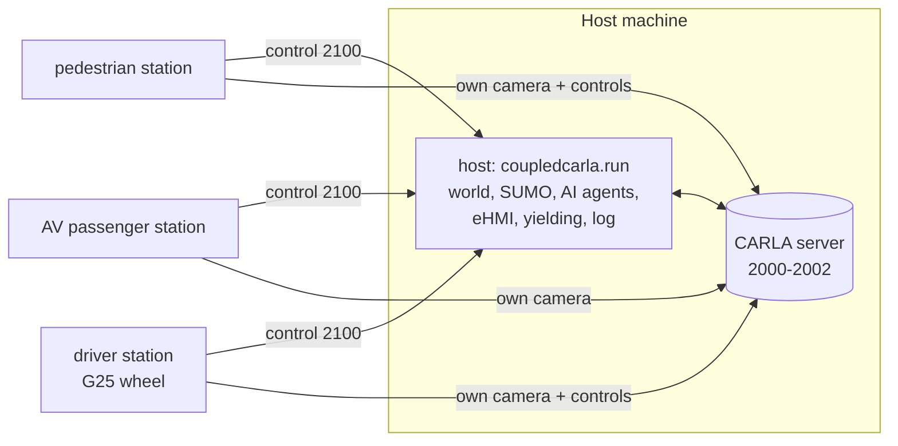

- **Stations** connect twice: to the CARLA server, to render their own camera and apply their own controls
  directly (no detour through the host), and to the host's **control channel** (TCP, JSON lines, port 2100) for
  everything else: their role and actor, trial start and end, visual-sync flashes, eHMI commands, round trips.
  The host waits for every `station: true` participant before a trial starts; stations stay connected across
  the trial sequence (each trial runs in a fresh child process, see [Lessons learned](#lessons-learned-gotchas)).
- **Roles** (`participants[].kind`): `driver` (a manual car: keyboard or G25 wheel, R puts the car back on its
  lane), `pedestrian` (a walker: W/S/A/D, mouse or arrows to look, Shift to run; camera at eye height) and
  `av_passenger` (rides in a scripted AV, front passenger seat; keys 1-9 choose the eHMI message, 0 switches it
  off). Every station has F for a visual sync and Esc to leave.
- **AI participants** (`agents`, [`coupledcarla/ai.py`](coupledcarla/ai.py)):
  - `kind: car`: follows a route through lat/lon points, planned on the lanes, at a speed profile set by
    **triggers** along the route, after coupled-sim's SpeedSettings: `{at: [lat, lon] | at_m: metres,
    speed_kmh, accel, yield_s, blinker: left|right|hazard, ehmi: state}`. It stops for SUMO red lights and, with
    `yield_to_pedestrians`, for pedestrians (human or AI) in its path, braking to rest ~4 m short and holding
    until the path has been clear for 0.8 s. Its eHMI is `manual` (set by an AV-passenger station or by
    triggers), `auto` ("I'M STOPPING" while it yields, "DRIVING" otherwise) or `off`.
  - `kind: walker`: walks a path of lat/lon points (`speed`, `start_s`, `loop`) with direct walker control,
    so it needs no CARLA navigation mesh.
- **eHMI** states and colours are configurable (`ehmi.states`), and so is where a car shows them
  (`ehmi.slots` for every car, `agents[].ehmi_slots` per car; coupled-sim had top and hood slots):

  | Slot | What | Read by |
  |---|---|---|
  | `front` (default) | light bar across the front, the text above it | someone in front of the car |
  | `rear` | the same on the back | a cyclist or driver behind |
  | `roof` | a light ring round the roof, the text on all four sides | anyone around the car |
  | `road` | the text projected on the road 3 m ahead | a pedestrian about to cross |
  | `eyes` | two eyes on the front whose pupils follow the nearest pedestrian (within 40 m), in the state's colour | eye contact with the AV ("eyes on a car") |

  CARLA renders debug *text* only in the spectator view, so the text is drawn with debug *lines* in a small
  line font, which every camera sees. The Eindhoven crossing's AV uses `[front, roof, road, eyes]`.
- **Eye contact** (`eye_contact: {angle_deg: 20, distance_m: 30}`): the host logs `eye_contact_start` and
  `eye_contact_end` whenever a pedestrian and a vehicle face each other within the angle and distance, with
  both angles. A pedestrian station sends where its camera looks; a vehicle faces along its heading (no head
  tracking yet, so for a driver this is "the car points at the pedestrian").
- **Pedestrian crowd** (`traffic.walkers`, `coupledcarla/crowdpeds.py`, [`experiments/eindhoven_crowd.yaml`](experiments/eindhoven_crowd.yaml)):
  pedestrians near the participants who behave like the real pedestrians of the map's country, calibrated with
  [CROWD](https://github.com/crowd-dataset/crowd) (dashcam videos from 238 countries with automatic pedestrian
  tracks). `count: auto` gives `walkers_per_km` (8) per km of kerb, scaled by CROWD's pedestrians per minute of the
  city (else country, continent, world: 18.1) and its night/day ratio. Speeds are the place's median crossing speed
  and quartiles (crowd-city). Walkers cross `crossings_per_km` (2.0) times per km, scaled by the share of tracked
  pedestrians that crossed; a crossing is mid-block with the country's measured share (crowd-jaywalking: Japan
  0.45%, France 1.5%, Netherlands 7.1%, Vietnam 30%, Bangladesh 77%; modelled from pedestrians per minute
  elsewhere, a weak fit), else at the nearest OSM crossing, else at the junction. At the kerb a walker waits for the
  HCM critical gap (width / speed + 2 s, shrinking to 60% after a minute); at a marked crossing it also steps out
  when every approaching car can still stop. On the road, SUMO traffic and scripted cars yield to them
  (`crowd_crosses` events). Walkers start where Overture places, bus stops and open pedestrian counts (NYC DOT,
  City of Sydney) are dense. `behaviour: off` keeps the old crowd that never crosses. Not CARLA's walker AI:
  CARLA 0.9.16 serves no navigation mesh for an OpenDRIVE world. `python tools/crowdpeds_check.py <experiment>
  [--sumo]` shows a map's plan:

  | Map | Walkers | Speed (m/s) | Crossings/km | Mid-block share |
  |---|---|---|---|---|
  | Eindhoven | 41 | 1.35 | 2.2 | 7.1% (measured) |
  | New York (Midtown) | 67 | 1.29 | 4.3 | 0.6% (modelled) |
  | Cairo (Tahrir) | 76 | 1.36 | 1.2 | 4.7% (modelled) |
  | Tokyo (Shibuya) | 80 | 1.30 | 6.1 | 0.45% (measured) |
  | Sydney (CBD) | 28 | 1.40 | 1.6 | 0.5% (modelled) |

  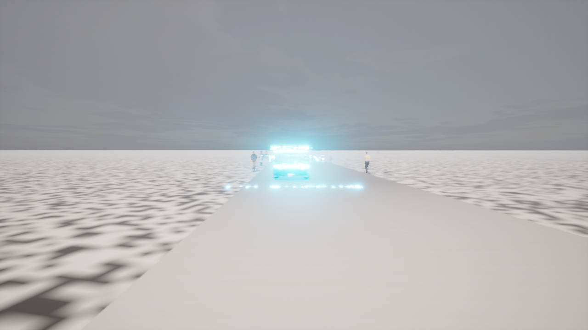
- **SUMO traffic yields to pedestrians**: SUMO vehicles near a pedestrian brake for one in their path and drive
  on when it is clear (`sumo_yields` events). SUMO itself only yields to persons on crossings, and CARLA
  pedestrians are not in SUMO.
- **Visual sync**: `coupling.visual_sync_at_s` (or F at any station) shows a red bar on every station for 1 s
  and logs `visual_sync` with the frame, to align screen recordings, eye trackers or physiology afterwards.
- **Latency**: the host sends every tick's frame number and wall time to the stations; each station estimates
  the clock offset to the host from its pings (the shortest round trip, as NTP does) and measures, on the
  host's clock, when it saw that frame's world snapshot (`tick_to_station_ms`) and when that frame's camera
  image arrived (`tick_to_image_ms`). Per frame in the station CSV, as median and 95th percentile in the
  `station_stats` events and in `summary.json`. Display lag (monitor, VR headset) comes on top; a photodiode
  on the visual-sync bar measures it.
- **Logging**: agents get rows every frame (`kind = agent`, with an `ehmi` column), and the events include
  `station_joined`, `station_left`, `station_stats` (round trip to the host and rendered fps, every 5 s),
  `ehmi` (with who set it), `trigger`, `agent_stops` / `agent_goes` (with the reason), `sumo_yields`,
  `visual_sync`, and `collision` for every participant and agent. Each station also writes
  `logs/stations/<role>_<time>.csv`: one row per rendered frame with wall-clock time, CARLA frame, simulation
  time, round trip, visual-sync flag, speed and eHMI.

### Running the Eindhoven crossing

[`experiments/eindhoven_crossing.yaml`](experiments/eindhoven_crossing.yaml): a straight two-way street east of
the station (OSM way 7157413, 392 m, no lights). The AV starts 130 m before the crossing at 30 km/h; the
pedestrian waits at the north kerb; the driver starts 38 m behind the AV; an oncoming AI car with an automatic
eHMI, two AI walkers and SUMO traffic fill the street; two trials (day, dusk).

```bash
# host (the machine with the GPU)
.venv/bin/python -m coupledcarla.run experiments/eindhoven_crossing.yaml
# one station per human, on any machine of the LAN (needs only the carla client, pygame, numpy)
.venv/bin/python -m coupledcarla.station --host <host ip> --role pedestrian
.venv/bin/python -m coupledcarla.station --host <host ip> --role av_passenger
.venv/bin/python -m coupledcarla.station --host <host ip> --role driver --input wheel
```

`--input bot` runs a station without a human (the experiment's `bot` entry: the pedestrian's path and gaze
target, the passenger's eHMI schedule, the driver on autopilot), with `--headless --frames-every 0.5` to save
its view; `run ... --local` runs every station role as a bot on the host, for a quick test without stations.

**Test run** (13 Nov 2026): host and CARLA on lin4080 (RTX 4080 SUPER, shared with another job); driver and AV
passenger stations on lin4080; the pedestrian station on a different PC (wsl5090, wired LAN), all as bots;
both trials:

| | |
|---|---|
| Stations | all three joined in ~3 s, rejoined for trial 2, left cleanly at the end |
| Round trip to the host | 0.3-20 ms (local stations), 12-23 ms (other PC) |
| Station frame rate | ~35 fps each (the host's tick rate) |
| Real-time factor | 0.69-0.70 (host plus three cameras at 50 Hz on the shared GPU) |
| AV | stopped for the pedestrian at 14.9 s, drove on at 19.5 s; eHMI yielding 13.0 s, go 16.0 s, driving 21.0 s (passenger station) |
| Oncoming AI car | stopped for AI walker 1 at 9.1 s, drove on at 11.8 s; its automatic eHMI followed |
| Collisions | 0 in both trials |
| Latency (rerun with the latency log, all stations local) | tick to station snapshot 0.1 ms; tick to camera image 106-197 ms median (CARLA renders and reads back a camera 4-6 frames after its tick) |
| Eye contact | pedestrian and AV from 29.5 m to 13.5 m; pedestrian and driver from 29.6 m to 20.3 m |

**Network**: stations need the host's ports 2000-2002 (CARLA) and 2100 (control) on a wired LAN. A station on
Wi-Fi (lin5080) could talk to the host but received no camera frames: its path dropped packets above ~1,350
bytes without telling the sender (a path-MTU black hole), so CARLA's image stream stalled. A remote station
receives its camera as raw images over the network (960x540 at 35 fps is about 70 MB/s), so gigabit Ethernet
carries about one full-HD remote station; CARLA's multi-GPU secondary servers, rendering on the station's own
GPU, are the next step for more.

## Phase 3: CARLA 1.0 and the Eindhoven digital twin

Phase 3 brings real looks: CARLA 1.0 on Unreal Engine 5.8 (Lumen, World Partition, the Digital Twin baker)
and Eindhoven built from Dutch national open data instead of OSM alone.

### Running on CARLA 1.0

coupled-carla takes the same experiment files on CARLA 0.9.16 and CARLA 1.0. CARLA 1.0 renamed or dropped
most vehicle blueprints; [`compat.py`](coupledcarla/compat.py) maps every 0.9 name used here to the closest 1.0
blueprint (by body type and size, then by `base_type`, then by wheel count) and logs each substitution once.
The SUMO conversion script that CARLA 1.0 no longer ships is vendored in `bridge/util/`. Set up a second
environment next to the 0.9.16 one:

```bash
# the CARLA 1.0 package (UE5 weekly, ~14 GB), extracted to e.g. ~/carla58-pkg/CARLA_1.0
uv venv --python 3.12 .venv10
grep -v '^carla' requirements.txt > /tmp/req10.txt
VIRTUAL_ENV=.venv10 uv pip install -r /tmp/req10.txt <package>/PythonAPI/carla/dist/carla-1.0-cp312-cp312-linux_x86_64.whl
# env10.sh: CARLA_ROOT=<package>, SUMO_HOME, PATH and PROJ_LIB as in env.sh
bash tools/run_coupled_test.sh experiments/eindhoven_crossing.yaml env10.sh .venv10/bin/python
```

The 1.0 server needs a recent NVIDIA driver. With driver 560 (lin4080) it stops at start-up ("Vulkan device
could not be created at the project's supported feature levels"), even with only the NVIDIA Vulkan driver
visible; lin5080 (driver 595, RTX 5080) is the 1.0 machine.

**Source build (2026-11-14).** CARLA `ue58-dev` (38b72cc52) builds on lin5080 with the CMake presets in
about 15 minutes once the UE 5.8 engine fork is built (`cmake --preset Release`, then the `carla-server`,
`carla-client`, `carla-python-api-install`, `carla-unreal` and `carla-unreal-editor` targets; the venv needs
`build` installed). The server is the editor binary in `-game` mode; the first start spends a few minutes building
derived data. The first coupled-carla run on it: `eindhoven_centre.yaml`, 40 s, autopilot driver with SUMO traffic,
RTF 0.82, 0 collisions, every 0.9 blueprint mapped to a 1.0 stand-in. That run used `-nullrhi` (no rendering, so no
cameras or stations), because the RTX 5080 was full with other jobs. The real-world scenery has its own 1.0 mesh
catalogue ([Scenery on CARLA 1.0](#scenery-on-carla-10-and-on-baked-levels)). Install the 1.0 wheel after
`requirements.txt`, which pins `carla==0.9.16`.

### The Eindhoven digital twin

The twin is built with CARLA's [Digital Twin pipeline](https://github.com/carla-simulator/carla-digitaltwins)
(`ue58-twins`), extended with Dutch open data in the fork
[bazilinskyy/carla-digitaltwins](https://github.com/bazilinskyy/carla-digitaltwins/tree/nl-data) (branch
`nl-data`):

| Layer | Source | Resolution |
|---|---|---|
| Road network, signs, crossings | OpenStreetMap via Overpass (fetched in quarters when a server times out) | |
| Terrain | [AHN](https://www.ahn.nl) DTM via the PDOK WCS, heights in NAP | 0.5 m |
| Aerial photo (road surfaces, refinement, ground texture) | [PDOK Luchtfoto](https://www.pdok.nl/introductie/-/article/pdok-luchtfoto-rgb-open-) RGB, current year | 8 cm, resampled to 25 cm |
| Buildings | [3DBAG](https://3dbag.nl) LoD 2.2 (BAG footprints with AHN lidar roofs) | per building |

```bash
python -m twinmodel build --bbox 51.4360 5.4700 51.4500 5.4930 --name EhvCentre --out build/ehv_centre --profile nl_urban
python -m twinmodel bake-export build/ehv_centre EhvCentre
python TwinModel/tools/threedbag_buildings.py build/ehv_centre      # OSM boxes -> 3DBAG roofs
```

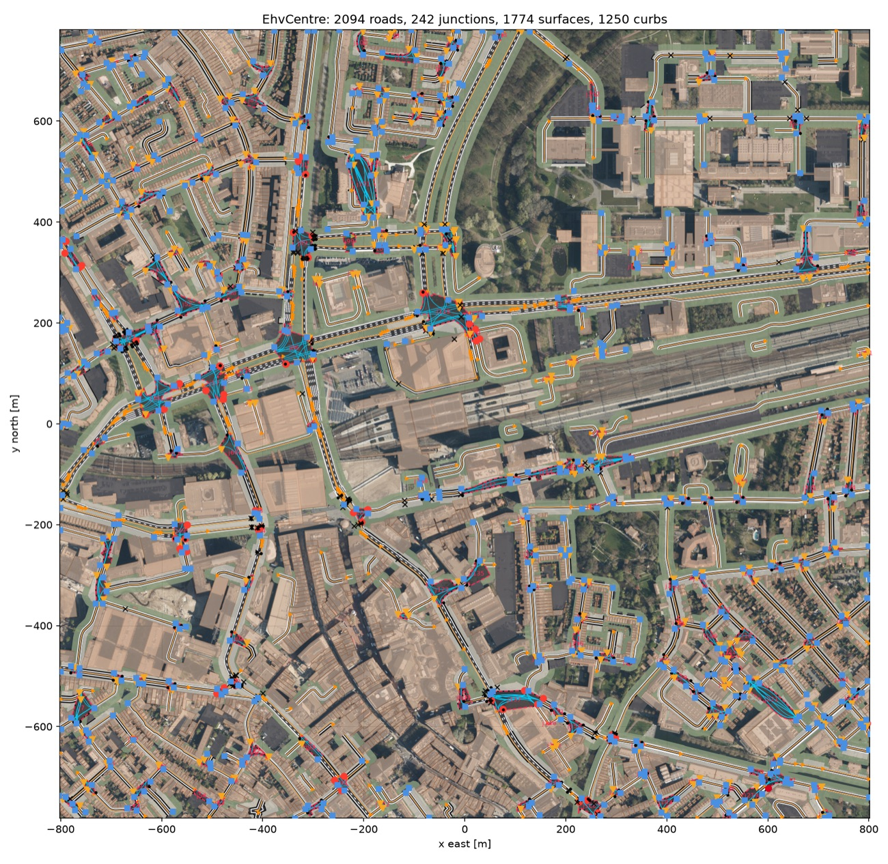

*The Eindhoven centre twin (1.6 x 1.6 km, the same area as `eindhoven_centre.yaml`): 2,094 roads, 242
junctions and 1,578 signals over the 8 cm PDOK aerial photo; terrain from AHN (12.1-23.9 m NAP); the OpenDRIVE
validates in CARLA (98,920 waypoints). Bake input: 623 meshes, 0.9 M triangles.*

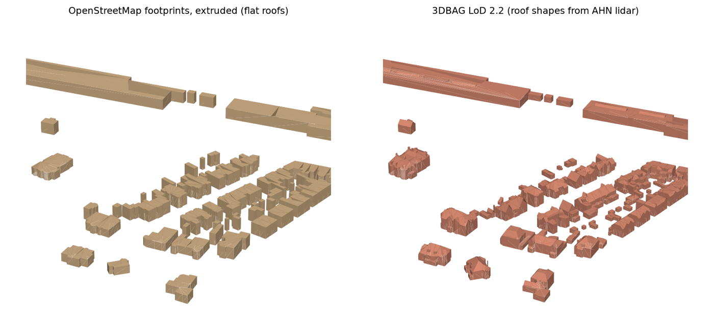

*Buildings near the Eindhoven crossing: OSM footprints extruded to a guessed height (left) and 3DBAG LoD 2.2
with the real roof shapes (right). The centre twin has 3,654 3DBAG buildings (274k triangles in 63 tiles).*

**Baked into a CARLA 1.0 level (2026-11-14).** Stage 3 of the pipeline imports the bake input into the UE 5.8
source tree as the World Partition level `/Game/Carla/Maps/Twins/EhvCentre/EhvCentre`, headless on lin5080 in
7 minutes: 623 Nanite meshes (roads, lane markings, kerbs and risers, sidewalks, crossings, parking, islands,
3DBAG buildings, ground) with CARLA's road, sidewalk, marking and facade materials, 400 vehicle spawn points, the
OpenDRIVE and the Traffic Manager cache next to the level; 65 MB of content.

```bash
UnrealEditor-Cmd <carla>/Unreal/CarlaUnreal/CarlaUnreal.uproject -run=pythonscript -unattended -nosplash -nullrhi \
    -script="<carla-digitaltwins>/TwinModel/ue/bake_level.py --manifest <abs>/build/ehv_centre/ue/manifest.json \
             --name EhvCentre --python-bin <venv with the carla 1.0 wheel>/bin/python"
```

The baked level's folders (`Content/Carla/Maps/Twins/EhvCentre`, `Content/Carla/Static/*/Twins/EhvCentre` and the
level's `__ExternalActors__`) are plain uasset files: copied into another CARLA 1.0 tree (win5090) the level loads
there too, and `-DCARLA_MAPS_TO_COOK=.../Twins/EhvCentre/EhvCentre` cooks it into a package.

coupled-carla drives it with [`experiments/eindhoven_twin.yaml`](experiments/eindhoven_twin.yaml):
`map.opendrive` names the twin's OpenDRIVE (copy `build/ehv_centre/EhvCentre.xodr` to `twins/`) and
`map.carla_level` the level. `mapbuild` then makes the SUMO net from that same OpenDRIVE (so SUMO and the level
share their roads; the real bus lines and GTFS timetables are matched onto it as on any map), and the trial
loads the level by name instead of generating an OpenDRIVE-only world. First run, headless on lin5080 (no
GPU): 90 s, 35 SUMO vehicles shown in CARLA, 0 collisions, RTF 0.72 with the machine's other jobs running.

**Rendered on Windows (2026-11-14).** CARLA 1.0 also builds natively on Windows 11 (win5090: VS 2022, the
engine fork with `GenerateProjectFiles` and msbuild, CARLA with CMake and Ninja) and packages: a Shipping
server cooked with `-DCARLA_MAPS_TO_COOK=.../Town10HD_Opt+.../OpenDriveMap+.../TestMaps/EmptyMap+.../Twins/EhvCentre/EhvCentre`
(9.9 GB; copy the twin's `OpenDrive/` and `TM/` folders next to the package's `Content/Carla/Maps/Twins/EhvCentre/`,
since the cook stages only CARLA's own towns' OpenDRIVE). The packaged server starts in 30 s and uses 9.7 GB of RAM
and 2.6 GB of GPU memory (the editor in `-game` mode: 21.6 GB and 7.5 GB); at the twin it ticks in 15 ms, 16 ms with
a 1280x720 camera. A coupled trial with the client in WSL on the same machine (`server.host: 127.0.0.1`, mirrored
networking): 120 s, SUMO traffic on the twin, 0 collisions, but RTF 0.32: the server takes 16 ms of the 55 ms per
tick and the SUMO bridge's calls over the CARLA 1.0 API the rest (the same loop runs at 0.99 on 0.9.16), so the
bridge needs profiling on 1.0.

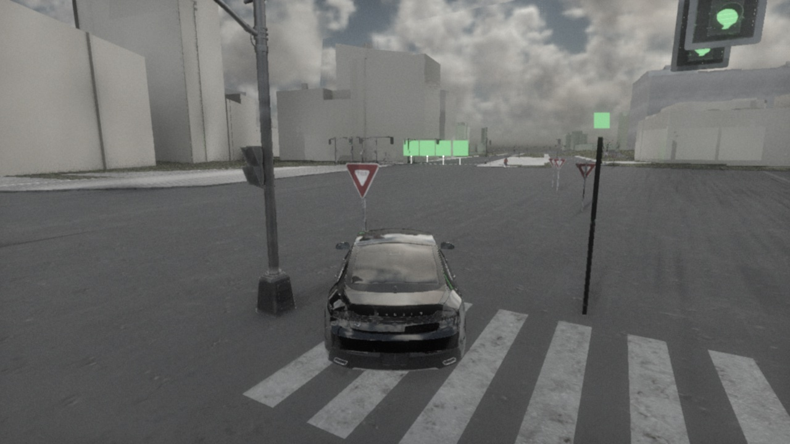

*The baked Eindhoven twin in CARLA 1.0 on win5090: lane markings, a zebra crossing, yield signs, a CARLA traffic
light, snapped scenery, SUMO's bus, 3DBAG buildings with CARLA's plain facade material (the twin's facades are
slabs; `--buildings procedural` would use the modular facade generator).*

**Styled buildings (2026-11-14).** `EhvCentreFacades` is the same twin with every 3DBAG building styled by its BAG
construction year and use (brick of three periods, render, concrete and glass offices, industrial cladding, shopfront
ground floors, plain party walls) and roofs textured with the PDOK aerial photo: 791 building and roof meshes, 85
materials, 113 textures, 239 MB, baked in 6 minutes ([`experiments/eindhoven_twin_facades.yaml`](experiments/eindhoven_twin_facades.yaml)).
The facade textures and styles are made by the carla-digitaltwins NL branch (`twinmodel/export/facades.py`,
`threedbag_buildings.py`). A packaged server needs the scenery's folders in the cook
(`+DirectoriesToAlwaysCook` for `/Game/Carla/Static/Vegetation`, `StreetLight`, `Static`, `TrafficSign`, `Pole`,
`Bicycle`, `Motorcycle`): without them trees render as black leaf cards and the lamp blueprints do not exist.

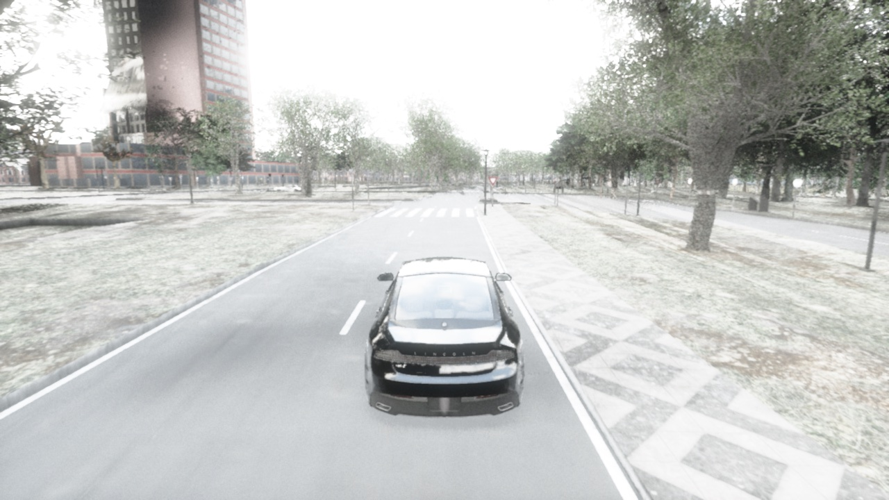

**Real time on CARLA 1.0.** CARLA 1.0 builds rpclib without TCP_NODELAY (0.9.16's rpclib set it on both ends):
two fire-and-forget calls in a row (debug draws, `apply_control`, `set_light_state`) then hold up the next
blocking call (`world.tick()`) by about 40 ms, a delayed ACK. So the runner sends debug drawings, traffic-light
states and the spectator over a second connection (`coupledcarla/side.py`), and controls and light states of
participants, agents and crowds go with the bridge's one batch per tick. The bridge also caches its traffic-light
index and the light states it sets, subscribes SUMO vehicles outside CARLA to their position only, and snaps
CARLA-driven cars to SUMO lanes with its own lane index (`coupledcarla/lanesnap.py`: the same point as SUMO's
`convertRoad`, checked on 104,000 points, without its 1.6 ms scan). `simulation.profile: true` prints the
milliseconds per tick of each part of the loop. Eindhoven twin on lin5080 (`-nullrhi`, 60 s, headless): 18.9 ->
7.7 ms per tick, the client's own 15.0 -> 4.5 ms; RTF 1.06 -> 2.59. On Windows (win5090, the packaged server
rendering, client in WSL) a fire-and-forget batch before the tick still waited for the delayed ACK (43 ms per tick
against the server's 17 ms), so the bridge sends its batch with `apply_batch_sync`: the Eindhoven twin with
styled buildings and a 1280x720 camera then runs in real time, 13-14 ms per tick (the server 6-7 ms of it).

**Still to do in phase 3:** stations on the rendering server, facade textures for the 3DBAG buildings, VR; the
rpclib fix upstream.

## Traffic

- **Models.** SUMO's Extended IDM (EIDM) for car following (human-like reaction and drive-off) with
  `tau = 1.2 s`, `minGap = 2 m`, speed factor N(1.0, 0.1); the sublane model (`--lateral-resolution 0.25`)
  for lane changing, which lets cyclists ride at the right edge and cars overtake them.
- **Fleet.** Where an open vehicle register covers the map (`traffic.fleet: auto`, `coupledcarla/fleet.py`),
  the car body types and colours are the register's: the RDW's 9.9 M insured Dutch passenger cars (hatchback
  38%, estate 31%, MPV 22%; grey, black, white, blue) and the NY DMV's Manhattan registrations (SUV 67%, sedan
  22%, 3% yellow cabs), Waka Kotahi's Motor Vehicle Register for New Zealand (Auckland: 1.4 M light vehicles, SUV
  30%, hatchback 31%, utes 8.5%; station wagons split into SUV, MPV and estate by model) and Senatran's monthly
  fleet for São Paulo, Rio and Brasília (car 81%, SUV 8%, pickup 7%; colours of all vehicles). Body types are spread over the CARLA models that look like them; each SUMO car gets a
  colour drawn from the register's shares and the bridge gives it to the CARLA car. A register counts the fleet
  that is registered, not the mix on the street. Elsewhere a weighted mix of compact European-style CARLA models
  with a world colour mix. Gazelle omafiets, BH crossbike and Diamondback bikes (cyclists at about 5 m/s with
  spread); buses in their line's OSM colour.
- **Demand.** Random trips (`randomTrips.py --validate`) per class and hour, with a fringe factor so traffic
  enters at the edges of the map. Buses run the real lines (see [Public transport](#public-transport)).
- **Measured counts.** Where open traffic counts cover the map (`traffic.counts: auto`, `coupledcarla/counts.py`),
  the cars follow them: each counter is matched to the SUMO edge it counts (position, direction, OSM name or road
  number), its count becomes the flow of the trial's local hour and day type, and SUMO's `routeSampler` picks car
  routes from many random candidates so that the counted edges carry those flows, then tops up to `cars_per_hour`
  with routes that pass no counter. Daily totals are spread over the day with a typical urban profile (after DfT
  TRA0307; within 0.5 percentage points per hour of Montevideo's weekday detectors). Cached in `real/counts.json`;
  `python tools/counts_check.py <experiment>` measures the fit in a SUMO-only run. At 08:00 on a weekday:

  | Map | Counts (source) | Counters matched | Median GEH, random trips -> counts |
  |---|---|---|---|
  | Montevideo | Intendencia video detectors | 19 of 25 | 25.5 -> 2.2 |
  | Burlington, Vermont | VTrans AADT stations | 62 of 101 | 15.0 -> 2.2 |
  | Portland, Oregon | PBOT counts | 149 of 278 | 19.4 -> 3.6 |
  | Auckland | Auckland Transport counts | 452 of 661 | 13.3 -> 4.6 |
  | Lyon | Criter loops | 27 of 34 | 20.4 -> 6.2 |
  | London (Westminster) | DfT AADF by direction | 34 of 42 | 22.7 -> 6.9 |
  | New York (Midtown) | NYC DOT automated counts | 16 of 20 | 38.6 -> 9.6 |

  New York and London stay higher because a trial starts with empty streets and the inner counters fill in its
  first minutes. None open for Eindhoven (NDW's nearest site is 3.6 km away), Leuven (motorway loops only),
  Tokyo, Taipei (live feed only), São Paulo (PDF reports) or Sydney (needs a key).
- **Demand without counts.** `traffic.cars_per_hour: auto` derives the cars per hour from the map: lane-km by road
  class x the median daily flow per lane measured on the counted maps (primary 3,400, secondary and tertiary
  2,600, other 1,000 cars) x the hour's share / the mean trip length, capped at 5,000 cars/h (above that random
  trips jam SUMO's junctions). The city files keep their explicit numbers.
- **Cyclists** (`coupledcarla/cycling.py`, `traffic.cycling`). Bike trips follow the real cycle network: OSM
  bicycle route relations (LCN/RCN/NCN, the Dutch and Belgian knooppunten) and cycle tracks, lanes and cycle
  streets are laid on the SUMO net's bike lanes (cached as `cycling.json`). 70% of bike trips start and end on
  that network, and every cyclist prefers cycle routes and tracks when choosing a route; the rest are random
  trips, so side streets keep their cyclists. Where open bike counters lie in or near the box, `bikes_per_hour` is
  fitted to their typical count for the trial's day type and hour (capped at `max_bikes_per_hour`, 3000: a
  cyclist costs CARLA about 3 ms per tick). Bike edges within 30 m of a shared-bike dock draw three times the trip
  starts and ends (`dock_weight`: Lyon 21 -> 41% of trips starting near a dock, London 18 -> 40%, Taipei 25 -> 48%).

  | Map | Cycle routes matched | Bike-km on cycle routes (random -> cycling) | Counters | Bikes/h at 08:00 weekday |
  |---|---|---|---|---|
  | Eindhoven | 19 (11 knooppunten) | 22% -> 34% | none keyless (NDW needs an account) | 1200 (as set) |
  | Lyon | 9 | 11% -> 21% | 6 (Métropole de Lyon) | 3000 (counted 4277, capped) |
  | New York | 14 | 49% -> 70% | 1 (NYC DOT, 8th Ave) | 300, 107 of them entering on 8th Ave |
  | Sydney | 8 | 13% -> 45% | 13 (City of Sydney) | 1503 |
  | Leuven | 9 (5 knooppunten) | 22% -> 27% | 2 nearby (AWV), outside the net | 1200 (as set) |

- **Speed limits and driving style** (`coupledcarla/speeds.py`). Where OSM gives a road no `maxspeed`,
  netconvert uses its rural defaults (100 km/h on primary and secondary roads: 109 edges of Midtown Manhattan,
  204 around Taipei Main Station); in a trial these roads get the country's urban limit through a variable speed
  sign (`traffic.speed_limits: auto`; CARLA's OpenDRIVE still carries the netconvert value). Where open speed
  measurements cover the map (`traffic.speed_factor: auto`), the cars' speed factor is fitted in SUMO-only runs so
  that simulated spot speeds match them (`tools/speeds_check.py --calibrate`, `data/speed_calibration.json`):
  Portland (PBOT speed counts, factor 0.91, MAPE 36.6 -> 32.7%), Taipei (live detectors, 1.06, 44.2 -> 30.1%),
  Montevideo (video detectors, 0.80, 24.4 -> 13.1% at night; daytime congestion SUMO does not make). Eindhoven's
  NDW floating-car speeds check the default (median simulated / measured 1.01). Elsewhere N(1.0, 0.1) in [0.8, 1.2].
- **Interaction.** The participant's car is mirrored into SUMO each tick (`moveToXY`), so SUMO vehicles brake
  for it, queue behind it and yield to it.
- **Level of detail.** SUMO simulates the whole map; a SUMO vehicle exists in CARLA only within
  `simulation.lod_radius_m` (250 m) of a participant and is removed beyond 280 m.

## Traffic lights

SUMO runs the signal programs (`simulation.tls_manager: sumo`). CARLA's own traffic-light actors are unusable
in a world built from OpenDRIVE: they have no OpenDRIVE id, so they cannot be linked to SUMO, and
`set_state()` does not change them (they stay red). SUMO is therefore the only source of truth:

- each signalled lane's light is **drawn in the world** at its stop line (a pole with a lamp, right of the
  lane), coloured from SUMO, for lights near a participant; the drawing shows in every camera, so the driver
  sees it;
- each participant's **next light** (id, distance, state) comes from the lane their SUMO twin is on; it drives
  the autopilot, the HUD, the per-frame log (`next_tl*` columns) and a `next_light` event whenever it changes.

The signal programs are CARLA's converter defaults for now (per approach 42 s green, 3 s yellow, 3 s red), not
the coordinated programs SUMO derives from OSM ([Known limits](#known-limits)).

## Logging and data

Each trial writes to `logs/<experiment>/<YYYYmmdd-HHMMSS>_trial<k>/`:

| File | Content |
|---|---|
| `config.yaml` | The merged configuration of this trial. |
| `frames.csv` | Semicolon-separated like coupled-sim's CSV; one row per actor per frame at the simulation rate (50 Hz). Participants and scripted agents every frame; SUMO vehicles, cyclists, buses and crowd walkers every frame while within `logging.radius_m` of a participant. |
| `events.csv` | `trial_start`, `spawn` (with SUMO id), `next_light`, `collision`, `left_road`, `reset_to_lane`, `trial_end` (with a summary). Line-buffered, so it survives a crash. |
| `summary.json` | Ticks, simulated and wall time, real-time factor, rows, collisions, SUMO vehicles shown. |
| `analysis/` | Encounter measures, POI passes and a timeline plot, written after the trial (see [Analysis](#analysis)). |
| `sumo/` | The trial's demand and SUMO config, `sumo_fcd.xml.gz` (**every** vehicle on the map at 10 Hz with lat/lon and signals), `sumo_tripinfo.xml`, `sumo.log`. |
| `view_*.jpg` | Snapshots of the first participant's view when `--frames-every` is set. |
| CARLA recorder | `coupledcarla_<experiment>_<time>_trial<k>.log` on the server machine, for replay from any viewpoint with CARLA's replayer. |
| UDP 40131 | Every 0.2 s a JSON frame shaped like coupled-sim's live data (`Driver [i]`, `Pedestrian [i]`, `CarLight [id]` entries with position, rotation, lat/lon, speed, lights). |

Both CSV files time rows in seconds of trial time (0 at the first tick), so a frame and an event line up by
`timestamp` or by `frame`. (Logs before 2026-11-14 wrote CARLA's server time in `frames.csv`; the analysis
lines them up by frame.)

`frames.csv` columns: `timestamp; frame; actor_id; kind` (participant, car, bike, bus, walker)`; role; type_id;
pos_x; pos_y; pos_z` (CARLA metres: x east, y south, z up)`; rot_pitch; rot_yaw; rot_roll; lat; lon; vel_x;
vel_y; vel_z; speed_kmh; acc_x; acc_y; acc_z; blinkers` (0 none, 1 left, 2 right, 3 hazard)`; front_lights;
stop_lights; throttle; steer; brake; reverse; hand_brake` (participants)`; next_tl; next_tl_dist;
next_tl_state` (participants and agents)`; ehmi` (agents). `kind` is `agent` for scripted AI cars and walkers,
logged every frame like participants.

Unlike coupled-sim's wide CSV (one column block per agent, fixed agents), this is a long table: SUMO spawns
and removes hundreds of vehicles, so one row per actor per frame is the shape that works (and loads directly
into pandas or R).

## Analysis

After every trial the host measures each encounter between a pedestrian (the participant's and the scripted
walkers) and a vehicle (the driver, scripted cars, SUMO traffic) that came within 30 m, and writes
`analysis/encounters.csv`, `analysis/poi.csv` and `analysis/timeline.png` next to the logs. The same runs by hand
on one trial or on a whole experiment, which also collects every trial in `logs/<experiment>/analysis.csv`:

```bash
.venv/bin/python -m coupledcarla.analysis logs/eindhoven_crossing
.venv/bin/python -m coupledcarla.analysis logs/eindhoven_crowd/<time>_trial0 --all-walkers --poi-frames
```

| Column | Meaning |
|---|---|
| `min_gap_m`, `t_min_gap` | Closest distance between the pedestrian (a 0.3 m disc) and the vehicle's box (size by blueprint: car, van, bus, bicycle). |
| `min_ttc_s`, `t_min_ttc` | Shortest time to collision, both keeping their velocity, while the vehicle moves (under 10 s, else empty). |
| `pet_s`, `first` | Post-encroachment time: the shortest time between the pedestrian being at a spot and the vehicle's box covering it (10 Hz); who was there first. |
| `t_in_path`, `veh_speed_in_path_kmh`, `veh_dist_in_path_m`, `ehmi_in_path` | When the pedestrian first stepped into the vehicle's path (its width plus 0.5 m, ahead, within 60 m), and the vehicle's speed, distance and eHMI then: the gap the pedestrian accepted. |
| `stopped`, `t_stop`, `stop_gap_m` | Whether the vehicle came to a stop with the pedestrian ahead, when, and how far away. |
| `eye_contact_s`, `t_eye_contact` | Total eye contact (the `eye_contact_*` events) and when it began. |
| `ehmi_states`, `collision` | The vehicle's eHMI changes (`time:state`), and whether the two collided. |

`poi.csv` gives, for every participant and scripted agent, its closest distance to each point of interest and
the first time within the POI's radius (`radius_m`, default 10 m); with `--poi-frames`, `frames_poi.csv` has
the participants' positions in each POI's reference frame (x forward along its `heading`, compass degrees,
y to its left), as coupled-sim's reference frames.

From the coupled test of the Eindhoven crossing (trial 1): when the participant pedestrian stepped into av1's
path, av1 was 21.9 m away at 28.8 km/h with its eHMI on "yielding"; it stopped 10.2 m before the pedestrian,
who crossed first (PET 5.6 s, shortest time to collision 4.97 s), after 5.2 s of eye contact. The pedestrian
also crossed before the human-driven car (PET 7.6 s), which stopped 18.8 m away.

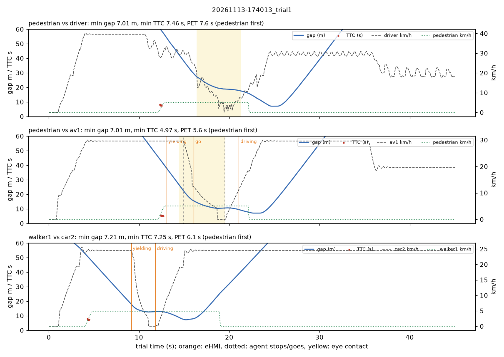

*`analysis/timeline.png`: one panel per conflict, the gap (blue), time to collision (red), the vehicle's and the
pedestrian's speed, eHMI changes (orange), the scripted car's stop and go (dotted) and eye contact (yellow).*

## Trial viewer

[`viewer/index.html`](viewer/index.html) replays a trial in the browser with three.js (inspired by the
browser-built cities shared in the project channel, e.g. mrdoob's procedurally generated New York and the
OSM-massed Berlin demo): roads as ribbons, cycleways in red, OSM buildings extruded to their tagged height
(or 3.2 m per level), actors as boxes coloured by kind, a timeline with play/speed, free / follow / top
cameras, the participant's speed and next light, and the events so far.

```bash
.venv/bin/python -m coupledcarla.export_trial logs/eindhoven_centre/<time>_trial0   # -> trial.json
python3 -m http.server 8765
# open http://localhost:8765/viewer/?file=/logs/eindhoven_centre/<time>_trial0/trial.json
```

Three demo trials are included: `http://localhost:8765/viewer/?file=data/eindhoven_centre.json` (180 s),
`?file=data/new_york_midtown.json` (40 s) and `?file=data/eindhoven_crossing.json` (the coupled crossing,
45 s: agents in dark blue with their eHMI bar, AI walkers in purple). A file can also be
dropped onto the page. `window.viewer.renderAt(t, camera)` renders a given moment;
[`tools/viewer_shots.py`](tools/viewer_shots.py) uses it to make the screenshots in this README in headless
Chromium.

## Performance

Measured on lin4080 (RTX 4080 SUPER 16 GB, **shared with another job using ~60 % of the GPU** unless noted),
CARLA 0.9.16 at Epic, 50 Hz. The rows before 2026-11-14 ran with the spectator rendering (see below):

| Setup | Real-time factor |
|---|---|
| Eindhoven, 180 s, level of detail 250 m, ~5-10 SUMO actors in CARLA at a time | 0.78 |
| Same, no level of detail (all ~100 SUMO vehicles in CARLA) | 0.26 |
| 20 Hz, cars only (no cyclists), all in CARLA | 1.00 |
| The 19 maps, 40 s each, before the spectator was parked (2026-11-13) | 0.55-0.99 (small towns fastest) |
| The 19 maps with full scenery, spectator parked (2026-11-14, GPU not shared at the time) | 0.98-0.995 |
| Coupled crossing: host + 3 stations with 50 Hz cameras + 4 agents | 0.69-0.70 |

**The spectator.** An off-screen CARLA server still renders its spectator view, and in our worlds it looked at the
whole map from its start position. The host now parks it in the sky looking up (when `server.offscreen`).
Stellenbosch, 40 s, same GPU: 0.70 without scenery before, **0.99** after; with its 2,379 scenery meshes 0.40
before (buildings alone 0.39), **0.97** after. The full Town buildings would cost even with that fixed, so the
scenery uses CARLA's optimised (`_Opt`) versions where they exist (64 of 70).

Each SUMO vehicle in CARLA costs server time every tick: about 0.4 ms for a car and **about 3 ms for a
cyclist** (the bike carries an animated rider), which is why the level of detail matters. The base frame time at
Epic is about 20 ms, which is the whole budget at 50 Hz; on an unshared GPU (or at `--quality Low`) the trial
runs in real time. Map building takes 2-4 s per city plus the Overpass downloads.

## coupled-sim features in coupled-carla

| coupled-sim | coupled-carla | Status |
|---|---|---|
| Roles: manual driver, AV passenger, pedestrian | `participants` with kind driver / av_passenger / pedestrian, each host-local or at a station | done |
| Experiment definitions, trial sequence, run automatically | YAML experiment, `trials` with overrides, run in order | done |
| Input: keyboard, steering wheel | keyboard, G25 with force feedback | done |
| Input: Xsens motion suit | walker bone control | to do |
| Output: screen | pygame window, driver/hood/chase | done |
| Output: HMD (VR) | OpenXR / DReyeVR-style | phase 3 |
| AI cars on waypoint circuits with speed/yield triggers | scripted agents on lat/lon routes with triggers (speed, accel, yield, blinker, eHMI) + SUMO traffic | done |
| AI pedestrians on waypoint circuits | scripted walkers on lat/lon paths (no navigation mesh needed) | done; SUMO persons as walkers: to do |
| eHMI on the AV (top, windshield, hood) | light bar + line-font text on the front or rear, a roof ring, text projected on the road, or "eyes" that look at the nearest pedestrian; set by passenger, triggers or automatically | done |
| Traffic lights, switchable | SUMO signal programs, drawn in the world | done (default programs) |
| Day/night | weather presets, sun altitude | done |
| Networking host + 3 clients | host + one station per human on the LAN, no fixed limit | done; multi-GPU secondaries: to do |
| Binary log 50 Hz + CSV conversion | `frames.csv` at 50 Hz directly | done |
| Live data UDP 40131 | JSON frames on UDP 40131 | done |
| Driver eye contact | `eye_contact_start` / `_end` events when a pedestrian and a vehicle face each other (vehicle heading; no head tracking yet) | done |
| Round-trip time in the log | `station_stats` events + per-frame station logs, with tick-to-station and tick-to-image latency | done |
| Points of interest as CSV reference frames | `pois` in lat/lon with `heading` and `radius_m`; passes in `poi.csv`, positions per POI frame in `frames_poi.csv` | done |
| Analysis scripts | `coupledcarla.analysis` after every trial: gaps, time to collision, PET, accepted gaps, stops, eye contact per encounter, timeline plot | done |
| Visual sync (red bar) | red bar on every station, scheduled or on F, logged with the frame | done |
| Video recording | CARLA recorder + re-render from any viewpoint | recorder done |
| A small fictional US town | any place on Earth, 19 cities ready | done |

## Known limits

- **Looks:** the scenery uses CARLA 0.9.16's own meshes: real positions, footprints and heights, but CARLA's
  facades, tree models and props, and flat or tilted ground tiles (steps between tiles on steep maps). No road
  markings or crossings on OSM maps, and lamps give no light. Exact buildings, aerial-photo ground and markings
  need the UE 5.8 digital twin (phase 3).
- **Pedestrians:** human pedestrians, scripted AI walkers and the crowd walk by direct control (no navigation
  mesh). Crowd walkers keep to one street, cross at OSM crossings, junctions or mid-block, and ignore pedestrian lights. Walkers off the road walk on the ground plane,
  0.3 m below the road surface. `map.sidewalks: true` puts sidewalk lanes into the OpenDRIVE (not into SUMO's
  net, where they crash SUMO), but walkers fall through CARLA 0.9.16's generated sidewalk meshes, so it stays
  off. SUMO persons are not mirrored: SUMO needs sidewalks for them.
- **eHMI:** drawn with debug lines, so it glows (bloom) and the passenger sees it mirrored through the
  windshield.
- **CARLA 1.0** needs a recent NVIDIA driver: on lin4080 (driver 560) the UE 5.8 package stops at start-up with
  "Vulkan device could not be created at the project's supported feature levels"; lin5080 (595) is the 1.0
  machine.
- **Remote stations** receive their camera as raw images (about one full-HD station per gigabit link) and need a
  wired LAN; multi-GPU secondaries are not used yet.
- **Signal programs:** CARLA's converter replaces SUMO's OSM-derived, junction-coordinated programs with one
  default program per approach (green 42 s, yellow 3 s, red 3 s). Real programs are a follow-up.
- **Public transport** is buses only (no trams or trains), with frequencies per hour rather than the exact
  departures; cities without a free GTFS feed (London, Taipei, Kigali, ...) use OSM intervals or a default.
- **Autopilot:** the test autopilot follows random lanes; on a few lane drops it leaves the road and is put back
  (logged). Scripted agents use routes (CARLA's route planner with a bounded topology walk, see Lessons
  learned); on some maps (New York) a route between two given points is not found and the agent follows lanes.
- **CARLA 0.9.16 only:** the UE 5 line (0.10 / ue58-dev) has no SUMO co-simulation; porting the vendored
  bridge is part of phase 3.

## Roadmap

1. **Phase 1 (done):** any OSM area, single driver, SUMO traffic, logging, viewer, 19 cities.
2. **Phase 2 (done):** coupled experiments: stations for driver, pedestrian and AV passenger on any machine
   of the LAN, scripted AI cars and walkers with coupled-sim-style triggers, eHMI, SUMO traffic yielding to
   pedestrians, visual sync, round-trip logging; then eHMI slots (front, rear, roof, road, eyes), eye-contact
   events, tick-to-station and tick-to-image latency, a pedestrian crowd. **Still open from phase 2:** CARLA
   multi-GPU secondaries for station rendering, Xsens suit, SUMO persons, head tracking for the driver's gaze,
   a human (not bot) pilot study.
3. **Phase 3, looks (in progress):** CARLA 1.0 on UE 5.8: coupled-carla runs on it with scenery (its own mesh
   catalogue), the Eindhoven digital twin (AHN terrain, PDOK aerial photos, 3DBAG buildings) is baked into a
   CARLA 1.0 level and driven with the SUMO bridge on its own OpenDRIVE, and CARLA 1.0 builds and renders on
   Windows (win5090), where a packaged server rendered a coupled trial on the twin. Next: real time on 1.0
   (profile the bridge), stations on the rendering server, facade textures, VR.
4. **Phase 4, more real data:** done: real bus lines at timetable frequencies, live bus positions (GTFS-RT),
   register fleets (NL, NYC, NZ, Brazil), municipal trees and lights, BGT ground and street furniture (NL), PLATEAU
   buildings (Tokyo), canopy tree heights, cyclists on the real cycle network with counted volumes, car demand
   fitted to open counts with `routeSampler` (7 cities). Next, from a survey of free sources (2026-11-14): NDW and
   Telraam (token) for counts in NL and Leuven, JARTIC once a counter falls inside the Tokyo box, an archive of
   Taipei's live detectors, Overture's roof and facade attributes, leaf state by date (Copernicus HR-VPP), GBFS
   bike-share docks, night radiance (NASA Black Marble), a brick ground mesh for Dutch klinkers. Real signal timings
   (SPaT) are not open in the Netherlands or Flanders (UDAP and Mobilidata admit certified parties only).

## Lessons learned (gotchas)

What cost time while building phases 1 and 2, so it does not again:

- `carla.Osm2Odr.convert` segfaults in CARLA 0.9.16 on real city extracts (Linux and Windows); call SUMO's
  `netconvert` directly (it is what Osm2Odr wraps).
- `carla.Client("localhost")` hangs on Windows (it tries `::1`; CARLA listens on IPv4): use `127.0.0.1`. A
  client created before the server listens never recovers: wait for the port first.
- Port 8000 (Traffic Manager default) is often taken; the bridge's TM port is configurable here.
- netconvert writes OpenDRIVE `<signal>`s without a name and CARLA's `netconvert_carla.py` skips unnamed
  signals, so SUMO gets no traffic lights; name them.
- An OpenDRIVE with a UTM georeference makes `map.net.xml`'s `netOffset` the whole UTM shift, and CARLA's bridge
  then puts every SUMO vehicle ~5,700 km away (and moving the ego there crashes SUMO). The real shift is the
  difference between the two networks' offsets.
- CARLA's traffic-light actors in OpenDRIVE-generated worlds are inert (no OpenDRIVE id, `set_state` ignored).
- A SUMO cyclist costs CARLA ~3 ms per tick; level of detail is essential at city scale.
- `moveToXY` far from any lane, or on a network with guessed sidewalks, crashes SUMO.
- Creating CARLA's Traffic Manager builds its own map of the network and segfaulted on Luang Prabang; it is
  off unless `simulation.traffic_manager: true` (SUMO drives the traffic anyway).
- A camera that renders every few seconds never adapts its auto-exposure (dark frames): use manual exposure.
- CARLA's spawn points in OpenDRIVE-generated worlds do not always face along the lane.
- CARLA's GlobalRoutePlanner walks each topology segment until it reaches the segment's exit, always taking the
  first successor; on OSM maps that walk can branch away and never end (out of memory). `routing.py` bounds it.
- The bridge names the SUMO type of a CARLA-driven car after its blueprint, which clashes (fatally) with SUMO's
  own fleet types of the same name; CARLA-driven cars get `carla:<blueprint>` types.
- `world.debug.draw_string` shows only in the spectator view, never in camera sensors; draw text with lines.
- A CARLA client whose server goes away (the host restarts the server for every trial) can hang or abort the
  whole process; stations run each trial in a child process that exits as soon as the trial ends.
- CARLA 1.0 (UE 5.8) renamed or dropped most vehicle blueprints (`vehicle.lincoln.mkz_2020` is
  `vehicle.lincoln.mkz`, the Audi A2 is gone, walkers start at 0015) and no longer ships `Co-Simulation/`;
  `compat.py` maps the old names and `bridge/util/netconvert_carla.py` is vendored.
- CARLA 0.9.16 writes an OpenDRIVE world's navigation mesh (`OpenDriveMap.bin`) but never serves it: 
  `get_random_location_from_navigation()` stays `None`, even after loading the world again. And a client keeps
  the empty mesh it got on its first request. Walkers also fall through the generated sidewalk meshes.
- Public Overpass servers time out (504) on a 1.6 km city centre with buildings; four quarters, merged, work.
  The 3DBAG API returns at most 50 buildings a page and repeats buildings across pages (its `numberMatched`
  counts each about twice): keep each building once, by id.
- A station on Wi-Fi received no camera frames: a path-MTU black hole (packets above ~1,350 bytes dropped
  silently) stalls CARLA's image stream while the small RPC packets still pass. Use wired stations.
- A scripted car that stops for a pedestrian only while the pedestrian is within its (speed-dependent)
  look-ahead flickers stop/go; hold the stop until the path has been clear for a moment.

- Scenery: `static.prop.mesh` actors cannot be moved after spawning (`set_transform` is ignored), so every
  placement is computed in advance from measured mesh sizes, including the pivot offset (many CARLA meshes are
  not centred) and, for tilted ground tiles, the rotation about the pivot.
- An actor's location reads (0, 0, 0) until the first tick after its spawn: load anything around the
  participants after that tick.
- CARLA's `sun_azimuth_angle` is the direction the light travels, not where the sun stands (compass + 90°), and
  cloudiness above about 60 turns an OpenDRIVE world's sky black.
- Ground meshes of the Town maps (`Ground/Town03`) are cooked without their materials (checkerboard); the
  `SideWalkCube` scaled and sunk works as paving, `Terrain/Town03/SM_Square_60` as grass.
- `sumolib`'s `lane.getShape(True)` includes junctions; the 3D shape is `getShape3D()`.
- `pkill -f "CarlaUE4...port=2000"` inside `ssh host '...'` matches the ssh command line itself and kills it.
- SUMO 1.27/1.28 segfaults (`MSVehicle::getBackPositionOnLane`, found with a debug build and a replayed TraCI
  trace) when a vehicle placed with `moveToXY` straddles two lanes under the sublane model: it gets a shadow
  lane but no further lanes, and the next vehicle that looks at it across a junction crashes SUMO. CARLA's
  junction paths are not SUMO's internal lanes, so the participant's car did straddle them (Taipei, and
  Leuven). The bridge now keeps CARLA-driven vehicles within 0.6 m of their SUMO lane's centre.
- `moveToXY(..., keepRoute=2)` (CARLA's bridge default) ignores lane permissions: where the nearest lane is
  closed to cars (an internal bike or bus lane), SUMO lists the car but puts it on no lane, and the next query or
  FCD record dereferences the missing lane (Leuven segfaulted at the first step; it was built flat for this until
  now). The bridge maps with `keepRoute=0` first and falls back to 2 only off the road.
  `COUPLED_SUMO_TRACE=1` records a trial's TraCI calls, which replay without CARLA, for such hunts.
- netconvert writes OSM bus-only lanes as OpenDRIVE `restricted`, and SUMO's OpenDRIVE import closes those to
  everything, buses included; the vendored type map opens them to buses.
- Overpass `out geom(bbox)` returns `null` for the points of a way outside the box: split the way there.
- GTFS line names need Unicode folding to match OSM (Tokyo writes `都０１（Ｔ０１）`, OSM `都01(T01)`), and the
  Mobility Database files some feeds under a wrong country or box (OVapi's gtfs-nl as AT; Sydney's box covers
  Taipei): sort feeds by box size and count a feed only when it has stops inside the map.
- netconvert reads OpenDRIVE as right-hand traffic: the SUMO net it re-made from a left-hand map's OpenDRIVE fell
  apart (Auckland's largest strongly connected part: 8 of 582 car edges; London 21 of 530), so those maps got
  almost no SUMO cars (24 of 400 trips passed validation). CARLA's own graph of the same file was fine. Left-hand
  maps now run SUMO on `geo.net.xml`, the net the OpenDRIVE was written from.
- netconvert joins junction ids into OpenDRIVE signal ids of up to 158 characters; CARLA 1.0 warns about every id
  over 32 characters on every lookup (2.7 GB of server log in 20 minutes). Signals get short ids now.
- A CARLA 1.0 package cook on a content checkout with LFS pointers (maps whose content was never pulled: Town11-15,
  the content repo's demo twins) reports each pointer as an unloadable package (527,000 errors) and fails on the
  count: move those `__ExternalActors__` folders out of the tree. On Windows it also compiles D3D11 SM5 shaders,
  where CARLA's `M_RoadMaster` exceeds 16 samplers; the server runs D3D12 SM6, so drop
  `D3D11TargetedShaderFormats=PCD3D_SM5`.
- A baked World Partition level streams its cells (ground and roads with their collision) around the spectator;
  the off-screen run loop parked it over the origin, so it now follows the first participant.
- CARLA 1.0's rpclib (branch `carla`) lacks TCP_NODELAY: two fire-and-forget calls in a row stall the next blocking
  call by ~40 ms (200 ms is Windows' usual delayed ACK). Send one batch per tick and debug drawings over a second
  connection.
- An OSM road without `maxspeed` gets netconvert's rural default (100 km/h on a city primary road).
- CARLA's `get_waypoint` with driving and bike lane types together picks the nearest bike lane: a point on a
  driving lane beside a cycle lane then counts as free. Ask for each lane type separately.
- A CARLA 1.0 editor server (`-game`) grows with every world it loads: one reached 40.9 GB and was OOM-killed.
  Restart it between maps, or watch it.

## Project layout

```
coupledcarla/
  config.py          experiment files and defaults
  mapbuild.py        OSM (+ terrain heights) -> pruned SUMO net -> OpenDRIVE -> CARLA-consistent SUMO net
  realworld.py       real-world data: OSM features, Overture, 3DBAG, BD TOPO, NYC, AHN, Terrain Tiles, Open-Meteo, sun
  scenery.py         buildings, trees, furniture, signs and ground placed from it; streamed in at run time
  transit.py         bus lines and stops from OSM on the SUMO net, GTFS frequencies (Mobility Database), live positions
  fleet.py           car body types and colours from open vehicle registers (RDW, NY DMV, Waka Kotahi, Senatran)
  counts.py          open traffic counts -> SUMO edges -> routeSampler car routes; demand estimate without counts
  cycling.py         cyclists on the OSM cycle network, fitted to open bike counters
  bgt.py             the Dutch BGT: ground surfaces and municipal street furniture
  canopy.py          tree heights from Meta/WRI's 1 m canopy height map
  meshes10.py        CARLA 1.0's mesh choices for scenery.py
  crowdpeds.py       the pedestrian crowd calibrated with CROWD per country (speeds, crossings, gaps, places)
  parking.py         parked cars at the kerbs and on car parks
  ndwsigns.py        the Dutch national traffic sign register (NDW) and Rijkswaterstaat's speed limits
  season.py          leaf state by date and place; lit street lamps on CARLA 1.0
  speeds.py          urban speed limits and speed factors fitted to open speed data
  gbfs.py            shared bikes and scooters (GBFS)
  side.py            a second CARLA connection for drawings (CARLA 1.0's rpclib stalls)
  lanesnap.py        SUMO lane snapping without convertRoad
  data/              meshes_0.9.16.json, meshes_1.0.json: sizes of the CARLA meshes scenery.py places (tools/mesh_catalog.py)
  cities.py          experiment files and maps for experiments/cities.yaml
  traffic.py         SUMO vehicle types and demand per trial
  run.py             the host: trial loop, participants, agents, stations
  station.py         a participant's station (driver, pedestrian, AV passenger; keyboard, wheel or bot)
  coupling.py        host <-> station control channel (TCP, JSON lines)
  ai.py              scripted AI cars and walkers, eHMI slots, eye contact, the crowd, SUMO yielding
  compat.py          CARLA 0.9.x and 1.0: blueprint stand-ins, renamed calls
  routing.py         CARLA's route planner with a bounded topology walk
  server.py          start / attach to the CARLA server
  bridge/            SUMO <-> CARLA bridge, vendored from CARLA 0.9.16 (MIT) with fixes (batching,
                     level of detail, traffic lights, offsets, TM port); util/netconvert_carla.py
  signals.py         SUMO traffic lights drawn in CARLA, next light per participant
  inputs/            keyboard, G25 wheel (steering_wheel.py), autopilot
  display.py         participant view (pygame window or saved frames)
  logger.py          frames.csv, events.csv, UDP
  analysis.py        encounter measures (gap, TTC, PET, stops, eye contact), POI passes, timeline plot
  geo.py             WGS84 <-> CARLA coordinates
  export_trial.py    trial -> trial.json for the viewer
experiments/         eindhoven_centre.yaml, eindhoven_crossing.yaml and eindhoven_crowd.yaml (coupled), eindhoven_twin.yaml,
                     cities.yaml, cities/<slug>.yaml
viewer/              index.html (three.js trial viewer), data/ (demo trials)
tools/               test_cities.py, run_coupled_test.sh, mesh_catalog.py, plot_maps.py, viewer_shots.py,
                     render_twin_buildings.py, counts_check.py, scenery_check.py, snap_scenery.py,
                     crowdpeds_check.py, crowd_table.py, speeds_check.py
docs/                city_tests.md, img/
tests/               unit tests (pytest; no CARLA needed), run by GitHub Actions
maps/, logs/         built maps and trial logs (not in git)
```

## Credits, data and licences

- coupled-carla's own code is released under the [MIT License](LICENSE).

- Map data © [OpenStreetMap](https://www.openstreetmap.org/copyright) contributors, ODbL. Built maps and
  `buildings.json` are derived databases under the ODbL.
- [CARLA](https://github.com/carla-simulator/carla) (MIT); the SUMO bridge in `coupledcarla/bridge` is
  vendored from CARLA 0.9.16 `Co-Simulation/Sumo` (MIT, © CVC) and modified.
- [Eclipse SUMO](https://eclipse.dev/sumo/) (EPL-2.0), used as a separate program and through TraCI.
- Vehicle registers: [RDW open data](https://opendata.rdw.nl) (CC0), [NY DMV registrations](https://data.ny.gov/d/w4pv-hbkt)
  (NY Open Data). City registers: [Gemeente Eindhoven open data](https://data.eindhoven.nl) (public domain),
  [NYC 2015 Street Tree Census](https://data.cityofnewyork.us/d/uvpi-gqnh) (NYC Open Data).
- More registers: [Waka Kotahi Motor Vehicle Register](https://opendata-nzta.opendata.arcgis.com) (CC BY 4.0),
  [Senatran frota de veículos](https://www.gov.br/transportes/pt-br/assuntos/transito/conteudo-Senatran) (gov.br,
  CC BY-ND 3.0 site terms; only aggregate counts are used, nothing is redistributed).
- Traffic counts: [NYC DOT Automated Traffic Volume Counts](https://data.cityofnewyork.us/d/7ym2-wayt) (NYC Open
  Data), [DfT road traffic statistics](https://roadtraffic.dft.gov.uk) (OGL v3.0), [Métropole de Lyon
  Criter](https://data.grandlyon.com) (Licence Ouverte 2.0), [Intendencia de Montevideo](https://catalogodatos.gub.uy)
  (Licencia de Datos Abiertos de Uruguay), Auckland Transport traffic counts (CC BY 4.0), City of Portland PBOT
  counts, VTrans AADT stations.
- Bicycle counts: [Métropole de Lyon](https://data.grandlyon.com) comptages (ODbL), [NYC DOT Bicycle and
  Pedestrian Counts](https://data.cityofnewyork.us/d/ct66-47at) (NYC Open Data), [TfL Active Travel Counts
  Programme](https://cycling.data.tfl.gov.uk) (TfL Open Data), [AWV fietstellingen](https://opendata.apps.mow.vlaanderen.be/fietstellingen/)
  (Modellicentie Gratis Hergebruik v1.0), [City of Sydney cycling counts](https://data.cityofsydney.nsw.gov.au) (CC BY 4.0).
- Pedestrian behaviour: CROWD (Alam, Bazilinska & Bazilinskyy 2026, arXiv:2604.01044; CC BY 4.0), with crowd-city
  crossing speeds and crowd-jaywalking crossing checks; [Overture Maps](https://overturemaps.org) places (CDLA
  Permissive 2.0); [NYC DOT Bi-Annual Pedestrian Counts](https://data.cityofnewyork.us/d/cqsj-cfgu); [City of Sydney
  walking counts](https://data.cityofsydney.nsw.gov.au) (CC BY 4.0).
- Signs and speeds (NL): [NDW Verkeersborden](https://docs.ndw.nu) (CC0), Rijkswaterstaat Wegkenmerkendatabase
  maximum speeds (CC0), NDW floating-car speeds. Speeds elsewhere: PBOT speed counts (Portland), Taipei Traffic
  Control Center detectors (Taiwan OGDL 1.0), Intendencia de Montevideo.
- Shared mobility: GBFS feeds via MobilityData's systems catalogue (CC BY 3.0) under each operator's terms (Citi
  Bike, BIKETOWN, Dott, Felyx and Bike Itaú state none), TfL BikePoint, YouBike (Taiwan OGDL 1.0), Vélo'v (JCDecaux
  open licence), docomo and Flamingo (CC BY 4.0), OV-fiets (CC BY-SA 3.0 NL). Phenology: Rötzer & Chmielewski
  (2001), MODIS MCD12Q2 (NASA, public domain).
- More scenery data: [BGT](https://www.pdok.nl) via PDOK (CC0), PLATEAU (MLIT, PLATEAU terms of use) via
  [Flateau](https://source.coop/pacificspatial/flateau) by Pacific Spatial Solutions (CC BY 4.0), [Meta/WRI canopy
  heights](https://registry.opendata.aws/dataforgood-fb-forests/) (CC BY 4.0).
- Live bus positions: GTFS-Realtime feeds of the agencies (OVapi for the Netherlands).
- Public transport: the GTFS feeds of the transit agencies (each feed's licence is recorded in the map's
  `transit.json`), found through the [Mobility Database](https://mobilitydatabase.org) catalogue (MobilityData).
- Scenery data: [Overture Maps](https://overturemaps.org) buildings (ODbL / CDLA Permissive 2.0),
  [IGN BD TOPO](https://geoservices.ign.fr/bdtopo) (Licence Ouverte 2.0), [NYC Open Data](https://data.cityofnewyork.us)
  building footprints, [AWS Terrain Tiles](https://registry.opendata.aws/terrain-tiles/) (Mapzen; SRTM, USGS 3DEP and
  others, see their attribution), [Open-Meteo](https://open-meteo.com) (CC BY 4.0).
- Digital twin and scenery data for the Netherlands: [AHN](https://www.ahn.nl) (CC0), [PDOK Luchtfoto](https://www.pdok.nl) (Beeldmateriaal
  Nederland, CC BY 4.0), [3DBAG](https://3dbag.nl) (3D geoinformation group, TU Delft, CC BY 4.0).
- [three.js](https://threejs.org) (MIT), loaded from a CDN by the viewer.
- Successor of [coupled-sim](https://github.com/bazilinskyy/coupled-sim): Bazilinskyy, P., Kooijman, L.,
  Dodou, D., & De Winter, J. C. F. (2020). Coupled simulator for research on the interaction between pedestrians
  and (automated) vehicles. 19th Driving Simulation Conference (DSC), Antibes, France.
