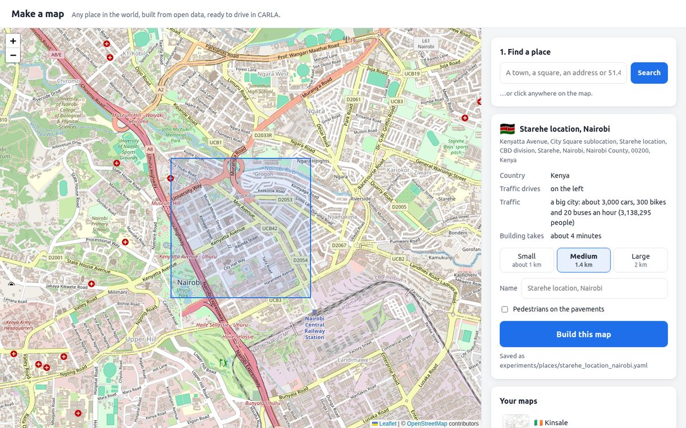
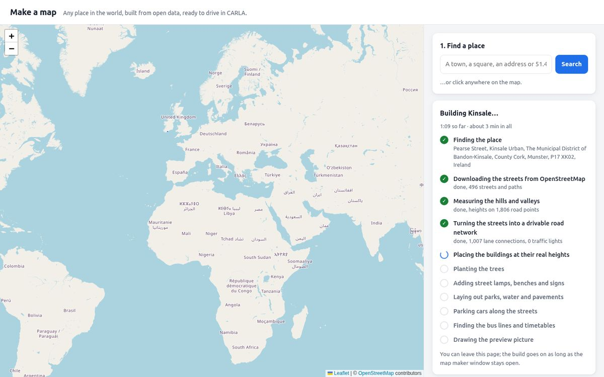
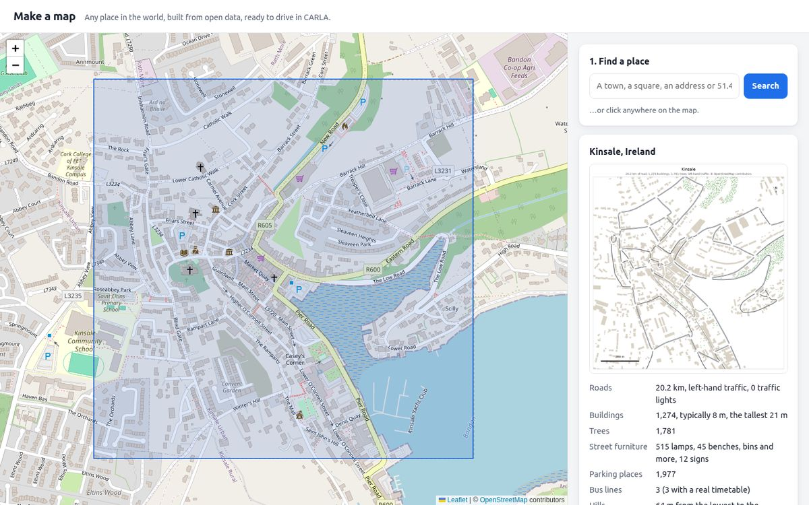

# Make a map of any place: a step-by-step guide

This guide is for people who want a driving simulation of a real place and do not want to program: researchers in
psychology and human factors, designers, students, city planners. You type a place, press a button, and a few
minutes later you can drive through it.

What you get is a 1 to 2 km square of the real place: its streets with their lanes, signs, speed limits and traffic
lights, the buildings at their real positions and heights, the trees, lamps and benches, the hills, the bus lines
with their timetables, parked cars, and traffic that drives on the correct side of the road. It is all made from
free, open data. What you do not get is a photo-real copy: the buildings are stand-in models of the right size, not
the real facades (see [What to expect](#what-to-expect)).

## What you need

- **To make maps:** a computer with Windows, Linux or macOS, an internet connection and about 2 GB of free disk
  space. Building a map downloads open data for 3 to 7 minutes.
- **To drive them:** a Windows or Linux PC with a gaming graphics card (NVIDIA, 8 GB or more), and the CARLA 0.9.16
  simulator (about 20 GB). CARLA does not run on a Mac: you can make maps on a Mac and drive them on a PC.

## Set up once

You do this once per computer. If someone has set up Coupled CARLA for you, skip to [Every day](#every-day).

1. **Get Coupled CARLA.** Download it from <https://github.com/bazilinskyy/coupled-carla> (the green "Code" button,
   then "Download ZIP") and unpack it, for example into your Documents folder. Or, if you use git:
   `git clone https://github.com/bazilinskyy/coupled-carla.git`.
2. **Install uv**, a small program that installs Python and the packages Coupled CARLA needs. Open a terminal
   (Windows: PowerShell; macOS: Terminal; Linux: any terminal) and paste one line:
   - Windows: `powershell -ExecutionPolicy ByPass -c "irm https://astral.sh/uv/install.ps1 | iex"`
   - macOS and Linux: `curl -LsSf https://astral.sh/uv/install.sh | sh`

   Then close the terminal and open a new one.
3. **Install the packages.** In the new terminal, go to the `coupled-carla` folder and run these lines:

   ```
   cd Documents/coupled-carla          (or wherever you unpacked it)
   uv venv --python 3.12 .venv
   uv pip install -r requirements.txt
   ```

   This takes a few minutes and downloads about 1 GB (Python, the SUMO traffic simulator and map tools).
4. **To drive (Windows or Linux only):** download CARLA 0.9.16 from
   <https://github.com/carla-simulator/carla/releases/tag/0.9.16> and unpack it as a folder named `CARLA_0.9.16`
   **next to** the `coupled-carla` folder (so both are in the same folder). The map maker finds it there. If you put
   it elsewhere, set the environment variable `CARLA_ROOT` to its folder.

## Every day

1. **Start the map maker.** Double-click the launcher in the `coupled-carla` folder:
   - Windows: `make_map.bat`
   - macOS: `Make a map.command` (the first time, macOS may ask whether to open it: right-click it, choose Open)
   - Linux: `make_map.sh` (or run `./make_map.sh` in a terminal)

   A small window opens (keep it open while you work) and your web browser shows the map maker.
2. **Find the place.** Type it in the search box and press Search: a town ("Leuven"), a square ("Markt,
   Eindhoven"), a landmark ("Shibuya crossing"), an address, or coordinates ("51.4416, 5.4697"). Any language and
   script works. If several places match, click the right one. Or just click anywhere on the world map.
3. **Check the square.** A blue square shows what will be built. The panel tells you the country, which side
   traffic drives on and how busy the traffic will be (from the size of the town). Choose the size:
   - **Small**, about 1 km across: a village centre, one neighbourhood, a single junction study. Fastest.
   - **Medium**, 1.4 km: a town centre. This is the size of the 19 ready-made cities.
   - **Large**, 2 km: a city centre with more routes. Takes longer to build and to load.

   Click elsewhere on the map to move the square. You can give the map a name; otherwise it is named after the place.
   Tick "Pedestrians on the pavements" for a crowd of people who walk and cross like people in that country do.

   
4. **Press "Build this map".** The panel lists each step in plain words while it works: downloading the streets,
   measuring the hills, placing the buildings, planting the trees, and so on. A medium map takes about 4 minutes.
   You can leave the page; the build goes on as long as the small window stays open.

   
5. **Look at the result.** You get a picture of the map from above (roads, buildings, trees, water) and a summary:
   how many kilometres of road, buildings, trees, lamps, bus lines, and how hilly it is. Under "Made from open
   data" are the sources; credit them when you publish pictures or results (OpenStreetMap at least).

   
6. **Press "Drive it".** On a PC with CARLA, the simulator starts and a window opens after about a minute. Drive
   with W/S/A/D or the arrow keys; Esc ends the drive. Without CARLA, the page tells you what is missing and shows
   the exact command to run on a PC that has it.

All your maps are listed under "Your maps" (and shown as grey squares on the world map); click one to see its
summary again or drive it.

### The same from a terminal

```
.venv/bin/python -m coupledcarla.mapmaker "Markt, Eindhoven"            (Windows: .venv\Scripts\python)
.venv/bin/python -m coupledcarla.mapmaker "51.4416, 5.4697" --size large --open
.venv/bin/python -m coupledcarla.mapmaker "Plaza Mayor, Salamanca" --drive
.venv/bin/python -m coupledcarla.mapmaker                                (asks you for the place)
```

`--size small|medium|large` (or a number of km), `--name` a name of your own, `--pedestrians` a crowd on the
pavements, `--open` shows the picture, `--drive` drives it when it is built, `--force` builds it again.

## A digital twin (CARLA 1.0)

The maps above are generated by CARLA 0.9.16 from the street network, with stand-in buildings. A **digital twin**
of the same square is a level baked into CARLA 1.0 (Unreal Engine 5.8): the real building shapes with facade
styles (or, in Japanese PLATEAU cities, their own photographed facades), the aerial photo on the ground and on the
roofs, the national terrain model, CARLA's road materials with lane markings and zebra crossings, and lit windows
at night. It is made with the best open data of the country: national aerial photos, terrain models and building
registers where they are open and need no account (the Netherlands, Spain, France, Flanders, Switzerland, the
United States, Japan), Overture Maps and global terrain elsewhere.

**What it needs, once:** a CARLA 1.0 *source build* with the Unreal editor (the CARLA `ue58-dev` branch built
with its editor; a downloaded CARLA package cannot bake levels), a checkout of
[carla-digitaltwins](https://github.com/carla-simulator/carla-digitaltwins) with its Python package installed
(`pip install -e TwinModel duckdb`), and a small file `~/.config/coupled-carla/twin.json` that says where they are:

```json
{"digitaltwins": "~/carla-digitaltwins",
 "python": "~/carla-digitaltwins/.venv/bin/python",
 "carla_root": "~/carla58/carla",
 "engine": "~/carla58/UnrealEngine5_carla",
 "carla_python": "~/carla58/venv/bin/python"}
```

With that file in place the map maker page shows a box "A CARLA 1.0 digital twin"; tick it before pressing the
button (it reads "Make the digital twin"). From a terminal:

```
.venv/bin/python -m coupledcarla.mapmaker "Plaza Mayor, Salamanca" --twin --size small
```

The steps are listed in plain words as for a map (the country's open data, the real buildings, the aerial photo,
the data credits, baking the level). A 1 km square takes about 15 to 30 minutes, most of it downloading the
national data; the bake itself took 5 minutes on our build machine and needs about 8 GB of memory. At the end you
get `experiments/places/<name>_twin.yaml` (it names the level and its OpenDRIVE, `twins/<Name>.xodr`) and the
level in the CARLA 1.0 tree at `/Game/Carla/Maps/Twins/<Name>/<Name>`, with `ATTRIBUTION.md` next to it: the data
sources and their licences, to credit when you publish.

**Driving it** needs a CARLA 1.0 server that has the level: the editor tree it was baked into (the editor in
`-game` mode), or a CARLA 1.0 package cooked with it, or a content pack made from it and installed into a package
(carla-digitaltwins' README, "Shipping the map"). Then `python -m coupledcarla.run experiments/places/<name>_twin.yaml`
as for any map. Left-hand countries work: the twin's roads say so to CARLA 1.0.

## Where things are

- `experiments/places/<name>.yaml`: the map's experiment file. It is a plain text file with comments; the top
  lines say what was guessed for you (driving side, traffic). Change the numbers there if you know better (for
  example `cars_per_hour`), then build again with `--force`. Everything else Coupled CARLA can do (other
  participants, scripted cars, conditions and trial orders) is set in this file: see the main README.
- `maps/<name>/`: the built map. `preview.png` is the picture, `summary.txt` the summary with the sources,
  `build.log` the full technical log (send it along when you ask for help).
- To delete a map, delete both.

## What to expect

- **It looks like the place, not like a photo of it.** Streets, junctions, lanes, hills, building sizes and
  positions, trees and street furniture are where they are in reality. The buildings themselves are CARLA's
  stand-in models (mostly North American houses and blocks), chosen and scaled to fit each real footprint and
  height. There are no road markings on these maps yet.
- **It is as good as OpenStreetMap is there.** In most of Europe, North America, Japan and big cities elsewhere the
  map data is detailed. In some places streets lack lanes or speed limits, or buildings are missing; the map maker
  then uses sensible defaults (and Overture Maps' buildings, which include buildings found in satellite images).
- **Traffic is a guess unless the city publishes counts.** Busy cities get more cars than towns. Where open traffic
  counts exist (New York, London, Lyon, Auckland and a few others) the traffic follows them.
- **Building needs the internet** and takes minutes; the downloaded data is kept, so a second build is faster.
- **Driving needs a PC with a good graphics card and CARLA 0.9.16.**

## Troubleshooting

| What you see | What to do |
|---|---|
| The launcher window closes at once, or says "needs its Python packages first" | Do [Set up once](#set-up-once), step 3. Then double-click the launcher again. |
| "I could not find ..." | Check the spelling, add the town or country ("Markt, Eindhoven"), or click on the map instead. |
| "No roads found here" ([what it looks like](img/mapmaker_error.jpg)) | The square is in the sea, a desert, a forest or a park. Move it onto streets, or choose a larger size. |
| "Only 0.8 km of road here connect into a drivable network" | The square holds few streets that form loops (in a valley town the road leaves the square at both ends). Choose a larger size, or move the square to where more streets meet. |
| "OpenStreetMap's server is busy: trying a mirror" | Nothing to do: it tries the next server. If all are busy, the build stops with a message; wait a few minutes and press Build again. |
| "I cannot reach the internet" | Check the Wi-Fi or network cable; a company VPN or proxy can also block the open data services. |
| "This area is very large" | Fine if you need it, but building takes longer and driving gets slower. Small or medium is usually enough. |
| "CARLA does not run on a Mac" or "CARLA is not set up" | Driving needs a Windows or Linux PC with CARLA 0.9.16 (see [Set up once](#set-up-once), step 4). Copy the `coupled-carla` folder (with `maps/` and `experiments/places/`) to that PC. |
| The browser does not open | Open <http://127.0.0.1:8777/> yourself (the launcher window shows the exact address). |
| "No free port" | Another map maker is already running: use that one, or close its window first. |
| Something else went wrong | Press Build again once. If it fails again, send `maps/<name>/build.log` to whoever set Coupled CARLA up. |

## Privacy

The place you type (or the point you click) is sent to OpenStreetMap's place search, Nominatim (or Photon by
Komoot when Nominatim does not answer), and the square's coordinates to the open data services that the map is made
from. Nothing about you is sent. The map maker's page runs on your own computer only (address 127.0.0.1) and is not
reachable from other computers.
